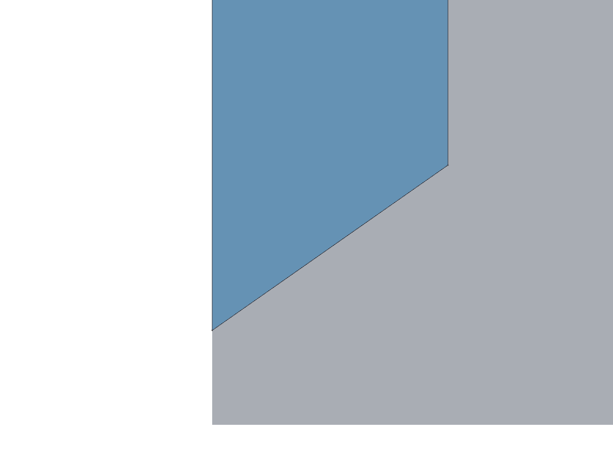
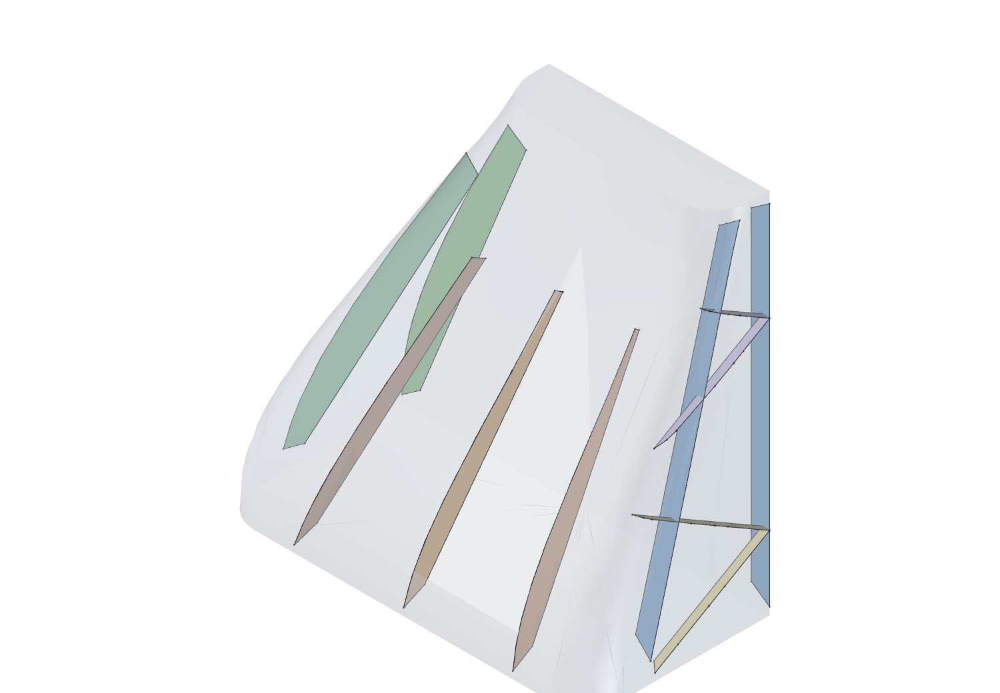

# Cowl — Design

**Status:** Reconstructed from the implementation, 2026-08-07 (IP-FC-7). The cowls had no
design authority; this document creates one by reading
[`cowl_geometry.scad`](../../src/Fuselage/scad/cowl_geometry.scad),
[`derived_cowl_parameters()`](../../src/Fuselage/tools/fuselage_variants.py), and the two
committed parameter files.

**How to read it.** Statements about *what the geometry does* are derived from the code and
are reliable — the transform algebra below was worked out from the source rather than
described from memory. Statements about *why* are marked as inference where they are
inference. Where intent could not be recovered there is an open question rather than a
guess.

**Updated 2026-08-09.** Five of the seven open questions were answered by the designer —
CW1, CW2, CW3, CW4 and CW6 — and the answers are marked as resolutions rather than folded
silently into the text, because four of them are *intent* that no reading of the code could
have recovered. Two of those four inverted a conclusion this document had drawn from the
code alone: `cone_angle` was not a violated printability limit but a deliberately aggressive
one, and the notched rib was not a modelling shortfall but the mechanism that makes spiral
vase printing possible. Where a resolution contradicts an earlier inference, the inference
is left in place with the correction beside it, so the failure mode stays visible.

**Millimetres and metres both appear here, deliberately.** The cowl is the one part of the
system where the existing millimetre-throughout rule meets metre-valued data, and getting
that boundary wrong is silent. Every quantity below is marked.

---

## What a cowl is

A cowl closes one end of the fuselage against the outer mould line. There are two, and they
are the same construction with different parameters:

- The **nose** assembly — a tip (`nose`), a removable **nose plate**, and the **nose cowl**
  that carries the tip back to the cowling bulkhead.
- The **tail** assembly — a single **tail cowl** from the aft OML to the cowling bulkhead.

**Only the cowl of each assembly is the vase-printed part, and the tip and plate exist so that
it can stay one.** A spiral-vase cowl is a single contour per layer, so it cannot cap itself:
closing the nose in the cowl would mean carrying that thin shell round the tip, where the
surface turns over and the wall would have to lean shallower than
`overhang_angle_from_bed`. The tip and the plate are separate printed pieces precisely so the
shell never has to violate the overhang limit to close the shape. **They are therefore not
shelled and not vase-printed**, and DES-12 does not reach them.

**The tail has no such pieces today and may later.** Its aft end is the OML's own closure
(OQ-DES-CW13), so one cowl suffices. A future tail design that needs an end piece to cap off
without an overhang violation would add one on the same footing as the nose's — a cap piece,
outside DES-12, for the same reason.

Unlike every other part in the system, a cowl's outer surface is **not** parametric
geometry. It is a fixed aerodynamic shape authored in OpenVSP, imported, and then cut. All
the parameters do is decide *where to cut it* and *what to hollow out of it*.

That single fact drives everything else in this document, including the two things that are
currently wrong with it.

---

## 1. The OpenVSP shape representation — where the surface comes from

The cowl's outer surface is authored in OpenVSP and lives in
[`cad/modular_sUAS_nose_tail.vsp3`](../../src/Fuselage/cad/modular_sUAS_nose_tail.vsp3).
**That file, not the exported mesh, is the definition of the shape.** Everything in §2
onward operates on a tessellation of it.

### 1.1 What the model actually contains

Read from the committed `.vsp3` (41 MB, of which nearly all is one embedded `MeshGeom` —
the parametric definition is tiny):

| `FuselageGeom` | Stations | `Length` [m] | Section types |
| --- | --- | --- | --- |
| `Nose` | 6 | 0.1 | POINT · CIRCLE · CIRCLE · **RR** · **RR** · POINT |
| `Midbody` | 2 | 0.1 | **RR** · **RR** |
| `Tail` | 4 | 0.1 | POINT · **RR** · **RR** · POINT |
| `FuselageGeom` | 4 | 0.5 | CIRCLE · **RR** · **RR** · **RR** |

**RR** = `ROUNDED_RECTANGLE`. The Vehicle also holds two `MeshGeom` components, `Nose Mesh`
and `Tail Mesh`, which are imported tessellations rather than parametric geometry.

The rounded-rectangle dimensions, in metres:

| Where | `RoundedRect_Width` | `RoundedRect_Height` |
| --- | --- | --- |
| `Nose` stations 3–4, `Midbody` both, `Tail` station 1 | 0.100 | 0.100 |
| `Tail` station 2 — the open aft end | **0.030** | **0.060** |
| `FuselageGeom` station 3 | 0.035 | 0.050 |

**A 0.1 × 0.1 m section is exactly `unit_width` at U = 1.** The OML is square where it meets
the structure, by construction — the rounded rectangle is not an approximation of the
fuselage cross-section, it *is* the fuselage cross-section. `Tail` station 2 is where the
section collapses to 30 × 60 mm on the way to the tail point, which is the open end of the
tail cowl.

> **Reading these out of the XML has a trap that cost two wrong answers.** Each `XSec`
> carries two `<Type>` elements whose values are in **element text**, not in a `Value`
> attribute — `<Type>4</Type>`, not `<Type Value="4"/>` — unlike every Parm in the file. The
> first is the XSec type, the second the XSecCurve shape enum.
>
> Worse, the `XSecCurve`'s `ParmContainer` `<Name>` is a **stale label that does not track
> the active type**: nine `ROUNDED_RECTANGLE` stations are labeled `Ellipse`, and one is
> labeled `Point`. Trusting that name reports the wrong section type on 10 of 16 stations.
> Read `<Type>`; never the label. Better still, read it through the API — see IP-FC-30.

So the whole outer mould line is defined by **four lofted fuselage components with four to
six cross-sections each** — a handful of numbers. The 12 MB and 24 MB STL files in `oml/`
are a *sampling* of that, at a density nobody chose deliberately.

### 1.2 The representation: sections, skinning, loft

An OpenVSP `FuselageGeom` is a **skinned loft**. Its shape is determined by three things:

**(a) A sequence of cross-section curves** $C_i$, each placed at a station along the spine
and each of a declared type. This model uses **POINT**, **CIRCLE** and
**ROUNDED_RECTANGLE**; the available set also includes `ELLIPSE`, `SUPER_ELLIPSE`,
`GENERAL_FUSE`, `FILE_FUSE` and `EDIT_CURVE`. Types per station are in §1.1.

The rounded rectangle is the load-bearing choice. It is what lets the OML meet a square
fuselage *exactly* rather than approximately — at 0.1 × 0.1 m it is `unit_width` at U = 1 —
and it means the cowl's section and the bulkhead's outer profile are the same shape by
construction, not by tolerance. The circles appear only in the nose forebody, where the
section is still round.

**(b) Per-station tangent controls, on each of four sides** (top, bottom, left, right). For
each side the model stores an **angle**, a **strength**, a **curvature** and a **slew**,
each with a `*Set` flag, plus `*LRAngleEq`-style flags tying the left and right halves
together. These are the boundary conditions of the loft, not decoration.

**(c) A continuity order per side** — `ContinuityTop`, `ContinuityBottom`, etc. — where
`0`, `1`, `2` request $G^0$, $G^1$, $G^2$ across the section.

The actual values in this model, which are the design:

| Component | Station | Section | Top angle | Top strength | Continuity |
| --- | --- | --- | --- | --- | --- |
| Nose | 0 | POINT | 90° | 1.00 | $G^0$ |
| Nose | 1 | ELLIPSE | 90° | 0.75 | $G^2$ |
| Nose | 2 | ELLIPSE | 30° | 1.25 | $G^2$ |
| Nose | 3 | ELLIPSE | 0° | 1.25 | $G^2$ |
| Nose | 4 | ELLIPSE | 0° | 1.00 | $G^0$ |
| Nose | 5 | ELLIPSE | −90° | 1.00 | $G^0$ |
| Tail | 0 | ELLIPSE | 90° | 0.75 | $G^0$ |
| Tail | 1 | ELLIPSE | 90° | 1.50 | $G^0$ |
| Tail | 2 | ELLIPSE | 0° (top), **−30° (bottom)** | 0.75 / 1.25 | $G^0$ |
| Tail | 3 | POINT | −90° | 0.75 | $G^0$ |

Two things are legible from that table. The nose's **90° tangent at the apex** is what makes
it close with a rounded rather than a conical tip, and the $G^2$ run through stations 1–3 is
what keeps the forebody fair. On the tail, **station 2 breaks top/bottom symmetry** — 0° on
top against −30° on the bottom — which is the upsweep, and it is the reason the tail
parameter file is named `tail_high_open`.

### 1.3 The mathematics of the loft

Angle and strength are Hermite boundary conditions expressed in Bézier form. For a
longitudinal segment between stations $i$ and $i+1$, with endpoints $\mathbf{P}_0$,
$\mathbf{P}_3$ on the two section curves and unit tangents $\hat{\mathbf{T}}_0$,
$\hat{\mathbf{T}}_1$ set by the **angles**, the interior control points are placed at a
distance set by the **strengths** $s_0, s_1$:

$$\mathbf{P}_1 = \mathbf{P}_0 + \tfrac{s_0}{3}\,\ell\,\hat{\mathbf{T}}_0,
\qquad
\mathbf{P}_2 = \mathbf{P}_3 - \tfrac{s_1}{3}\,\ell\,\hat{\mathbf{T}}_1$$

giving the cubic Bézier segment

$$\mathbf{B}(u) = \sum_{k=0}^{3}\binom{3}{k}(1-u)^{3-k}u^{k}\,\mathbf{P}_k ,
\qquad u\in[0,1]$$

The surface is the tensor product of that longitudinal family with the section curves:

$$\mathbf{S}(u,v) = \sum_{j}\sum_{k} N_j(v)\,B_k(u)\,\mathbf{P}_{jk}$$

so the OML is a **piecewise cubic Bézier surface** — a patchwork, $C^2$ where the
continuity flags demand it and $C^0$ where they do not. That is the entire shape
representation: a few dozen control points.

**One caveat worth stating rather than assuming.** Polynomial Bézier cannot represent a
true ellipse exactly — that needs a *rational* form (NURBS with non-unit weights). If
OpenVSP's `ELLIPSE` section is a non-rational cubic approximation, the sections are
accurate to roughly $10^{-4}$ of radius rather than exact. This does not matter for
printing and does matter if the STEP file is ever used as a datum for inspection. Verify
before relying on it either way.

### 1.4 Why this matters for every downstream use case

- **STEP export is lossless with respect to this model.** Bézier is a special case of
  NURBS, so writing STEP transfers the control net rather than approximating it. The
  36 MB of STL in `oml/` is a lossy sampling of a definition that would serialize in
  kilobytes.
- **The shape is editable.** A different nose is four to six numbers, not a re-mesh. UC-9's
  "generate new nose and tail shapes" is exactly this: drive the station parameters through
  the OpenVSP Python API rather than by hand in the GUI.
- **The sections are the natural place to enforce the airframe's own constraints.** The
  fuselage is square in cross-section; the OML is elliptical. Whether the OML should adopt
  `ROUNDED_RECTANGLE` sections to match is a design question nobody has recorded — see
  [OQ-DES-CW5](#open-questions).

---

## 2. The OML transform — exact algebra

`body_blank_full()` is the whole of the cowl's outer surface. It is four operations, and
OpenSCAD applies them innermost-first:

```scad
rotate([0, pitch_angle, 0])
  scale([s, s, s])
    translate([x₀, 0, 0])
      import(oml_filename);
```

So a mesh vertex **p** in file coordinates lands at

$$\mathbf{p}' = R_y(\theta)\,\big(s\,(\mathbf{p} + \mathbf{t})\big),
\qquad \mathbf{t} = [x_0,\;0,\;0]^{\mathsf T}$$

with

$$s = \frac{U}{\texttt{oml\_scale\_m\_per\_mm}}, \qquad
\theta = 90^\circ - 180^\circ\cdot[\![\texttt{oml\_reversed}]\!]
\;\in\;\{+90^\circ,\,-90^\circ\}$$

$$R_y(\theta) = \begin{bmatrix}\cos\theta & 0 & \sin\theta\\ 0 & 1 & 0\\ -\sin\theta & 0 & \cos\theta\end{bmatrix}
\;\Longrightarrow\;
R_y(90^\circ):\;(x,y,z)\mapsto(z,\,y,\,-x)
\quad
R_y(-90^\circ):\;(x,y,z)\mapsto(-z,\,y,\,x)$$

### 2.1 Three consequences, each of which is a trap

**(a) `oml_scale_m_per_mm` is a divisor, and it encodes a convention rather than a fact.** With
`oml_scale_m_per_mm = 1e-3`, $s = 1000\,U$. This is the only metre→millimetre conversion anywhere in
the OpenSCAD path, and it is written as a division by a small number rather than a
multiplication by 1000 — so it does not look like a unit conversion at the call site.

> **OpenVSP is dimensionless, so "the OML is in metres" is a project decision, not a
> property of the file.** Confirmed 2026-08-08 while implementing IP-FC-4. An OpenVSP model
> holds bare numbers: no unit travels with the geometry, which is why the API offers
> `LEN_UNITLESS` beside the real units and why several unrelated settings containers each
> carry an independent `*LenUnit` parm — every consumer declares its own interpretation.
>
> The convention this project uses is **1 model unit = 1 metre**, and the airframe is what
> fixes it: the OML's rounded-rectangle sections are 0.1 × 0.1 model units and must equal
> `unit_width` = 100 mm at U = 1 (§1.1). `oml_scale_m_per_mm = 1e-3` *is* that convention, written
> as a reciprocal.
>
> **Consequence for the STEP path.** The exporter must write some unit into the file
> header, and it writes `CONVERSION_BASED_UNIT('FOOT')` — verified by reading the exported
> file. That label is an artifact, and it is not adjustable through `CADLenUnit`: setting
> it to `LEN_M` produces a **byte-identical** file. So a consumer reading the STEP
> naïvely gets 0.1 ft = 30.48 mm where the convention means 100 mm, and must apply
>
> $$\texttt{STEP\_IMPORT\_SCALE} = \frac{1000}{304.8} = 3.28084$$
>
> which is stated and applied in
> [`oml_export.py`](../../src/Fuselage/tools/oml_export.py). The number is exact:
> $30.48 \times 3.28084 = 100.0$.
>
> This is the same hazard as everything else in this section, one layer out — geometry
> that loads cleanly, carries valid surfaces, passes every structural check, and is
> silently wrong by a constant factor.

**(b) `oml_offset_x_m` is applied _before_ scaling, so it is in _mesh_ units — metres.** The
tail's `offset_x = -0.25` is **−0.25 m**, i.e. −250 mm at U = 1. It selects which OML
station lands on the model origin. Reading it as millimetres understates it by a factor of
1000, and the result still renders.

**(c) `oml_reversed` is a 180° flip about the transverse axis, not a mirror.** It changes
which end of the imported body points along −z. Because it is a rotation, chirality is
preserved — an asymmetric OML stays correctly handed. A mirror would not.

### 2.2 The model frame

After the transform, **+z is the cowl axis and z = 0 is the tip**, with the body extending
toward −z and meeting the cowling bulkhead at the far end. Every cutting mask in the file
sits at negative z, which is the corroborating evidence.

The axial extent of interest is

$$\texttt{body\_len} = \frac{U\cdot\texttt{oml\_length\_m}}{\texttt{oml\_scale\_m\_per\_mm}} = s\cdot\texttt{oml\_length\_m}\ \ \text{[mm]}$$

— the same scale factor applied to a length expressed in mesh units. `oml_length_m` is
therefore **metres** as well: 0.050 m for the nose (→ 50·U mm), 0.1 m for the tail
(→ 100·U mm).

*Inference:* naming these `oml_length_m` and `oml_offset_x_m` without a unit suffix, in a
codebase whose convention is millimetres, is the single most likely place for a 1000×
error in the FreeCAD port. See [OQ-DES-CW1](#open-questions).

**Fixed 2026-08-09.** The three are now `oml_length_m_m`, `oml_offset_x_m_m` and
`oml_scale_m_per_mm_m_per_mm`, in the SCAD signatures, the `OmlParameters` dataclass and both cowl
JSON files. Verified geometry-identical by `verify_sweep_change.py`.

---

## 3. Axial decomposition

Two half-space intersections split the blank. Both use a square prism of half-width
`unit_width` in x and y — deliberately oversized, so the prism only ever cuts in z:

| Module | Retains | Used by |
| --- | --- | --- |
| `body_blank_full_upper` | $-\texttt{cut\_len} \le z \le 0$ | `nose()` — the tip |
| `body_blank_full_lower` | $-\texttt{body\_len} \le z \le -\texttt{cut\_len}$ | `nose_cowl()`, `tail_cowl()` |

So `cut_len` is the axial length of the tip section, and "upper"/"lower" refer to **z, not
to the aircraft's vertical**. That naming has misled at least one reader — this one — and is
worth renaming at the port.

Lateral masks then reduce the blank by symmetry:

$$\texttt{right\_half\_mask}:\; y \ge 0
\qquad
\texttt{octant\_mask}:\; 0 \le y,\; y \ge x \ \text{(the wedge about the diagonal)}$$

The nose cowl is built from **one octant** and tiled by `octant_to_full()` (8 copies); the
tail cowl from **one half** and tiled by `mirror_y()` (2 copies). The difference is not
stylistic: the tail's buttress pattern is not 8-fold symmetric, so it cannot be built from
an octant.

---

## 4. The buttresses are cutting tools, not ribs

This is the most misread part of the file, and the name is the reason.

```scad
difference() {
    body_blank_half_lower(…);          // the solid blank
    difference() {
        union() { …all buttresses… }   // the cutting set
        union() { pyramid; cube; }     // regions protected from cutting
    }
}
```

A "buttress" is **subtracted**, and it is subtracted from the **outer** surface — it cuts a
groove into the outside of the cowl.

**The rib is produced by the slicer, not by the CAD.** This is the mechanism, and it is the
single most important thing to understand about the cowl:

1. The buttress cuts a channel into the outer surface, so the cowl's cross-section at that
   station is no longer a smooth closed curve — it has a re-entrant notch.
2. The part is printed with **perimeters and zero infill** — and in **spiral vase mode**,
   which is a mode these cowls support and which is to be preserved, that number is one.
   The slicer walks a fixed number of perimeters around whatever contour it is given.
3. Following the notch inward and back out, those perimeters lay down a **double wall
   projecting into the interior** — a structural rib — where a smooth contour would have
   produced a single wall.

So a groove on the outside becomes a stiffener on the inside, for no added CAD complexity
and no support material. **More buttress ⇒ more rib, not less material.** The naming is
right after all; it was my reading of it that was wrong.

**And in vase mode it is the only mechanism available** (OQ-DES-CW6, 2026-08-09). Vase mode
spirals a single continuous contour up the part and admits no interior geometry whatsoever,
so a modelled rib is not merely unnecessary there — it is impossible, and a cowl given one
stops being vase-printable. Notching the exterior is how you get a rib inside a single-wall
print. That reframes everything below: the rib's absence from the CAD is not a shortfall to
be corrected, it is the consequence of a design choice worth keeping.

Two consequences follow, and both matter for the port:

- **The rib does not exist in the CAD model.** It is an emergent property of slicing a
  notched contour with a perimeter count. Any solid-model interior surface (§6.2) must
  reproduce it deliberately, because a naive inward offset of the *outer* surface will
  reproduce the notch but not the double wall that fills it. Its thickness is
  `2·w·n_perimeters + t_cut` (§4.1, OQ-DES-CW3) — **0.85 mm in vase mode** at a 0.4 mm
  extrusion width.
- **That interior surface must not become the printing export** (§6.4). Adding it destroys
  vase-mode printability, so the two representations stay separate.
- **UC-8 structural analysis cannot use the outer surface alone.** The ribs are the
  stiffening structure, and they are invisible to any analysis that meshes the CAD solid as
  drawn.

The inner `difference()` removes a **pyramid ∪ cube** region from the *cutting set*, which
protects a core near the aft end from being grooved — that is the cowling-bulkhead
interface, and it must stay a clean surface.

### 4.1 `buttress_shape` — the cutting profile

Every buttress is a prism: a 2D profile extruded to `buttress_cut_thickness`, centered —
0.1 mm. Until IP-FC-43 this read `2·buttress_thickness` with the parameter at 0.05, which cut
the same 0.1 mm by a route the parameter's name did not state; the factor was folded into the
value on 2026-08-18 and no geometry moved ([OQ-DES-CW8](#open-questions)). The
profile, in a plane whose axes are radius $r$ and axial station $\zeta$:

$$P = \Big\{
(-W,\; z_0),\;
(r_s,\; z_0),\;
(r_s + \rho,\; z_0 + \rho\tan\phi),\;
(r_e + \rho,\; L - z_e - \rho\tan\phi),\;
(r_e,\; L - z_e),\;
(-W,\; L - z_e)
\Big\}$$

where $W = \texttt{unit\_width}$, $L = \texttt{body\_len}$, $z_0 = \texttt{z\_offset}$,
$z_e = \texttt{z\_end}$, $r_s = \texttt{r\_start}$, $r_e = \texttt{r\_end}$,
$\rho = \texttt{r\_inset}$, $\phi = \texttt{cone\_angle}$.

Read structurally, this is a trapezoid spanning $\zeta \in [z_0,\; L - z_e]$ whose outer
boundary runs from $r_s$ to $r_e$, with the two corners **chamfered by $\rho$ radially and
$\rho\tan\phi$ axially**. The inner boundary at $r = -W$ is far outside the part, so the
profile behaves as a half-plane there — the cut always reaches the axis.

The chamfer edges therefore have slope

$$\frac{\mathrm{d}\zeta}{\mathrm{d}r} = \tan\phi
\quad\Longrightarrow\quad
\text{the chamfer makes angle } \phi \text{ with the radial direction.}$$

At $\phi = 35°$ the chamfer face sits 55° from the build axis and **35° above the bed**. With the
build direction known to be axial (§7), that is the whole meaning of `cone_angle` — the overhang
angle measured from the bed — and the value is a deliberately aggressive one that modern printers
hold in PLA, not a violated 45° limit. §7.1 supplied the missing half and settled
[OQ-DES-CW2](#open-questions); this paragraph previously left it open as "either the print
orientation is not along $z$, or these chamfers are not printability relief", which §7.1 answers.

**The purpose of the chamfer follows from that.** It is what takes the cut from full depth back
out to the outer surface at each end of the slot, so the slot ends in a 35° ramp the printer can
bridge rather than in a vertical wall it cannot.

**Confirmed against the built solid.** Read off the real `Top2Safe` tool's own vertices at
`U` = 3.0: reach 150 mm — the outer surface, at zero cut depth — at $\zeta$ = -294.0000, and reach
135 mm — the cut floor — at $\zeta$ = -283.4969. That is $\rho$ = 15.0 mm radially against
$\rho\tan\phi$ = 10.5031 mm axially, giving $\tan\phi$ = 0.70021 and $\phi$ = **35.00°**, matching
the profile algebra above exactly.



*`Top2Safe`'s slot (blue) in the real blank (grey), square on the `y` = 0 mirror plane at the
$\zeta$ = -294 end. $r$ runs across, $\zeta$ up; white is outside the part, and the vertical edge
at the left is the part's own outer surface.*

### 4.2 `cone_angle` appears twice, with reciprocal meanings

The same parameter also sets the plate-relief cone in `nose()`:

```scad
cylinder(h = L_c, r1 = R + L_c/tan(cone_angle), r2 = R, center = false);
```

with $R = \texttt{plate\_diam}/2 + \texttt{plate\_tol}$ and
$L_c = \texttt{cut\_len} - \texttt{plate\_thickness} + \texttt{nose\_flange\_height} + \varepsilon$.
The cone's half-angle measured from the axis is

$$\alpha = \arctan\!\left(\frac{r_1 - r_2}{L_c}\right) = \arctan(\cot\phi) = 90^\circ - \phi$$

So in the buttress profile $\phi$ is measured **from the radial direction**, and in the
plate cone it appears as $\cot\phi$, i.e. measured **from the axis**. Same number, same
name, complementary angles.

**Both are right, and the complementarity is the point** (resolved 2026-08-09,
[OQ-DES-CW2](#open-questions)). The radius lies in the bed plane and
the axis is normal to it, so `35° from the radius` and `90° − 35° = 55° from the axis` are
one face: **35° above the print bed**. `cone_angle` is the overhang angle, and the two call
sites reach the same physical slope from perpendicular references.

### 4.3 Buttress placement

Placement is hard-coded in `tail_cowl_half()`, *not* parametric — the JSON carries a
`top_diag1`/`top_diag2` group whose `angle` and `y_offset` fields are read into the
parameter tree and then never used, because the SCAD uses literals:

| Family | Angles (deg) | Offsets |
| --- | --- | --- |
| side | 5, 12.5, 20 | $x = -0.30\,W,\; 0,\; +0.30\,W$ |
| top | 15, 0 | $y = 0.07\,W$ on the first |
| bottom | 15, 0 | $y = 0.07\,W$ on the first |
| top diagonal | ±30, at two stations | $\Delta\zeta = W\sin 30° $ apart |

The nose cowl uses exactly one side buttress at 0°, cut into the octant before tiling.

That pattern, rendered in place on the real `tail_shell` blank at `U` = 3.0 — each coloured volume
is one named tool intersected with the blank, so what is drawn is the material that tool removes:



**Every literal in that table is either an angle or a fraction of `W = unit_width`**, so the
buttress pattern already scales with the cowl, which is what was intended
([OQ-DES-CW4](#open-questions)). The one deliberate
exception is `buttress.cut_thickness`, which is a slicer tolerance rather than part geometry and
is scale-independent for that reason. What is wrong here is not the scaling — it is that the
numbers live in SCAD rather than in the JSON fields that already exist to hold them.

---

## 5. Parameter schema and the scaling rule

A cowl is defined by a JSON file — [`nose_round_plate.json`](../../src/Fuselage/tools/nose_round_plate.json),
[`tail_high_open.json`](../../src/Fuselage/tools/tail_high_open.json) — named by the
variation table's `parameter_filename` column. `derived_cowl_parameters()` expands it.

**The scaling rule is the thing to know:** every numeric field is a **fraction of
`unit_width`** and is multiplied by it, *except* the names in `NOSE_UNSCALED`:

```python
NOSE_UNSCALED = ("cone_angle", "tolerance", "flange_inset", "thickness",
                 "active", "angle", "filename", "scale_m_per_mm", "length_m",
                 "offset_x_m", "reversed")
```

So three different unit conventions coexist in one JSON file:

| Class | Fields | Units |
| --- | --- | --- |
| Scaled | `cut_len`, `z_offset`, `r_inset`, `r_start`, `r_end`, `z_end`, `z_start`, `depth`, `diameter` | fraction of `unit_width` (dimensionless) |
| Unscaled, angular | `cone_angle`, `angle` | degrees — and `cone_angle` is degrees **from the print bed** (§4.2) |
| Unscaled, absolute | `cut_thickness`, `tolerance`, `flange_inset` | **millimetres** |
| Unscaled, OML | `length_m`, `offset_x_m`, `scale_m_per_mm` | **metres** (§1) — now stated in the names |

`buttress.cut_thickness = 0.1` is therefore 0.1 **mm** — an absolute value that does not
scale with the airframe — while `buttress.r_inset = 0.05` in the same object is 0.05 ×
`unit_width`, which is 5 mm at U = 1. Two small decimals of the same order, two different
meanings, one file. Before IP-FC-43 the two were *literally* the same number, 0.05 against
0.05 in `tail_high_open.json`, which is how close this trap sits to the surface.

*Inference:* the unscaled-absolute group are printer-process quantities and correctly do not
scale, consistent with the greeble tolerance and `longeron_tolerance` elsewhere.

`buttress.cut_thickness` is **the thickness of the cut into the OML**, not a wall — the cut is
what produces the buttress, through slicing. The printed rib is far thicker than the cut,
because the slicer walls both faces of it:

$$t_{\text{rib}} = 2 \cdot w_{\text{extrusion}} \cdot n_{\text{perimeters}}
                 + \frac{t_{\text{cut}}}{\sin\theta}$$

where $\theta$ is the angle between the cut plane and the layer plane. In spiral vase mode, which
is the mode these cowls are printed in, `n_perimeters = 1`, so at the sweep's
`extrusion_width = 0.6` and `cut_thickness = 0.1` a **vertical** cut ($\theta = 90°$) gives
$2(0.6)(1) + 0.1 = $ **1.3 mm**, and the tail's 30° diagonals give $1.2 + 0.1/\sin 30° =$
**1.4 mm**. This is the expectation `check_cowl_interior.py`'s rib-gap check asserts against the
real geometry, and it passes at 1.3000 mm exactly on both cowl kinds.

**The $\sin\theta$ term is not optional.** Writing a flat 1.3 mm into the expectation reports
correct geometry as an error at every inclined buttress, which it did —
[OQ-DES-CW19](#open-questions), resolved 2026-09-04. The $2 w n_p$ term is the slicer walling
*both* faces of the cut, which is why the printed rib is far thicker than the cut that produces
it.

Resolved 2026-08-09, [OQ-DES-CW3](#open-questions) and [OQ-DES-CW6](#open-questions); the
numbers above are stated at the current `cut_thickness` = 0.1 mm, after IP-FC-43 folded the
factor of two into the parameter value.

---

## 6. Shape representation: what is wrong today, and what has to change

### 6.1 The cowl is not a solid model

Every other part in this system is constructed from primitives and is a genuine solid. The
cowl is **an imported triangle mesh, cut by primitives**. Consequences:

- `oml/vsp_nose.stl` is **12 MB**; `oml/vsp_tail.stl` is **24 MB**. 36 MB of committed
  tessellation is the *authoritative definition* of the outer surface.
- Every curved surface on a cowl is faceted at whatever density OpenVSP happened to export.
  The tessellation is frozen in the repository, not a render setting.
- **UC-2, UC-3, UC-4 and UC-7 cannot be satisfied for cowls** while this holds: a mesh has
  no cylindrical face to STEP-export, no surface for an assembly constraint, and no arc for
  a drawing to dimension.

**OpenVSP exports STEP and IGES.** The fix is to import a *surface*, which makes the cowl a
B-rep like everything else — and removes 36 MB from the repository. That is IP-FC-4, it
depends on nothing, and it is on the critical path for four use cases.

> **The surface and the mesh are not the same geometry, and the difference is not negligible
> where it matters.** Measured 2026-08-31. Over the whole nose they agree to 0.005% by
> enclosed volume — but over the *nose cowl's own extent*, the 44 mm slice the cowl is cut
> from, they differ by **0.253%**. The nose cowl built on the surface encloses 371569 mm³
> where the same cowl built on the mesh encloses 372511 mm³. The tail's equivalent figure is
> 0.039%.
>
> The reason the whole-part figure hides it is that the difference reverses along the length:
> a station-by-station comparison puts the two surfaces within 0.14 mm of each other
> everywhere, with the sign changing, so the errors cancel end to end and concentrate in any
> slice taken from one part of the body. The STEP is a NURBS *fit* of the same loft the STL
> tessellates, and 0.14 mm is the fit residual.
>
> **Neither is wrong** — both are exports of the model in §1, which is the definition. What
> matters is that a ported cowl cannot be checked against an OpenSCAD-rendered cowl by
> comparing volumes, because the two are cut from different source geometry and will disagree
> by two to twenty-five times the migration's 0.010% tolerance while both are correct.
> Verified by holding the OML constant: built on the *same* mesh the OpenSCAD path uses, the
> ported nose and tail cowls agree with their references to **−0.0000%** each. That is what
> establishes the port; the volume difference above is a change of input, not an error.

### 6.2 The interior surface: why it is needed, and what it must be

**Status: built.** This section states the requirement and the constraints on it; the interior
surface itself is now constructed by `cowl_interior.cavity()`/`shell_solid()`, and
[cowl_interior_surface.md](cowl_interior_surface.md) is the authoritative description of the
algorithm, its preconditions, its refinement criterion and its verification. `tail_shell` and
`nose_cowl_shell` build and pass the external wall-thickness and rib-gap checks. What follows is
why the surface has to exist and what shape it has to be — not a description of missing work.

**The vase-mode representation is unchanged, and that is deliberate.** The cowl *as printed* is
still a **solid blank with channels cut into it**: it has no modelled wall, and the printed part
gets its interior from the slicer as a zero-infill operation with a perimeter count, which for
spiral vase mode is one. That is sufficient for printing and insufficient for everything else —
an open or solid blob has no meaningful mass, no wall to analyze, and cannot be assembled. The two
representations coexist on purpose; §6.4 is why they cannot be merged.

> **Constraint on everything in this section.** Cowls are printable in **spiral vase mode**,
> and that capability is to be kept ([OQ-DES-CW6](#open-questions)). Vase mode requires one
> closed contour per layer and no interior geometry whatsoever, so a cowl that has been given
> a modelled wall **is no longer vase-mode printable**. The interior surface described below
> therefore serves UC-2, UC-3, UC-4 and UC-8; it must not become what UC-1 exports. See §6.4.
>
> **This is `DES-12` in
> [system_requirements.md](system_requirements.md#4-design-requirements)** as of 2026-08-29 —
> this paragraph is its source, and the requirement restates it rather than deciding anything
> new. It went into the register because **nothing verifies it**: a modelling change that gives
> the cowl a wall destroys the capability, and the part still builds, still exports, and still
> measures correctly. That is [OQ-DES-SR2](system_requirements.md#open-questions).

**The interior must be generated as a per-layer 2D inset, not a 3D shell offset.** Those are
different surfaces, and the difference is not small.

Let the exterior be $S$, and let $C(\zeta) = S \cap \{z = \zeta\}$ be its cross-section at
station $\zeta$. The slicer-equivalent interior is

$$C_{\text{in}}(\zeta) \;=\; \text{erode}\big(C(\zeta),\; n_p \cdot w\big)$$

— a **2-D erosion of each layer's cross-section** by the perimeter count times the extrusion
width — and the interior surface is the union of those eroded contours stacked over
$\zeta$. A 3-D offset instead computes $\{ \mathbf{x} : \mathrm{dist}(\mathbf{x}, S) = t \}$,
measuring **normal** to the surface.

For a surface whose normal makes angle $\alpha$ with the horizontal plane, a horizontal
erosion of $t$ leaves a perpendicular wall of

$$t_\perp = t\cos\alpha$$

so the per-layer inset **thins toward horizontal surfaces**, reaching zero at a horizontal
face.

**That is correct**, because it is what the printer actually produces, and **the cowl never
reaches the degenerate end of it** — the design avoids near-horizontal geometry rather than
accommodating it. The nose closure is split off as its own parts, `nose_nose` and
`nose_plate`, so the body never turns over; the tail is open at both ends; and every internal
relief is cut at `overhang_angle_from_bed`. The shallowest surface the design permits is 55°
from vertical, which still leaves `0.6 × cos 55° = 0.344 mm` of wall — about seven times the
0.05 mm floor. Nor is there a top or bottom skin here for a solid-layer rule to be the
equivalent of: only the perimeters are printed.
[OQ-ARCH-17](../architecture/freecad_migration.md#open-questions) settles this, and the
algorithm carries it as a **precondition it asserts** rather than as a material rule.

**The method is [cowl_interior_surface.md](cowl_interior_surface.md)** (IP-FC-16); this
section states the requirement and the trap.

### 6.3 What the port should preserve

- The **transform algebra of §1** is the interface to the OML and must survive verbatim,
  including the fact that `offset_x_m` precedes the scale -- it is metres in the mesh's
  own frame, which is what the suffix is there to say.
- The **hollowing-by-subtraction** structure of §3 maps cleanly onto `Part::` booleans. It
  does not map onto `PartDesign::` bodies, which is another data point for
  [OQ-ARCH-1](../architecture/freecad_migration.md#open-questions).
- The **protected core** (pyramid ∪ cube) is the bulkhead interface and is load-bearing.
- The **notched blank must remain exportable as it stands** — see §6.4.

### 6.4 Two representations of one cowl, and why they cannot be merged

*Added 2026-08-09, resolving [OQ-DES-CW6](#open-questions).*

A cowl has to be two things at once, and the port cannot collapse them:

| | **Print representation** | **Solid representation** |
| --- | --- | --- |
| What it is | The notched blank exactly as generated today — no wall, no modelled rib | The blank shelled by the §6.2 per-layer inset, with the rib modelled where each notch is |
| Serves | UC-1 | UC-2, UC-3, UC-4, UC-7, UC-8 |
| Wall comes from | The slicer, one contour per layer in vase mode | Geometry |
| The rib | Emerges, as the wall follows the notch in and back out | Present in the geometry, `2·w·n + t_cut / sin θ` thick measured in the layer plane — 1.3 mm at a vertical cut, 1.4 mm at the tail's 30° diagonals ([OQ-DES-CW19](#open-questions)) |

**They cannot be merged, and the direction of the incompatibility is the important part.**
Adding a wall to the print representation destroys vase-mode printability outright: vase mode
spirals a single contour and admits no interior geometry, so the moment the cowl has a
modelled inner surface the mode is unavailable. Meanwhile the print representation is useless
for analysis, because the structure that carries the load is not in it.

So the port produces **both from one parametric source**, and the invariant to hold is:
**the UC-1 export path continues to come from the un-shelled notched blank.** Shelling is a
downstream operation for the other use cases, never a replacement for the blank. A port that
"improves" the cowl by giving it a proper wall and exports that for printing has silently
removed a printing capability, and nothing in the geometry would flag it — the STL would look
better and slice worse.

**This also fixes the direction of the modelling work.** The rib is not something to be
reverse-engineered from a slicer's output as a curiosity; it is the structure, and the notch
is the *mechanism* that produces it under a mode that permits no other mechanism. The notch
is not a workaround for the model's shortcomings. It is a design choice that buys ribs inside
a single-wall print, and it is the reason the interior is worth modelling at all.

**Status: both representations exist as of 2026-09-04** (IP-FC-17). The solid representation is
built by [`cowl_interior.py`](../../src/Fuselage/freecad/cowl_interior.py) and delivered as two
**additional** part kinds, `nose_cowl_shell` and `tail_shell`, beside the unchanged `nose_cowl`
and `tail`. The invariant above is held by construction rather than by care: the shelled kinds
are separate parts, the print kinds' output is unchanged, and the shelled kinds are FreeCAD-only
— asking for one on the OpenSCAD backend raises rather than quietly rendering the blank. Two
things the table above have turned out to be more specific in the built version. The rib is **not
modelled** as a feature: eroding the notched section reproduces it, which the acceptance tests
measure rather than assume — so that row reads *"present in the geometry"* rather than
*"constructed separately"*. And its thickness carries the cut angle, `2·w·n + t_cut / sin θ`
([OQ-DES-CW19](#open-questions)): 1.3 mm at every vertical cut and 1.4 mm at the tail's 30°
diagonals, because the cut is a fixed thickness normal to its own plane while the perimeters are
measured parallel to the build plate. And the wall
is a **horizontal** inset, not a normal offset, which is what makes the rib come out at that
thickness at all. At `U` = 1 the nose wall measures 9714.2617 mm³ and the tail 23685.2264 mm³,
each one valid solid. What is not yet established — the construction alternative that was never
compared, the cost of the dilation, and verification at any `U` but 1 — is
[cowl_interior_surface.md §10](cowl_interior_surface.md), as IP-FC-115, IP-FC-116 and IP-FC-117.

**Standing construction discipline** (design authority:
[cowl_interior_surface.md §4.5](cowl_interior_surface.md#45-closing-the-solid); decided by
[OQ-DES-CW20](#open-questions)): every operation that builds either representation — masking,
the interior surface fit, the notch cuts, the wall — runs on the un-mirrored symmetry cell only
(the octant for the nose, the half for the tail); no full-part intermediate is ever constructed;
mirroring happens exactly once, as the final operation, on the finished result; and the same
functions do this for both parts, differing only in cell shape and mirror count. This is not
optional hardening — a full-part intermediate constructed before the end was tried twice and
measured to reintroduce the defect it was meant to prevent, since it is a fresh boolean
operation OCC's kernel is free to get wrong independent of whether its inputs were symmetric.

---

## 7. Print orientation

**Confirmed 2026-08-07 (IP-FC-3).** The modeled frame is the print frame — the STLs the
sweep writes are already oriented for the bed, with no rotation applied between model and
slicer. System-wide, model `+z` is the build direction and corresponds to the **aircraft
body `x` axis**.

For the cowl family the **`z` sign is the whole story**, because none of these parts is
symmetric:

| Part | What goes on the bed (`z = 0`) |
| --- | --- |
| **Nose cowl** | The **large end** — the cowling-bulkhead end |
| **Tail cowl** | The **large end**, likewise — which is *forward* on the aircraft, so the tail cowl is built along the opposite body direction from the nose cowl |
| **`nose`** (the tip section) | Its **large end** down |
| **Nose plate** | **Flipped** — its flat side, which faces *forward* in body orientation, goes down |

**Every cowl prints large-end-down, tapering upward.** That is the orientation in which the
outer surface leans inward as it rises, so the OML is self-supporting over its whole length
— no support material inside a cosmetic aerodynamic surface, which is the point.

**The nose and tail cowls therefore print in opposite body directions.** Both put their
cowling-bulkhead face on the bed; on the nose that face is aft, on the tail it is forward.
This is the physical counterpart of `oml_reversed` in §2: the same 180° flip, appearing
once in the CAD transform and once on the print bed.

**The nose plate is the exception that proves the rule** — it is flipped relative to its
assembled orientation, so its forward-facing flat side is down. It is the one part in the
family whose print orientation is not its body orientation.

### 7.1 What this settles, and what it does not

**Settles:** the layer normal is the cowl axis, for every part in the family. An orthotropic
model (UC-8 tier 3) treats a cowl as weakest across planes normal to its axis — which is the
direction the cowl is loaded when the airframe is in tension, and the direction the buttress
ribs of §4 do nothing to help, since they stiffen the section rather than the joint.

**Settled [OQ-DES-CW2](#open-questions) — this section supplied the
missing half.** With the build direction known to be axial, the buttress chamfer's overhang is
computable rather than speculative. The chamfer runs `dζ/dr = tan φ`, so at `φ = 35°` its face
sits 55° from the build axis and **35° above the bed** — and that is the whole meaning of
`cone_angle`: the overhang angle, measured from the bed. The nose plate's cone reaches the
same 35° by the complementary spelling. What looked like an inconsistency was one face
described against two perpendicular references, and what looked like a violated 45° limit was
a deliberately aggressive value that modern printers hold comfortably in PLA.

---

## Open questions

| ID | Question | Blocking |
| --- | --- | --- |
| OQ-DES-CW25 | Metric A reports the in-plane clearance between the interior surface and a dilated buttress tool, but §4.2 cuts that tool out of the cavity, so the two overlap and the clearance is zero at all 160 stations of a tool’s run; the metric estimates a quantity that does not exist, and the decision is whether to retire it or replace it with a cut-floor-to-outer-surface wall measurement | Not blocking (Metric A is opt-in and flag-only; it never fails a build) |
| OQ-DES-CW26 | The rib cut can break the wall's cross-section ring over 93 mm while passing every existing check — one valid solid, healthy partition identity, mirror sewing closed, no exception — and the existing thickness check misreports the break as a 0.36 mm thickness. Reproduced and characterized; two checks are now identified that catch it, and which to adopt is the decision | **Blocking** for any claim that a completed `tail_shell` build's wall is verified |
| OQ-DES-CW27 | FreeCAD caches a shape's triangulation, so `solid_measure.converged_volume` run a second time on the same shape object converges at once on the cached mesh and reports the coarsest deflection as the converged one; with `tol` = 0 the identical call raises and then succeeds. The volume returned is still correct — only the convergence claim is not. Whether to defeat the cache, and at what cost on a real cowl, is the decision | Not blocking (the production path measures at one fixed deflection on a freshly built shape, so no shipped number is affected) |
| OQ-DES-CW28 | The interior fit's convergence criterion `TAU` = 0.05 mm is **five times looser than the acceptance tolerance** `WALL_TOL` = 0.01 mm the finished wall must meet, and the walls come out just inside the criterion they were converged to — 7 of the 12 distinct corpus walls are over tolerance, every `tail_shell` at every `U`. Tightening `TAU` works on a nose (`U` = 4 goes 0.01403 → 0.00378 mm at `TAU` = 0.02) but is now **measured not to build a tail at all, at two configurations**: at both 0.02 and 0.01 a `tail_shell` at `U` = 0.5 and again at `U` = 2.0 raises `Unconverged` against the 64-station patch budget, and pass 2's own worst gap is unchanged across the whole fivefold range both times, so on a tail `TAU` is not the lever. Pass 1 meanwhile converges to 0.0073 mm, inside `WALL_TOL`, and the finished wall is unmoved — because the two passes measure out to different exteriors, the un-notched OML and the notched one, which diverge by up to 26.5 mm. The two thresholds are additionally read by two different measures, 2.81x apart at `U` = 0.5. What to do instead — accept the wall as built, make the criterion adaptive, raise the refiner's limits, or remove the residual's mechanism — is the decision | **Blocking** for any claim that a build's wall meets `WALL_TOL`; not blocking any build, which fails nothing today |
| OQ-DES-CW29 | The acceptance gate now reports two wall-thickness measures side by side, and on a real `nose_cowl_shell` build they disagree about whether the part complies: the incumbent nearest-point minimum reads 0.0376 mm under nominal at 9 of 12 stations and fails the build, while the measure selected against five pre-committed gates reads 0.0031 mm and passes it with three times the margin. The incumbent is known not to converge; the selected measure is known to exclude samples near concave corners, which is where the incumbent's minima sit on a nose. Which of the two gates a build — and therefore whether a nose cowl is shippable today — is the decision | **Blocking** for any pass/fail verdict on a `nose_cowl_shell`; not blocking a `tail_shell`, where both measures agree the wall is over tolerance |
| OQ-DES-CW30 | `cavity`'s output carries an **open boundary** — one edge of 3 164, 1.0587 mm long, adjacent to exactly one face, confirmed by the kernel's own adjacency and not a seam, a pole, a stray face or an artifact of the measurement. `Shape.isValid()` passes it and the construction reports `1 solids, valid=True`, so the existing check does not establish that the cavity's shell is closed. The finished walls are unaffected: all twelve carry zero such edges, so a later step resolves it. Whether the construction should refuse an open cavity shell — which would fail every `tail_shell` build today while the parts they produce are sound — is the decision | Not blocking (no shipped wall is affected; the question is what the construction should refuse) |
| OQ-DES-CW31 | The interior fit's axial seed is a fixed **count** — `SEED_MAX` = 6 stations for any stretch over 3 mm — while a `nose_cowl_shell`'s stretch runs 22 mm at `U` = 0.5 and 176 mm at `U` = 4.0, so the axial spacing grows from 2.44 to 17.60 mm and the finished wall's error tracks it to within ±13 %, from 0.00189 to **0.01530 mm** against `WALL_TOL` = 0.01. **This is why `U` = 4.0 is the only failing nose configuration**, confirmed by its converse: raising `SEED_MAX` to 12 at fixed `U` = 4 takes the wall to 0.00733 mm, passing, at no measurable build cost. **Two premises corrected 2026-10-14.** The apparent 0.0071 mm "floor" is `TAU`, not the construction: `_refine` stops at the first subdivision inside it, and at `TAU` = 0.02 the same nose reaches 0.00268 mm — so **either lever alone makes the nose compliant** and the real floor under both is 0.00268 mm, 3.7x inside tolerance. And the 23-minutes-a-part cost objection prices the superseded 60-patch construction; every current build is `patch 1/1`, and generous seeding measures **+23 % on a nose and +33 % on a tail**. The tail prerequisite is measured too: it buys 12 %, leaving the tail 3.3x over tolerance while pass 1 improves 4.9x. So the decision is no longer a build-time trade — it is whether to adopt a correct seeding rule that fixes the nose knowing it does nothing for the tail, and whether `TAU` should do that job instead | **Blocking** a compliant `nose_cowl_shell` at `U` = 4.0; not blocking any tail, which fails for separate reasons |
| OQ-DES-CW32 | The rib dilation is a union of `RIB_FACETS` = 48 translated copies on a circle of radius `t`, so it is a solid only while `in_plane / t > 2·sin(π/48)` = 0.130806 — a fixed **count** standing against a ratio that two design rows move. The parameter sheet sits at 0.16667, **1.274× the floor**, and a single-parameter excursion crosses it in either direction: measured 2026-10-14, `buttress_cut_thickness` 0.1 → 0.07 mm, `extrusion_width` 0.6 → 0.8 mm and `cowl_n_perimeters` 1 → 2 are each refused by the precondition, needing 55, 52 and 77 facets. So the bounds are `buttress_cut_thickness` > 0.0785 mm and `cowl_n_perimeters × extrusion_width` < 0.7644 mm, and **a two-perimeter cowl does not build at all**. The same three are refused on a `tail_shell` at `U` = 0.5, where the binding tool is an axial slab reading 0.1004 mm in-plane rather than the nose's exact 0.1000. Whether to derive the count per tool, raise it to one larger fixed value, or document the region and leave it, is the decision | Not blocking any shipped wall — every value on the parameter sheet builds, with 27 % margin in the ratio; it blocks a two-perimeter cowl and bounds how far IP-WTM-41's input screen can reach |
| OQ-DES-CW33 | Every wall-thickness measure in this subsystem is **in-plane**, and a plane cutting a slab inclined at θ reads `thickness / cos θ` — always thicker than the slab is. Measured with a new 3-D normal-distance measure verified first against closed-form fixtures: across four saved walls, **66 readings on the fitted interior surface, every one confirmed thin and thinner than the plane said, none exonerated**. Real worst deficits **0.0943 mm (tail `U` = 0.5), 0.0790 (nose `U` = 4.0) and 0.0645 (tail `U` = 1.0) — six to nine times `WALL_TOL`** — where the in-plane figures at those same samples read 0.0135, 0.0140 and 0.0226, understating by 2.9–7.0×. The surface is inclined 21.5–30.8° there and `normal / cos θ` reproduces every in-plane figure to 0.0037 mm; the in-plane column independently reproduces IP-WTM-45's 0.01345 and OQ-DES-CW28's 0.01403. **Not localized**: on the tail at `U` = 1.0, 1 954 of one station's 4 267 samples are thin on the fitted surface, 46 % of the circumference. **No measure the gate has or is choosing between can see any of it**, and in-plane severity is measured to rank the real readings *last*, so a cheap worst-`N` confirmation pass selects against the defect. Whether to filter by face class and measure, document the bias and leave the gate in-plane, or something else, is the decision | **Blocking** any claim that an in-plane pass means a wall meets `WALL_TOL`; not blocking a build, and an in-plane *failure* is still evidence of a defect |

### OQ-DES-CW1 — Unit suffixes on the OML fields — RESOLVED 2026-08-09

**Problem.** The cowl geometry imports an outer-mould-line mesh produced by OpenVSP. Three
parameters control that import: `oml_scale_m_per_mm`, `oml_length_m` and `oml_offset_x_m`. All three are
expressed in **metres**, while every other length in the OpenSCAD generator is in
**millimetres**, and none of the three carries a unit suffix.

Two of them are actively misleading. `oml_scale_m_per_mm = 1e-3` is used as a *divisor* —
`scale = U/oml_scale_m_per_mm` — so it multiplies by 1000 while looking like it divides. And
`oml_offset_x_m` is applied *before* the scale, so the tail's `-0.25` means −0.25 m (−250 mm
at U = 1), not −0.25 mm; reading it as millimetres understates it a thousandfold, and the
part still renders.

The project guideline is to encode units in a name when they are not obvious from context.
Here the context points the wrong way. This affects anyone editing a cowl parameter file
and, more seriously, the FreeCAD port (IP-FC-12), which will read these values and
reproduce whatever convention it infers.

**Alternatives**

1. **Rename with unit suffixes** — `oml_scale_m_per_mm_m_per_unit`, `oml_length_m_m`,
   `oml_offset_x_m_m`.
   *Benefits:* the trap disappears at the point of reading; matches the guideline; costs
   nothing at runtime.
   *Drawbacks:* touches the SCAD modules, both cowl JSON files, and
   `derived_cowl_parameters()`; the standing rule is not to rename identifiers in a path
   scheduled for replacement.
   *Prerequisites:* none.

2. **Rename only on the Python side, leave the SCAD and JSON alone.**
   *Benefits:* the surviving layer is correct; small diff; provable byte-identical by
   `scad_snapshot.py`.
   *Drawbacks:* the JSON files — which a human edits — keep the misleading names, and they
   are the most likely place for the error.
   *Prerequisites:* none.

3. **Leave the names, document the convention here, and fix it at the port.**
   *Benefits:* no churn in retiring code; this document already records the algebra.
   *Drawbacks:* the port is exactly when the misreading is most costly, and documentation
   is a weaker guard than a name.
   *Prerequisites:* none.

**Recommendation: alternative 1.** This is the same argument that justified renaming
`nozzle_diameter` to `extrusion_width` in IP-GEO-24 and it applies more strongly here,
because the failure mode is a factor of 1000 rather than 20 %. The "do not rename retiring
code" rule exists to avoid churn for cosmetic gain; a name that states the wrong unit is not
cosmetic. Verify with a geometric comparison, since the generated `.scad` text changes.

**RESOLVED 2026-08-09 — alternative 1, done.**

| Was | Now | Why the suffix reads that way |
| --- | --- | --- |
| `oml_length` | `oml_length_m` | Metres, in a codebase whose every other length is millimetres |
| `oml_offset_x` | `oml_offset_x_m` | Metres, and applied *before* the scale, so it is metres in the mesh's own frame — the tail's −0.25 is −250 mm at U = 1 |
| `oml_scale` | `oml_scale_m_per_mm` | A **divisor**: `scale = U/oml_scale_m_per_mm`. At 1e-3 it multiplies by 1000 while the bare name suggests it divides. The suffix names the ratio in the order the division takes it |

Renamed in all four places the value passes through: the SCAD module signatures
(`cowl_geometry.scad`, `nose_cowl.scad`, `tail_cowl.scad`), the `OmlParameters` dataclass,
and — because `derived_cowl_parameters()` copies OML fields by `fields()`, so the dataclass
field names *are* the schema — the JSON keys in both cowl parameter files.

**`_m_per_mm` rather than the `_m_per_unit` originally proposed.** "Unit" is the most
overloaded word in this project — `U`, `unit_width`, `unit_length` — and spending it here on
"model unit" would have planted a fresh ambiguity in the middle of a rename whose whole
purpose was removing one. `_m_per_mm` names both ends of the ratio and borrows nothing.

**Verified geometry-identical**, which was the stated requirement. This change alters SCAD
module signatures, so the generated `.scad` text necessarily differs and `scad_snapshot.py`
would report DIFF by construction — the case `verify_sweep_change.py` exists for. It re-ran
the real sweeps and compared the resulting solids: nose cowl, tail, and non-cowl parts as
controls, all identical.

### OQ-DES-CW2 — What `cone_angle` measures — RESOLVED 2026-08-09

**`cone_angle` is the overhang angle for printing, measured from the print bed. Both call
sites are correct, and the apparent inconsistency was an artefact of how this document posed
the question.**

The two expressions are complementary because they are written against **perpendicular
reference directions**, and the physical face they produce is the same. Working each through
to the bed plane:

| Call site | As written | Face relative to the axis | **Face relative to the bed** |
| --- | --- | --- | --- |
| `buttress_shape()` | `dζ/dr = tan φ` — angle φ from the *radius* | 55° | **35°** |
| `nose()` | `r₁ = r₂ + L/tan φ` — half-angle `90° − φ` from the *axis* | 55° | **35°** |

The radius lies in the bed plane and the axis is normal to it (the part prints axially, large
end down, §7), so "35° from the radius" and "55° from the axis" are two spellings of one
face. `tan 35° = 0.700`, and a cone whose radius grows by `L/0.700 = 1.428·L` over height `L`
stands at `atan(1.428) = 55°` from the axis — 35° above the bed. The parameter is used
against its natural sense at both sites; only the documentation was missing.

**Why 35° and not 45°.** The 45° figure this document measured against is a rule of thumb,
and a conservative one: modern printers do considerably better than 45° in PLA, and 35° from
the bed is readily achievable. It is an aggressive value chosen deliberately, not a value
that drifted past a limit. The earlier reading — "a 55°-from-vertical face, steeper than the
usual 45° self-supporting limit, so something must be wrong" — inverted the conclusion: 55°
from vertical *is* the achievable direction, and the design is spending the margin the rule
of thumb leaves on the table. **Other materials may not hold 35°**, which makes this a
material-dependent process limit rather than a shape parameter.

**Consequences for the port.**

- **Do not split it.** Alternative 2 of the original question is wrong: the two sites are one
  quantity, and forcing them apart would let them drift out of step for no reason. Nothing
  needs correcting under alternative 3 either — there is no disagreeing call site.
- **The name states a shape and hides a constraint.** `cone_angle` describes what the geometry
  looks like at one of the two sites and nothing at all at the other; what it *is* is a
  minimum printable angle. `overhang_angle_from_bed` names both the quantity and the reference
  the ambiguity turned on — and the reference is exactly what OQ-DES-CW1 argues belongs in the
  name. Note that it is a **floor, not a target**: shallower fails, steeper is free.
- **It is a printer setting, not a cowl setting.** It is already in `NOSE_UNSCALED` and does
  not scale, correctly — but it sits in the cowl JSON, where it reads as a property of the
  shape. Being material-dependent, it belongs in `PrinterSettings` with `extrusion_width`,
  `layer_height` and the `n_perimeters` that OQ-DES-CW6 needs (IP-FC-42): the four together
  are the process, and a cowl designed for one material should not have to be re-authored for
  another. Recorded as IP-FC-28.
- **It is the only printability constraint expressed anywhere in this project's geometry**,
  but that does not make it a single project-wide number. Every other self-supporting
  decision — the greeble chamfers, the bulkhead flange chamfer, the corner's snap groove
  cones — is a literal angle chosen to be printable, with nothing recording that printability
  is what set it. The tempting fix is to derive them all from one value; it is the wrong fix,
  because **the achievable angle depends on what is overhanging**:

  | What varies | Why it changes the achievable angle |
  | --- | --- |
  | Span | A 2 mm chamfer sags negligibly at an angle that would ruin a 40 mm one. Droop accumulates over the unsupported run, not per layer |
  | Surface type | A cone is self-supporting in a way a flat ceiling is not — each layer is a closed loop laid on the one below, with no free end |
  | Function | A cosmetic face tolerates droop; a mating surface — the plate relief, the snap groove — does not, and wants margin the cowl's exterior does not need |
  | Cooling and orientation | The same face on the same printer behaves differently depending on what is around it |

  So the process value is a **baseline**, and individual features are entitled to be more
  conservative where the span is long or the surface mates, or more aggressive where the span
  is short. What is worth capturing is not one angle but the *fact* that a given chamfer is
  set by printability and against which reference — so that changing material prompts a
  review of each rather than a silent global substitution. Whether the baseline should
  additionally carry per-feature overrides, and on what rule, is left open here; the cowl
  needs one value and this question is about the cowl.

### OQ-DES-CW3 — Is `buttress.thickness` a wall or a cut clearance? — RESOLVED 2026-08-09

**Neither, and the question was posed on a false dichotomy.** `buttress.thickness` is the
thickness of **the cut into the OML that produces the buttress through slicing**. It is not
a clearance around some other feature, and it is not the rib's thickness — it is the notch
whose walls, once the slicer has laid perimeters down both faces of it, *are* the rib.

The thickness of the buttress measured on the interior of the cowl is therefore

$$t_{\text{rib}} = 2 \cdot w_{\text{extrusion}} \cdot n_{\text{perimeters}} + t_{\text{cut}}$$

These cowls print in **spiral vase mode** ([OQ-DES-CW6](#open-questions)), so `n_perimeters`
is **1**: a 0.05 mm parameter yields a **0.85 mm** rib at `extrusion_width = 0.4`, 1.25 mm at
the sweep's 0.6. The value looked implausible because it was being read as the whole rib when
it is the smallest of the three terms that make it — and because a single-wall print was not
in view, which is the case where a 0.85 mm rib is a substantial fraction of the structure.

**This settles the scaling question too, and the current treatment is right.**
`buttress.thickness` **is a slicer tolerance, not a part geometry parameter**, and a slicer
tolerance has no business tracking the airframe — so it does not scale, and `thickness`
belongs in `NOSE_UNSCALED` exactly where it is. Alternative 3 of the original question is
answered: it should not scale. The consequence follows and is intended
([OQ-DES-CW4](#open-questions)): the buttress *pattern* — angles, offsets, extents — scales
with the cowl, while the rib's thickness does not, because the first is design and the second
is process.

**What the name should be.** `thickness` is defensible now that its referent is known, but it
reads as the rib's thickness at every call site, and a reader sizing a rib would take it and
be wrong by a factor of thirty. `buttress_cut_thickness` states which of the two thicknesses
it is. That is a rename across the JSON schema, `ButtressSet` and eight SCAD signatures, so
it is deferred to the port rather than done twice — recorded as IP-FC-29.

**One discrepancy to settle, flagged rather than fixed.** Every call site extrudes the cutting
prism as

```openscad
linear_extrude(height=2*buttress_thickness, center=true, ...)
```

so the cut actually taken out of the blank is **0.1 mm, twice the parameter**, and the rib
built on it is `2·w·n + 2·t`. Under the definition above the factor of two is either a
half-thickness-per-side convention that the parameter name does not state, or an error. It
is not resolvable by measurement — the two readings differ by 0.05 mm of rib thickness,
whatever the extrusion width — so it is a question of intent for whoever set the value.
*Split out as its own question and settled 2026-08-18 — see [OQ-DES-CW8](#open-questions).
The doubling is kept and folded into the value: the parameter becomes
`buttress_cut_thickness = 0.1` and the `2*` comes out of the four extrudes, so the cut stays
0.1 mm and no geometry moves. `t` in the rib formula is therefore the stored number, and the
printed parts remain reproducible from the files.*

**The perimeter count is not a parameter anywhere in this project.** `PrinterSettings` carries
`extrusion_width` and `layer_height` and nothing else; `n_perimeters` lives only in the slicer
profile, which is not in the repository. The formula above therefore cannot be evaluated by
the generator as it stands. That matters directly to OQ-DES-CW6 — a nominal rib cannot be
modelled without it — and it is the same class of gap as the OML/`.vsp3` link that OQ-DES-CW7
closed: a value the geometry depends on, held outside the system that depends on it.

### OQ-DES-CW4 — Should buttress placement become parametric? — RESOLVED 2026-08-09

**Problem.** `tail_cowl_half()` hard-codes every buttress angle and offset as a literal:
side buttresses at 5°, 12.5° and 20°, top and bottom at 15° and 0°, diagonals at ±30°, with
offsets written as fractions of `unit_width` inline.

Meanwhile the cowl JSON carries `angle`, `y_offset`, `z_start` and `depth` fields for each
buttress group, `derived_cowl_parameters()` faithfully scales them into the parameter tree,
and the geometry **ignores all of them for placement**. This is the same defect class as
OQ-DES-B6 and OQ-DES-C3: a parameter threaded through the whole pipeline and discarded at
the point of use.

The practical consequence is that a new cowl shape cannot be given a different buttress
pattern without editing SCAD, which defeats the purpose of the JSON parameter files.

**Alternatives**

1. **Make placement parametric** — drive the angles and offsets from the fields that
   already exist.
   *Benefits:* the JSON becomes a complete description of a cowl; new cowl types stop
   requiring code changes; the dead fields become live.
   *Drawbacks:* the buttress *count* is also hard-coded (three side, two top, two bottom,
   two diagonal pairs), so a full solution needs a list rather than a fixed group set;
   larger change than it first appears.
   *Prerequisites:* deciding whether count is parametric too, or only placement.

2. **Delete the unused fields.**
   *Benefits:* removes the misleading appearance of configurability; smallest change.
   *Drawbacks:* gives up the capability; the next cowl shape re-raises the question.
   *Prerequisites:* none.

3. **Defer to the port**, and design the buttress set as a list of placements in the
   FreeCAD generator.
   *Benefits:* the port is rewriting this layer anyway; a list is natural in Python and
   awkward in OpenSCAD.
   *Drawbacks:* the dead fields persist until then, and any cowl designed meanwhile is
   hard-coded.
   *Prerequisites:* none.

**Recommendation: alternative 3, with alternative 2's honesty in the interim** — mark the
unused fields as unused in the JSON schema documentation so nobody sets them expecting an
effect. The full fix wants a list of buttress placements rather than a fixed set of named
groups, and that is a natural thing to build in the port and an unnatural one to retrofit
into the current SCAD.

**Resolved 2026-08-09 — with the question split in two, because it was conflating them.**

**Scaling: intended, and already correct.** The existing buttress design is meant to scale
with the cowl, and it does — every hard-coded placement in §4.3 is either an angle
(dimensionless) or a fraction of `unit_width`, and the `z` stations are taken from `tail_len`,
which scales. Nothing here needs changing and **the port must preserve it**: a placement
re-expressed in absolute millimetres would reproduce U = 1 exactly and be wrong everywhere
else, which is the failure mode this project has hit before and the reason the sweep is
checked at four values of U rather than one.

The single exception is `buttress.cut_thickness`, which is scale-independent **because it is a
slicer tolerance rather than a part geometry parameter** — the same reasoning that resolved
[OQ-DES-CW3](#open-questions). That also settles
the question CW3 left hanging: the rib's thickness being constant across airframe sizes while
its placement and extent scale is *deliberate*, not an oversight. A slicer tolerance has no
business tracking the airframe.

**Parametric placement: alternative 2 is rejected outright, alternative 3 stands, and its
scope shrinks.** The unused fields stay — they are wanted, not dead. But note what the port
is and is not being asked to do:

- **In scope: making today's chosen placements data.** The angles and offsets of the existing
  pattern move from SCAD literals into the buttress list, each entry scaled by `unit_width`
  exactly as the literals are now. This is a transcription, verifiable against the current
  geometry, and it makes the existing JSON fields live.
- **Out of scope: choosing placements for a new OML.** There is no generalized algorithm for
  siting buttresses on an arbitrary nose or tail, and none is claimed. That is a design
  problem worth exploring later, and it is not a prerequisite for the port — a list of
  placements is exactly the representation such an algorithm would eventually *write into*,
  so building the list now is a step towards it rather than a detour around it.

### OQ-DES-CW5 — Elliptical or rounded-rectangle sections? — RESOLVED 2026-08-07

**Rounded rectangles**, on 10 of the 16 stations — including every station where a cowl
meets structure. The question was posed on a misreading of the `.vsp3` (see §1.1), and the
answer is better than the question: the OML is not an ellipse being reconciled to a square
fuselage, it is **square by construction**, 0.1 × 0.1 m, exactly `unit_width` at U = 1.

That carries into the port. The cowl's section and the cowling bulkhead's outer profile are
the same shape derived from the same number, so they cannot drift — the same class of
guarantee the greeble gets from being cut with `corner_end()`. A port that re-derives the
cowl section independently of `unit_width` would silently break it.

### OQ-DES-CW6 — Representing the slicer-generated rib in a solid model — RESOLVED 2026-08-09

**Problem.** The cowl's stiffening ribs do not exist in the CAD model. §4 establishes the
mechanism: a buttress cuts a groove into the **outer** surface, and the slicer — walking a
fixed perimeter count with zero infill — follows that notch inward and back out, laying
down a **double wall projecting into the interior**. The rib is an emergent property of
slicing a notched contour, not modelled geometry.

Every solid-model use case therefore has a problem. An interior surface generated by
offsetting the outer surface inward (§6.2) reproduces the notch but *not* the double wall
that fills it. The resulting solid understates both the part's stiffness and its mass, and
a structural analysis meshed from it would miss the entire stiffening structure — which is
the reason the buttresses exist.

Affects UC-4 (assemblies), UC-8 (analysis) and any mass estimate. Does **not** affect UC-1,
because the printed part is produced from the outer surface and is correct as it stands.

**OQ-DES-CW3's resolution supplies the number this question was missing.** The rib's
thickness is `2·w·n_perimeters + t_cut`, which is a closed form in two printer settings and
one existing parameter — so alternative 2's "nominal thickness" no longer has to be invented,
and alternative 1's slicer-specific geometry is a much smaller step than it looked. Its
*depth* into the interior is still open: that is set by how far the slicer's contour walks
into the notch before turning back, and it does not follow from the cut width alone.

The catch is that `n_perimeters` **is not a parameter in this project** — `PrinterSettings`
has only `extrusion_width` and `layer_height`, and the perimeter count lives in a slicer
profile that is not in the repository. Modelling any rib at all therefore requires adopting
it as a parameter first, which is the honest version of alternative 1's "the CAD would encode
a process-specific result": the process value has to enter the model *somewhere*, and the
choice is whether it does so explicitly or by a number written into the geometry code.

**Alternatives**

1. **Model the rib explicitly** — generate the double wall as geometry where the notch is.
   *Benefits:* the solid matches the printed part; analysis and mass properties are
   correct; assemblies show real interior clearance.
   *Drawbacks:* the rib's exact form depends on slicer settings — perimeter count,
   extrusion width, the slicer's own corner handling — so the CAD would encode a
   process-specific result; changing slicer profile invalidates the model.
   *Prerequisites:* the interior-surface algorithm (IP-FC-16) must exist first.

2. **Model a nominal rib** of stated thickness, not tied to a specific slicer.
   *Benefits:* captures the structure for analysis without pretending to slicer fidelity;
   robust to profile changes.
   *Drawbacks:* the model is then neither the CAD intent nor the printed reality; the
   discrepancy has to be stated wherever the model is used.
   *Prerequisites:* a decision on what nominal thickness represents — supplied by
   OQ-DES-CW3: `2·w·n_perimeters + t_cut`. Still needs `n_perimeters` adopted as a parameter,
   and a rule for the rib's depth.

3. **Model the interior without ribs and record the omission.**
   *Benefits:* simplest; the outer surface stays authoritative.
   *Drawbacks:* analysis is conservative in stiffness by an unknown margin, which is not
   the same as safe — a conservative stiffness can be unconservative for buckling and for
   resonance.
   *Prerequisites:* none.

4. **Stop generating ribs by notching, and model them directly** — change the design so the
   rib is real geometry and the slicer is not doing structural work.
   *Benefits:* removes the CAD/print divergence at its source; the model becomes the truth.
   *Drawbacks:* discards a mechanism that gets ribs for free with no support material;
   likely heavier; a substantial redesign of a working part.
   *Prerequisites:* evidence that the divergence actually costs something.

**Recommendation: alternative 2, and treat alternative 4 as out of scope unless analysis
shows the current design is marginal.** The notching mechanism is elegant and works; the
problem is representational, not structural. A nominal rib gives UC-8 something to analyse
and UC-4 something to assemble, and the honest thing is to state in the model where it
diverges from the print. Alternative 1's slicer-specific fidelity is more precision than
the rest of the analysis chain can use.

*Amended 2026-08-09.* With OQ-DES-CW3 resolved, alternatives 1 and 2 have largely converged
on the thickness axis — the "nominal" thickness and the slicer-faithful one are the same
formula, and both need `n_perimeters` in the model. What still separates them is the rib's
**depth** and its end conditions, where alternative 1 would have to model what the slicer's
contour actually does at the ends of a notch and alternative 2 would state a depth and move
on. The recommendation stands, on the narrower grounds that depth is where slicer fidelity
gets expensive and stiffness is least sensitive to it.

---

**RESOLVED 2026-08-09 — alternative 2, and alternative 4 is ruled out on a ground the
question did not know about.**

**The notched rib implementation is to be kept, because it is what makes cowls printable in
spiral vase mode.** That is the fact this question was missing, and it inverts the framing.
Vase mode spirals a single continuous contour up the part: one wall per layer, no infill, no
top or bottom, and **no interior geometry permitted at all**. Under that constraint a
modelled rib is not merely unnecessary, it is *impossible* — any interior feature makes the
part un-vase-printable. Notching the exterior is therefore not a workaround for the model
lacking ribs. It is **the only mechanism that can put a rib inside a single-wall print**, and
the design gets its stiffening for free, with no support material, no second wall, and no
loss of the fastest and strongest-per-gram mode the printer has.

So:

- **Alternative 4 is rejected, not deferred.** "Stop generating ribs by notching and model
  them directly" would trade the vase-mode capability for representational tidiness. The
  drawback listed against it — "discards a mechanism that gets ribs for free" — turns out to
  understate the cost by a long way, because what is discarded is a whole printing mode.
- **Alternative 3 is rejected.** Recording the omission is not enough now that the rib's
  thickness has a closed form (OQ-DES-CW3) and the rib is known to be the primary stiffening
  structure of a single-wall part.
- **Alternative 2 is adopted**, with alternative 1 available where fidelity is later shown to
  matter. The rib is modelled at `2·w·n_perimeters + t_cut`, with `n_perimeters = 1` in vase
  mode — refined 2026-09-04 by [OQ-DES-CW19](#open-questions) to `2·w·n_perimeters + t_cut / sin θ`,
  measured in the layer plane, θ being the cut's angle to it and 90° for every vertical cut — which is the case that matters, and conveniently the case where the formula is least
  ambiguous.
- **The representational split is now a stated invariant, not a compromise.** §6.4 records it:
  the print export stays the un-shelled notched blank, and the shelled-and-ribbed solid is a
  downstream product for the other use cases. Two representations, one parametric source.

**This unblocks IP-FC-17 and IP-FC-23**, with a constraint attached that neither had: the
interior-surface work must be additive to the existing blank rather than a replacement for
it, and the sweep's printing output must be verifiable as unchanged by it.

**What is still open, and it is small.** `n_perimeters` is not a parameter anywhere in the
project (IP-FC-42), and the rib's *depth* into the interior — how far the contour walks into
a notch before turning back — does not follow from the cut width. Neither blocks the port;
both want one sliced cowl inspected in the slicer's preview to settle by observation.

### OQ-DES-CW7 — Keeping the `.vsp3` and the exported OML in step — RESOLVED 2026-08-08

**Problem.** The cowl's outer surface is defined in
[`cad/modular_sUAS_nose_tail.vsp3`](../../src/Fuselage/cad/modular_sUAS_nose_tail.vsp3) and
consumed as `oml/vsp_nose.stl` (12 MB) and `oml/vsp_tail.stl` (24 MB). **Nothing connects
them.** No check asserts that the committed meshes were exported from the committed model,
no process re-exports when either changes, and the export is performed by hand in the GUI.

The committed `.vsp3` is dated 2025-07-13 and the meshes 2025-07-12 and -13. Whether the
model has been edited since is not determinable from the repository.

The failure mode is silent and was nearly demonstrated during this document's own writing:
a design document derived from the committed model can disagree with the designer's actual
design, and there is no signal distinguishing "the document is wrong" from "the committed
model is stale". Affects IP-FC-4 directly — exporting a STEP surface from a stale model
would propagate the staleness into every downstream use case.

**Alternatives**

1. **Automate the export** — drive OpenVSP headlessly to regenerate the OML from the
   committed `.vsp3` as part of the build.
   *Benefits:* the two cannot drift; the OML stops being a committed artifact and becomes a
   derived one; this is UC-9's first half, needed anyway.
   *Drawbacks:* adds OpenVSP as a build-time dependency; export settings become code that
   must itself be right.
   *Prerequisites:* OpenVSP Python API access, resolved as licence-clean in OQ-ARCH-9.

2. **Check rather than automate** — store a hash of the `.vsp3` alongside the exported OML
   and fail a verification run when they disagree.
   *Benefits:* much smaller; catches drift without owning the export; works with the
   existing manual workflow.
   *Drawbacks:* detects the problem rather than preventing it; requires discipline to
   regenerate the hash for the right reason.
   *Prerequisites:* none.

3. **Stop committing the meshes**, and treat the `.vsp3` as the only source.
   *Benefits:* removes 36 MB and the possibility of disagreement by construction.
   *Drawbacks:* nobody can build a cowl without OpenVSP installed; breaks the current
   workflow for anyone who only has the CAD toolchain.
   *Prerequisites:* alternative 1.

**Recommendation was alternative 2 now, alternative 1 with IP-FC-4.** The hash check is
small enough to do immediately and converts a silent failure into a loud one; automating
the export is the real fix.

---

**RESOLVED 2026-08-08 — both delivered, in [`oml_export.py`](../../src/Fuselage/tools/oml_export.py).**

- **Alternative 1, automation:** the tool drives the committed `.vsp3` headlessly through
  the OpenVSP Python API. The OML is now *derived* from the model rather than hand-exported
  from a GUI session, so the two cannot silently diverge in the first place.
- **Alternative 2, detection:** `--check` compares a SHA-256 of the committed `.vsp3`
  against the hash recorded in `oml/oml_provenance.json` at export time, and exits
  non-zero when they disagree.

Two properties of the check worth keeping:

- **It does not import the OpenVSP API.** A provenance check has to be runnable in CI, or
  by anyone, without OpenVSP installed — otherwise only the people who could already
  regenerate the file are able to detect that it is stale.
- **It was tested in both directions and on its exit code.** Current → `OK`, exit 0;
  perturbed hash → `STALE` naming both hashes, exit 1. The first attempt reported the
  failure but exited 0, because a `grep` in the test pipeline masked the status — a check
  that prints a failure and exits clean is useless to CI.

**One thing this does not yet close.** The 36 MB of `.stl` remains, because OpenSCAD cannot
import STEP and the OpenSCAD path still consumes it. The meshes disappear at IP-FC-34, when
that path is retired — not before.

### OQ-DES-CW8 — The factor of two in the buttress extrude — RESOLVED 2026-08-18

*Raised and resolved 2026-08-18, split out of [OQ-DES-CW3](#open-questions), which flagged the
discrepancy rather than settling it.*

**The problem.** `buttress.thickness` is `0.05` in both parameter files and as the literal
default in both drivers, but all four modules that build a cutting prism extrude it as
`linear_extrude(height=2*buttress_thickness, center=true, ...)` — `top_buttress` at
`scad/cowl_geometry.scad:310`, `top_diag_buttress` at `:324`, `side_buttress` at `:338` and
`bottom_buttress` at `:354`. No call site omits the doubling. So the groove cut into every
cowl this repository has produced is **0.1 mm wide, twice what the parameter says**, and the
rib the slicer builds on it is $2wn + 2t$ rather than $2wn + t$ — a difference of exactly
0.05 mm of rib thickness, independent of extrusion width and perimeter count, because the cut
and the perimeters are additive terms rather than factors. All lengths here are millimeters:
the cowl generator is the OpenSCAD path, to which the project's SI convention does not apply.

**Resolved: fold the doubling into the value.** The parameter becomes `0.1` and the four
extrudes become `height=buttress_cut_thickness`. The extruded height is unchanged at 0.1 mm,
so **no geometry moves** — every cowl the repository has ever produced still comes out
identical, and the parts that were flown remain reproducible from the files.

**Why this rather than keeping `0.05` with a `2*` and a `_half_thickness` name.** That
alternative is equally geometry-preserving and equally honest about what the parameter denotes,
so the choice does not turn on either. It turns on two narrower points. First, the rib formula
is $t_{\text{rib}} = 2 w_{\text{extrusion}} n_{\text{perimeters}} + t_{\text{cut}}$, and
`buttress_cut_thickness` at `0.1` **is** $t_{\text{cut}}$ — the formula can be evaluated
straight from the parameter file, where a half-thickness cannot without knowing to double
first. Second, it removes the factor of two from the code entirely rather than leaving it
alive at four sites that must stay in step. The cost accepted in exchange is that the stored
number changes, so any external note or slicer profile recording "0.05" as the buttress
setting no longer matches the file.

**What this does not decide.** It does not recover what the person who wrote `0.05` intended,
and it does not claim the 0.1 mm cut is the *right* cut. It records what the tool has always
cut, which is the one part that was never in doubt. Whether 0.1 mm is the correct groove width
is a separate question, answerable only by printing a cowl each way and measuring rib
stiffness, and worth reopening only if the rib turns out to govern a structural margin — which
would also require `n_perimeters` to become a real parameter, since it currently lives only in
the slicer profile, outside the repository.

**Implementation.** Folded into **IP-FC-29**, which is already renaming `buttress.thickness` to
`buttress_cut_thickness` across the JSON schema, `ButtressSet` and the SCAD signatures; the
rename and this change are one edit to the same call sites. **Done 2026-08-18.**

*A textual check cannot verify this, and the reason is worth recording.* `scad_snapshot.py`
compares generated `.scad` text, which names the library by path and contains none of its
text — so the removal of the `2*` inside `cowl_geometry.scad` is invisible to it, while the
rename changes the module signature and makes it report DIFF by construction. It is wrong in
both directions at once. `verify_scad_change.py` is no better here: it re-renders the
`.stl.scad` files already in the output tree, and those pin the *old* signature. Only
`verify_sweep_change.py` reaches this class of change, because it runs the real sweep and
compares measured geometry, letting signatures and generated text move freely while the solid
must not. It reported both cowls identical against `variant_output_baseline`, and a control
run with the change stashed reproduced its output exactly. `verify_drivers.py` covers the
remaining gap — the hand drivers, which no other tool renders — and passed warning-free, a
warning being the only signal a missed rename gives, since a bare identifier with no matching
variable evaluates to `undef` rather than failing.

### OQ-DES-CW9 — Where does `n_perimeters` belong, and what is it for a part that is not vase-printed? — DECIDED 2026-08-18: a per-part `slicing` group

**The problem.** `n_perimeters` sets how many loops a slicer walks around a contour, and this
project's geometry depends on it in three places. It could not go into `PrinterSettings`, which
declares itself *"properties of the machine, not of the design"* — a perimeter count is neither.
Nor is it a property of a part: **spiral vase is a mode these cowls support, not the only way
they are printed**, so the same cowl is 1 perimeter on one build and 3 on another. And parts are
sliced independently, so a corner's count has nothing to do with a cowl's.

**It also already had a consumer, unnamed.** The cowling bulkhead's flange radius is written

```openscad
circle(r = corner_radius - extrusion_width - cowl_flange_tolerance)
```

in `fuselage_bulkhead_geometry.scad`. That lone `extrusion_width` is the radial room left for
the cowl's wall so the cowl's outer surface lands on the mold line — so the bulkhead hard-codes
**the cowl's** count at 1, with the `1` written nowhere. At 0.6 mm extrusion width a cowl
printed at three perimeters puts an 1.8 mm wall into a 0.6 mm gap: **1.2 mm of interference**,
six times the `cowl_flange_tolerance` that exists to absorb print variation.

**Decision: a `slicing` group, holding a perimeter count per part.** Not one figure for the
airframe — that would assert a constraint between independently sliced parts that does not
exist. The group names a count for each part kind, and the couplings are expressed where they
actually are and in the direction they actually run.

**`cowl_n_perimeters` has three consumers, and it is the *cowl's* count in all three** — the
bulkhead's own perimeter count is irrelevant to any of them, because each of these dimensions
is sized around the wall of the cowl:

1. **The cowl's rib thickness**, $2 w n + t_{\text{cut}}$ (OQ-DES-CW3), for whenever the rib is
   modelled (IP-FC-17, IP-FC-23). Until a count is fixed the rib has no single thickness: 1.3 mm
   at one perimeter against 3.7 mm at three, on the only stiffening structure the part has.
2. **The cowling bulkhead's flange radius**, which becomes
   `corner_radius - cowl_n_perimeters * extrusion_width - cowl_flange_tolerance`. Named for
   whose count it is, so nobody later reads it as the bulkhead's own.
3. **The nose cowl's base offset** — the `offset(r = -nose_flange_inset)` that insets the
   projected OML outline to form the base flange in `nose()`.

**One sub-choice was left open, and it was the only thing blocking consumer 3. Settled
2026-08-21, and the geometry did not move.** `nose_flange_inset` is **0.5 mm** and one
extrusion width in the sweep is **0.6 mm**, so unlike the flange radius — where substituting
`cowl_n_perimeters = 1` is byte-identical — the base offset had to be shown to be a function
of the perimeter count before it could be written as one. It is: the nose shape seats on top
of the cowl's perimeter shell and is bonded there, and the inset is what gives that joint its
alignment and its bonding surface. The offset is therefore
`cowl_n_perimeters * extrusion_width + nose_flange_tolerance` with
**`nose_flange_tolerance = -0.1`**, which at the sweep's 0.6 returns exactly the 0.5 mm every
nose cowl has been built with. The literal is gone, the parameterization now says what the
number depends on, and **no face moved** — verified across all 576 variants with no existing
parameter changing value. `design_constants.json`'s blanket refusal of negative tolerances was
removed to allow it, on the grounds that the assumption behind the rule had never been checked.
Recorded in full as [OQ-DES-CW10](#open-questions).

**A wrong turn is recorded here because it was convincing and it was wrong.** This note
originally argued that `0.5 = 0.4 + 0.1` — one perimeter at the hand drivers'
`extrusion_width = 0.4`, plus the 0.1 mm `panel_tolerance` uses — and concluded from that
apparent provenance that the sweep's offset "should" be `1 × 0.6 + 0.1 = 0.7 mm`, leaving the
flown parts 0.2 mm tight. **The 0.4 is a development test value.** It was never a tuned
parameterization, so an expression that lands exactly on it carries no information at all, and
the whole inference was arithmetic dressed as evidence. The sweep's parameterization is the
correct one and the only one any dimension here should be reasoned about through.

The related temptation, equally wrong, was to reach for `cowl_flange_tolerance = 0.2` on the
grounds that the cowl-to-bulkhead joint is the same kind of bonded lap. It is the same kind of
joint and **not the same fit** — which is exactly why the two are separate parameters, and why
neither one's value may be inferred from the other's.

**What does not change.** The perimeter count for any solid part remains unrecorded and must
not be invented — there is still no slicer profile in the repository. The `slicing` group gets
a cowl entry because the cowl's count has consumers; other kinds get entries when theirs do.

*Implementation: IP-FC-42.*

### OQ-DES-CW10 — Is the nose cowl's base offset a function of the nozzle? — RESOLVED 2026-08-21: yes, and the built value is correct

**Answer: yes.** The nose shape seats on top of the cowl's perimeter shell and is bonded
there — the same kind of lap joint the cowl makes when it slides onto the cowling bulkhead's
flange. The inset is what gives that joint both its **alignment** and its **bonding surface**,
so it is a function of the shell it lands on, and therefore of the perimeter count and the
extrusion width. `cowl_n_perimeters * extrusion_width + nose_flange_tolerance` is the right
form, which is what IP-FC-42 implemented.

**The value is `nose_flange_tolerance = -0.1`, and the geometry does not move.** At the
sweep's `extrusion_width = 0.6` and one perimeter that gives 0.5 mm, which is what every nose
cowl has been built with and what it should be built with. **The sweep's parameterization is
the correct one**; expressing the offset through it was the whole point, not a step toward
changing it.

**A negative fit and a bonded joint are not in conflict**, which is where this question went
wrong. The alignment fit and the bond are not the same surface: the inset locates the parts,
and the joint is glued on the face it seats against. Reading the sign of the fit as though it
decided whether the joint could be bonded is the error, and it is recorded here because it is
easy to make again.

**Two things must not be carried forward from the analysis that produced this question.**

1. **`0.5 = 0.4 + 0.1` is not provenance.** The hand drivers' `extrusion_width = 0.4` is a
   **development test value**. It was never an official tuning, so a decomposition that lands
   exactly on it is a coincidence of leftover test numbers. That arithmetic was treated here
   as the strongest evidence available and it was worth nothing — it is the reason this
   question twice concluded the sweep's offset should be 0.7 mm, which is wrong. No dimension
   in this project should be reasoned about through the 0.4 figure.
2. **`cowl_flange_tolerance` does not set this value.** The cowl-to-bulkhead joint and the
   nose base joint are both glued, and their **fits are different**. That is precisely why
   they are two parameters rather than one, and the 0.2 mm on the other joint says nothing
   about this one.

*Implementation: IP-FC-42, complete — no re-render, no baseline departure.*

### OQ-DES-CW11 — Which group does the overhang angle belong in? — RESOLVED 2026-08-21: `slicing`

**Decision: alternative 2, the `slicing` group.** Choosing an overhang angle is a slicing
concern. It is not a property of the machine, so `printer` was wrong for it — that group's
own rule is *"the same airframe printed on a different nozzle wants different numbers here and
no other change"*, and this number does not move with the nozzle. `slicing` already exists for
quantities that are neither machine nor design, which is what OQ-DES-CW9 created it for.

**And it is not a free parameter, which matters more than the group does.** Being categorically
a slicing setting does not make this one safe to re-tune whenever the material or the perimeter
count changes:

- **It has to agree with where the break line between the nose and the cowl falls.** The angle
  and the split location are two halves of one decision about how the part comes off the bed.
- **Changing it means adjusting the buttresses to match**, since `buttress_shape()` builds
  every leading and trailing ramp from `r_inset * tan(angle)`.
- **As the nose is currently designed, the angle is baked into the part.**

**Nothing in the code enforces either coupling.** Both are geometry a person would have to
move by hand, so editing this value alone yields a part that builds, renders, passes every
check this project has, and is wrong. That is why the constant carries the warning rather than
just the number — the group tells a reader what kind of thing it is, and only the entry can
tell them what else has to move with it.

**Two consequences for the schema, both landed.**

1. **`slicing` is no longer one kind of quantity, so the validator is per key.** A perimeter
   count is a whole number of loops; an overhang angle is continuous. One rule cannot serve
   both — "positive number" would admit half a perimeter, "whole number" would refuse 35.5° —
   so `_check_slicing` dispatches on the name, and a name with no rule is **refused** rather
   than passed through unchecked. The angle is required to lie strictly between 0 and 90:
   0 is a flat ceiling with no slope to print, the geometry divides by its tangent, and 90 is
   a vertical wall needing no relief.
2. **`slicing` is not uniformly per part.** A perimeter count is, because parts are sliced
   independently. An overhang angle is a limit of the process and applies to whatever is being
   printed. The group's `_about` says so rather than leaving the CW9 wording to be read as a
   rule it was never meant to be.

**Renamed, and moved from four places to one.** `cone_angle` said what it happened to build
rather than what it means; it is now `overhang_angle_from_bed`, which states the reference
frame OQ-DES-CW2 had to establish. It was written out four times — twice in the cowl parameter
files and twice in the hand drivers — and is now a single entry in `design_constants.json`.

**Verified geometry-neutral**, as a rename must be: all seven GUI drivers render the same
131,506 triangles before and after, compared as sorted facet sets rather than bytes, and the
sampled sweep agrees on every cowl. `audit_call_args.py` reports no positional mismatch across
the renamed signatures.

*Implementation: IP-FC-28, complete.*

### OQ-DES-CW12 — What measures whether a ported part is correct, now that volume cannot — RESOLVED 2026-09-09: alternative 1, adopted, with alternative 2 also built

**Both recommended alternatives are in the codebase, not just the recommendation.** Alternative
1 — tessellated volume in place of `Shape.Volume` — is what every cowl comparison in IP-FC-12
and IP-FC-13 has run on since 2026-08-31: the nose cowl and tail agreements quoted there
(**−0.0000%**, **+0.0136%** and the rest) are all tessellated figures, and the 0.02 mm export
deflection this item measures convergence against is the same value `build_part.py` exports
the cowls at.

Alternative 2 — comparing surfaces directly rather than volumes — was also built and promoted,
under IP-FC-33: [`mesh_to_brep.py`](../../src/Fuselage/freecad/mesh_to_brep.py) samples the
mesh against the B-rep surface and reports **max 0.000158 mm, mean 0.000025 mm** over 300
points on a matching part against 57.310369 mm on a mismatched one — five orders of magnitude
of separation, and it is now the tier IP-FC-33 records as strongest for exactly the reason this
item gives: it never tessellates the B-rep side, so FreeCAD's own mesher never enters the
comparison as a third variable.

Alternative 3 was not adopted, for the reason already given: a tolerance loose enough to
absorb `Shape.Volume`'s error is loose enough to miss a real defect.

*Implementation: [`freecad/mesh_to_brep.py`](../../src/Fuselage/freecad/mesh_to_brep.py) (surface
distance) and the tessellated-volume checks throughout [IP-FC-12](../implementation/freecad_migration.md), [IP-FC-13](../implementation/freecad_migration.md) and [IP-FC-33](../implementation/freecad_migration.md).*

### OQ-DES-CW13 — Where the tail's folded aft closure gets fixed — RESOLVED: alternative 1, as recommended and already implemented; alternative 2's provoking feature is now identified and confirmed

**Alternative 2 update (2026-09-09).** The provoking feature this alternative's own prerequisite asked for has been found and confirmed causally, not just correlated. `Tail`'s `XSecSurf` has 4 stations: `XS_POINT`, `XS_ROUNDED_RECTANGLE`, `XS_ROUNDED_RECTANGLE`, `XS_POINT` -- the aft closure sits at the last, a point. Surveying every station's skinning-continuity group (OpenVSP container `SkinXSec`, holding `AllSym`/`TBSym`/`RLSym` and the four sides' tangent angle and strength) across **both** `Nose` and `Tail` finds exactly one asymmetric station in either component: **`Tail` station 2**, the rounded-rectangle immediately before the aft point --

    Top(angle=0.0deg, strength=0.75)   Bottom(angle=-30.0deg, strength=1.25)
    Left(angle=-12.5deg, strength=3.00) Right(angle=-12.5deg, strength=3.00)

Left and Right agree with each other; Top and Bottom do not, by 30 degrees and a factor of 1.67
in strength. Every other station in both components -- including `Nose`'s own point-terminated
aft end, the "same kind of feature" that exports clean -- has Top = Bottom = Left = Right
exactly, angle and strength both.

**A name collision in OpenVSP's own parm set nearly hid this.** `GetXSecParmIDs` returns two
unrelated parms both named `AllSym` (and `TBSym`, `RLSym`) on every station: the skinning
group above (container `SkinXSec`) and an always-inert Chevron group (container `Ellipse`,
`Chevron_Type = 0` on every station checked). A name-keyed dict over the returned parm IDs
silently keeps whichever comes last, which is the Chevron one -- so a first attempt to test
this by setting "`AllSym`" to 1 and re-exporting changed nothing, because it was toggling a
flag with no effect on the geometry. Disambiguating by `GetParmContainer`/`GetContainerName`
rather than by name alone is what finds the real parm.

**Confirmed causal, not merely correlated.** Two exports of `Tail` alone, otherwise identical:
setting the real `SkinXSec.AllSym` parm to 1 on station 2 (which propagates Bottom, Left and
Right to Top's values -- 0.0deg, strength 0.75, all four sides) and re-exporting removes the
fold entirely.

| export | faces | folded faces | volume |
| --- | --- | --- | --- |
| unmodified | 12 | **4** (`[8, 9, 10, 11]`, exactly the closure `repair_closure` already targets) | -17970.614 |
| station 2 symmetrized | 12 | **0** | -18100.276 |

The volume moves 0.72% -- this is a real model change, not a repair confined to the importer,
which is exactly alternative 2's own tradeoff as originally stated: it fixes the export at the
source but changes the airframe definition, invalidating the recorded provenance hash and every
already-exported artifact.

**This does not change the recommendation, and is not itself an instruction to make the change.**
Alternative 1 remains adopted and is unaffected -- it is shape-preserving and already shipped.
What this finding does is remove alternative 2's own prerequisite ("finding the provoking
feature, which needs an experiment") and its stated blocker ("not yet known what in the model
provokes it, so the work is open-ended"). The recommendation's original condition for revisiting
alternative 2 -- "once the port is running, at which point there is a working comparison to
verify a model change against" -- is now met, since [OQ-DES-CW17](#open-questions) closed with
the tail correct across the full swept range. Whether to actually flatten station 2's tangent
asymmetry in the `.vsp3` is a decision about the airframe definition, not a drawing or port
question, and is not made here.

**Problem.** The tail's outer surface is exported from OpenVSP as twelve freeform patches.
Four of them — the flat closure across the aft opening — are malformed. All four lie in a
single plane, as a flat closure should, but the mathematical description **doubles back on
itself**, covering part of that plane twice, facing opposite ways.

Measured 2026-08-31. On those four patches the surface's facing direction reverses across a
contiguous band covering a quarter to a third of the patch. The reversals are real rather than
numerical noise: they occur where the surface is well-conditioned (a well-behaved region
scores about 0.89 on the relevant measure; the reversed samples score 0.43, and only 9 of
roughly 120 lie on the patch edge, which is the one place a reversal would be meaningless).
Every other patch on the tail, and every patch on the nose — **including the nose's own aft
closure, the same kind of feature** — shows zero reversals.

The consequence is that cutting operations fail near the tail's aft end. Cutting the tail
blank with a cylinder passing through it returns *nothing* at 9 of 20 tested positions, all in
the upper half; the general-purpose splitting operation returns 3 pieces where a sound solid
gives 4; and relaxing the tolerance to 0.001 mm and 0.01 mm changes neither. The tail cowl is
built by cutting buttress tools out of this blank, so as it stands this blocks the tail cowl.

**No export setting avoids it.** Of the STEP options the model carries, only surface splitting
changes what `ExportFile` writes — merge-points, representation and tolerance produce a
byte-identical file, matching the behavior already recorded for `CADLenUnit` in
`tools/oml_export.py`. Splitting is what creates the closure patches at all: with it off, each
part exports as a single uncapped surface that cannot be closed into a solid. So there is no
setting that yields a closed tail without yielding these four patches.

**Alternatives.**

1. **Rebuild the closure when the surface is imported.** Discard the four patches and close
   the opening with one flat face built from the boundary the remaining eight leave behind.
   *Benefits:* measured 2026-08-31 to fix the cutting failures completely — 0 of 20 positions
   fail, against 9 before — and to be shape-preserving: the repaired solid encloses
   594449.974 mm³, identical to the original. About twenty lines, confined to the import.
   *Drawbacks:* the repository's surface no longer matches what OpenVSP wrote, so a reader
   comparing them finds a difference that only the importer explains; and the repair is
   specific to a *flat* closure, so a future model whose tail closes with a curved surface
   would need it revisited. *Prerequisites:* none — implemented.
2. **Fix the closure in the `.vsp3` model.** Change how the tail's aft end is built so the
   exporter produces a sound closure. *Benefits:* fixes it at the source, so every consumer
   benefits and no importer carries a special case. *Drawbacks:* it is not yet known what in
   the model provokes it, so the work is open-ended; it changes the airframe definition, which
   invalidates the recorded provenance hash and every exported artifact. *Prerequisites:*
   finding the provoking feature, which needs an experiment the aft closure's construction
   would have to be varied in.
3. **Trim the aft end away before use.** The tail cowl is open at both ends (§6.2), so the
   closure may be cut off by the part's own trimming before any buttress is cut. *Benefits:*
   no repair code at all, if it holds. *Drawbacks:* it has not been shown to hold — it depends
   on where `cut_len` falls, and it would silently stop holding if that changed; and it leaves
   an unusable blank in the repository for every other consumer. *Prerequisites:* confirming
   the trim always removes the affected region, at every unit size in the sweep.
4. **Export IGES instead of STEP.** `oml_export.py` already supports it. *Benefits:* a
   different exporter path might not produce the fold. *Drawbacks:* entirely unknown whether
   it helps; IGES carries less topology than STEP, so the sewing step could be worse rather
   than better. *Prerequisites:* one experiment.

**Recommendation.** Alternative 1, and it is what the port uses, because it is measured,
small, reversible, and provably does not change the shape. Alternative 2 is the durable fix
and should follow once the port is running, at which point there is a working comparison to
verify a model change against — which there is not today. Alternative 3 should not be relied
on even if it happens to be true, because it makes a part's correctness depend on a trim
length that nothing checks.

### OQ-DES-CW14 — Should the buttress positions be editable values? — WITHDRAWN 2026-08-31

**Withdrawn: already decided, and the framing was wrong.**
[OQ-DES-CW4](#open-questions) resolved this on 2026-08-09 — *"the full fix wants a list of
buttress placements rather than a fixed set of named groups"*. Placement becomes data at the
port. There was nothing left to ask.

Two things were wrong with asking it again. It re-opened a settled decision, which costs a
reader the work of re-deciding something the document already answers. And by offering "keep
them in the code" as an alternative and questioning whether the present angles are "deliberate
or incidental", it put the rib layout itself up for negotiation. **The ribs are designed
structure.** They are the cowl's only internal load path, and the mechanism that produces them
under a print mode that admits no other (§4, §6.4). Nothing about the port removes, moves or
reconsiders them.

*Implementation: the eleven tail placements and the nose's one become sheet rows under
IP-FC-12, per CW4.*

### OQ-DES-CW15 — How much of a cowl document should survive changing the outer shape? — WITHDRAWN 2026-08-31

**Withdrawn: speculative.** It asked what a cowl document should do if the aircraft's outer
shape were replaced. No such shape exists or is planned; the question invented a scenario and
asked for a decision about it, which is design effort spent on something that may never happen
and a decision made without the case that would inform it.

The nose tip's lip is derived from the outer surface the model actually has, which is what §1
establishes as the definition. If the airframe is ever reshaped, cowls are regenerated — the
OML provenance record ([OQ-DES-CW7](#open-questions)) already exists to make that change
visible, and it is the point at which a real question could be asked with a real case behind
it.

### OQ-DES-CW16 — Should the cowl construction move off scripted booleans, onto stock objects plus `BooleanFuzzy = 0` (alternative 6), so a `.FCStd` re-solves in stock FreeCAD? — RESOLVED: alternative 7 adopted

**Resolution note (2026-09-21).** Alternative 7 is adopted, in the path-registration form
described in that alternative's 2026-09-21 revisions below — not a vendored copy of
`cowl_tree.py`/`cowl_interior.py`, but the project's own checkout registered as a location
FreeCAD's document-restore permission check recognizes. The rationale: anyone who needs to
change a shape's parameters and regenerate it already has the checkout (design decision, 2026-09-21),
and exposing these construction functions from inside the FreeCAD GUI is itself a standing
roadmap item, not a use case invented to justify this addon — so there is no scenario this
project needs to serve where the scripts are shipped separately from a document that depends
on them, and therefore nothing to vendor or keep in version-sync.

The open prerequisite this alternative's write-up flagged — whether FreeCAD's restore check
recognizes a directory registered by path rather than one holding a physically-placed copy —
is now confirmed, not assumed. Checked directly 2026-09-21 against `App/PropertyPythonObject.cpp`
on FreeCAD's `main`: `PropertyPythonObject::isAllowedModule()` resolves an unloaded module with
`importlib.util.find_spec()` (without importing it) and permits it if that spec's origin path
falls under any entry of `FreeCAD.__ModDirs__`/`__MacroDirs__` — and `Application.cpp` populates
`__ModDirs__` from `AdditionalModulePaths`, which is set verbatim from the `-M`/`--module-path`
command-line option, scanned "flat" (the named directory itself is registered, with no `Init.py`
or package structure required). Verified empirically the same day on FreeCAD 1.1.3
(`freecadcmd.exe`): a document with a scripted `Part::FeaturePython` object, whose Proxy class
lives in a plain module in an arbitrary scratch directory (no `Mod` placement, no symlink, no
copy), fails to restore with exactly the `blocked import of module` error when opened by a
fresh `freecadcmd` with no flags, and restores correctly — Proxy attached, `execute()` runs, a
changed property recomputes a new shape — when the same `freecadcmd` is given
`-M "<that same directory>"` and nothing else. So a bare, unmodified checkout directory named
on the command line is sufficient by itself; the "or a stub package that extends `sys.path`"
and "symlink under a real `Mod` directory" fallbacks that alternative 7's write-up hedged with
are not needed.

**Not yet done:** this closes the design question — which alternative, and why — not the
implementation. Wiring `-M`/`AdditionalModulePaths` (or a small addon that sets it, per
alternative 7's original framing) into the actual toolchain — the sweep, `build_part.py`,
and whatever mechanism hands a `.FCStd` to someone who is not running the sweep — is
unstarted follow-up work, not implied by this resolution.

The investigation below is kept in full because it is what the decision rests on; read this
note only for current status.

**Two things this recommendation does not reach, worth stating plainly rather than
discovering by surprise if alternative 6 is ever picked up.**

*"Fuzzy" means two unrelated things here, and only one of them is what alternative 6 turns
off.* `BooleanFuzzy` is a global preference (`Mod/Part/Boolean`), read once at FreeCAD
startup, that makes *document-object* booleans (`Part::Cut`, `Part::MultiFuse`,
`PartDesign::Boolean`) silently apply an automatic tolerance scaled to the part's
bounding-box size — that is the mechanism this whole investigation measures as wrong for
this part, and alternative 6 sets it to `0` to disable it. `cowl_interior.py`'s
`RIB_CUT_FUZZ = 1.0e-5` (added this session, fixing the `Diag12Safe` near-tangency sliver in
`cavity()`'s rib cut) is a different thing entirely: an explicit tolerance this project's own
code passes as an argument to `Part.Shape.cut((tool,), fuzz)`, the bare geometry API, never
through a document object. This item's own measurements show why the two do not interact —
sweeping `Part.Shape.cut`'s fuzzy argument reproduces the document layer's automatic
behavior, meaning the automatic fuzz is applied *by the document-object feature*, on top of
an otherwise-unfuzzed shape call, not by `Part.Shape.cut` itself. So `BooleanFuzzy = 0` would
not touch `RIB_CUT_FUZZ`'s call in either direction: that call never goes through a document
object's automatic-fuzz code path to begin with.

*Alternative 6 could not reach `_CowlShell` even if adopted in full.* Everything this item
measures is about `cowl_tree.py`'s outer-solid buttress cuts (`_ShapeBoolean`, building
`tip` — the print/blank kinds, `nose_cowl` and `tail`). The shelled kinds (`nose_cowl_shell`,
`tail_shell`) are a separate scripted `Part::FeaturePython` object, `_CowlShell`
(`cowl_tree.py`), which did not exist when this item was written and calls
`cowl_interior.shell_solid()` — B-spline surface fitting, structuring-element dilation, and
sewing, none of which has a stock `Part::` equivalent to convert to. No setting or
document-object substitution makes that construction stock-restorable; `_CowlShell` would
stay a scripted, non-re-solving node regardless of what happens to `_ShapeBoolean`. So even a
fully successful alternative 6 delivers stock-restorable `.FCStd` files for the print/blank
kinds only, not for the shelled ones — a narrower win than "cowls re-solve in stock FreeCAD"
suggests on its own.

**Problem, as originally framed** (kept for the investigation it introduces, not because the
construction is still uncertain). A cowl is made by cutting slots into the aircraft's outer
surface. The outer surface arrives as a NURBS solid (the tail's is nine faces of degree 5×3 with 139 control
points along the body). The slots are 0.1 mm wide and do not scale with the aircraft — they
are fold lines for vase-mode printing, not gaps, and two of the tail's eleven slots cross each
other inside the solid at ±30°. Cutting a 0.1 mm slot across another 0.1 mm slot in a curved
NURBS body is the hardest case a solid modeller meets, because the two sides of a slot are
0.1 mm apart while the curves bounding them are computed by approximation.

A FreeCAD document is made of *document objects* — a `Part::Cut`, a `PartDesign::Pocket` — and
those are what make a saved file editable: change a number and the objects recompute. FreeCAD
also exposes the same operations directly on geometry, as `Part.Shape` methods, which are not
document objects and do not recompute on their own.

**Measured 2026-09-01 on FreeCAD 1.1.1, the two do not agree, and the document objects are the
ones that are wrong.** With byte-identical inputs — the same half-body, the same cutter:

| route | faces | valid | `Shape.Volume` | tessellated volume |
|---|---|---|---|---|
| `Part.Shape.cut` (not a document object) | 39 | yes | 308777.93 | 297004.19 |
| `Part::Cut` (document object) | 69 | no | 310563.18 | 232547.58 |
| `PartDesign::Boolean` | 69 | no | — | — |
| `PartDesign::Pocket`, slots cut in sequence | — | no | — | — |

The document result is not the right solid with a pedantic flag on it. It loses 68 mm³ of
material that the correct result has, it carries six invalid faces including one whose
boundary does not close, and it tessellates 22% smaller — so it would print wrong, not merely
report oddly. All three document routes give the same wrong answer because in FreeCAD 1.1 they
share one `TopoShape` layer, which emits `TopoShapeExpansion.cpp: hasher mismatch` throughout.
The same layer inflates tolerances generally: two plain 10 mm boxes fused by `Part::MultiFuse`
come out at 1.3e-05 where `Shape.fuse` gives 1.5e-07.

**What the document layer is doing is reproducible from the geometry API.** `Part.Shape.cut`
takes an optional fuzzy tolerance, and sweeping it reproduces the document's answer:

| fuzzy | faces | valid | volume |
|---|---|---|---|
| 0, 1e-09, 1e-07 | 39 | yes | 308777.93 |
| 1e-06 | 68 | yes | 310343.13 |
| 1e-05 | 68 | yes | 310367.26 |
| *the document* | 69 | no | 310563.18 |

So the document booleans behave as though a fuzzy value of about 1e-06 or larger were applied,
where the correct answer needs 1e-07 or tighter. **Nothing exposed changes it**, each of these
measured 2026-09-01 and each leaving the result at 69 faces and invalid: tightening both
operands with `fixTolerance` to 1e-07 and 1e-08 (the operands are already 3.8e-07 and 1.5e-07);
`Document.UseHasher = False`; clearing `_ElementMapVersion`, which the object rewrites;
`Refine`; a cutter cleaned to 1.5e-07. On 1.1.1 the boolean features' entire property list is
`Base`, `Tool`, `Refine`, `Placement`; on 1.1.3 `Part::Cut`'s list is unchanged and only
PartDesign gained a `FuzzyTolerance`. An earlier version of this paragraph also said there was
no fuzzy or tolerance preference anywhere in the parameter tree. **That was wrong** — there is
one, `Mod/Part/Boolean/BooleanFuzzy`, and setting it to 0 resolves this outright. See *What
1.1.3 changed* below, which carries the correction and the measurements.

**Rearranging the model does not avoid it either**, all measured: eleven separate cuts, the six
connected groups, a single `Part::Compound` tool, chained pairwise `Part::Fuse`, diagonals first
or last, the crossing pair pre-fused into one tool, `PartDesign::Pocket` per slot,
`PartDesign::Boolean` with the whole cutter, re-expressing the cut as an intersection with the
cutter's complement, and building the model 10× and 100× oversize so the 0.1 mm feature sits
further above OCC's absolute 1e-07 confusion. Cutting the full body before masking rather than
after — which is free set algebra, `(blank ∩ mask) − cutter` being `(blank − cutter) ∩ mask` —
returns an *empty* solid. The geometry API gets the right answer in every one of these
arrangements, including plain sequential cuts.

**What 1.1.3 changed, and what it did not.** Everything above was measured on FreeCAD 1.1.1.
FreeCAD 1.1.3 (rev 20260725) adds a `FuzzyTolerance` property to `PartDesign::Boolean`, and it
does exactly what it says — but it reaches one of the cowl's operations and not the other two.
All of the following measured 2026-09-01 on 1.1.3, against the same tail half and cutter.

*The cut is fixed.* With one clean tool and `FuzzyTolerance = 0`, `PartDesign::Boolean`
reproduces the reference solid with **zero** symmetric difference:

| route | faces | valid | `Shape.Volume` | symmetric difference |
|---|---|---|---|---|
| `Part.Shape.cut` (the reference) | 39 | yes | 308777.9299 | — |
| `Part::Cut` | 69 | no | 310563.1768 | 6.84e+01 |
| `PartDesign::Boolean`, `FuzzyTolerance = −1` (auto) | 69 | no | 310563.1768 | 6.84e+01 |
| `PartDesign::Boolean`, `FuzzyTolerance = 0` | 39 | yes | 308777.9299 | **0** |

`FuzzyTolerance` is an ordinary stored property, so it survives a save. Values of 1e-12, 1e-09
and 1e-07 give the same exact result; `Part::Cut` still has no such property.

*The fuse and the intersection are not.* A cowl is not one cut. The tail fuses its eleven
tools into a cutter, and both cowls intersect the blank with masks. Both come out wrong:

* **Fuse.** `PartDesign::Boolean` of type `Fuse` returns a *compound* rather than a union, at
  every fuzzy value tried (−1, 0, 1e-09, 1e-08, 1e-07, 1e-06). Fusing `Top1` with `Diag11`,
  which overlap by about 1.1 mm³, returned two solids totalling 2015.7495 — exactly the sum of
  the two inputs, with none of the overlap removed. Over the six overlapping tools it gives
  6065.3155 where the correct union is 6061.7611.
* **Common.** The nose's first mask intersection — a box against the NURBS blank — comes back
  with 5 faces where the reference has many, +4067.96 mm³, and a tolerance of 19.7 mm. Carried
  through, a fully stock nose ends as 4 solids with a symmetric difference of 1.84e+05. Retested
  with the *global* fuzz off as well (below), it is worse, not better: it returns an **empty
  shape** for the tail's lower mask, which covers the whole blank and should be a no-op.

Both of those were first measured with the global fuzz still at its default, relying on the
per-feature property alone; they were re-measured at `BooleanFuzzy = 0` and are unchanged for
`Fuse` (still a two-solid compound, +3.554461 mm³) and worse for `Common`. So these are real
defects in those operations, not fuzz.

**`PartDesign::Pocket` does work, and an earlier note here saying otherwise was wrong.** The
1.1.1 table above records it as going invalid at the second diagonal. Re-rigged properly on
1.1.3 — eleven pockets, each the buttress sketch carried on the slab's placement, `Midplane`
with `Length = buttress_cut_thickness`, `FuzzyTolerance = 0` — **all eleven succeed and every
one is a single valid solid.** It is still not the right part: the chain ends at 66 faces and
+561.60 mm³ against the reference's 39, because a pocket subtracts one profile at a time and
subtracting the crossing tools in sequence is not the same as subtracting their union. That is
the same 0.18% error the geometry API gives for sequential cuts, and it is 18× the project's
0.010% tolerance. The obstacle is the missing union, not PartDesign's ability to cut.

*Why no arrangement of stock `Part::` objects can supply the clean tool the cut needs.* The
tolerance a stock boolean records is proportional to the size of its operands — measured at
**7.0e-07 per mm of bounding-box diagonal**, from two independent cases: the six overlapping
tools (diagonal 170.3 mm) record 1.20e-04, and all eleven (diagonal 371.2 mm) record 2.63e-04.
The cut's requirement, by contrast, is *absolute*: 1.5e-07 gives the exact answer and 1.0e-06
already gives 68 faces and +1565 mm³, with nothing working in between. A stock-built tool is
therefore clean enough only if it fits inside a box about **0.2 mm** across, which no part does.

The geometry is not what is wrong. `Part::MultiFuse` followed by `Part::Cut` reproduces the
reference cutter to **±0.000000 mm³**. Forcing that stock cutter's tolerance down with
`fixTolerance` restores a 39-face valid result; forcing the clean cutter's tolerance *up* to
the stock value reproduces the 69-face invalid one. The recorded tolerance is the entire
defect — and nothing stock re-records it: `Part::Refine`, `Part::Mirroring` applied twice about
the same plane, and `Draft::Clone` at scale 1 each return the identical shape at the identical
2.63e-04.

**But the fuzz is a preference, and turning it off fixes everything.** This corrects an earlier
claim in this document, which said no such preference existed. It does. From PR #17119's own
diff, the value is read once at startup in `AppPart.cpp`

    hGrp = ...GetGroup("Mod/Part/Boolean");
    Part::FuzzyHelper::setBooleanFuzzy(hGrp->GetFloat("BooleanFuzzy", 10.0));

and applied in `FCBRepAlgoAPIHelper::setAutoFuzzy()` as

    op->SetFuzzyValue(getBooleanFuzzy() * sqrt(bounds.SquareExtent()) * Precision::Confusion());

`sqrt(SquareExtent)` is the bounding-box diagonal, so at the default of **10.0** the applied
fuzz is 1.0e-06 per mm of diagonal — which is the measured 7.0e-07 per mm of *recorded*
tolerance above, and explains it exactly. Two things had hidden it: the earlier search looked
only for 7-bit ASCII in the binaries, where a Windows build may hold the string otherwise; and
the value is read **once at module load**, so setting the parameter from a running session —
which is how it was first tested — cannot change anything.

Set `BooleanFuzzy = 0` before FreeCAD starts and the stock objects become correct. Measured
2026-09-01 on 1.1.3, against the same reference:

| | recorded tolerance | result |
|---|---|---|
| `Part::MultiFuse`, default fuzz | 2.63e-04 | — |
| `Part::MultiFuse`, `BooleanFuzzy = 0` | **2.12e-07** | geometry unchanged, ±0.000000 mm³ |
| `Part::Cut`, default fuzz | — | 69 faces, invalid |
| `Part::Cut`, `BooleanFuzzy = 0` | — | **39 faces, valid, symmetric difference 0** |

Carried through the whole part, with every boolean a stock `Part::MultiCommon`, `Part::MultiFuse`,
`Part::Cut` and `Part::Mirroring`, and nothing scripted in the chain:

    tail  stock solids=1 faces=74  valid=True  | scripted faces=74  | symmetric difference 0
    nose  stock solids=1 faces=64  valid=True  | scripted faces=64  | symmetric difference 0

So the three things that could not previously hold at once — correct geometry, a document that
re-solves in stock FreeCAD, and nothing of this project's installed — **all hold**, at the cost
of one preference set on each machine that opens the file. That is alternative 6.

**Stale, checked 2026-09-21: those face counts no longer describe the current construction,
and this comparison needs re-measuring before alternative 6 is acted on.** `74 faces tail, 64
nose` was measured against the OML blank as it stood on 2026-09-01 — nine raw faces per
surface. [OQ-DES-CW17](#open-questions), resolved 2026-09-09, landed
`oml_blank.condition()` afterward, reparameterising and subdividing that same blank into 129
faces (measured directly, `condition()`'s own report: `faces_in=9, faces_out=129`) as part of
fixing the tail's off-`U`=1 correctness. Building the current `tail_cowl()`/`nose_cowl()` at
the reference configuration today gives **306 faces (tail), 88 faces (nose)** — both valid,
single-solid, matching this session's own direct measurement — not 74 and 64. The `Part.Shape`
vs. stock-object comparison this alternative rests on was never re-run against that
now-standard 129-face input; it still describes construction from before the fix that made the
tail correct off `U` = 1. Whether stock objects plus `BooleanFuzzy = 0` still reproduce the
current construction exactly is unverified, not simply a stale number to correct in place —
the file count more than quadrupling on the tail is exactly the kind of change that a boolean
kernel's tolerance handling can be sensitive to, so this needs a fresh measurement against
today's blank, not an inference from one taken against yesterday's.

*Further arrangements ruled out on 1.1.3*, adding to the list above: cutting by the eleven
tools separately rather than by their union (69 faces, +1496 mm³, tolerance 0.266); cutting by
a `BooleanFragments` decomposition of the overlapping group into 32 disjoint pieces, which is
itself exact and clean (±0.000000 mm³ at tolerance 2.12e-07, via FreeCAD's own `BOPTools`
scripted features, which take an explicit tolerance) but gives 52 faces and +1149 mm³ when cut
with; and cutting slot by slot in sequence (70 faces, invalid). One of these does not merely
return the wrong solid — `PartDesign::Boolean` handed all eleven tools at the stock tolerance
of 1.4e-04 ran for 24 minutes and then died of `Not enough memory available`, the same
pathology as the 4.4 GB build recorded in IP-FC-12. A tool at stock tolerance is not a
degraded input to these operations; it is one they cannot complete.

*One thing worth keeping from this.* Only **one** fuse in the tail is load-bearing. The eleven
tools form six disjoint solids, and only one group of six actually overlaps — `Top1`, `Top2`
and the four diagonals. Cutting by that group's union and then by the five remaining slabs
separately reproduces the reference exactly. So the scripted surface could in principle shrink
from seven nodes to one. It is not worth doing on its own: a single blocked module import
stops a document restoring just as completely as seven do, so it buys no deployment and costs
a construction the two cowls would no longer share.

The port therefore builds the cowls through a small scripted document object (`_ShapeBoolean`
in `cowl_tree.py`) that performs the operation with `Part.Shape` and stores the result. It is a
real document object — it links its operands, recomputes when the spreadsheet changes, and is
saved and reloaded — and with it both cowls come out geometrically identical to the reference
implementation, exactly zero difference in both directions.

**The cost is deployment.** FreeCAD 1.1 refuses to restore a scripted object whose defining
module is not FreeCAD's own or an installed addon:

    PropertyPythonObject::Restore: blocked import of module 'cowl_tree' during document
    restore. Only modules from FreeCAD or installed addons are permitted.

There is no preference anywhere in FreeCAD's parameter tree that grants trust; the decision is
made purely from where the module sits on disk. So opening `tail_U1.FCStd` on a machine that
has only FreeCAD gives a document that *displays the correct part* — the geometry is saved, and
the spreadsheet, sketches, extrusions, wedge and datum placements all restore — but the seven
boolean nodes come back inert, so changing a parameter rebuilds nothing. The document is
correct and readable; it is not re-solvable.

This affects nobody in the project's own toolchain: the sweep and `build_part.py` import
`cowl_tree` before opening anything, so they rebuild normally. It affects a person handed a
`.FCStd`.

**Alternatives.**

1. **Keep the scripted object; ship documents that display but do not re-solve.** The geometry
   is right, the parameter sheet and the whole feature tree are visible and inspectable, and
   anyone regenerating a variant does it through the sweep, which works. *Benefits:* nothing to
   install, no geometry compromise, no further work. *Drawbacks:* a recipient cannot change
   `U` in the GUI and get a new part; the boolean nodes show as errors on open, which looks
   like breakage even though the part is correct. *Prerequisites:* none.

2. **Ship the cowl modules as a FreeCAD addon.** Place them under a FreeCAD `Mod` path so the
   restore is permitted. *Benefits:* fully live documents — open, change `U`, recompute.
   *Drawbacks:* makes the project a FreeCAD extension, which is a deployment posture the
   project has not chosen; every recipient needs the install, and it must be kept in step with
   the repository. *Prerequisites:* deciding where the addon lives and how it is versioned
   against the source tree.

3. **Widen the slots until the document booleans cope.** The failure is specific to 0.1 mm
   features; a wider slot may be within what `Part::Cut` handles. *Benefits:* a fully stock
   document with no scripted objects at all. *Drawbacks:* changes the printed part. The slot
   width is not free — it is a vase-mode fold line, deliberately unscaled (§6.3), and widening
   it turns a fold into a gap. *Prerequisites:* measuring the width at which the document
   boolean becomes correct, then deciding whether the resulting part is still the design. This
   has not been measured.

4. **Build against a FreeCAD that does not apply automatic fuzz.** **This is a known upstream
   regression, identified 2026-09-01.** FreeCAD [PR #17119](https://github.com/FreeCAD/FreeCAD/pull/17119),
   merged October 2024 and shipped in 1.1, made every boolean in every core workbench apply an
   automatic fuzzy value computed as `BooleanFuzzy × Precision::Confusion() × size of the part
   in mm`. For this half — bounding box 100.08 × 50 × 100, diagonal 150.06 mm — that is about
   1.5e-05, and the table above shows the correct answer needs 1e-07 or tighter. It explains
   every observation: why `Part::Cut`, `PartDesign::Pocket` and `PartDesign::Boolean` agree with
   each other and not with `Part.Shape.cut`, and why no rearrangement helps. Upstream states the
   change "is also known to cause several regressions".

   [PR #31249](https://github.com/FreeCAD/FreeCAD/pull/31249), in **1.1.3**, adds a
   `FuzzyTolerance` property so a feature can ask for pre-1.1 non-fuzzy behaviour. Two limits:
   the changelog entry is *"PD: Add FuzzyTolerance property"* — PartDesign, not `Part::` — and
   1.1.x deliberately **keeps auto-fuzz as the default**. **1.1.3 was installed and tested on
   2026-09-01, and it does not resolve this.** It fixes the cut exactly — `PartDesign::Boolean`
   at `FuzzyTolerance = 0` reproduces the reference solid with zero symmetric difference — but
   PartDesign's `Fuse` returns compounds instead of unions and its `Common` collapses the NURBS
   intersection, so the cowl's other booleans are worse off than before, and no stock `Part::`
   object can supply the clean tool the fixed cut needs (all measured, *What 1.1.3 changed*
   above). An earlier version of this alternative said **26.3 reverts to pre-1.1 behaviour, no
   fuzziness by default**, citing `FeaturePartBoolean.cpp` on `main` as carrying no fuzzy
   property. **Both halves of that are withdrawn (2026-09-01).** The file check was of the wrong
   file — the fuzz has never lived there; it is applied in `FCBRepAlgoAPIHelper::setAutoFuzzy()`
   in `FCBRepAlgoAPI_BooleanOperation.cpp` and configured from `AppPart.cpp`. And the 26.3
   release notes say only that *"a Fuzzy Tolerance property was added to override the default
   fuzziness/tolerance for boolean operations determined from the size of the input shapes"* —
   a knob, not a revert — with the release date still a placeholder.

   **Checked directly against `main`, and this alternative is ruled out** (2026-09-01). On the
   branch 26.3 comes from: `FCBRepAlgoAPI_BooleanOperation`'s constructor still calls
   `setAutoFuzzy()` *unconditionally*; `AppPart.cpp` still reads `BooleanFuzzy` with the same
   default of **10.0**; and `Part::Boolean`'s property list is still just `Base`, `Tool`,
   `History`, `Refine`, with no per-feature `FuzzyTolerance`. So 26.3 neither disables the fuzz
   by default nor lets a `Part::` boolean override it per feature. The `FuzzyTolerance` the
   release notes describe is a PartDesign property, it is already present in 1.1.3, and
   PartDesign cannot build this part for reasons unrelated to fuzz. Waiting for 26.3 would
   change nothing; alternative 6 is the route, and the same preference exists on `main`, so it
   keeps working across the upgrade.

   *Benefits:* the only alternative that gives up nothing — correct geometry, a document that
   re-solves in stock FreeCAD, no addon, no design change, and nothing of this project's placed
   inside FreeCAD. On such a build the scripted objects come out and this question closes.
   *Drawbacks:* 26.3 is not released — it is planned for Q4 2026 under the new CalVer scheme and
   its release-notes page still carries a placeholder date — so this is a wait unless a weekly
   development build is used; and pinning a version is itself a constraint on whoever opens the
   files. 1.1.3 is now ruled out, so the wait is for 26.3 specifically rather than for the next
   1.1.x. *Prerequisites:* running the reproduction above against a build of `main`. Weekly
   development builds are published and would answer it now. Note this is not alternative 2:
   changing which FreeCAD is used adds nothing of this project's to FreeCAD.

5. **Flatten the boolean nodes when the document is saved**, replacing each with a plain
   `Part::Feature` holding its computed shape, and keep the sketches, spreadsheet and
   expressions. *Benefits:* opens anywhere with no errors and no install. *Drawbacks:* gives up
   re-solving deliberately rather than accidentally — the same capability as alternative 1,
   presented honestly instead of as a broken node. *Prerequisites:* none.

6. **Build the cowls from stock objects, and set `BooleanFuzzy = 0`.** Add the key
   `BooleanFuzzy` with value `0` under `BaseApp/Preferences/Mod/Part/Boolean` — in the GUI,
   Preferences → Part → Boolean — which restores pre-1.1 boolean behaviour for that FreeCAD
   install. Every boolean in both cowls then becomes an ordinary `Part::MultiCommon`,
   `Part::MultiFuse`, `Part::Cut` or `Part::Mirroring`, and the blank's scaler an ordinary
   `Draft::Clone`, so nothing scripted remains and the document restores and re-solves
   anywhere. **Measured 2026-09-01 on 1.1.3:** both cowls come out at exactly zero symmetric
   difference against the current build, with matching face counts (74 tail, 64 nose), and the
   `Draft::Clone` blank matches `_ScaledSurface` at zero difference and still tracks `U`
   (200.000 mm at `U` = 2). *Benefits:* correct geometry, a fully live document in stock
   FreeCAD, no addon, no design change, and it works on the FreeCAD already installed rather
   than on a version that does not exist yet. *Drawbacks:* it is a per-install setting, so a
   recipient must apply it too, and a document that silently depends on a preference is a trap
   if it travels without that instruction — the failure would be a wrong part rather than an
   error. It also changes boolean behaviour for everything else in that install, and upstream
   introduced the automatic fuzz to fix real failures for other users (PR #17119 lists eight
   issues), so turning it off may reintroduce those elsewhere. *Prerequisites:* deciding how the
   setting travels with the file, and — since the value is read once at startup — making the
   sweep and `build_part.py` set it before FreeCAD loads rather than after.

7. **Added 2026-09-21, raised in conversation. Ship a small, purpose-built addon that supplies
   only the scripted Proxy classes needed to recompute, not the project's build pipeline.**
   FreeCAD's restore restriction is on which *module* a scripted object's class comes from, not
   how much code that module contains — so instead of placing `cowl_tree.py` and its sweep/CSV/
   parameter machinery under a `Mod` path (alternative 2's actual drawback), package only what
   `execute()` needs to recompute: `_ShapeBoolean`, and everything `_CowlShell.execute()` calls.

   The two classes are not equally cheap. `_ShapeBoolean` is about thirty lines, has not changed
   in this whole engagement, and depends on nothing but `Part.Shape.cut`/`fuse`/`common` — no
   cowl-specific logic at all, and it has not needed one either. Extracting it into its own
   tiny, generic addon module is close to free, and it reaches everything alternative 6 does
   (the print/blank kinds) without alternative 6's silent-wrong-part failure mode: a missing
   addon shows the same visible "blocked import" error alternative 1 already accepts, not a
   quietly wrong solid, and it needs no global preference that changes boolean behaviour for
   everything else on that install.

   `_CowlShell` is the harder case, but not for the reason alternative 2 was rejected.
   `execute()` calls `cowl_interior.shell_solid()`, which is 2082 lines — but checked directly,
   that module imports nothing from this project (`math`, `os`, `sys`, `time`, `numpy`,
   `FreeCAD`, `Part` only), so it can be vendored into the addon standalone, without dragging in
   `cowl_tree.py`, `corner_common.py`, `build_part.py`, the CSVs, or the sweep. That is a real,
   substantial reduction in scope from "the whole repository as an addon" — but the module
   itself is not small, and it is the most actively developed file in the project: this single
   engagement rewrote large parts of it repeatedly (IP-FC-137/139/140/141, this session's own
   `RIB_CUT_FUZZ`). Vendoring it means a disciplined release step — cut a version, copy it into
   the addon, tag which commit it came from — every time it changes, or the addon silently
   recomputes an old algorithm against a new document. That is alternative 2's real drawback,
   inherited in full for this one file, even though the rest of the repository is no longer
   part of it.

   *Benefits:* reaches **both** representations — unlike alternative 6, a `tail_shell.FCStd`
   becomes fully re-solvable too — with no design change, no global preference, and a visible
   rather than silent failure mode when the addon is missing or stale. *Drawbacks:* still an
   addon a recipient must install (alternative 2's core cost, just narrower); `_CowlShell`'s
   half needs an actual release discipline for `cowl_interior.py`, not a one-time packaging
   step, given how often that module has changed; and a version mismatch between the addon and
   the document that produced it is a new failure mode to design for (does the addon check
   a stamped version and refuse to recompute rather than recompute wrongly?). *Prerequisites:*
   deciding whether that release discipline is worth taking on now, versus deferring it until
   `cowl_interior.py`'s own churn has settled.

   **Revised 2026-09-21, in conversation: the release-discipline cost above assumed a
   deployment scenario that does not hold in practice.** The scenario that made vendoring a
   real cost was a `.FCStd` reaching someone who has FreeCAD but not the project checkout —
   for that person, the addon's copy of `cowl_interior.py` and the project's own copy can drift
   apart. But the actual case this project needs to serve is narrower: anyone who changes a
   shape's parameters and regenerates it already has the project checkout, because that is
   where the parameters live. The addon is not a bridge to people without the scripts; its
   purpose is letting FreeCAD's own restore permission recognize scripts that are already
   there — and the reason to have it at all is a standing item on the development roadmap
   (stated 2026-09-21, not previously written down here): making these construction functions
   usable from inside the FreeCAD GUI, which needs the modules present and importable on that
   same machine regardless of this question.

   That removes the reason to distinguish "package only the Proxy classes" from "package the
   whole pipeline": there is no second copy to keep in sync in either case, because nothing
   needs to be vendored. The addon only needs to make the project's own
   `src/Fuselage/freecad` directory resolve as an installed location — a `Mod`-registered path,
   or a stub package that extends `sys.path` to the checkout in place — not a duplicated copy.
   `cowl_tree.py`, `cowl_interior.py` and everything else stay exactly where they are and
   change exactly as often as they already do; there is only ever one copy of the code, so
   there is nothing to fall out of step.

   *Unverified, and the actual prerequisite now:* whether FreeCAD's restore check ("Only
   modules from FreeCAD or installed addons are permitted") passes a module by where it
   resolves from — a `Mod`-registered path pointing at the existing checkout, which this would
   satisfy — or requires the file to be physically placed under a `Mod` directory, in which
   case a symlink there would still avoid copying, but a bare `sys.path` addition from a stub
   addon might not. This has not been tested in this investigation; it is the concrete next
   step before treating either class as settled, and it is a narrower, cheaper check than
   anything alternative 6's `BooleanFuzzy` measurement required.

   If it works as hoped, this also folds away most of alternative 2's drawback: alternative 2
   was rejected partly because its addon copy would need to be "kept in step with the
   repository," but registering the checkout itself has nothing to keep in step, since it *is*
   the repository. What alternative 2 still costs that this does not resolve is the standing
   choice of deployment posture — the project becoming a FreeCAD extension — which the stated
   roadmap intent to expose these functions in the FreeCAD GUI suggests is a direction already
   intended, not one incurred solely to close this question.

**Recommendation (revised 2026-09-21, withdrawing the 2026-09-01 choice of alternative 6 —
not just re-measuring it; revised again the same day once script access was clarified).**
**Alternative 7, in its path-registration form, for both representations — pending the one
prerequisite above.** The split first drafted the same day (alternative 7 for the outer solid,
alternative 1 for the interior shell until `cowl_interior.py` stabilizes) rested on a vendoring
cost that assumed a deployment scenario — a document reaching someone without the project
checkout — that does not describe how this project is actually used. Once the addon is
understood as registering the existing checkout rather than shipping a second copy of it,
there is no asymmetry left between the two Proxy classes to justify treating them differently:
neither needs vendoring, so neither needs release discipline. The one open item is the
`Mod`-path-vs-`sys.path` prerequisite above; if that check comes back unfavorable for a bare
path addition, the fallback is a symlink under a real `Mod` directory pointing at the checkout,
which is still not a copy and carries none of alternative 2's synchronization cost.

Alternative 6 is withdrawn, for three independent reasons, each sufficient alone. Its own
comparison ("matching this construction exactly, 74 faces tail, 64 nose") was measured
against the OML blank as it stood on 2026-09-01; [OQ-DES-CW17](#open-questions), resolved
2026-09-09, subdivided that same blank to 129 faces as part of fixing the tail's off-`U`=1
correctness, and the current reference build measures 306 faces tail, 88 nose — the
comparison has not been re-run against the construction that actually ships. Independent of
that: `_CowlShell` did not exist on 2026-09-01, and both `tail_shell()` and
`nose_cowl_shell()` build it *on top of* the full `_ShapeBoolean` outer-solid tree, so
alternative 6 — even re-verified and fully implemented — can only ever make the print/blank
kinds (`tail`, `nose_cowl`, serving mainly UC-1 export, normally regenerated from the sweep
rather than hand-edited) stock-restorable. `tail_shell.FCStd`/`nose_cowl_shell.FCStd` — the
kinds UC-2, UC-3, UC-4, UC-7 and UC-8 actually use (§6.4's table) — stay exactly as scripted
as they are today regardless, because `_CowlShell` has no stock equivalent to convert to
(B-spline surface fitting through eroded contour rows, structuring-element dilation, sewing).
And it would leave the outer solid and the interior shell, built into the same document
seconds apart, correct by two different mechanisms — stock objects plus a global preference
for one, the `Part.Shape` API directly for the other — which is the special-casing this
project avoids elsewhere on principle (one mechanism for both cowls, one construction path
for both representations, §6.4). None of this is new evidence against `Part.Shape` as the
correct-geometry mechanism; it is evidence that *stock objects*, alternative 6's specific
proposal, buy less than believed and cost a silent-wrong-part failure mode alternative 1
never had.

**Alternative 7 supersedes it for both representations.** FreeCAD's restore restriction is on
which *module* a scripted object's class comes from, not how much code that module contains —
and, per the 2026-09-21 clarification above, the module does not need to be a second, vendored
copy either; it can be the project's own `cowl_tree.py`/`cowl_interior.py`, made visible to
FreeCAD's restore check by registering the checkout itself as an installed location.
`_ShapeBoolean` is about thirty lines, unchanged this entire engagement, and depends on
nothing but `Part.Shape.cut`/`fuse`/`common`; `cowl_interior.py`, which `_CowlShell.execute()`
calls, is 2082 lines and the single most actively rewritten file in this engagement
(IP-FC-137/139/140/141, this session's own `RIB_CUT_FUZZ`) — but that churn is a reason a
*vendored copy* would need release discipline, not a reason the *original file*, registered in
place, would drift from itself. With no copy involved, both classes reach the same outcome the
same way: a missing or unregistered addon fails *visibly* (a missing-module error, like
alternative 1 already accepts) rather than silently producing a wrong solid, and there is no
version to fall out of step because there is only the one file, wherever it is imported from.

**Confirming this isn't a case the interior-shell work's own newer techniques already solve
differently.** Neither of the two fixes those newer investigations found bears on this item's
crossing-slot problem. `RIB_CUT_FUZZ` (`cowl_interior.py`) adds a small *positive* tolerance
for a genuine near-zero-volume sliver at one tool's own near-tangency — a real geometric
degeneracy a fuzz-free cut can legitimately stumble on. This item's cut has no such
degeneracy: `Part.Shape.cut` with *no* fuzz argument already returns the exact, 39-face valid
answer (what `_ShapeBoolean` runs today); the defect here is the opposite shape, a
*document-object* layer applying unwanted automatic fuzz on top of an operation that needed
none. And "sew the open shells instead of fusing" (`mirror_across_cell`/`_strip_seam`) fixes
two mirror-image solids meeting at exactly one shared face, a different topology from eleven
buttress slabs genuinely overlapping in 3-D — a volumetric union to compute, not a seam to
zip. Both confirm rather than reopen this item's own finding that the `Part.Shape` API is
what gets this part's geometry right.

**Ranking kept for the case alternative 7 does not pan out either**, unchanged from the
2026-09-01 analysis except that alternative 6 no longer sits above it: pursue
alternative 4 first if revisited (an unfuzzed FreeCAD build) — it is the only remaining
alternative that gives up nothing — but it is already closed as of 2026-09-01: 1.1.3 does not
compute this correctly, and FreeCAD `main` (the future 26.3) was checked at source and keeps
the automatic fuzz with no override for `Part::` booleans, so waiting for a release changes
nothing. Failing that, alternative 1 or 5 (keep the part right, give up live re-solving) rank
above alternative 2 (ship the whole build pipeline as an addon, only worth it if editable
files turn out to be a hard requirement), and alternative 3 (widen the slots) ranks last —
adopting it on convenience grounds trades a correct part for a convenient toolchain, the
wrong way round, and the measurements throughout this item show the failure is not simply a
matter of the slot being too narrow.

### OQ-DES-CW17 — The tail cowl only builds correctly near `U` = 1 — RESOLVED: alternatives 3, 6 and 7 adopted together, as recommended

**Resolution note (2026-09-09).** The measured cure below — the blank reparameterised to C1,
subdivided at every third knot into 129 faces, and the eleven tail tools cut individually
rather than fused — is not just recommended, it is in the shipped code:
[`oml_blank.condition()`](../../src/Fuselage/freecad/oml_blank.py) carries the reparameterisation
and the subdivision and is called from `surface()`, and
[`cowl_tree.tail_cowl()`](../../src/Fuselage/freecad/cowl_tree.py) builds one `Safe` cut per
tool rather than cutting by a fused group. The domain check in alternative 1 was never added as
a separate guard and is not needed — it was a stopgap for before the cure landed, superseded by
alternatives 3, 6 and 7 actually fixing the whole swept range rather than merely fencing off the
broken part of it. The investigation below is kept in full because it is what the fix rests on;
read the header only for current status.

**Problem.** `U` is the airframe's size multiplier: every dimension of the aircraft is written
as a multiple of it, and the project sweeps `U` from 0.5 to 4.0. The tail cowl is made by
cutting eleven slots into the aircraft's outer surface, a NURBS solid. Those slots are 0.1 mm
wide and **do not scale with `U`** — they are fold lines for vase-mode printing, not gaps, and
that is deliberate (§6.3). So as `U` grows the body grows and the slots do not, and the slot
becomes ever finer relative to the part.

**Measured 2026-09-01 on FreeCAD 1.1.3, the tail is correct only at `U` = 1.** Everything
feeding the cut scales exactly: `Half` tracks `U`³ to four decimals, and the cutter's volume
tracks `U`² to four figures — 10464.28, 16353.48 and 23551.93 at `U` = 1, 1.25 and 1.5, which
is what fixed-thickness plates must do. It is the cut itself that degrades.

**This must be measured tessellated, not with `Shape.Volume`** (OQ-DES-CW12). The slots remove
231 mm³ from a 297 243 mm³ half — 0.078% — while `Shape.Volume` overstates that half by 5.5%,
so the raw-volume version of this test reports the removal as 5923.93 and is measuring its own
error. A first version of this question carried those raw figures and read the damage as
"+16.7% at `U` = 1.1"; **they are withdrawn**, and the tessellated measure shows the failure is
far larger than they suggested.

| `U` | faces | valid | half (tess) | cut (tess) | removed | should be | over |
|---|---|---|---|---|---|---|---|
| 1.0 | 39 | yes | 297242.57 | 297011.11 | 231.46 | 231.46 | — |
| 1.1 | 38 | yes | 395630.09 | 310740.07 | **84890.02** | 280.07 | **303×** |
| 1.25 | 68 | **no** | 580552.73 | 574666.06 | 5886.66 | 361.66 | 16× |
| 1.3 | 69 | **no** | 653042.97 | 648758.29 | 4284.68 | 391.17 | 11× |
| 1.5 | 68 | **no** | 1003196.03 | 993190.66 | 10005.37 | 520.79 | 19× |
| 1.6 | 7 | yes | — | — | cut volume **−11.05** | | |
| 1.75 | — | — | — | — | **empty** | | |
| 2.0 | — | — | — | — | **empty** | | |
| 3.0 | 7 | yes | — | — | cut volume **−339.51** | | |

`Half` tessellates to exactly `U`³ at every row (580552.73 is 297242.57 × 1.25³), so the input
is right and the cut is what fails. It removes between 11 and 303 times too much material at
every `U` above 1, is invalid from 1.25 to 1.5, and returns nothing or a negative volume above
that. The part is not slightly wrong above `U` = 1; it is destroyed at the first step above it.

**It is also not repeatable.** The same computation at `U` = 1.25 reported `valid = True` in one
run and `valid = False` in another, the only difference being which values of `U` the document
had been recomputed through first. Whatever the cause, the result depends on history.

**The failures are silent.** At `U` = 1.6 and 3.0 the result is a negative-volume solid that
`Shape.isValid()` accepts, which is the worst possible behaviour inside a sweep. A fresh build
fails identically to editing the sheet (`U` = 2.0 empty by either route, `U` = 1.25 agreeing to
three decimals), so this is not a recompute-order defect and the sweep is affected exactly as
the interactive path is. Fusing only the crossing group and cutting the rest singly gives
byte-identical results at every `U`, so it is not a construction-order defect either.

**The controlling quantity is the slot width relative to the body**, not `U` as such. Holding
`U` at 1 and thinning the slot instead reproduces the same collapse: at 0.1 mm the part is
correct; at 0.08 mm it returns a 40-face solid of 59.11 mm³ where 308 777 is right; at 0.05,
0.04 and 0.0125 mm it returns nothing. The ratios agree across both knobs — 0.08 mm at `U` = 1
and 0.1 mm at `U` = 1.25 are both slot/body = 0.0008 and both wrong; 0.05 mm at `U` = 1 and
0.1 mm at `U` = 1.75 are both about 0.0005 and both empty. The cliff sits near 0.0006–0.0008
and **the design sits at 0.001**, so the working configuration is only 25–40% clear of it, with
failure in both directions: a thinner slot or a larger body.

**The OpenSCAD path builds both cowls correctly at `U` = 4.0** (confirmed against the
pre-migration sweep output, 2026-09-01). The design is buildable at every scale in the swept
range; it is this port that is not. CGAL meshes have no curve-intersection tolerance, so none
of what follows arises there.

**One fault is confirmed to be in this port's construction, and it is not sufficient.** The
blank is built by *scaling* an imported NURBS solid, and `Shape.scale()` multiplies the recorded
tolerance along with the coordinates — so the body is stamped 3.3e-07 at `U` = 1 rising to
1.3e-06 at `U` = 4, while the cutter that has to meet it stays at 1.5e-07 at every scale. That
is bookkeeping, not geometry: scaling a NURBS surface moves its control points exactly.
Resetting it with `fixTolerance(1e-07)` measurably helps — `U` = 2.0 goes from **empty** to a
38-face valid solid, and `U` = 1.5 from 68 faces invalid to 40 faces valid — but the removal
stays an order of magnitude too high at every `U` above 1, and `U` = 4.0 is still empty. So it
is a real defect and not the root cause.

**It also shows the `U` = 1 configuration is not robust.** Resetting that tolerance, which
cannot change the geometry, changes the material removed at `U` = 1 from 231.46 to 457.66 mm³.
The one configuration that agrees with OpenSCAD is sitting on a knife edge rather than
comfortably correct, which is the more troubling result of the two.

**One construction explanation has been tested and ruled out.** The cutting tools extend well
past the body — at `U` = 2 a slab is 0.1 mm thick and 268 mm long, an aspect ratio of 2676:1 —
which costs nothing in CSG and is not free in a B-rep. Trimming every tool to the body's
bounding box, at 2% and at 20% padding, changes nothing: `U` = 1.25 and 1.5 still give 68 faces
and `U` = 2.0 is still empty. Whatever is wrong, it is not the tools' reach.

This is a property of the B-rep port, not of the design. The OpenSCAD path meshes with CGAL and
has no curve-intersection tolerance, so it builds the whole swept range. The nose cowl is
unaffected — 10 faces on its cut and 64 on the part at every `U` from 0.5 to 3.0, always valid,
with removal per `U`² holding to ±1.3%.

**A real finding that turned out *not* to be the cause: the blank is not a legal boolean
argument.** It is recorded here because it is true, because it cost a day to establish, and
because the experiment that disproved it as the cause is below and is worth keeping. OCC's own
argument analyser says so directly. `Shape.check(True)` runs `BOPAlgo_ArgumentAnalyzer`, which
asks whether a shape is fit to be handed to a boolean, and on every OML-derived shape it
raises:

```
BOP check found the following errors:
Error in Edge: BOPAlgo GeomAbs_C0
Error in Face: BOPAlgo GeomAbs_C0
```

`BOPAlgo_GeomAbs_C0` is the status OCC reports when an argument contains C0 geometry. Its
boolean algorithm requires arguments to be at least C1. Every shape on the OML side fails the
check and every cutting tool passes it:

| shape | `check(True)` at `U` = 1 | at `U` = 2 |
|---|---|---|
| `Blank`, `Lower`, `Half` | C0 errors | C0 errors |
| `Core`, `Cutter`, `Safe` | clean | clean |

**The blank has never been a legal argument, at any scale** — the condition is present at
`U` = 1 too, where the part comes out right.

**And legality is not what matters.** Two experiments settle it, and they point the same way.
First, the C0 condition can be removed *exactly*: reparameterising the V knot intervals so the
Bézier segments join at matching parametric speed makes the surface genuinely C1 (measured
below), after which the interior multiplicity drops from 3 to 2 at **all 45 joints** and
`check(True)` returns **CLEAN** on a 9-face blank. The cut still fails — `U` = 4 returns a
removal of **−3573.933 mm³**. Second, and conversely, splitting each face into three-knot-span
pieces gives a 129-face blank that OCC flags with **256 C0 errors**, and it produces the correct
part to +0.0036%. A legal blank that fails and an illegal blank that succeeds, in the same
harness: **subdivision is what the cut needs; continuity is neither sufficient nor necessary.**

**Continuity is not irrelevant, though — it buys margin**, and an earlier version of this
section overstated the case by saying it was not what the cut needs at all. Measured in one
harness with controls, the C1 conversion moves the subdivision cliff by a factor of two:

| blank | `k` | faces | removed | vs correct |
|---|---|---|---|---|
| C1 | 23 | 17 | −2438.945 | −0.500 |
| C1 | 12 | 33 | 4498.708 | 0.922 |
| **C1** | **6** | **65** | **4874.110** | **0.999** |
| plain | 6 | 65 | −46674.487 | −9.569 |
| C1 | 3 | 129 | 4873.375 | 0.999 |
| plain | 3 | 129 | 4877.857 | 1.000 |

Plain, the cliff sits between `k` = 3 and 6; converted, between 6 and 12. So both contribute to
conditioning, and the cheapest way to sit well clear of the edge is to do both.

The depth required is sharp and was measured at `U` = 4 by splitting at every `k`-th knot:

| `k` | faces | `check(True)` | removed | vs correct | whole part vs OpenSCAD |
|---|---|---|---|---|---|
| 46 | 9 | 16 C0 | 3979478.761 | 815× | −20.86% |
| 23 | 17 | 32 C0 | 2315319.183 | 474× | −12.14% |
| 12 | 33 | 64 C0 | −40644.893 | −8.3× | +0.2475% |
| 6 | 65 | 128 C0 | −46674.487 | −9.6× | +0.1506% |
| **3** | **129** | **256 C0** | **4877.857** | **1.000** | **+0.0036%** |
| 1 | 369 | — | 4879.645 | 1.000 | +0.0034% |

Three knot spans per face is enough and six is not, with nothing in between: the failure at
`k` = 6 is not a near miss but a negative-volume result. Going finer than `k` = 3 buys nothing.

**The exact C1 conversion, for the record**, since it is a usable technique even though it does
not solve this. The joints are G1 but not C1 — tangent directions agree to 0.000029° while the
parametric speeds do not — and the speed ratio at each V joint is **u-independent to 3.5e-07**,
with the ratios exact powers of two (0.125, 0.25, 0.5, 1, 2, 4; OpenVSP subdivides its domain
dyadically). So propagating `Δv[i+1] = Δv[i] · r[i]` along the chain makes it C1 with **no
control point moved**: measured deviation **2.9e-14 mm**, knot-interval dynamic range 512×.
Multiplicity then reduces 3 → 2 at all 45 joints at a further 3.1e-10 mm. Multiplicity 2 at
degree 3 is exactly C1, so the ten corner curvature breaks survive — unlike every refit. A
corroboration worth keeping: before reparameterisation `removeVKnot` succeeded at exactly 6 of
45 joints, which are exactly the 6 whose speed ratio was already 1.0.

**Where the C0 comes from.** The blank is imported from `vsp_tail.step`, and OpenVSP's internal
surface representation *is* a grid of Bézier patches. Its STEP writer joins them into one NURBS
by setting the interior knot multiplicity equal to the degree, which is C0 by definition. Each
of the blank's eight B-spline faces is degree 5 × 3 with **45 interior V knots at multiplicity
3** — 360 C0 seams on the blank. The V direction is circumferential; U is axial and is a single
quintic span.

**The surface is not creased, only written that way.** Measured across all 45 interior knots of
face 0, the worst normal break is **0.000029°**. The multiplicity permits a crease; the control
points line up and there is none. This matters because it is what makes the condition fixable
without touching the geometry — and it is also why the condition went unnoticed: nothing about
the surface looks wrong.

**Boolean fuzz is not the cause and does not help.** `Part.Shape.cut()` takes an explicit fuzz.
Scanned at the failing scales:

| fuzz | `U` = 1 | `U` = 1.5 | `U` = 2 |
|---|---|---|---|
| 0 | 39 faces, valid, 231.46 removed | 68 faces, invalid, 10004.97 | empty |
| 1e-07 | 39 faces, valid, 231.46 | 68 faces, invalid, 10004.97 | empty |
| 1e-06 | 68 faces, invalid, 1267.15 | 68 faces, invalid, 10004.97 | empty |
| 1e-04 | 69 faces, invalid, 64649.90 | 74 faces, invalid, 214667.23 | empty |

At `U` = 1.5 it is already wrong with **zero** fuzz, and there is nothing below zero. Setting
the `BooleanFuzzy` preference to 0 changes nothing either, and for a second reason: this port
builds through `Part.Shape` rather than document objects, and that path does not read the
preference. The `U` = 1 row does show how narrow the working margin is — the part is correct
only while the fuzz stays at or below 1e-07 mm, which is OCC's own `Precision::Confusion`.

**Refitting the surface is ruled out by the airframe, not by the kernel.** The obvious repair is
to re-approximate the faces at C1 or better. It cannot be used: the fuselage section is a
rounded rectangle, whose straight runs meet the corner arcs tangentially, so the section is C1
but emphatically **not C2** — curvature jumps from 0 to 1/r at every corner tangency, and the
bulkhead mates to that profile. Measured on face 0, **10 of the 45 interior knots carry real
curvature discontinuities**, up to a 99.3% jump (κ = 0.0687 → 9.4528 at knot 15, a corner radius
of 0.106 mm — the same order as the 0.1 mm cut itself). A C1 smoothing approximation was tried
and flattened all ten: curvature breaks over 5% went from 10 to 0, the maximum jump from 99.3%
to 0.1%, deviation reached 4.2e-03 mm against a 1e-04 mm budget, and the result would not sew
into a closed solid. Any free re-parameterisation smooths the corners, because the fit has no
reason to keep knots where the curvature breaks are.

**Splitting at the C0 seams changes no geometry and removes the scale dependence.** A B-rep is
entitled to tangent discontinuities *between* faces; the C0 seams are only illegal because they
sit inside a face. Splitting each face along its 45 C0 knot lines gives 46 strips per face, each
a single Bézier patch and so C∞ internally, at 369 faces for the blank. A first spike gives:

| `U` | solids | valid | removed | per `U`² from `U` = 1 |
|---|---|---|---|---|
| 1.0 | 1 | yes | 213.05 | 1.00 |
| 1.5 | 1 | yes | 685.35 | 1.43 |
| 2.0 | 1 | yes | 1218.36 | 1.43 |
| 4.0 | 1 | yes | 4873.08 | 1.43 |

Against 19× at `U` = 1.5 and nothing at all at 2.0 and 4.0, every scale now returns one valid
solid and the error is **constant** rather than growing — which is what scale-invariance looks
like.

**The split is geometrically exact and its costs are now measured** (2026-09-01). Tessellated,
the split blank is 16833.772147 mm³ against the original's 16833.911873 — a difference of
**−8.3e-04%**, eight parts per million. An earlier note here reported a 6.35% volume loss and
withdrew the split on it; that figure came from `Shape.Volume`, which reports 17975.091439 for
the same blank against the true 16833.911873, a 6.8% overstatement matching the +6.79% already
recorded for this shape. **It is withdrawn.** Sewing is not the cost either: `Part.Shell`,
`sewShape` and `makeSolid` together take 1.0 s for 369 faces. The 24-minute stall that first
made the split look unaffordable was `Shape.check(True)` — `BOPAlgo_ArgumentAnalyzer` scaling
badly with face count — and not the construction. What the split does cost is recompute: about
75 s per `U` against about 12 s for the whole document build with the 9-face blank, roughly 6×.

**The C0 condition is one of two defects, and the second is the fuse.** With the split blank the
error localises completely: cutting with each of the six disjoint `Safe` solids alone, five of
them scale as `U`² to **0.07%** (213.290 mm³ at `U` = 1 against 3410.144 at `U` = 4, where
213.290 × 16 = 3412.64). All of the remaining error sits in the sixth, which is the fused group
of six overlapping tools — `Top1`, `Top2` and the four diagonals — and it is not a tool defect:
cut individually, all six behave, and their removals sum to 91.320 mm³ at `U` = 1 and 1486.304
at `U` = 4.

| tool | `U` = 1 | `U` = 4 | per `U`² | factor |
|---|---|---|---|---|
| `Top1Slab` | 44.345 | 709.818 | 709.526 | 1.000 |
| `Top2Slab` | 22.875 | 365.962 | 365.998 | 1.000 |
| `Diag11Slab` | 7.686 | 138.407 | 122.978 | 1.125 |
| `Diag12Slab` | 6.999 | 111.864 | 111.992 | 0.999 |
| `Diag21Slab` | 3.459 | 54.814 | 55.346 | 0.990 |
| `Diag22Slab` | 5.956 | 105.439 | 95.296 | 1.106 |

**Fused, that group removes −0.252 mm³ at `U` = 1 and 1461.713 at `U` = 4.** At `U` = 4 that is
98.3% of the sum of the singles, which is what modest overlap should give; at `U` = 1 it is
zero. The fuse does not fail at large `U` — **it fails at `U` = 1**, which is the reverse of what
every earlier note here assumed, and it is why the `U` = 1 configuration looked like a knife
edge: the part that agreed with OpenSCAD was agreeing while silently omitting a cut.

**All three fixed, the tail is correct across the whole swept range.** Measured 2026-09-01, and
this is the shipping configuration: the blank converted to C1 (alternative 3), subdivided at
every third knot into 129 faces (alternative 6), and the eleven tools cut individually
(alternative 7), with the whole mirrored part measured against the pre-migration OpenSCAD sweep.

| `U` | recompute | removed | per `U`² | whole part | OpenSCAD reference | difference |
|---|---|---|---|---|---|---|
| 0.5 | 10.2 s | 76.106 | 1.0000 | 74158.400 | 74155.416 | **+0.0040%** |
| 1.0 | 10.4 s | 304.517 | 1.0003 | 593874.323 | 593851.961 | **+0.0038%** |
| 1.5 | 11.0 s | 685.318 | 1.0005 | 2005006.818 | 2004935.411 | **+0.0036%** |
| 2.0 | 12.3 s | 1218.285 | 1.0005 | 4753419.174 | 4753250.616 | **+0.0035%** |
| 3.0 | 12.1 s | 2741.312 | 1.0005 | 16045530.354 | 16044964.051 | **+0.0035%** |
| 4.0 | 11.5 s | 4873.375 | 1.0005 | 38037098.226 | 38035749.164 | **+0.0035%** |

One valid solid at every scale, **154 faces at every scale** — the topology is stable, not just
the volume — and the difference is **flat across an 8× range in `U` and 512× in volume**. It is
the mesh-OML against surface-OML difference (§6.1) and carries no scale term at all. Removal
tracks `U`² to **0.05%**.

**And it is not expensive.** Recompute runs 10.2 to 12.3 s against about 12 s for the original
9-face blank — no penalty at all, and slightly faster than the same subdivision without the C1
conversion (12.2–15.6 s), which is the reverse of what a heavier blank would suggest. The
conversion itself is a one-time 0.5 s at import. An earlier note here costed this fix at 6× on
recompute; that came from splitting to 369 faces, which the `k` table above shows is 2.9× more
subdivision than the cut needs. **It is withdrawn.**

**The nose runs the same conditioning, and it improves there too.** Both cowls import through
`oml_blank.surface()`, so whatever conditions one conditions the other; two cowls conditioned by
two different mechanisms would be the same trap `nose_cowl()` already avoids for its booleans.
The nose blank is not shaped like the tail's, and exercises a case the tail never does: its
faces 0–3 carry interior **U** multiplicities of 5 at degree 5, so it is C0 in *both* parametric
directions where the tail is C0 only in V. The conditioning handles both — 8 faces in, 96 out,
180 multiplicity reductions, deviation 9.5e-10 mm, 0.2 s — and the speed-ratio precondition
holds in both directions (spread 2.7e-11 in U, 5.7e-08 in V, against a 1e-04 tolerance).

The nose was never broken, but it was **drifting**, which had not been measured before:

| `U` | unconditioned | conditioned |
|---|---|---|
| 0.5 | +0.0110% | +0.0136% |
| 1.0 | +0.0111% | +0.0136% |
| 2.0 | **−0.0046%** | +0.0134% |
| 4.0 | **−0.0156%** | +0.0134% |

Unconditioned it moves 0.027% across the swept range and crosses zero, which is a scale term,
small but real. Conditioned it is flat, one valid solid and 88 faces at every scale, at 1.3 s
per recompute. This supersedes the note above that the nose "is unaffected": it does not fail,
and it was not clean either.

Neither fix alone suffices: without subdivision the cut fails at scale whatever the blank's
continuity, and without unfusing, `U` = 1 silently loses 91.491 mm³ — the fused tree removes
213.044 where 304.564 is right.

**Alternatives.**

1. **Declare the FreeCAD backend's tail valid only for `U` ≤ 1.2 and enforce it.** Add a domain
   check that refuses to build outside the range, the way `boom_key_validity_check()` does for
   the boom key. *Benefits:* honest, immediate, and converts a silent wrong answer into a loud
   refusal, which is the single most valuable change available. *Drawbacks:* leaves the tail
   unported over most of the swept range, so `compare_backends.py` cannot cover it there.
   *Prerequisites:* establishing the safe bound properly — the measurements above sample `U` at
   0.5, 0.75, 1.0, 1.1, 1.2, 1.25, 1.3, 1.5, 1.6, 1.75, 2.0 and 3.0, and `U` = 1.1 already
   removes 21% of the part, so the honest bound today is `U` = 1 exactly, not 1.2.

2. **Keep OpenSCAD as the production path for the tail cowl** and treat the FreeCAD tail as a
   single-point reference. *Benefits:* the swept range keeps working today, and nothing has to
   be solved. *Drawbacks:* abandons the port's purpose for this one part, and the migration's
   value comes from covering the whole space. *Prerequisites:* none.

3. **Convert the blank to C1 after import.** Reparameterise the V knot intervals so the Bézier
   segments join at matching parametric speed, then reduce interior multiplicity 3 → 2. Both
   steps are exact — no control point moves — and the whole conversion runs in **0.5 s** at a
   measured deviation of **5.8e-10 mm**. *Benefits:* it does not fix the cut on its own, but it
   **doubles the subdivision margin**: with it, `k` = 6 works where plain `k` = 6 fails at
   −9.57×, moving the cliff from between `k` = 3 and 6 to between 6 and 12. Paired with
   alternative 6 at `k` = 3 it also tightens `U`² tracking from 0.14% to 0.05% and is slightly
   *faster* to recompute, so it costs nothing to keep. Multiplicity 2 at degree 3 is exactly
   C1, which is the continuity the rounded-rectangle section actually has, so the ten corner
   curvature breaks survive untouched. *Drawbacks:* it depends on a property of this export —
   the speed ratio at each V joint is u-independent to 3.5e-07, with the ratios exact powers of
   two — which holds for OpenVSP's dyadic subdivision but is not guaranteed for a surface from
   another source, so the conversion needs to verify its own precondition rather than assume it.
   *Prerequisites:* none; measured and verified.

   **Alone it is not a fix.** A C1 9-face blank on which `check(True)` is CLEAN still returns
   −3573.933 mm³ at `U` = 4. The **refit** route once carried under this heading stays closed:
   the section is C1-but-not-C2 by design, and a C1 smoothing approximation flattened all ten of
   its curvature breaks.

4. **Cut the slots by splitting the surface rather than by a solid boolean**, building the cowl
   from the split surface. *Benefits:* avoids the solid-solid intersection that is failing.
   *Drawbacks:* a substantial rewrite of both cowls, and it must still produce a solid for
   vase-mode slicing, so the closure problem returns. *Prerequisites:* a spike showing a surface
   split survives at `U` = 2 where the boolean does not.

5. **Scale the slot width with `U` after all.** *Benefits:* removes the problem completely; the
   ratio stays at 0.001 everywhere. *Drawbacks:* changes the printed part at every `U` except 1,
   turning a fold line into a gap, which §6.3 and the source both reject. *Prerequisites:* none,
   but it is a design change and not a port fix.

6. **Subdivide the blank's faces on import**, at every third knot line — 129 faces for the
   blank. It belongs in `oml_blank.surface()`, which is the one place every consumer of the OML
   already passes through, and it pairs with alternative 3 in the same function. *Benefits:* it
   changes the geometry by **nothing** — a trimmed view on the original surface, no
   approximation, no tolerance budget, no argument about whether a deviation is small enough
   against the bulkhead fit — and it is what actually fixes the cut, across the whole swept
   range. *Drawbacks:* the blank goes from 9 faces to 129, and it affects every other consumer
   of the OML, not just the cowls. The recompute cost is **not** a drawback: 10.2–12.3 s with
   alternative 3, against about 12 s for the 9-face blank. **Necessary but not sufficient on its
   own** — it must be paired with alternative 7, or `U` = 1 still silently omits 91.5 mm³.
   *Prerequisites:* none; measured and verified at `U` = 0.5, 1.0, 1.5, 2.0, 3.0 and 4.0. On
   depth: with alternative 3, `k` = 6 already works and `k` = 3 is the belt-and-braces choice at
   no extra cost; without it, `k` = 3 is the minimum and `k` = 6 returns a negative volume.
   `k` = 1 (369 faces) buys nothing and costs 75 s per recompute.

7. **Cut with the eleven tools individually instead of fusing the overlapping group.** The six
   tools that overlap are fused into one solid before cutting, and that solid removes nothing at
   `U` = 1 (see *Cause* above). *Benefits:* with alternative 6 it makes the tail correct across
   the sweep — +0.0037% at `U` = 1 and +0.0034% at `U` = 4 against the OpenSCAD reference, the
   same offset at both, with removal tracking `U`² to 0.15%. It also removes a construction step
   rather than adding one. *Drawbacks:* eleven cuts instead of one, so more boolean calls per
   rebuild, and the scripted-boolean node count rises — which cuts against the direction
   OQ-DES-CW16 wants for restorability. *Prerequisites:* none; measured and verified. Note this
   **reverses** a finding recorded in IP-FC-12, that cutting by the group's union reproduces the
   reference exactly — the reference it was checked against was the baked FreeCAD document,
   which carries the same omission.

**Recommendation.** Note first that alternative 1 bounds the damage without curing it: the
`U` = 1 configuration is itself only marginally stable, since resetting a tolerance that cannot
change the geometry moves its removed volume by a factor of two. A domain check makes the
failure loud; it does not make the surviving point trustworthy.

Alternative 1 immediately and unconditionally, because the current state ships a *silent* wrong
answer — a negative-volume solid that passes `isValid()` — and that must stop regardless of what
else is decided. Set the bound at `U` = 1 on today's evidence and widen it only if measurement
supports it. A domain check is also the right shape of fix now that the cause is known: the
condition it should test is not a value of `U` at all but whether `check(True)` passes on the
blank, which is a direct question with a direct answer.

Then **alternatives 3, 6 and 7 together**, which are the cure, are measured rather than
proposed, and cost nothing. Together they hold the tail within **+0.0035% to +0.0040%** of the
OpenSCAD reference at every swept `U` from 0.5 to 4.0 — flat across 512× in volume, so no scale
term survives — with removal tracking `U`² to 0.05%, 154 faces at every scale, and recompute at
10–12 s against about 12 s today.

**6 and 7 are each load-bearing and neither works alone**: 6 without 7 silently omits 91.5 mm³
at `U` = 1, and 7 without 6 fails at scale. **3 is the one that is optional** — and it should
still be taken, because it is the difference between sitting two-fold clear of the subdivision
cliff and four-fold clear, and it makes the result more accurate and slightly faster for half a
second at import. Adopt all three as one change.

The only real cost is eleven booleans in place of one, which raises the scripted-node count and
so pulls against OQ-DES-CW16's restorability concern — that tension is worth stating, but it is
a small price against a part that is otherwise wrong by a factor of 20 above `U` = 1.

Do **not** repoint the alternative-1 domain check at `check(True)`, which an earlier version of
this recommendation proposed: a blank carrying 256 C0 errors builds the part correctly, so that
test would refuse a good configuration. If a guard is wanted, test the invariant that actually
holds — removal per `U`² against its value at `U` = 1, which is constant to 0.14% when the
construction is right and off by factors of 8 to 800 when it is not.

Check **alternative 3** first, since it is strictly cheaper if it works — a blank that arrives
C1 costs no faces and needs no code — but do not wait on it, because the piecewise-Bézier form
is OpenVSP's internal representation and an exporter option to change it may not exist.

Alternative 2 is the fallback if both fail, and should be stated openly rather than arrived at by
default. Alternative 5 should not be adopted: it trades the printed part for a convenient
toolchain, which is the wrong way round. The refit route once carried under alternative 3 is
closed — the section is C1-but-not-C2 by design and no free re-parameterisation preserves that.

### OQ-DES-CW18 — Should the plate and flange thicknesses scale with `U`? — RESOLVED: alternative 2 adopted

**Resolution note (2026-09-21).** Alternative 2 — all four values stay in the per-`U` table
and scale with `U`, as the current derivation already does. The reasoning: `plate_thickness`,
`plate_flange_width`, `plate_flange_height` and `nose_flange_height` are ordinary swept
dimensions, the same class as every other geometric quantity `nose_size_variants.csv` varies by
`U` (e.g. `plate_diam`) — not manufacturing tolerances in the sense §6.3 uses for
`cut_thickness`/`tolerance`/`flange_inset`, which stay fixed regardless of `U` because they are
properties of the slicer rather than the airframe. That rejects alternative 1 (hold all four
fixed, treating them as tolerances) and alternative 3 (split them, treating the flange
dimensions as a fixed joint fit while only `plate_thickness` scales) on the same grounds — all
four are being decided together, as the same kind of thing. Alternative 4 (derive them from
`n_layers`/`extrusion_width`, removing them from the sweep table entirely) is rejected because
that is the opposite of what "table values like other sweep parameters" asks for.

**What this does not settle.** The four values already in the table are still the untuned
linear placeholders this item's own investigation found — generated by plain scaling when the
sweep was set up in 2026-08, never checked against a print or a load case. Deciding that they
*should* scale as ordinary table values is not the same as deciding the rate they scale at;
tuning the actual numbers against a print or a load case is separate, unstarted work.

**Withdrawn 2026-09-21: this did not settle anything that needed settling.** An earlier version
of this note claimed the committed archive (`variant_output_original/...`, which holds all four
fixed at their `U` = 1 values) needed regenerating against the scaling table before it could be
used to check the nose plate or the nose tip at any `U` other than 1. That claim was never
checked against what actually verifies the port: `compare_backends.py` (IP-FC-13) renders both
engines fresh, at the same current parameters, every time it runs — measured 2026-09-01, and
nothing in this codebase reads `variant_output_original` at all. It is a one-time, hand-inspected
snapshot from 2025-09-22 with no role in any live check, so nothing about this resolution
requires it to change, and it should not be touched — it also predates the current sweep's
filename convention entirely (a separate fact, unrelated to this OQ, discovered and reverted
2026-09-21 after `variant_output_original` was briefly and wrongly modified).

The investigation below is kept in full because it is what the decision rests on; read this
note only for current status.

**Problem, as originally framed.** `U` is the airframe's size multiplier: every dimension is written as a multiple of
it, and the project sweeps `U` from 0.5 to 4.0. Four values in `nose_size_variants.csv` are
given a separate column per `U` and increase linearly with it:

| `U` | `plate_thickness` | `plate_flange_width` | `plate_flange_height` | `nose_flange_height` |
|---|---|---|---|---|
| 0.5 | 0.4 | 1.2 | 0.6 | 0.6 |
| 1 | 0.8 | 2.0 | 1.0 | 1.0 |
| 2 | 1.6 | 4.0 | 2.0 | 2.0 |
| 4 | **3.2** | **8.0** | **4.0** | **4.0** |

All four are millimetres. `plate_thickness` is the nose plate's thickness — the plate is a flat
printed disc that closes the nose and carries the flange the tip plugs into. `plate_flange_width`
and `plate_flange_height` are that flange's section; `nose_flange_height` is the matching flange
on the tip.

**These are placeholders.** Recorded 2026-09-01: the per-`U` values were generated by plain
linear scaling when the sweep was set up, and were never tuned against a print or a load case.
The file has carried them unchanged since it was first committed on 2026-08-04. They are not a
decision that these dimensions scale, and the archive's fixed values are not a decision that
they do not — the question below is open on its merits.

**These read as manufacturing dimensions, not airframe dimensions.** At a 0.2 mm layer height,
0.8 mm is four layers and 3.2 mm is sixteen. §6.3 already establishes that
`buttress.cut_thickness` is deliberately absolute and does **not** scale, on the grounds that it
is a slicer tolerance and *a tolerance has no business tracking the airframe*; the same section
lists `tolerance` and `flange_inset` as unscaled for the same reason. It does not mention these
four, so the existing documentation neither confirms nor contradicts scaling them.

**The pre-migration sweep held all four fixed.** Read from the generated drivers it rendered
from, `variant_output_original/U_4.0/nose/U_4.0__nose_plate.stl.scad` calls
`nose_plate(plate_diam = 240.0, plate_flange_height = 1.0, plate_flange_width = 2,
plate_thickness = 0.8)` — `plate_diam` scaled from 60 to 240 while the other three stayed at
their `U` = 1 values. The tip driver does the same with `nose_flange_height = 1.0`. So the
archive and the current derivation disagree, and one of them is wrong.

**What the two readings give at `U` = 4:**

| | scaled (sweep) | fixed (archive) |
|---|---|---|
| plate volume | 184 542 mm³ | 38 669 mm³ |
| plate z-extent | 11.200 mm | 2.800 mm |
| tip z-extent | 28.000 mm | 25.000 mm |

A factor of 4.8 in the plate's material.

**No backend comparison can detect this.** `compare_backends.py` renders both engines from the
same `derived_cowl_parameters()` result, so a parameter that scales when it should not produces
two engines agreeing exactly on the wrong part. Measured 2026-09-01, FreeCAD and OpenSCAD agree
on the `U` = 4 plate to **2.0e-05** — inside `TOL_EXACT` — while building the 3.2 mm version.
The comparison validates the port; it never validates the parameters. That is why this question
survived a backend compare and needs answering separately.

**Alternatives.**

1. **Hold all four fixed at their `U` = 1 values**, as the archive does. *Benefits:* consistent
   with §6.3's rule for every other manufacturing dimension, and with the last physically
   printed configuration; a plate stays four layers whatever the airframe. *Drawbacks:* a
   240 mm plate 0.8 mm thick may be too floppy to handle or to print flat, so the rule that
   suits a tolerance may not suit a structural member. *Prerequisites:* a view on whether the
   plate is structure or skin.

2. **Scale all four with `U`**, as the current derivation does. *Benefits:* the part stays
   self-similar, so its stiffness keeps up with its span, and nothing has to change.
   *Drawbacks:* it silently contradicts the reasoning §6.3 gives for `cut_thickness`, and it
   makes a printed wall a function of the airframe rather than of the printer.
   *Prerequisites:* none; it is the status quo.

3. **Split them by what they are.** Scale `plate_thickness` because it is structural, and hold
   the three flange dimensions fixed because they are a joint fit — `flange_inset` is already
   unscaled by §6.3, so a flange whose inset is absolute and whose height scales is
   inconsistent. *Benefits:* answers each on its own merits rather than by category.
   *Drawbacks:* four values with three rules is harder to state and to check.
   *Prerequisites:* deciding each one.

4. **Derive the thicknesses from the printer instead of from `U`** — `plate_thickness =
   n_layers × layer_height`, the flanges from `extrusion_width`, the way
   `nose_flange_inset` is already `cowl_n_perimeters × extrusion_width + tolerance`.
   *Benefits:* puts a manufacturing dimension under the manufacturing parameters, where the
   existing precedent already sits, and it stops being a swept axis at all. *Drawbacks:* the
   largest change of the four, and it removes the ability to sweep them.
   *Prerequisites:* choosing `n_layers`, and confirming the plate's job is printing rather than
   stiffness.

**Recommendation.** **Alternative 4**, and the reason is that the values are untuned. A
derivation removes the need to tune them: `plate_thickness = n_layers × layer_height` and the
flange section from `extrusion_width` are numbers that follow from the printer rather than
numbers somebody has to pick eight times and keep consistent. It also puts these dimensions
where the precedent already is — `nose_flange_inset` is already
`cowl_n_perimeters × extrusion_width + tolerance`, and §6.3 puts `cut_thickness` and
`tolerance` in the same class — so it makes the rule uniform instead of adding a fourth
convention.

Alternative 2 is worth choosing on its merits if the plate is structural, but not on the grounds
that it is what the file already says.

The one thing that would change this recommendation is the plate being **structural**. If it
carries load rather than closing the nose, its thickness has to follow the span and not the
nozzle, which is alternative 1's drawback and alternative 2's whole case. That is the question
to answer first, and it is not answerable from the geometry.

Whichever is chosen, the sweep and the archive must be brought back into agreement, because at
present the committed reference geometry cannot be used to check the nose plate or the nose tip
at any `U` except 1.

### OQ-DES-CW19 — The rib at an inclined buttress cut is thicker than the rib everywhere else — RESOLVED 2026-09-04

**Alternative 1**, and for a better reason than the one recommended. The recommendation rested
on the cost of re-rendering the tail. The actual reason is that the two terms are measured in
different frames because they are two different kinds of dimension:

- **The thickness of the OML cut is fixed regardless of orientation.** `buttress_cut_thickness`
  is a property of the cut — 0.1 mm normal to the cut's own plane, whichever way that plane
  faces. It is not a function of the cut's angle, and there is nothing in the model to change.
- **The thickness of the perimeters is evaluated parallel to the build plate.** A perimeter is
  laid down by a nozzle travelling within a layer, so its width is an in-plane measurement by
  definition. That is the same fact that makes the interior a horizontal inset rather than a
  normal offset (§6.2, and [cowl_interior_surface.md](cowl_interior_surface.md) §9.2).

The rib is the two together, measured where the printer measures them — in the layer plane — so
its thickness is

    2 · n_p · w + t_cut / sin θ

with θ the angle between the cut plane and the layer plane. Every vertical cut has θ = 90°,
which returns the familiar 1.3 mm; the tail's 30° diagonals give 1.4 mm. **θ is bounded away
from 0, where the expression diverges, by the design and not by the arithmetic:** a rib forms
because the perimeter walks into the notch and back out within a layer, a notch lying in the
layer plane offers no such path, and a horizontal rib would therefore come out malformed under
thin-wall perimeter slicing — so horizontal ribs are not used. Stated 2026-09-04 and recorded as
P4 in [cowl_interior_surface.md](cowl_interior_surface.md) §2, where it sits beside P1 for the same
reason: a horizontal surface leaves no wall, and a horizontal notch leaves no rib. **Nothing in the
geometry changes, and nothing was ever wrong with it.** OQ-DES-CW3's `2·w·n + t_cut` is the
θ = 90° case of this expression, not a rule the diagonals break.

Alternatives 2, 3 and 4 are all rejected by the first clause: each of them scales the cut's
thickness by its orientation, which is precisely what a fixed cut thickness means not doing.

**Nothing to implement.** `check_cowl_interior.in_plane_width` already derives the width from
the cut face's own normal as `t_cut / hypot(n_x, n_y)`, which is this expression and holds for a
cut at any orientation rather than only for rotation about one axis. The measured 1.3000 mm at
every axial notch and 1.4000 mm at every diagonal is the design being met, not tolerated.

**One thing this does not settle, kept here rather than reopened.** The diagonal rib's thickness
is a function of `top_diag_angle` — 1.4 mm at 30°, 1.59 mm at 15° — and nothing couples the two.
Under this resolution that is correct behaviour rather than a defect, since the cut stays 0.1 mm
and a shallower layer plane simply cuts it wider. It does mean a shape parameter moves a
structural dimension with no note anywhere that it does, which is the same class of unenforced
coupling [OQ-DES-CW11](#open-questions) records for `overhang_angle_from_bed`.

### OQ-DES-CW20 — Where should the tail body's bilateral symmetry actually be enforced? — RESOLVED 2026-09-20

**Resolution: every cowl is built as one symmetry cell — the `y >= 0` half for the tail, one
octant for the nose — with every operation (the mask, the interior surface fit, the notch cuts,
the wall) performed entirely inside that cell, and mirroring applied exactly once, as the last
operation of the entire construction, to the finished wall. No full, mirrored body or other
full-part intermediate is ever constructed at any earlier step, for either cowl, by the same
shared mechanism.** See
[cowl_interior_surface.md §4.5](cowl_interior_surface.md#45-closing-the-solid) for the
construction itself, including why the finished wall's own mirror step has to sew rather than
fuse; this note records the decision and why weaker alternatives do not hold.

Two weaker alternatives were tried first and rejected by measurement, not by argument. Making the
tail's un-notched body exactly symmetric before fitting anything (`lower_sym`, fused with its own
mirror — the same pattern `_symmetrize_y()` already uses elsewhere) left the `U` = 0.7 rib-cut
residue completely unchanged and made `U` = 0.5's worse, because the surface fit itself was still
computed as one continuous 360° loop through a body that is only a cell topologically. Cutting the
cell's own notches and then mirror-fusing the resulting *cavity* fixed `U` = 0.7 completely, but
at `U` = 0.5 the fuse of the two mirrored cavity halves failed outright on a near-tangency sliver
at the seam, and a different boolean API (`generalFuse`) only moved the same failure one step
further downstream, to the final wall cut. Both alternatives are a boolean between two shapes that
had each already been carried out to a full or reconstructed part — exactly the class of operation
the resolution above forbids, whether or not the inputs were themselves exactly symmetric.

**The raw body's own measured asymmetry, once independent of this resolution, is now confirmed
not to exist.** `body_symmetry_check.py` had measured the tail's un-notched, axially-masked body
(`lower`) as asymmetric by 0.4485/1.236/3.621 mm³ at `U` = 0.5/0.7/1.0, even though it descends
from `_symmetrize_y()`'s exactly-symmetric output — tracking that to ground was
[IP-FC-138](../implementation/freecad_migration.md). Rebuilding `lower` through the current
pipeline at those same three `U` and re-measuring, both by the original whole-solid method and by
a face-level check sampling every OML-derived face's interior against its mirror, found it
exactly symmetric (`0.000000` mm) by both methods at all three points — the original figures do
not reproduce against the code as it stands, most likely fixed as a side effect of the
`oml_blank.py` work done since. The construction above never depended on `lower`'s symmetry
either way, so this was always independent of the resolution here, not a prerequisite for it.

Only the tail was ever affected by the residue defect the two weaker alternatives were tried
against. The nose builds its OML by mirroring one octant three times and was audited directly
(`nose_symmetry_check.py`, `nose_diagonal_check.py`) at exactly 0.000000 mm about all three planes
it uses; it gets the same construction discipline for its interior-shell pass regardless, because
sharing one mechanism between both cowls — never a special case for the tail alone — is itself
part of this resolution.

**Implementation status, verification numbers, and the defects found while building this are
tracked in the implementation plan, not here** — see
[freecad_migration.md IP-FC-139](../implementation/freecad_migration.md) (the construction itself,
including a wrong-order mistake found and corrected on 2026-09-21 after the first implementation
mirrored the cavity rather than the wall), [IP-FC-140](../implementation/freecad_migration.md) (the
partition-slip measurement question, resolved) and
[IP-FC-141](../implementation/freecad_migration.md) (the disconnected-cavity defects, resolved).
This note records the decision; it is not the place to look for whether a given build currently
passes.

### OQ-DES-CW21 — The finished wall reads thinner than tolerance near the tail's diagonal buttresses at large `U` — RESOLVED 2026-09-25

**Resolved, 2026-09-25: alternative 2.** The cowl's interior wall (nominal `t` =
`cowl_n_perimeters * extrusion_width`, 0.6 mm at the sheet's current values, held to an absolute
0.05 mm tolerance — [cowl_interior_surface.md §5](cowl_interior_surface.md#5-the-refinement-criterion))
was found reading thinner than tolerance at
the largest swept sizes: `tail_shell` `U` = 3.0 (0.053 mm thin) and `U` = 4.0 (0.150 mm thin), and
`nose_cowl_shell` `U` = 4.0 (0.052 mm thin), all at stations inside the tail's shallow-angle
(30°) diagonal buttress notches. Five direct measurements (full evidence and build-by-build
numbers in [IP-FC-143](../implementation/freecad_migration.md)) ruled out every numerical-artefact
candidate in turn — `RIB_CUT_FUZZ`, `RIB_FACETS`'s polygon approximation, a `_refine()` coverage
gap in the pre-rib surface fit, and cross-mirror rib-tool overlap at the tail's seam (a different
symptom on a different pair of tools, from the already-closed IP-FC-137) — and instead pinned the
effect precisely: at every flagged station, the wall's own worst point sits at the diagonal
buttress's own angular placement (`top_diag_angle` = 30°), where the smooth pre-rib surface
already measures clean (within 0.001–0.038 mm of nominal) but the rib cut removes measurably more
material than that offset predicts (0.015–0.053 mm short). **The mechanism is a real, bounded,
deterministic consequence of the dilated rib tool's own geometry meeting the smooth interior
surface at a shallow angle** — present, in miniature and under tolerance, at every `U` this
construction has ever built, not a defect introduced at large sizes.

Bounding `U` (alternative 1) was rejected outright on standing project policy: a `U`-range
restriction is only acceptable for an actual geometric constraint, which can only occur at the
minimum `U` (already verified feasible at `U` = 0.5); a defect that only crosses tolerance at the
high end is a construction failure to fix, not grounds to shrink the part's declared valid domain.
Scoping the tolerance (alternative 3) carries the same objection in its own drawback — exempting
the symptom from the check is not fixing the failure either.

**Chosen fix**: add a second convergence loop that measures the *finished*, rib-cut wall near a
notch boundary — not only the smooth pre-rib surface `cavity()` checks today — and refine against
that measurement until it also converges inside tolerance, closing the coverage gap this item
found. **Correction, 2026-09-26: this loop cannot live inside `cavity()` itself.** `cavity()` is
only ever given the un-notched cell (`body`), the correct reference for the pre-rib fit, but not
the finished wall's real exterior — that is the *notched* cell (`cowl_tree.pieces()`'s `cell_cut`),
which only `shell_solid()` holds, and only once it has already cut the cavity out of it. The second
loop belongs there, measured directly on `shell_solid()`'s own finished, cell-sized wall, not on a
`body`-derived exterior reference `cavity()` has no way to keep current with the rib cut. This is a
real algorithm change, not a constant retune, and is not yet designed or implemented; tracked
through to completion in [IP-FC-143](../implementation/freecad_migration.md).

**Second correction, 2026-10-05: the chosen fix stands, but this item's scope statement and the
quality of its evidence do not.** Three things were found while answering
[OQ-DES-CW26](#open-questions), and none of them changes the decision — alternative 2, investigate
the mechanism and fix the construction, is still the right direction and still the work
IP-FC-143 tracks. What they change is what this item claims.

*The title and framing are wrong about `U`.* This item is recorded as the wall reading thin "at the
high end of the swept `U` range", resolved on the basis that `U` = 0.5 through 2.5 read clean. They
read clean against a 0.05 mm acceptance tolerance, and the acceptance tolerance on a wall *thickness*
is **0.01 mm** — `cowl_interior.WALL_TOL`, split out from `TAU` under IP-FC-149, because the slicer's
decision to lay a single spiral-vase perimeter at all is near-binary in the measured thickness. At
0.01 mm the same construction reads thin at **22 of 24 stations on `tail_shell` at `U` = 1** and at 2
of 24 on `nose_cowl_shell` at `U` = 1. The condition is not confined to large `U`; it was below the
threshold everywhere else.

*The twelve-station sample was hiding failures at this item's own tolerance.* Re-run at 24 stations,
`tail_shell` at `U` = 1 fails **three** stations against `TAU` = 0.05 mm — the figure this item was
resolved against — while the 12-station default reports the same build `OK`.

*But the magnitudes this item quotes come from a measure that does not converge, so they are lower
bounds and not settled deviations.* `wall_thickness`'s nearest-point minimum was still falling at
3840 samples at 17 of 24 stations on both kinds
([cowl_interior_surface.md §6.1](cowl_interior_surface.md)).

*Settled 2026-10-10, and the thinning is real and larger than this item recorded.* An instrument was
screened against closed-form ground truth and shown to converge, and all 28 saved soak walls were
re-measured with it
([cowl_interior_surface.md §6.4](cowl_interior_surface.md#64-which-measure-reads-the-wall-and-what-it-says-the-wall-is)).
Of the six `tail_shell` walls measurable at every station, **none meets `WALL_TOL`**: they read
0.0135 to 0.0469 mm, three to five times over. An interim reading in this paragraph — that the
converged area-based mean gave 0.0033 mm at this build's worst station, *inside* `WALL_TOL` — is
superseded, because a mean cannot see a local thin spot.

**This paragraph also briefly carried figures of 0.1514 and 0.2136 mm, and those are withdrawn.**
They came from discretizing each section at a fixed 1 440 samples, which scales to 1.45 mm between
samples at `U` = 4 on a 0.6 mm wall; at a fixed 0.125 mm spacing the same walls read 0.0469 and
0.0347 mm ([§6.6](cowl_interior_surface.md#66-sampling-density-a-fixed-sample-count-on-a-part-that-scales)).
So this item's own 0.053 mm and 0.150 mm figures were of the right order after all, and the
`U` = 3.0 figure in particular is close to the 0.0469 mm now measured.

### OQ-DES-CW22 — The post-cut refinement loop's per-round re-scan makes real convergence unaffordably slow — RESOLVED 2026-09-27

**Resolved, 2026-09-27: alternatives 1 and 3, combined.** IP-FC-143's post-cut refinement pass
(decided by [OQ-DES-CW21](#oq-des-cw21--the-finished-wall-reads-thinner-than-tolerance-near-the-tails-diagonal-buttresses-at-large-u--resolved-2026-09-25))
re-scans the entire patch on every one of up to six rounds, which was invisible while every case
tested converged in round 0 but cost 9.5 hours without finishing once real convergence (`tail_shell`
`U` = 1.0 and `U` = 3.0) was actually exercised. Round 1 onward will instead only re-check a
±15–20 mm window around that round's own insertions — sized from a direct measurement of how far
one properly-bisected insertion's effect on the finished wall actually reaches (decaying from
−0.023 to −0.024 mm within a millimetre of the insertion to at most ±0.0012 mm, 2.4 % of τ, beyond
20 mm) rather than assumed — combined with front-loading round 0 itself using the notch topology
already read for the edge-focused scan, to insert as many of the likely-needed stations as
possible before the bisection loop starts, trading a larger round-0 scan for fewer total rounds.

**The combination was chosen over alternative 1 alone because the two are complementary, not
redundant**: windowing (alternative 1) cuts the cost of whatever rounds still run; front-loading
(alternative 3) aims to cut the number of rounds needed in the first place, and alternative 3's own
listed drawback — guessing too few stations still falls back on the existing bisection loop, and
that loop still needs to be cheap — is exactly what alternative 1 supplies. Alternative 2 (reduce
`POST_CUT_ROUNDS`/density) and alternative 4 (defer the check out of the build) remain rejected for
the reasons already recorded against them above.

**Not yet implemented, and one open measurement remains from before this was decided**: alternative
1's window was measured on a single station on `tail_shell` `U` = 1.0 only, not yet confirmed to
generalise to a station near a patch boundary or to the nose's octant cell (two construction planes
rather than one); alternative 3's own up-front prediction accuracy (how well notch-edge proximity
alone predicts which stations end up needed) is likewise still unmeasured. Both remain open
implementation questions for IP-FC-143 to resolve with evidence as it proceeds, not blocking
conditions on starting the work.

### OQ-DES-CW23 — `cavity()`'s post-cut check predicts the finished wall's thickness rather than measuring the real cut — WITHDRAWN 2026-10-10, not a design choice

**Withdrawn rather than resolved, because it was never a design question.** This item asked how to
handle "the resulting small residual gap" between pass 2's prediction and the real cut, and offered
four alternatives. It was flagging missing information and presenting it as a choice: no instrument
available could say how large the gap was, so none of the four alternatives could be scored, and
nothing about the item turned on preference. The information has since been gathered. It is recorded
in [cowl_interior_surface.md §6.4 and §6.5](cowl_interior_surface.md#64-which-measure-reads-the-wall-and-what-it-says-the-wall-is),
which is the design authority for both the instrument and what it reads, and the evidence trail this
item accumulated about the mechanism at `tail_shell` `U` = 3.0 is preserved there in full.

**The gap has now been measured, and it is small — so this item's own description of it was
accurate.** An intermediate version of this note, written earlier the same day, claimed the premise
was false and that the gap was a regime change of 0.11 to 0.17 mm above `U` = 2. **That was itself a
measurement artefact and is withdrawn**: it discretized each section at a fixed 1 440 samples, and a
cowl's perimeter scales with `U` while its wall stays an absolute 0.6 mm, so the spacing that bought
was 0.30 mm at `U` = 1 and 1.45 mm at `U` = 4. Re-measured at a fixed 0.125 mm circumferential
spacing, refined until the reading settled
([cowl_interior_surface.md §6.6](cowl_interior_surface.md#66-sampling-density-a-fixed-sample-count-on-a-part-that-scales)):

| build | pass 2's predicted thinness | the real wall, refined | shortfall |
| --- | --- | --- | --- |
| `tail_shell` `U` = 1.0 | 0.0481 mm | 0.0286 mm | none — the prediction is conservative |
| `tail_shell` `U` = 3.0 | 0.0430 mm | 0.0469 mm | **0.0039 mm** |
| `tail_shell` `U` = 4.0 | 0.0393 mm | 0.0347 mm | none — the prediction is conservative |

**So the residual is at most about half of `WALL_TOL`, and pass 2's prediction tracks the part
closely.** This item's original characterization — a gap "present everywhere at a roughly
±0.01-0.04 mm scale", not a rare defect a smarter check could target — is consistent with that, and
its mean absolute 0.0121 mm was the right order even though the instrument behind it was unsound.
What was never available until now is the *size* of the gap measured by something trustworthy, which
is exactly why the item could not be scored and why it was missing information rather than a choice.

**The four alternatives, as they now stand.** None is adopted, because the finding is not a menu.

1. *Rely on the external `wall_thickness()` check as the authoritative gate.* **This is what the
   evidence supports, with one repair owed first.** The gap it would be accepting is at most
   0.0039 mm, and alternatives 3 and 4 are measured ineffective against it. But the check as written
   is not yet trustworthy at large `U`: `AROUND` is a fixed 240 inner samples, which on a
   `tail_shell` section at `U` = 4 is 8.7 mm apart — fourteen times the 0.6 mm wall — so its readings
   above `U` = 2 are unsound in either direction. Replacing that count with an arc-length spacing,
   the way `cowl_interior.check_samples` already does at `CHECK_ARC` = 0.20 mm, is the prerequisite.
   The separate concern that its nearest-point minimum cuts across concave corners is real and is
   what selected the corner-excluded measure in
   [§6.4](cowl_interior_surface.md#64-which-measure-reads-the-wall-and-what-it-says-the-wall-is);
   on a `nose_cowl_shell` wall the two differ by about 0.03 mm even at fine sampling.
2. *Characterize the gap further.* Done, and it is what closed this item.
3. *Perform the real boolean cut inside the post-cut loop.* Measured and ineffective: one insertion
   at the most favourable station closed 3 % of the deficit, at roughly 45 % more cost per round.
   Now plainly not worth it, since the gap being chased is 0.0039 mm.
4. *Tighten the candidate surface's own resolution.* Relies on the same station-insertion mechanism
   as 3 and inherits the same weak coupling — insertion moves the real wall by about 1/14 of what it
   moves the prediction.

The measurements that ruled out 3 and 4 are unaffected by any change of instrument, since both work
by station insertion and that coupling is weak whichever measure reads the result.

**What is now known.** Pass 2's prediction tracks the real wall to within 0.0039 mm at every `U`
measured, so the quantity it converges is very nearly the quantity that matters. An intermediate
version of this note claimed pass 2 "breaks above `U` = 2" and that no tightening of τ could help;
both statements came from the withdrawn fixed-count readings and neither holds.

**The one real finding left is about τ, not about this item's gap.** Properly sampled, every
`tail_shell` wall's worst station reads 0.028 to 0.048 mm thin — three to five times `WALL_TOL`,
consistently across `U` — while pass 2 stops at τ = 0.05 mm and the walls come out just inside it.
The wall is about as thin as the criterion permits, which is a binding criterion rather than a
construction defect, and exactly what τ's own note says it is by design.

**Whether tightening τ yields a compliant wall was a measurement, and it has been taken — with
opposite answers on the two kinds.** `freecad/tau_study.py` builds one part at several τ and
measures each resulting wall. A `nose_cowl_shell` at `U` = 4 becomes compliant at τ = 0.02 for 14 %
more build time. A `tail_shell` at `U` = 0.5 does not improve at all — pass 2's worst gap reads
0.0601 mm at τ = 0.05, 0.02 and 0.01 alike — and then raises `Unconverged` at both tightened values,
against `cavity`'s 64-station patch budget rather than `POST_CUT_ROUNDS`. **So on a tail the
criterion is not what binds**, and the sentence above is a nose statement. What binds a tail is the
residual's own mechanism (IP-WTM-26), which station insertion is now measured not to reach. The
decision this leaves is OQ-DES-CW28; it is in any case not this item's subject, which was how to
handle the prediction-versus-real gap.

**One earlier worry is retired.** This note previously flagged that the `U` = 4 readings sat at or
above the 0.19 mm a severed section ring was once misreported as a thickness at, so the walls might
be broken rather than thin. Measured directly: every station of every tail wall examined is a
healthy annulus, and the readings are 0.028 to 0.048 mm rather than 0.19 mm. They are thin walls.

Nothing here is bounded by a `U` limit, and per the standing rule it must not be — the floor once
retired from `cowl_tail_shell` was `MIN_U` = 0.8, at the opposite end, and a `U` limit is justified
only at a geometric floor and never to dodge a construction defect. The defect that remains is not
`U`-specific in any case: it is present at `U` = 1 at the same magnitude.

### OQ-DES-CW24 — `shell_solid()`'s cut can sever the cell wall, and neither metric built to predict it does so — RESOLVED 2026-10-04

**Closed as recommended: alternatives 2 and 3 adopted now, alternative 4 scheduled behind them,
alternative 1 not adopted on its own.**

**2 — the fit's station seeding is fixed.** `MIN_INTERVAL` is tied to `t` rather than fixed at
0.20 mm; the per-patch union of seed stations and notch edges gains the separation filter it has
never had; and the "do not subdivide a short interval" guard is separated from the "do not measure
it" behaviour the same condition currently produces. Rationale: this is the only change backed by a
controlled before/after test, it costs no accuracy (worst wall error 0.0496 mm either way, 30 rows
against 36, 416.9 s against 539.8 s), and it has a mechanism behind it rather than a correlation —
a displacement δ at a station whose neighbour is `h` away enters the C² system as δ/h, which is 11
at the real `h` = 0.0009 mm. Design:
[cowl_interior_surface.md §4.1 and §5](cowl_interior_surface.md). Work item: IP-FC-144.

**3 — Metric B is retired; Metric A is re-scoped.** Metric B compares each tool's distance to the
*surface* and never the tools' positions, so it cannot represent crowding at all: at the station
the crowding argument was built on, the three tools it ranks as crowded have their nearest points
87.7-176.9 mm apart on a 300 mm part, and the real dilated tools' largest pairwise overlap is 0.59 %
of the smaller tool against the ~40 % that produced IP-FC-137's synthetic pathology. It is removed
rather than given a cutoff, because no cutoff on a quantity with no geometric meaning is sound.
Metric A stays opt-in and flag-only at 0.01 mm as a rib-cut clearance diagnostic, with its
wall-thickness description withdrawn — it spans a factor of 2.5 where the real wall spans 4.9 %, and
the orderings disagree. Work item: IP-FC-147.

**4 — the remaining mechanism is to be characterized before any further check is designed.**
`z` = -294.1530 is still unexplained. This item proposed three predictors — absolute clearance,
crowding ratio, row spacing — and testing refuted all three, which is why no fourth is to be
designed before the mechanism is known. Work item: IP-FC-146.

**1 was not adopted on its own** because the 0.03 mm sign-reversed "silent result" from an earlier
round has never been retested, and it is the only claim of a failure the existing checks would not
catch. Reproducing or withdrawing it is IP-FC-145.

**Caveats attached to this closure.**

- Both reproduced failures *are* caught by `shell_solid()`'s existing solid-count and partition
  checks, and no variation of a real design parameter has ever produced one. This closure assumes
  that remains true; it is not a finding that the construction is robust.
- Whether the row-nudge probe corresponds to anything a real build can do is **not established**
  ([cowl_interior_surface.md §6.2](cowl_interior_surface.md)). If it does not, the severity of this
  whole item drops substantially.
- Metric A's final disposition is not settled here. It depends on a measurement not yet taken, and
  is [OQ-DES-CW25](#open-questions).

**Where this item's design content now lives.** It had been carrying construction and verification
design inline, which is not where authoritative design belongs:
[§4.1](cowl_interior_surface.md) station spacing and the floor;
[§4.4](cowl_interior_surface.md) the continuity the fit imposes as built, and what displacing one
row actually does; [§5](cowl_interior_surface.md) the refinement blind spot;
[§6](cowl_interior_surface.md) the construction-integrity checks;
[§6.1](cowl_interior_surface.md) measurement cautions;
[§6.2](cowl_interior_surface.md) the row-nudge probe and its validity domain;
[§7](cowl_interior_surface.md) the failure itself, with the rendered evidence.

### OQ-DES-CW25 — Does Metric A measure the face that bounds the wall, and should it be kept at all?

**Metric A is defined in
[cowl_interior_surface.md §6.3 "Rib-cut clearance: what the scan measures, and what it does not"](cowl_interior_surface.md#63-rib-cut-clearance-what-the-scan-measures-and-what-it-does-not),
which is its design authority.** That section carries the definition, the three containment states a
reported figure can be in, the four roles a tool's faces play, and what the measurement below found.
**It also carries two TechDraw cross-sections of the real geometry**, sectioned by the kernel from
a real `nose_cowl_shell` build and projected by TechDraw, which are the quickest way to see what
this question is about: at the worst flagged station, and at the one station the scan calls clear,
the dilated tool has run through the fitted interior surface and is cutting into the cavity. Each
sheet prints the figure the scan reports beside the statement that it is not a clearance. (An
earlier revision carried three hand-drawn SVG figures instead, one of them 0.30 mm across. They
are withdrawn, and the description of them here was stale until 2026-10-24.) Read that section
first; this question is only the decision about whether the metric is kept. (Note that a bare "§6.3" elsewhere in
*this* document means this document's own §6.3, "What the port should preserve", which is unrelated.)

**Problem.** `cowl_interior.clearance_margin_scan` reports **Metric A**: the smallest in-plane
distance, at a sampled axial station, between the fitted interior surface's cross-section and the
cross-section of the nearest **dilated** buttress cutting tool. `CLEARANCE_MARGIN_MM` = 0.01 mm is
the value it is compared against. It ships opt-in (`clearance_check`, off by default, roughly an hour
added to a build) and flag-only: it reports, and never fails a build.

**The word "dilated" is load-bearing and this paragraph omitted it until 2026-10-17.** §4.2 forms the
rib by removing `dilate(B, t)` from the cavity, so the tool the scan measures against is the
buttress profile grown outward by the wall thickness `t`, not the buttress profile itself. That is
why a tool is *supposed* to reach the surface, and it is the fact that reframed this whole question
once the measurement was taken.

[OQ-DES-CW24](#open-questions) retired its companion Metric B outright, and withdrew Metric A's
description as a wall-thickness and print-accuracy signal. Across four stations measured both ways,
Metric A spans a factor of 2.5 (0.085222 to 0.213606 mm) while the real `wall_thickness()` spans
4.9 % (0.562703 to 0.589999 mm), and the two orderings disagree — the station with the largest
Metric A has neither the largest nor the smallest real wall. What Metric A still plausibly measures
is rib-cut clearance: how close the interior surface comes to a cutting tool.

**What is not known, and is the whole question.** A buttress tool is a slab, and only one of its
four face roles — the **floor**, the cut's innermost reach — bounds the finished wall's thickness.
The two **cheeks** bound the slit's side walls, the **ends** bound the slit's axial run, and the
**outer** edge sits outside the blank and bounds nothing; §6.3's table is the authority on all four.
Metric A takes the minimum distance to the *whole* tool section, so it cannot distinguish them, and
**nobody has measured which face the minimum actually lands on.** If it lands on the floor, the
number says something about the wall and is worth keeping. If it lands on anything else, it is a
distance to a surface that bounds no wall thickness — which would also explain why it does not
co-vary with the real wall thickness. (An earlier wording here said "flanks", collapsing cheek, end
and outer into one word; the measurement turned on telling a cheek from a floor, so the four roles
are the useful division.)

The measurement is cheap relative to the scan that already exists: at each flagged station, record
which face of the tool section carries the minimum and classify it. The stations to check are
already known, from the corrected per-wire survey — 15 points from 60 nm to 4.1 µm, worst at
`z` = -134.498, recurring at a second `U` and on `nose_cowl_shell`'s own octant.

**Alternatives:**

1. **Measure the floor-versus-flank question, then decide.** Instrument the existing scan to report
   which tool face carries each minimum, run it on the stations already known to be thin, and
   decide on the result. *Benefits:* the only option that answers the question rather than assuming
   an answer; cheap, because both the scan and the station list already exist. *Drawbacks:* leaves
   Metric A shipping under a withdrawn description until the measurement is done. *Prerequisites:*
   none.
2. **Keep Metric A as-is, re-described as a rib-cut clearance diagnostic.** Change only the
   docstrings — already done — and stop there. *Benefits:* no further work; the metric is flag-only
   and cannot fail a build, so a number nobody can interpret is harmless in itself. *Drawbacks:*
   ships a reported number with no established meaning, which is exactly how Metric B survived as
   long as it did. *Prerequisites:* none.
3. **Retire Metric A as well, and remove the `clearance_check` path.** *Benefits:* removes roughly
   an hour of optional build cost and a diagnostic with no demonstrated meaning, and leaves one
   fewer number to misread. *Drawbacks:* discards the only in-plane clearance instrumentation that
   exists; the corrected survey's thin points are real measurements even if what they bound is
   unverified. *Prerequisites:* confirming nothing downstream consumes `ThinWallFlags` or
   `WorstClearanceMargin`.
4. **Replace it with a direct measurement of the finished wall at the same stations.** Instead of an
   in-plane distance to a tool, measure `wall_thickness()` on the cut result at every station the
   clearance scan would have flagged. *Benefits:* measures the quantity actually cared about, with
   no interpretation step between the number and its meaning. *Drawbacks:* materially more
   expensive, because it needs the real cut rather than a section of the candidate surface, and it
   duplicates what the external check already does. *Prerequisites:* a cost measurement against the
   existing scan.

**Recommendation: alternative 1.** The question is one cheap measurement on instrumentation that
already exists, and alternatives 2, 3 and 4 are all decisions that should be made *after* it rather
than instead of it. Keeping or retiring a diagnostic whose meaning has never been checked is the
mistake that let Metric B stand as long as it did, and this item should not repeat it one metric to
the left. Work item: IP-FC-148.

**The measurement called for by alternative 1 has been taken, 2026-10-04**, and is recorded in
[cowl_interior_surface.md §6.3](cowl_interior_surface.md#63-rib-cut-clearance-what-the-scan-measures-and-what-it-does-not). On `nose_cowl_shell` at `U` = 1, of the 15
stations the scan flags under 0.01 mm, **none is a distance to a cut floor**: 7 land on a cheek,
which bounds the rib rather than the wall, and 8 land on no face's own dilated surface at all. The
worst figure the scan reports, 0.000081 mm, is a cheek contact. **A prior question the item did not
anticipate was also answered: the dilated tool has already crossed into the interior surface at
every one of the 15.** The scan itself reports 14 crossings and one `clear`; that last station,
`z` = -8.0479, was sectioned and measured by the kernel on 2026-10-18 and the dilated tool reaches
**0.191 mm** past the fitted surface there too, with 0.0606 mm² of its section inside. The scan
missed it because its engagement sampler stands at four places covering 2.5 % of the tool's
perimeter, leaving unsampled the end cap that penetrates — see
[IP-FC-154](../implementation/freecad_migration.md#work-items). So there is no clearance at any of
those stations to measure — and a dilated tool is
*supposed* to cross, because that is how §4.2's identity gives the rib its `t` of material. On
`tail_shell` at `U` = 1 the same pattern holds: 11 cheek contacts, 4 on no face's surface, zero on a
cut floor. Separately, 8 of the nose's 15 figures are below the 0.0013 mm by which the 48-gon
dilation falls short of the disc it approximates.

**The decisive finding, measured 2026-10-24: the clearance Metric A reports does not exist at any
station, and cannot.** §4.2 forms a rib by cutting `dilate(B, t)` out of the cavity, so a tool
doing any work must overlap the cavity, and overlapping regions have crossing boundaries with no
clearance between them. Walking the whole 40 mm run of `nose_cowl_shell`'s tool at `U` = 1 in
0.25 mm steps: of the 160 stations where both have a section, **160 cross and 0 are apart**. So the
quantity is identically zero wherever it can be evaluated, every non-zero figure ever reported for
it is error, and — since every station is therefore under the 0.01 mm threshold — the fifteen the
scan names are simply the fifteen where the error was smallest.

**A second finding explains why those figures are also arbitrary.** At `z` = -36.9470 the exact
distance is zero — `distToShape` returns 0.000000000000 mm and `section` finds the two crossing
points — and Metric A reports 0.000081 mm. It cannot report zero: it samples 200 points on one
outline against a 400-segment chord approximation of the other, and no sample is a crossing point.
Varying only that sampling, on geometry that never changes, the same station reads:

| surface points / tool segments | Metric A | against the 0.01 mm flag |
| --- | --- | --- |
| 100 / 200 | 0.216054 mm | not flagged |
| 150 / 300 | 0.118449 mm | not flagged |
| **200 / 400** — as shipped | **0.000081 mm** | **flagged** |
| 400 / 800 | 0.027226 mm | not flagged |
| 2000 / 4000 | 0.015543 mm | not flagged |
| 20000 / 40000 | 0.001161 mm | flagged |

A factor of 2700, no convergence toward the exact zero, and the flag crossed in both directions.
`z` = -8.0479 behaves the same, spanning 0.000163 to 0.292392 mm. Neither outline degenerates under
`discretize` at any of these counts, so this is the sampling method itself and not a known defect of
it. The detail is in
[cowl_interior_surface.md §6.3.5](cowl_interior_surface.md#635-limits-on-the-instrument). An earlier
account of this, that the figure was "the distance from the sampled station to a geometric
crossing", is withdrawn — refining the sampling at a fixed station would then reproduce it, and it
does not.

**Alternative 2 is no longer defensible, and the choice is between 3 and 4.** Alternative 2 would
keep Metric A under a corrected description, but there is no description to give it: the quantity
is zero at every station by construction, so a re-described Metric A is a flag that should fire
everywhere and in practice fires wherever its own arithmetic error is smallest. This is the same
ground Metric B was retired on — "no cutoff on a quantity with no geometric meaning is sound" — now
with a census behind it rather than an argument.

Alternative 3 (retire it, remove `clearance_check`) and alternative 4 (replace it with a direct
`wall_thickness()` measurement at the same stations) remain. Alternative 4 is the stronger of the
two on the evidence, because the quantity it would measure — how close a tool's cut floor comes to
the outer surface — is the one the metric was presumably reaching for, is the one §6.3.2 identifies
as the only face that bounds the wall, and is already implemented. It has a second reason too: see
[OQ-DES-CW26](#open-questions), where a wall 0.19 mm thin passes every check the construction has.
Fixing the sampling is **not** among the options: a correctly sampled Metric A would report
0.000000 mm at every station, which is true and useless. That decision is still yours.

### OQ-DES-CW26 — The cut can break the wall's section ring and pass every check; which checks catch it?

**Problem.** The cowl's printed wall is a fixed real-world dimension —
`cowl_n_perimeters * extrusion_width`, 0.600 mm at the parameter sheet's current values — and it is
held to **0.01 mm** (`cowl_interior.WALL_TOL`), not to the 0.05 mm that governs the surface fit's own
convergence. The reason is the slicer: its decision to lay a perimeter down at all is near-binary in
the measured wall thickness, and a cowl prints in spiral-vase mode with a single perimeter and no
second wall behind it (§7), so a wall materially under `n_p·w` does not print thin — it prints open.
The wall is produced by cutting a fitted interior solid out of the buttress-notched blank
(`notched.cut(inside)`), and the construction checks that result five ways: §4.2's rib residue
against `RIB_RESIDUE` = 0.01 mm³, the cavity's connectivity, the cut returning exactly one solid,
the cut and its complement re-adding to the blank within `PARTITION_TOL` = 2.0e-3, and the mirrored
result sewing into exactly one closed shell.

**Measured 2026-10-04 and characterized 2026-10-05 on `tail_shell` at `U` = 3.0: all five pass on a
wall with a 93 mm hole in it.** Displacing one row of the fit's input contours by 0.03 mm at the
station `z` = -283.9951339 — a legitimate conditioning probe, since that station's nearest
neighbouring row is 0.4311 mm away and the displacement is 7 % of that gap — breaks the wall's
cross-section ring at `z` = -217.7261 into a 1293 mm arc and a 213 mm arc, with **93.2 mm of the
1600 mm ring absent**. Both arcs measure 0.612 and 0.613 mm across, against 0.600 nominal: the wall
is the right thickness and simply missing over part of its circumference. Rib residue reads
0.000000 mm³, the cut returns one valid solid, the partition slip reads 2.396e-05 against a healthy
build's 2.831e-05, and the mirror sews to one closed shell. **No exception is raised anywhere.**

**The existing thickness check reports the break as a thickness**, which is how it read as a 0.19 mm
thinning for a day. `check_cowl_interior.wall_thickness` sorts a section's closed loops by enclosed
area, takes the two largest, and measures the distance from the second to the first — correct for an
outer/inner pair, meaningless for two disjoint arcs, where it measures the gap between the broken
ends and returns 0.355705 mm. That is a defect in the check, independent of this question's own:
nothing asks whether the section is the annulus the measure presumes. Full evidence, including the
dose series and the arithmetic on the surface fit, is
[cowl_interior_surface.md §7.1](cowl_interior_surface.md).

Three measured properties bound what any answer has to cope with:

- **The construction is linear and well behaved right up to the break, so there is no early warning
  in the numbers.** Displacements of 0.001, 0.003 and 0.01 mm give changes of +0.000408, +0.001225
  and +0.004084 mm — a gain of 0.408 mm per mm at every one, to three figures, and all three pass
  every check with a 0.000000 mm³ rib residue. Extrapolating that line to 0.03 mm predicts
  +0.0123 mm; the measured value is -0.190851 mm. **The failure is a discontinuity, bracketed
  between δ = 0.01 mm and δ = 0.03 mm**, not a trend a tighter tolerance would have caught sooner.
- **The dose series is not ordered by severity.** δ = 0.1 mm severs the wall into five solids and is
  caught; δ = 0.03 mm, a third of it, passes everything and is wrong. A check calibrated on severity
  will not order these correctly.
- **Whether the fit carries the displacement is open.** An earlier version of this question argued
  it could not, on the grounds that the measured station is 66 mm from the perturbed row and the fit
  attenuates about 3.7× per station. But the linear regime measures a gain of 0.408 mm per mm at
  that same distance, which implies about 1.12× per station — so the attenuation figure understates
  the measured sensitivity by three orders of magnitude and cannot be used to rule the fit out. That
  discrepancy is itself unexplained.

**What is not known.** Whether any *unperturbed* build reaches this state has not been shown. Every
occurrence comes from the row-nudge probe, which no real build performs. So this may be a reachable
failure mode or an artifact of a synthetic input, and that distinction is the main thing separating
the alternatives below.

**Two of the three bounds on that evidence are now closed by measurement** (see the evidence below).
Along `U`: every distinct corpus wall scanned at 1 mm axially, 1 704 stations, not one severed ring.
Along the **design inputs**: a second corpus built one input off the sheet per wall, 36 walls over
two kinds, 1 638 stations, every one a healthy annulus. So no legitimate configuration yet built, at
any `U` or at any single-input excursion from the sheet, is in the severed state. What is left is an
**interaction** — two inputs moved together, or one input at a large `U` — and **what the switch
actually is**.

**Alternatives:**

1. **Measure whether an unperturbed build can reach it, then decide.** Characterize what the switch
   actually is — which boolean decision changes — and whether any legitimate variation of the design
   inputs lands on the other side of it. *Benefits:* the only option that establishes whether this
   needs catching at all; every other alternative either pays for a check against a possibly
   unreachable state or accepts a possibly real one. *Drawbacks:* open-ended, and the switch has
   resisted three refuted predictors already (nearest-tool clearance, the crowding ratio, row
   spacing). *Prerequisites:* none; IP-FC-146's characterization is the start of it. **This splits
   in two, and the reachability half is now done on both axes:** whether any saved unperturbed wall
   is in the severed state is measured — 1 704 dense stations across all twelve distinct walls on
   the `U` axis, 1 638 more across 36 walls on the design-input axis, none severed, plus the 336
   acceptance-grid readings — while *what the switch is* remains unmeasured. So choosing this
   alternative now means committing to the switch alone, plus whatever interaction testing is
   wanted.
2. **The annulus identity on the finished wall's own sections, asked of the kernel.** At each
   checked station, slice the mirrored wall and hand the wires to
   `Part.makeFace(wires, 'Part::FaceMakerBullseye')`, which resolves the nesting itself: **one face
   with two wires means the ring is continuous; several one-wire faces mean it is broken into that
   many arcs.** `Face.Area` on the result is the material area directly. *Benefits:* it is an
   **identity, not a tolerance**: a closed shell's
   transverse section *is* an annulus, so there is no threshold to calibrate and nothing to tune per
   `U`. Measured on this failure it separates absolutely — across seven stations on each wall, the
   healthy one reads **annulus at 7 of 7** and the damaged one reads **broken into 2 arcs at 5 of
   7**, the two that pass being stations the perturbation did not reach, where both walls return
   bit-identical areas and boundary lengths. The ring-length shortfall (93.2 mm of 1600) and
   material-area shortfall come from the same slice as corroboration. It needs no boolean and no new
   geometry: the slice costs about 7 s on a 2464-face wall, which every existing measurement already
   pays, and the classification adds **0.6 s**. It also catches a class, not an instance: any break
   in the wall fails it, however caused. *Drawbacks:* it does not
   measure thickness, so it would not catch a genuine uniform thinning; and a slot's end cap may
   legitimately break the annulus at some stations, so the false-positive rate across both kinds and
   the swept `U` range has to be surveyed before it can refuse a build. *Prerequisites:* that
   survey. **Half of this is already built and verified, 2026-10-05**: `section_regions` classifies
   the wires and `wall_thickness` returns `None` for a section that is not an annulus, which both
   its callers already count as a failure. On the two walls this question was characterized against,
   the healthy one returns thicknesses at all six spot-checked stations and the broken one returns
   `None` at five of six — so **the external check now catches this failure**, where before the fix
   it reported it as a 0.355705 mm thickness. What is *not* built is the build-time half: nothing in
   `shell_solid` runs it, so a build still completes silently.
3. **A finished-wall thickness check at `WALL_TOL` — which needs an instrument this project does not
   have.** *Benefits:* measures the quantity the requirement is actually about. **The cost objection
   an earlier version of this item raised is withdrawn**: `shell_solid` has already built and
   mirrored the real wall, so the boolean is paid for and what remains is slicing.
   *Drawbacks, and they are the substance:* the measure available does not converge. Measured
   2026-10-05 on `nose_cowl_shell` at `U` = 1, `wall_thickness`'s nearest-point minimum was still
   falling at 3840 samples at **17 of 24 stations**, drifting up to 0.0079 mm per doubling, because a
   nearest-point distance at a concave corner crosses the corner rather than the wall and this
   section has such a corner at every slot mouth. Measuring along the contour's local normal
   oscillates instead, by up to 0.0139 mm. The **area-based mean** does converge — 0.5993 mm from
   the kernel's own `Face.Area`, 0.0007 mm from nominal — but a mean cannot see a local thin spot,
   which is the thing the slicer responds to, and it is only trustworthy where the section's two
   loops are near-equal in length. *Prerequisites:* a converged *local* thickness measure, and **the
   standing candidate for one is now refuted**. Eroding the section face by `(n_p·w − WALL_TOL)/2`
   and requiring it to stay connected is sampling-free and exact on clean geometry — on a
   0.6 × 100 mm polygon ribbon `makeOffset2D` gives 1.9884 mm² at d = 0.290, 0.0000 at 0.300 and
   raises at 0.310, the transition landing precisely at the half-width — but **one call against the
   real section's convoluted B-spline boundary did not finish in six minutes**, against 0.6 s for
   the whole face classification. What to try instead is open.
4. **Accept it and document it as a limit of the construction.** Record that a completed build's
   wall is verified by the external `check_cowl_interior` run and not by the build itself, and
   require that run before a part is used. *Benefits:* no new build cost; honest about where the
   verification actually lives. *Drawbacks:* leaves a failure mode that produces a usable-looking
   part, and the external check is not run by the normal build path. **Its other drawback has been
   repaired rather than accepted:** as of 2026-10-05 the external check does now catch this case,
   where before the annulus guard it reported the break as a 0.355705 mm thickness — so this
   alternative is stronger than it was that morning, though it still rests on a check nobody is
   obliged to run. *Prerequisites:* none.

**Recommendation: adopt alternative 2 now, and treat alternative 3 as the work it actually is.**

Alternative 2 is the answer to "what catches this reliably", and it earns that on three grounds
rather than on its separation alone. It is an identity, so it needs no threshold — this thread has
spent three metrics (Metric A, the crowding ratio, row spacing) on thresholds calibrated against
single observations, and the two checks that have ever caught anything here, the partition identity
and the rib residue, are both identities. It separates by containment, 200/200 against 0/200, with no
margin to erode. And it generalizes: it tests the property that makes the part a shell, so it catches
any break rather than this one.

Alternative 3 remains the only thing that measures the requirement, and it should be built — but
"add a thickness check" is not a small task, because **the project has no converged local thickness
measure at 0.01 mm**, and the one in use reports a broken ring as a thickness. Two separate pieces of
work follow: fix `wall_thickness` so a disjoint section is refused rather than mismeasured, and build
a local thickness measure that converges. Neither is blocked by this question.

Alternative 1 is no longer the recommendation it was. It was chosen on the principle that
characterization precedes any new check, and that principle still holds for a *predictor* — a check
calibrated to fire before a failure. It does not apply to alternative 2, which is not a predictor: it
detects the broken part itself, after the fact, by a property that is true of every healthy build by
construction. Characterizing the mechanism is still wanted, and is [IP-FC-146](../implementation/freecad_migration.md#work-items),
but no longer gates the check.

**What is still unmeasured, and what it would change.** Whether an *unperturbed* build can reach this
state is unknown — every occurrence comes from §6.2's row-nudge probe, which no real build performs.
Two axes have now been searched for it and come back empty: 1 704 dense stations across the twelve
`U`-varying corpus walls, and 1 638 across 36 walls that each move one design input off the parameter
sheet, with every station a healthy annulus. **That strengthens rather than weakens the case for
alternative 2**, read the right way round: a check with nothing to catch is the cheap-insurance
reading of it, and the two scans make that reading more likely while leaving interactions and the
mechanism untested. It does not change the recommendation, because the check costs a second a station
and needs no calibration; it does make alternative 3 less urgent than it looked.

**Evidence on that question, 2026-10-10, reported from
[wall_thickness_measure.md](../implementation/wall_thickness_measure.md).** Two findings bear on this
item, and they point in opposite directions.

**No unperturbed build has been caught in this state, across 336 station readings.** The annulus
guard described in alternative 4 was added on 2026-10-05; the 28-build soak ran on 2026-10-06, with
the guard active, and recorded `missing_stations` = 0 for every build — 28 builds at 12 stations
each, every one a genuine annulus with the inner loop inside the outer. Since the guard returns
`None` on a non-annular section and the soak counts that a missing station, a broken ring at any
sampled station would have shown up as a non-zero count. None did. **That evidence was bounded by
the axial sampling, and the bound is now closed rather than argued:** 12 stations across a tail of
roughly 300 mm is about 25 mm apart, and while the reproduced break spanned 93 mm of the ring's
*circumference*, its extent in `z` was never measured, so an axially short break could have fallen
between stations. The dense scan reported below is what closes it.

**That scan is built, and it is not "a file read" — an earlier version of this paragraph said it
was, and the number refuting that was already in this item.** Alternative 2 above records that "the
slice costs about 7 s on a 2464-face wall", and a dense axial scan is one slice a station.
`freecad/ring_scan.py` drives `locate.state_profile` over the saved walls with no build; **measured
2026-10-11** on `tail_shell` at `U` = 3.0 at 1 mm axially and 0.2 mm circumferentially, it runs at
**16.3 s a station**, 298 stations, about **81 minutes for that one wall** — and all twelve distinct
walls at that density is some 1 700 stations and several hours of machine time. So closing this
bound fully was a real expense to be scheduled rather than a free check, which is
[wall_thickness_measure.md](../implementation/wall_thickness_measure.md) IP-WTM-40. **It has since
been scheduled and paid: 3 h 4 min for the twelve walls, 2026-10-11**, at 1.2 to 2.2 s a station on
a `nose_cowl_shell` and 5.2 to 9.2 s on a `tail_shell` — the per-station cost tracking the face
count (536 against 2 464) far more strongly than `U`, which moves it only 1.8× across an eightfold
range on either kind. The 16.3 s figure above halved to 8.1 s on the same wall once the scan stopped
slicing twice a station. None of this changes this item's recommendation — alternative 2 was chosen
on grounds independent of whether the failure is reachable.

**A second finding reported here on 2026-10-10 is withdrawn, and its withdrawal is good news for
this item.** It said the large-`U` thickness readings had moved into the range this item's own
misreading occupied — 0.1514 and 0.2136 mm against the 0.355705 mm a broken ring was misreported as
— so that at large `U` a thickness figure could no longer distinguish a thin wall from a broken one.
Those readings were the instrument: discretized at a fixed sample count, which scales with `U`. At a
fixed 0.125 mm spacing the same walls read **0.0469 and 0.0347 mm**
([§6.6](cowl_interior_surface.md#66-sampling-density-a-fixed-sample-count-on-a-part-that-scales)),
nowhere near 0.355705 mm. A thickness figure and a severed ring remain an order of magnitude apart,
so the worry that they had become confusable does not stand.

**The axial bound is now closed, on every distinct wall the corpus holds, 2026-10-11.**
`freecad/ring_scan.py` scanned all **twelve** saved walls — both kinds at `U` = 0.5, 1.0, 1.5, 2.0,
3.0 and 4.0 — at **1 mm axially**, 25 times finer than the acceptance grid on a tail, each across
its own real sectioning extent, classifying the ring at every station from that station's own
section loops at 0.2 mm circumferentially:

| wall | stations | healthy annulus | severed | `no_wall` |
| --- | --- | --- | --- | --- |
| `nose_cowl_shell` `U` = 0.5 | 20 | 20 | **0** | 0 |
| `nose_cowl_shell` `U` = 1.0 | 42 | 42 | **0** | 0 |
| `nose_cowl_shell` `U` = 1.5 | 64 | 64 | **0** | 0 |
| `nose_cowl_shell` `U` = 2.0 | 86 | 86 | **0** | 0 |
| `nose_cowl_shell` `U` = 3.0 | 130 | 130 | **0** | 0 |
| `nose_cowl_shell` `U` = 4.0 | 174 | 174 | **0** | 0 |
| `tail_shell` `U` = 0.5 | 48 | 48 | **0** | 0 |
| `tail_shell` `U` = 1.0 | 98 | 98 | **0** | 0 |
| `tail_shell` `U` = 1.5 | 148 | 148 | **0** | 0 |
| `tail_shell` `U` = 2.0 | 198 | 198 | **0** | 0 |
| `tail_shell` `U` = 3.0 | 298 | 297 | **0** | 1, a slice artifact |
| `tail_shell` `U` = 4.0 | 398 | 398 | **0** | 0 |
| **total** | **1 704** | **1 703** | **0** | 1 |

**So no severed station exists anywhere in the corpus at 1 mm resolution.** A break would have to be
shorter than about a millimetre in `z` to have hidden between these stations, against the 93 mm of
circumference the reproduced one spanned. The nesting test and the kernel were asked to disagree and
did not, at the one station where there was anything to disagree about — and the escalation-only
policy costs less here than it looks, because **whether a ring is severed is decided by the kernel's
own wire topology and not by the sampling**: a break leaves the section either one closed loop or two
non-nested ones, and the loop count comes straight from `Shape.slice()`. The 0.2 mm discretization
enters only the nesting decision between loops, where under-sampling's known failure direction is a
false positive rather than a missed break.

**What this closes, and what it does not.** It closes the *axial* bound this item set itself: the
remaining uncertainty is no longer where between two gate stations a short break might sit. What
remained was the **input-space** bound, a different and larger thing — those twelve walls vary in
`U` alone, with every other design input at the parameter sheet's values, so that scan said nothing
about a configuration the corpus does not contain.

**That bound is now measured too, 2026-10-14, and it is the same answer.** IP-WTM-41 built a second
corpus in which one design input is moved off the sheet per wall, at a fixed `U`, and scanned it at
the same 1 mm axially and 0.2 mm circumferentially: **36 walls across two kinds, 1 638 stations, 0
severed, 0 confirmed gaps, 0 kernel disagreements.** The two populations are reported separately
rather than folded together, because they answer different questions:

| population | cases | built | refused | scanned | stations | severed |
| --- | --- | --- | --- | --- | --- | --- |
| `nose_cowl_shell` at `U` = 1.0 | 18 | 15 | 3 | 15 | 630 | **0** |
| `tail_shell` at `U` = 0.5 | 24 | 21 | 3 | 21 | 1 008 | **0** |

That is **14 excursion cases over 8 design rows on the nose and 20 over 11 rows on the tail**, each
row moved both ways except where one direction is refused or is not a design: how wide every rib tool
cuts, how far in every tool is set, how its dilation ramp leans, the wall thickness itself, and — on
the tail — where the diagonal buttresses start, how deep and at what angle they run, and where the
two top placements sit. Four of those rows move **all eleven** tools at once, which is how the
`side*` and `bottom*` placements are covered without a build each. **Every excursion changed the
built wall** —
checked, not assumed, by a fingerprint of solids, faces, edges, bounding box and raw volume, with
volumes running 3936 to 6352 mm³ on the tail against the baseline's 5851 — so this is coverage of
those inputs and not the baseline scanned thirty-six times. The baseline is a control in its own
right: the nose's hashes to the same value as all five of the 2026-10-06 soak repeats, so the harness
builds what that corpus built.

Three cases on each kind are **refused by the construction** rather than scanned, and all six are
the same cause: `RIB_FACETS` = 48 is a fixed facet count and the dilation is only a solid above a
floor that two design rows cross. That is [OQ-DES-CW32](#open-questions), and those three points of
the input space stay uncovered until it is answered.

This supersedes the 21-case design-input sweep of 2026-09-30 as the evidence on this axis. That
sweep tested construction *validity* on the round-0 construction and saved nothing, so it could not
be asked about the ring at all.

**What still remains:** the screen moves one input at a time at one `U` per kind, so an
**interaction** between two inputs, or between an input and a large `U`, is untested — and `U` = 3.0
on a tail, the configuration the break was reproduced on, is covered only along the `U` axis. And the
mechanism is still uncharacterized: what the switch between δ = 0.01 mm and δ = 0.03 mm actually is
remains [IP-FC-146](../implementation/freecad_migration.md#work-items).

**The single `no_wall` reading is a slice artifact, and distinguishing it needed a step the scan did
not have at first.** At `z` = -293.98226487 the slice returned no closed wire at all. The kernel
*agreed* with that — and the agreement was worthless, because with zero wires the nesting test and
`Part.makeFace` both say "not an annulus" for the same empty input. What settles it is the second
caution in [cowl_interior_surface.md §6.1](cowl_interior_surface.md#61-measurement-cautions):
`Shape.slice()` can return nothing at one exact plane on a healthy wall. Re-probed at six offsets,
**every one returns a 2-loop annulus** — `z` -0.200, -0.050, -0.010, +0.010, +0.050 and +0.200 mm,
each with about 5 742 samples on a ~1 150 mm perimeter. The wall is continuous through that plane
and the gap belongs to the sectioning, not to the part. `locate.nearby_states` and
`is_slice_artifact` now do this automatically for any `no_wall`, because a scan that cannot tell an
artifact from a hole would have reported this wall as defective.

**That artifact is deterministic, and the whole-corpus run is what shows it.** The `U` = 3.0 wall was
scanned twice, hours apart in separate processes, and the second run reproduced the first to the last
printed digit: the same `z` = -293.98226487, no closed wire there either time, and all six neighbours
a 2-loop annulus both times. So this is a property of that plane against that geometry, not an
intermittent kernel flake — which matters, because an intermittent one could appear at a station the
re-probe happens to call healthy. It is also **rare**: one station in 1 704 across both kinds and the
whole `U` range, and the only one in the corpus.

What remains for this item is therefore narrower than it was: no unperturbed build has been caught
in the severed state across 336 acceptance-grid readings **plus 1 704 dense readings covering every
distinct wall the corpus holds**, at an axial resolution 25 times finer than the gate's. That
strengthens the existing recommendation rather than altering it — alternative 2 was chosen on grounds
independent of whether the failure is reachable, and it remains the thing that would catch a break
arising from a configuration outside the corpus.

### OQ-DES-CW27 — A shape's triangulation is cached, so a repeated convergence run converges on nothing

**What this is about.** Measuring the volume of a solid built from B-spline surfaces cannot be done
by asking the kernel for it: `Shape.Volume` is wrong by 0.16 to 0.24% on this project's cowl
solids, the same order as the differences the reproducibility work exists to detect. So volume is
measured by *tessellating* the solid — approximating it with flat triangles — and summing the
triangles. How finely it is tessellated is set by a **deflection**: the maximum distance, in
millimetres, between the true curved surface and the flat triangle standing in for it. A smaller
deflection means more, smaller triangles and a more accurate volume.

Because no single deflection is known in advance to be fine enough, `solid_measure.converged_volume`
tessellates the same solid repeatedly at successively smaller deflections — 0.02, 0.005, 0.001,
0.00025 mm — and stops when two successive volumes agree to within a tolerance. That agreement is
the evidence the answer no longer depends on the discretization. It returns the volume, the
deflection it stopped at, and the triangle count.

**The problem.** FreeCAD caches a shape's triangulation on the shape object. `tessellate(d)` does
not re-mesh a shape that has already been meshed; it returns the mesh it already has, whatever `d`
is asked for. Measured 2026-10-06 on a cylinder of radius 5 mm and height 10 mm:

| deflection requested | facets, fresh shape | facets, same shape asked again |
| --- | --- | --- |
| 0.02 | 500 | 5 024 |
| 0.005 | 1 672 | 5 024 |
| 0.001 | 5 024 | 5 024 |

The first run of `converged_volume` on a given shape is therefore sound: it walks coarse to fine,
so each request really is finer than what is cached, and the mesh genuinely refines. **A second run
on that same shape object is not.** Every deflection returns the same cached mesh, so the first two
volumes compared are bit-identical, convergence is declared at once, and the function reports
`DEFLECTIONS[1]` = 0.005 mm — the *coarsest* comparison it made — as the deflection at which the
measurement converged, when the mesh it actually measured is the 0.001 mm one from the earlier run.

Measured on the same cylinder: call one returns 785.394893 mm³ at a reported deflection of 0.001 mm
and 5 024 triangles; call two returns 785.394893 mm³ at a reported 0.005 mm and 5 024 triangles.
The sharpest form of it is with `tol` = 0, which no mesh can ever satisfy: the first call raises
`NotConverged` and the identical second call succeeds.

**What is and is not wrong.** The volume returned is the finest mesh's and is therefore the right
number — the error is in the reported deflection and in the *claim* that a convergence was
observed. Nothing shipped is affected: `soak_cowl_shell.py`, the only production caller that
measures volume, uses `mesh_volume` at one fixed deflection on a freshly built shape, and
`converged_volume` was measured and rejected for that soak in September on cost grounds (787 s for
the cheapest case). The exposure is to any future caller that measures the same shape twice, to
`converged_difference`, which walks deflections over two shapes the same way, and to
`check_solid_measure.py`, whose convergence assertions are only valid in the order they happen to
run.

**How it was found.** Porting `check_solid_measure.py` to pytest under IP-GB-20. The ported test
asserted the `tol` = 0 refusal twice in a loop on one cylinder, to check that a remote exception is
the same class each time, and the second call did not raise.

**Alternatives**

1. **Document it and require a fresh shape.** Add the caution to the measurement-cautions list,
   state in `converged_volume`'s docstring that it must be given a shape that has not been
   tessellated, and have the tests build a fresh shape per convergence run. *Benefits:* no code
   change, no cost on any build, and the constraint is honest about what the kernel does.
   *Drawbacks:* a silent wrong answer remains one mistake away, and the mistake is invisible —
   nothing raises, and the returned volume looks right. *Prerequisites:* none.
2. **Copy the shape before each deflection.** `Shape.copy()` yields an untessellated shape, so each
   deflection would mesh from scratch. *Benefits:* `converged_volume` becomes correct for any
   caller with no constraint to remember. *Drawbacks:* a copy of a real cowl wall is not free, and
   this would add one copy per deflection rung to a measurement already rejected for the soak on
   cost; the copy cost on a 2 464-face wall has not been measured. *Prerequisites:* measure
   `Shape.copy()` on a real `tail_shell` wall at `U` = 1 and 4.
3. **Detect the cache instead of defeating it.** Compare the triangle count against the previous
   rung and raise if it did not change when a finer deflection was requested. *Benefits:* cheap —
   one integer comparison — and turns a silent wrong claim into a named failure; it also catches
   the genuine case where a shape is already as fine as the kernel will make it. *Drawbacks:* makes
   `converged_volume` refuse a reused shape rather than measure it, so a caller still has to supply
   a fresh one; it reports the problem without solving it. *Prerequisites:* none.
4. **Ask FreeCAD to drop the cached mesh.** If a supported call clears a shape's triangulation,
   calling it per rung would be cheaper than a copy. *Benefits:* correctness without the copy cost.
   *Drawbacks:* no such call is known to be exposed in FreeCAD's Python API; it may not exist.
   *Prerequisites:* establish whether one exists in 1.1.3.

**Recommendation**

**Alternative 3, with alternative 1's documentation alongside it.** The cheapest change that
removes the silent failure is to make the function refuse what it cannot measure: a triangle count
that does not rise when the deflection falls is exactly the signature of the cache, costs one
comparison to detect, and converts a wrong convergence claim into a named error. Pairing it with
the documented constraint means a caller is told what to do, not only that something is wrong.

Alternative 2 is the only one that makes the function correct for any caller, and it is the right
answer if `Shape.copy()` turns out to be cheap on a real wall — but that is unmeasured, and this
function was already rejected for the soak on cost, so adding per-rung copies without measuring
them first would be the wrong order. Alternative 4 would dominate 2 if the call exists; nobody has
checked. Alternative 1 alone is not enough, because the failure is silent and the returned volume
looks correct.

### OQ-DES-CW28 — The fit converges to five times looser than the tolerance the wall must meet

**The problem**

Both cowl cells are built by fitting a smooth interior surface through a stack of eroded
cross-sections and then subtracting the buttress ribs from it
([cowl_interior_surface.md](cowl_interior_surface.md) §4). Two separate thresholds govern that, and
they are deliberately different quantities:

- **`TAU` = 0.05 mm** is the fit's **convergence criterion**. The refinement loop keeps inserting
  station rows until the wall it predicts is within `TAU` of nominal, then stops.
- **`WALL_TOL` = 0.01 mm** is the **acceptance tolerance** on the finished wall's own thickness. It
  is set by what a slicer does with a too-thin perimeter: the cowls print in spiral-vase mode as a
  single 0.6 mm perimeter, and a perimeter that reads thin enough can be dropped altogether, which
  is a hole in the part rather than a thin spot.

Both are absolute at every `U`, because the wall is `n_p · w` thick at every scale — extrusion width
is a property of the machine, not of the airframe.

`TAU` being the looser of the two is not an oversight; `cowl_interior.TAU`'s own note argues that a
convergence criterion "may be as loose as the construction's own budget allows" while the acceptance
tolerance is set by the part's requirement. **The measurement now shows what that costs.** A
construction that stops as soon as it is inside 0.05 mm lands just inside 0.05 mm, so the finished
walls sit well outside 0.01 mm:

| wall | `U` = 0.5 | 1.0 | 1.5 | 2.0 | 3.0 | 4.0 |
| --- | --- | --- | --- | --- | --- | --- |
| `nose_cowl_shell` | 0.00115 | 0.00310 | 0.00376 | 0.00504 | 0.00829 | **0.01403** |
| `tail_shell` | **0.01345** | **0.02862** | **0.04208** | **0.03449** | **0.04689** | **0.03468** |

Seven of the twelve distinct walls are over `WALL_TOL` (bold) — **every `tail_shell` at every `U`**,
and the nose at `U` = 4. The readings are in millimetres, taken at a fixed 0.125 mm circumferential
spacing on a station grid placed from each wall's real axial extent
([cowl_interior_surface.md](cowl_interior_surface.md) §6.4, §6.6, §6.7). Pass 2's own prediction
tracks them to within 0.0039 mm, so the construction is not mis-measuring its own output — it is
converging to the wrong number.

**Tightening `TAU` is measured to work, on one configuration of one kind.**
`freecad/tau_study.py` builds a part once and then re-cuts its wall at each `TAU`
([cowl_interior_surface.md](cowl_interior_surface.md) §6.8). On `nose_cowl_shell` at `U` = 4, the
cheapest configuration that fails the tolerance:

| `TAU` | fit rows | real wall | stations over `WALL_TOL` | build |
| --- | --- | --- | --- | --- |
| 0.05 (current) | 11 | 0.01403 mm | 2 of 12 | 117 s |
| 0.02 | 15 | 0.00378 mm | 0 of 12 | 133 s |
| 0.01 | 17 | 0.00187 mm | 0 of 12 | 138 s |

Compliant at `TAU` = 0.02 for four extra rows and 14 % more time, with five times the margin at
0.01. Neither tightening raised `Unconverged` and neither exhausted the six-round budget.

**Re-measured 2026-10-14, further down, and the nose has a limit too.** Pushing past the values in
that table, at `U` = 4 with `SEED_MAX` = 24 so the seed is not the binding constraint:

| `TAU` | stations | pass 1's worst | real wall |
| --- | --- | --- | --- |
| 0.02 | 28 | 0.00428 | 0.00268 mm |
| 0.01 | 28 | 0.00428 | 0.00268 mm |
| 0.004 | **63** | 0.00512 | 0.00268 mm |
| 0.002 | — | — | **`Unconverged`**, 64-station patch budget |

Three readings worth taking from it. **`TAU` is a two-position switch on a nose, not a dial** — 0.02
and 0.01 produce the identical build, and 0.004 produces 63 stations against 28 and the identical
wall, so there is a floor at 0.00268 mm that tightening does not pass. **Pass 1 cannot reach 0.004**,
stalling at 0.00512 with 63 stations, so neither pass converges to zero under insertion. And **the
64-station patch budget stops a nose as well**, which matters for alternative 7 below: that limit was
recorded here as the thing that refuses tails, and it is the construction's limit on both kinds.
(The 0.00378 mm figure in the table above was taken before 2026-10-14's re-measurement, which reads
0.00393 mm for the same configuration — a 4 % difference, and its 0.01403 mm baseline reads 0.01530;
the two sets are not differenced anywhere, and each table is internally consistent.)

**On a `tail_shell` it does not work at all, measured 2026-10-12 (IP-WTM-28).** `tail_shell` at
`U` = 0.5, the cheapest tail there is, one build and then one re-cut per criterion:

| `TAU` | pass 1 stations | pass 2's round-1 gap | outcome | real wall | over `WALL_TOL` | re-cut |
| --- | --- | --- | --- | --- | --- | --- |
| 0.05 (current) | 19 | 0.0601 | converged | 0.01346 mm | 3 of 12 | 711 s |
| 0.02 | 20 | 0.0601 | **`Unconverged`** | — | — | 3 827 s |
| 0.01 | 23 | 0.0601 | **`Unconverged`** | — | — | 2 154 s |

Three things in that table matter more than the failure itself.

**Pass 2's gap is the same number at all three criteria** — 0.0601 mm, to the four decimals the log
prints — while pass 1's own worst prediction falls 0.0286 → 0.0122 → 0.0081 mm across the same
range. Tightening the criterion fivefold moved the smooth surface and left the finished wall where
it was. So on a tail `TAU` is **not the lever**, which is the reading this whole question was built
on and is now refuted for the kind that actually fails.

**The failure is not the round budget.** `POST_CUT_ROUNDS` = 6 is never reached. Both runs stop
against `cavity`'s other limit, `budget` = 64 stations in one patch, while applying round 3's and
round 2's insertions — 20 → 36 → 62 → 94 stations at `TAU` = 0.02, and 23 → 43 → 77 at 0.01. And
where the refiner wants to split it increasingly cannot: 77 over-tolerance stations at `TAU` = 0.02
sit "in an interval at the 0.400 mm subdivision floor", a hard geometric floor, with gaps in the
same 0.020–0.055 mm band as the residual itself.

**`TAU` and `WALL_TOL` are not thresholds on the same measure.** Pass 2 converges a plain minimum
distance with no corner exclusion, at `CHECK_ARC` = 0.20 mm; the "real wall" column above, and the
corpus table, are `corner_excluded_min` at 0.125 mm. Those are the incumbent and the selected
measure of OQ-DES-CW29, which is itself open. On this wall they read **0.03794 and 0.01346 mm**, a
factor of 2.81, so `TAU` = `WALL_TOL` does not ask for a 0.01 mm wall — it asks pass 2's measure to
reach 0.01 mm. The factor varies across the corpus (2.81x, 1.68x, 1.15x, 1.06x, 0.92x, 1.13x at
`U` = 0.5 to 4.0), and **`U` = 0.5 is its worst case**, which is an unlucky coincidence rather than
a chosen one: that `U` was picked for costing 727 s.

**That confound has since been removed, and the conclusion survives it (IP-WTM-44).** The same
study was run on `tail_shell` at `U` = 2.0, where the two measures read 1.10x apart under the same
instrument, so `TAU` = 0.01 there asks for about 0.0091 mm by the gate's measure rather than
`U` = 0.5's 0.0036 mm. Both tightened values raise `Unconverged` again, against the same 64-station
patch budget, after 5 656 s and 1 799 s — and pass 2's round-1 gap is again flat at 0.0481 mm at
both, against 0.0508 mm at `TAU` = 0.05. **Pass 1 meanwhile converges to 0.0073 mm, inside
`WALL_TOL`, and the finished wall it hands over is unchanged.** There is a structural reason: the
two passes measure out to *different exteriors* by necessity — pass 1 to `body`'s un-notched OML,
since no cut exists when the surface is fitted, and pass 2 to `notched`'s real exterior, which
`cavity` records as diverging from it by 26.5 mm at one real thin station. Tightening `TAU` tightens
a quantity referenced to the OML, which is not the quantity the part is held to
([cowl_interior_surface.md](cowl_interior_surface.md) §6.8, §6.8.1).

**Measured at the station level, that is now more specific, and it is the strongest single datum
here.** Both exteriors were measured on one tail build with the same `_finished_wall_gap` call and
only the reference swapped (§6.8.2). At `tail_shell` `U` = 0.5's worst station, `z` = -15.27863, the
notch-referenced reading is **0.06005 mm** — the figure that is invariant in `TAU` and that refuses
the build at 0.02 and 0.01 — while the OML-referenced reading at that same station is
**0.00175 mm**. *The fit is accurate to under two thousandths of a millimetre exactly where pass 2
refuses to converge.* `TAU` governs the fit, so there is nothing for it to improve there. Across
that wall the reference surface accounts for 106 of 114 over-tolerance stations; 8 survive the swap
at 0.0103–0.0185 mm. On a `nose_cowl_shell` at `U` = 4.0 it accounts for **none** of 20, the two
readings agreeing to 0.00003 mm — so the two kinds' residuals are different phenomena, measured
rather than inferred.

**`TAU` is also not reachable from the document.** `cowl_tree._CowlShell.execute` calls
`shell_solid` without a `tau` argument and the shell object carries no `Tau` property, so every
production build uses the module constant. Changing it is a one-line edit that applies to every
part; making it per-part is a new property, a new column in the parameter sheets, and a migration
for the existing ones.

**What this question is not.** It is not whether `WALL_TOL` is the right acceptance tolerance —
that is settled and is a slicer property. It is not whether the residual has a mechanism worth
removing; it may, and that is
[wall_thickness_measure.md](../implementation/wall_thickness_measure.md) IP-WTM-26 and IP-WTM-36,
which alternative 5 below depends on. And it is not a question about appearance: the alternatives
differ by hundredths of a millimetre on a 0.6 mm wall and by build time, so no drawing would
distinguish them and none is offered.

**Alternatives**

1. **Tie `TAU` to `WALL_TOL`** — set `TAU` = `WALL_TOL` = 0.01 mm, and keep them equal by
   construction so the fit converges to the tolerance the part must meet.
   *Benefits:* the only setting under which the construction can guarantee its own acceptance
   criterion rather than meeting it by luck; removes the standing inconsistency between the two
   thresholds; measured to give five times the margin on `nose_cowl_shell` at `U` = 4; one
   constant, no new plumbing.
   *Drawbacks:* **measured not to build, at two configurations.** On `tail_shell` at `U` = 0.5 it
   raises `Unconverged` after 2 154 s and at `U` = 2.0 after 1 799 s, both against the 64-station
   patch budget rather than the round budget, having moved pass 2's gap not at all either time.
   Adopting it as written would refuse every tail, which is a worse outcome than the thin wall it is
   meant to fix. It also equates thresholds on two different measures referenced to two different
   exteriors (see the problem statement), so even the compliance it appears to guarantee is not the
   compliance the gate tests.
   *Prerequisites:* to become viable again it needs whatever makes a tail converge — alternative 5
   or alternative 7 — not a further measurement of itself.

2. **Set `TAU` = 0.02 mm** — the loosest value measured to produce a compliant wall.
   *Benefits:* compliant on `nose_cowl_shell` at `U` = 4 at 14 % more build time.
   *Drawbacks:* **also measured not to build**, and it fails *more* expensively than alternative 1:
   `Unconverged` after 3 827 s on `tail_shell` at `U` = 0.5 and 5 656 s at `U` = 2.0, reaching round
   3 and round 2 respectively before exhausting the station budget. At `U` = 2.0 its worst gap also
   *rose* between those rounds, 0.0481 to 0.0514 mm, after 27 insertions. It is additionally still
   looser than the tolerance, so on the kinds where it does build it is a measured coincidence
   rather than a guarantee.
   *Prerequisites:* the same as alternative 1.

3. **Keep `TAU` = 0.05 mm and accept the walls as built** — record that the finished wall is within
   0.047 mm of nominal rather than 0.01 mm, and state the compliance claim at that figure.
   *Benefits:* no build-time cost; no risk to any configuration that currently converges; honest
   about what the construction delivers.
   *Drawbacks:* `WALL_TOL` exists because a single-perimeter spiral-vase wall can have its
   perimeter dropped, so accepting 0.047 mm is accepting that risk on every tail at every `U`,
   which is a print-reliability decision and not a documentation one. It would also leave the
   subsystem with an acceptance tolerance nothing is held to.
   *Prerequisites:* none to adopt; it would need a statement of what wall error the print
   actually tolerates, which no measurement in this project supplies.

4. **Make `TAU` adaptive** — keep the loose criterion for the bulk of the fit and tighten only
   where pass 2 measures a station over `WALL_TOL`.
   *Benefits:* pays the extra rows only where the wall needs them, which is the pattern pass 2
   already follows; it inserts stations selectively and re-scans a window around each insertion
   rather than re-scanning the patch. Potentially the cheapest route to full compliance on a tail.
   *Drawbacks:* a genuine code change to the refinement loop rather than a constant; the loop's
   bisection discipline is load-bearing (forcing a station at an arbitrary `z` was measured to make
   the finished wall 0.10–0.35 mm *worse* everywhere in the patch), so a second criterion
   interacting with it needs its own measurement; harder to reason about than one number.
   *Prerequisites:* none outstanding. Its prerequisite was alternative 1's or 2's measurement, to
   know whether a uniform tightening was affordable; that measurement is done and a uniform
   tightening does not build on a tail, so this alternative's complexity is no longer competing
   against a simpler setting that works. One caution the measurement adds: pass 2 already inserts
   selectively and that is precisely what failed, so "tighten only where pass 2 measures a station
   over `WALL_TOL`" has to mean something other than more insertion at the same places.

5. **Fix the mechanism instead of converging harder** — leave `TAU` alone and find what produces
   the residual, on the evidence that the nose's thinning is strictly monotonic in `U` (0.00115 to
   0.01403 mm over `U` = 0.5 to 4.0, a factor of 12.2 across a factor of 8) while the tail's is not
   monotonic at all and is twelve times the nose at `U` = 0.5. Two terms, one scaling and one not.
   *Benefits:* if the residual has a removable cause, every build gets compliant at no extra time
   cost, which no other alternative offers; the `U`-linear nose term is a specific, cheap lead and
   the nose is forty times cheaper to build than the tail.
   *Drawbacks:* the mechanism is not identified and five candidates are already refuted (chord sag,
   envelope merging, lateral-versus-normal offset, local curvature, rib proximity), as is a
   boundary-value error at the rib creases — so there is no estimate of how long this takes or
   whether it ends in a fix. It is not an alternative to choosing a `TAU` in the meantime.
   *Prerequisites:* IP-WTM-26 and IP-WTM-36.

6. **Expose `TAU` as a per-part property** — orthogonal to the value question: add `Tau` to the
   shell object and a column to the parameter sheets, so a configuration that needs a tighter
   criterion can have one without every part paying for it.
   *Benefits:* lets the expensive kinds and the cheap kinds differ; makes the criterion visible in
   the saved document rather than implicit in the module.
   *Drawbacks:* a new property, a new sheet column and a migration of the existing sheets, which
   the project's own sequencing rule keeps as a separate work item from the generator change that
   reads it; a per-part criterion is one more thing that can be set wrong silently, and the current
   single constant is at least uniform.
   *Prerequisites:* a decided value for the default, from one of 1–4.

7. **Raise the refiner's own limits** — `cavity`'s `budget` = 64 stations a patch and
   `MIN_INTERVAL` = 0.20 mm (a 0.400 mm subdivision floor) are what the tail actually hit, not
   `TAU`. Raise one or both, and a tighter `TAU` may simply converge.
   *Benefits:* the only alternative that attacks the measured failure rather than the symptom that
   led to it; both are constants; it would tell us whether a tight criterion is unreachable in
   principle on a tail or merely disallowed by two numbers chosen for a different situation.
   *Drawbacks:* the evidence that it would be enough is weak and points the other way, and `U` = 2.0
   strengthened that. 77 of the over-tolerance stations at `TAU` = 0.02 on the `U` = 0.5 build are
   already at the 0.400 mm floor and cannot be split at any budget; pass 2's worst gap did not move
   across a fivefold range of `TAU` at either configuration; and at `U` = 2.0 the gap **rose** from
   0.0481 to 0.0514 mm across a round that inserted 27 stations, which is the opposite of what a
   raised budget is supposed to buy. The station counts also diverge rather than settle — 30 → 57 →
   106 at `U` = 2.0 — so there is no visible ceiling to raise the budget to. Cost rises steeply:
   3 827 s and 5 656 s to reach the budget at `TAU` = 0.02 on the two tails, each round re-fitting
   and re-cutting. `MIN_INTERVAL` also has a geometric reason behind it rather than being a
   performance knob.
   **One addition, 2026-10-14, and it cuts both ways.** The 64-station budget is now measured to
   stop a **nose** as well — `TAU` = 0.002 at `U` = 4 raises `Unconverged` against it — so this is
   the construction's limit on both kinds rather than a tail pathology, which is the strongest thing
   yet said for attacking it. But the same run shows there would be nothing to collect: between
   `TAU` = 0.02 and 0.004 the nose's station count goes 28 to 63, a 2.25x increase well inside the
   budget, and the finished wall does not move at all. A budget raise buys stations, and on the kind
   where stations are affordable they are already measured not to help.
   *Prerequisites:* one run of `tau_study.py` on a tail with a raised budget, which is hours and
   may not terminate; bound it before starting it.

**Recommendation**

**Alternative 5 is now the critical path, with alternative 3 as the honest interim and alternative 6
decidable independently. Alternative 1 is what should be adopted the moment a tail can reach it,
and today it cannot.**

The previous version of this recommendation chose alternative 1 outright and said it was not
decidable until IP-WTM-28 reported. It has reported, and it changed the answer. The structural
argument for alternative 1 is untouched — a convergence criterion looser than the acceptance
tolerance cannot guarantee the tolerance, it can only happen to meet it, and the corpus shows it
does not. But a setting that refuses to build every tail does not deliver that guarantee either; it
converts seven non-compliant walls into six absent ones. Alternative 1 remains the right
*destination* and is not currently a reachable setting.

What the measurement moved, and why:

- **Alternatives 1 and 2 are not adoptable as settings.** Both raise `Unconverged` on the cheapest
  tail. This is not a cost objection, which is what the question anticipated; it is a refusal.
- **Alternative 5 moves from an aspiration to the critical path**, which is exactly the branch the
  previous recommendation named for this outcome. Station insertion is now measured not to be a
  lever on the tail's residual — pass 2's gap is unchanged across a fivefold range of `TAU` at two
  separate configurations, and most of its thin stations are at the subdivision floor where it
  cannot split further. A mechanism that insertion cannot reach has to be removed rather than
  converged away. That is IP-WTM-26 and IP-WTM-36, and neither has a schedule. IP-WTM-44 also hands
  it a starting point it did not have: pass 1 converges to 0.0073 mm against the **un-notched OML**
  while the finished wall, referenced to the **notched** exterior, stays at 0.0481 mm, so the
  residual lives in that difference and not in the fit.
- **Alternative 3 is the honest description of the interim**, not a decision to stop. While 5 is
  open the project is shipping `TAU` = 0.05 and walls at 0.013–0.047 mm, and it should say so at
  that figure rather than imply a 0.01 mm wall. What it still lacks is a statement of what wall
  error the print actually tolerates; `WALL_TOL` is a slicer-risk threshold and nothing in this
  project has measured 0.047 mm to be safe. That is the part of alternative 3 that is a real
  decision and it is unchanged.
- **Alternative 7 is new and is cheap to rule out, not cheap to adopt.** The tail failed against
  `budget` and `MIN_INTERVAL`, not against `TAU` or the round count, so those two constants are
  worth naming; but the evidence that raising them would help is weak and points the other way.
- **Alternative 4 no longer competes against a simpler setting that works**, so its complexity is
  easier to justify than it was. Its own caution is that pass 2 is already selective, and being
  selective is what failed.

**One thing should be settled before this question is, and it is not a matter of taste.**
OQ-DES-CW29 decides which measure reads a wall. `TAU` is compared against one of them and
`WALL_TOL` against the other, and on `tail_shell` at `U` = 0.5 they differ by a factor of 2.81. Any
numeric relationship adopted between the two thresholds — and alternative 1 is exactly such a
relationship — means something different depending on how CW29 is answered. Answering CW29 first
costs nothing here, because none of the alternatives above becomes harder for having waited.

### OQ-DES-CW29 — Two wall-thickness measures now disagree about whether a nose cowl complies; which one gates?

**The problem**

The cowl's printed wall is a fixed real-world dimension — `cowl_n_perimeters * extrusion_width`,
0.600 mm at the parameter sheet's current values — and it is held to **`WALL_TOL` = 0.01 mm**,
because a cowl prints in spiral-vase mode with a single perimeter and no second wall behind it, so a
wall materially under that does not print thin, it prints open. The acceptance check
`check_cowl_interior.py` decides whether a finished build meets it.

**Measuring that thickness turned out to be the hard part, and the project now has two answers.**

- The **incumbent** is a nearest-point minimum: discretize the section's inner and outer contours,
  and for each inner sample take the distance to the nearest point on the outer contour. It is what
  every figure this project has published was measured with. **It does not converge.** Measured on
  `nose_cowl_shell` at `U` = 1, it was still falling at 3 840 samples at 17 of 24 stations, drifting
  up to 0.0079 mm per doubling, because a nearest-point distance taken at a **concave corner**
  crosses the corner rather than the wall — and these sections have such a corner at every slot
  mouth.
- The **selected measure** is `wall_measure.candidates.corner_excluded_min`: the same nearest-point
  minimum, with every sample within 0.30 mm of a concave turn of the inner contour dropped. It was
  chosen against five pass/fail gates fixed in advance of any candidate being run
  ([wall_thickness_measure.md](../implementation/wall_thickness_measure.md)), and it passes all
  five where the incumbent fails the convergence gate.

As of IP-WTM-10 the gate computes **both, from one section, at one sampling** and prints them side
by side; the incumbent still decides pass or fail. **On a real `nose_cowl_shell` build, 2026-10-12,
they disagree about the verdict:**

| | worst reading under nominal | stations over `WALL_TOL` | verdict |
| --- | --- | --- | --- |
| incumbent | **0.0376 mm**, 3.8× tolerance | 9 of 12 | **fails** |
| selected | **0.0031 mm**, 0.3× tolerance | 0 of 12 | **passes** |

The two are not independent: the selected measure minimizes over a *subset* of the incumbent's own
samples, so it can never report more thinness, and the gate now checks that identity on every run.
The disagreement is therefore entirely accounted for by the excluded samples — 100 to 230 of about
3 000 per station, 3 to 7 % — which is to say **the incumbent's minimum on a nose sits at a concave
corner at nearly every station**, exactly where its own known defect lives. The corpus sweep found
the same split: on the nose the incumbent reads 0.027 to 0.039 mm where the selected measure reads
0.001 to 0.012, and at `tail_shell` `U` = 1.5 and 3.0 the two agree **exactly**.

**One generalization that used to sit here is withdrawn.** It said that on the tail the two measures
agree closely, so the tail's thin spot is not at a corner and no corner-based exclusion reaches it.
Measured directly on the saved `tail_shell` `U` = 0.5 wall on 2026-10-12, that is false for that
configuration: the incumbent reads 0.03663 mm against the selected measure's 0.01345, a factor of
2.7, with a corner term of 0.019 to 0.033 mm at nine of the twelve stations. The exact agreement at
`U` = 1.5 and 3.0 stands; what does not stand is treating it as a fact about the kind. The two
measures also do not have their worst stations in the same place on that wall — the incumbent's
worst is 89 % corner term, while the selected measure's worst has a corner term of 0.0002 mm and is
a genuine thin wall 6.7 mm from the nearest rib
([cowl_interior_surface.md](cowl_interior_surface.md) §6.8.1).

**So the decision changes a verdict only on the nose**, and there it changes it completely: a nose
cowl is either three to four times outside its wall tolerance or comfortably inside it, depending
on which measure is believed. Every tail exceeds `WALL_TOL` under both measures and is unaffected by
the choice, even where the two differ by a factor of 2.7.

**What makes this a decision rather than a measurement.** Both measures are now implemented,
tested, and run on real builds, so no further data settles them — the question is what the gate
should be *for*. Excluding corner samples is either removing an artefact of the measure or removing
the places a wall is genuinely thinnest, and the geometry cannot say which without a definition of
what "the wall thickness" means at a concave corner of a 0.6 mm wall. That is a design judgment
about the requirement, not a property of the part.

**There is now some direct evidence, and it runs one way.** `locate.criterion_split` reports, per
station, what each measure reads on one section at one sampling, which separates the corner
disagreement from the sampling difference. On the two `tail_shell` walls measured so far:

| | `U` = 0.5 | `U` = 2.0 |
| --- | --- | --- |
| corner term at the **selected** measure's own worst station | 0.0002 mm | **0.00000 mm** |
| corner term at the **incumbent's** own worst station | 0.0326 of 0.0366 (89 %) | 0.0221 of 0.0383 |

Where the selected measure reports the wall at its thinnest, both measures agree about that place.
Where the incumbent reports its own worst, it is usually reporting a corner. That does not answer
the definitional question — a corner reading could still be the thing the slicer cares about — but
it does mean the incumbent's *magnitude* is, at those stations, a measurement of a corner rather
than of a wall, which is the defect it was already known to have.

**An independent measure now reaches the selected measure's own figure, which bears on this
question's central worry.** The standing objection to alternative 2 is that the 0.30 mm exclusion
margin was chosen by screening rather than derived, so it might be discarding the places a wall is
genuinely thinnest. `candidates.outer_corner_excluded_min` approaches the same wall from the
opposite direction: it never looks at the inner contour, and instead drops samples whose nearest
point on the **outer** contour sits at a crease — which is what a notch face meeting the OML is. On
the saved `tail_shell` `U` = 0.5 wall, with 546 creases found and 2 852 samples dropped, so the test
demonstrably engaged:

| | worst reading | station |
| --- | --- | --- |
| incumbent | 0.03663 mm | `z` = -31.545 |
| selected (inner concave turns excluded) | **0.01345 mm** | `z` = -5.364 |
| outer creases excluded | **0.01345 mm** | `z` = -5.364 |

The two exclusions agree to 1e-5 mm at 7 of 12 stations, differ nowhere by more than 0.00065 mm, and
agree exactly on the worst reading and on which station it sits at. They are excluding the same
samples, and those samples are at notch junctions
([cowl_interior_surface.md](cowl_interior_surface.md) §6.8.2.1). That does not prove the material is
there — both measures are in-plane and the surfaces at a junction are inclined to the layer plane —
but it does mean the selected measure's exclusions are not arbitrary, which was the specific doubt
against them.

**That 3-D measurement now exists, and it changes the premise of this question: both measures are
optimistic where it matters.** `wall_measure.normal_distance` leaves the wall's inner boundary along
its own normal and bisects `Shape.isInside` for the depth of material
([cowl_interior_surface.md §6.8.2.2](cowl_interior_surface.md#6822-the-wall-measured-perpendicular-to-itself-and-the-two-populations-it-separates)).
On `tail_shell` at `U` = 0.5 it separates the 372 under-tolerance readings into two populations with
**opposite** biases:

* **348 of 372 sit on planar cut faces** — rib-slot cheeks — where the in-plane path runs across a
  slot mouth at 15–73° to the surface's own normal. Along their normals these read 0.68–3.0 mm and
  **none is confirmed thin**. The incumbent's worst figure on this wall, 0.56337 mm, is one of these,
  so it is an artifact — which supports this question's case against the incumbent.
* **24 of 372 sit on the fitted interior surface**, the only readings that are wall thicknesses, and
  **all 24 are confirmed thin and thinner than the plane said** — 0.50570 mm at the worst, against
  the in-plane 0.58655. Across four walls, 66 such readings were measured and **none** was
  exonerated. The surface is inclined 21.5–30.8° there, and `normal / cos θ` reproduces each in-plane
  figure to **0.0037 mm or better** — a trigonometric identity holding between a 2-D polyline minimum
  and a 3-D kernel bisection, so it is a cross-check and not one instrument agreeing with itself.

So the real worst deficit on that wall is **0.0943 mm, 9.4× `WALL_TOL`**, where the incumbent reads
0.0135 mm at the same sample and the selected measure puts the wall's worst at 0.01345 mm. On a
`tail_shell` at `U` = 1.0 it is 0.0645 mm across 46 % of one station's circumference. **Both
candidates in this question understate the one defect that is real, by 2.9–7.0× and for the same
reason: they are in-plane and the wall is not.** Choosing between them remains a decision —
alternative 1's "no verdict changes" and alternative 2's "a nose becomes shippable" are unaffected —
but neither choice makes the gate able to see this. What the gate should do about it is OQ-DES-CW33.

**A caution about the agreement figures above.** The "two measures agree closely on the tail"
comparisons, including the 1.06x and 0.92x that made `U` = 2.0 and 3.0 look like clean tests, are
ratios of each measure's *maximum over the wall*. At `U` = 2.0 the three maxima fall at three
different stations, and underneath a 1.10x ratio the per-station corner term still runs 0.019 to
0.036 mm at eight of twelve stations. A ratio of maxima is not an instrument comparison; the
per-station split is.

**Alternatives**

1. **Keep the incumbent gating and go on reporting both.** *Benefits:* no verdict changes, so
   nothing shipped today becomes acceptable by a change of instrument; preserves comparability with
   every figure recorded so far; the conservative reading, since the incumbent can only report more
   thinness. *Drawbacks:* the gate's verdict rests on a measure known not to converge, so a nose
   failure means "compliance is not demonstrated" rather than "the wall is this thin", and the gate
   cannot ever return a clean pass on a nose. It also leaves the project in the position of having
   selected a measure against pre-committed gates and then not used it. *Prerequisites:* none.
2. **Switch the gate to the selected measure, keeping the incumbent printed.** *Benefits:* the gate
   decides with the measure the screening selected, which is the only one of the two that
   converges; a nose build gets a verdict that means something. *Drawbacks:* it changes a failing
   nose into a passing one, which is a decision to ship on the strength of a 0.30 mm exclusion
   margin that was itself chosen by screening rather than derived from the slicer's behaviour. If a
   genuine 0.03 mm thin spot does sit within 0.30 mm of a slot mouth, this gate will not see it.
   *Prerequisites:* none technically; in judgment, a reason to believe 0.30 mm is right.
3. **Gate on both: fail if either is over tolerance.** *Benefits:* no verdict loosens, and the gate
   gains the convergent measure's evidence without discarding the incumbent's. *Drawbacks:* given
   the subset identity, failing if *either* fails is arithmetically identical to alternative 1 —
   the incumbent is always the larger reading — so this is alternative 1 under a name that suggests
   more. Recorded because it is the obvious proposal and it is empty. *Prerequisites:* none.
4. **Gate on the selected measure but tighten the exclusion margin until the two agree, and report
   the margin at which they do.** *Benefits:* turns the 0.30 mm constant into a measured quantity
   rather than a screened one, and the margin at which a nose's verdict flips is itself a
   diagnostic — it says how far from a corner the thinning actually extends. *Drawbacks:* more work
   before any verdict changes, and it may find no margin that both excludes the artefact and keeps
   the thin spot, in which case the question returns unchanged. *Prerequisites:* a sweep of
   `reflex_margin_mm`, and it is cheaper than this entry first recorded — **no build at all.** The
   nose walls are already saved in the corpus and `freecad/criterion_check.py` reads them, at about
   24 s a station on a tail and less on a nose, so the sweep is minutes of machine time rather than
   a build.
5. **Resolve the definition first: measure what the wall actually is at a concave corner, and gate
   on that.** The in-plane nearest-point distance is one definition; the perpendicular distance to
   the outer contour along the inner contour's own normal is another, and the eroded-section
   construction defines a third — the wall *should* be the 2-D inset distance `t` by construction,
   which is the quantity §6 of the algorithm document is written around. *Benefits:* the only
   alternative that answers the question rather than choosing between two proxies for it; would
   also settle `WALL_TOL` compliance for the tail, which neither measure currently does.
   *Drawbacks:* the largest piece of work of the five, and the local-normal variant was already
   measured to oscillate by up to 0.0139 mm, so the third definition is the one with any promise
   and it is unbuilt. *Prerequisites:* a converged local thickness measure, which
   [cowl_interior_surface.md](cowl_interior_surface.md) §6.4 records as the standing open problem.
6. **Remove the cause instead and let the question lapse.** If the fit's convergence criterion is
   tightened (OQ-DES-CW28) and the residual's mechanism found (IP-WTM-26, IP-WTM-36), the wall may
   come out well inside tolerance on both measures, at which point which one gates stops mattering.
   *Benefits:* the only alternative that makes the disagreement irrelevant rather than adjudicated.
   *Drawbacks:* it is a bet on two unfinished investigations, and it does nothing for a build run
   today. **Half of its prerequisite has now reported, negatively:** IP-WTM-28 measured that
   tightening `TAU` does not improve a tail's wall at all and raises `Unconverged` at both 0.02 and
   0.01, so the cheap half of this bet is gone and what remains rests entirely on the two mechanism
   investigations. *Prerequisites:* OQ-DES-CW28 decided, and IP-WTM-26 or IP-WTM-36 delivering a
   mechanism — no longer IP-WTM-28, which has reported.

**Recommendation: alternative 1 for now, with alternative 4 as the work that makes alternative 2
decidable.**

Keep the incumbent gating, because changing a failing verdict to a passing one is the one move here
that cannot be undone by later evidence — a part built and printed on the strength of it is built.
The incumbent's non-convergence argues for distrusting its *magnitude*, not for preferring the
measure that reads smaller: a measure that cannot settle still establishes that *something* at those
stations reads 0.0376 mm under nominal, and the selected measure's answer to that is to stop looking
there. That may well be right, and alternative 4 is how it would be shown rather than assumed — the
margin at which the two verdicts meet is a number this project can measure in one build, and it
turns a screened constant into evidence.

Alternative 3 should be struck rather than considered: it is arithmetically identical to
alternative 1. Alternative 5 is the right long answer and remains the standing open problem;
nothing here should wait for it. Alternative 6 is worth preferring to all of this if OQ-DES-CW28's
decision happens to make the wall compliant on both measures, which would be the cleanest outcome
available and is not in this question's gift.

### OQ-DES-CW30 — The cavity's shell is open at one edge and every validity check passes it

**The problem**

Both cowl cells are built by cutting a fitted interior solid out of a buttress-notched blank. The
intermediate result of that cut — the **cavity** — is checked four ways by the construction, one of
which is `Shape.isValid()`, FreeCAD's wrapper over the kernel's own shape checker. Every
`tail_shell` build reports `cavity closed: 1 solids, valid=True`.

**Measured 2026-10-12 on `tail_shell` at `U` = 0.5: that cavity has an open boundary in it.** Of its
3 164 distinct edges, exactly one is adjacent to a single face rather than the two that every edge of
a closed shell must have. It is 1.05867 mm long and lies on a `SurfaceOfExtrusion` face — one of the
end-overrun walls the fitted interior is extended by. Four alternative explanations were tested and
all four are excluded: it is not a parameterization pole (it has length), not an artifact of the
measurement's own edge matching (the kernel's `ancestorsOfType` independently reports one face), not
a stray face left beside the solid by a boolean (1 060 of 1 060 faces belong to a solid), and not a
periodic surface's closing seam (the surface is periodic in neither direction). The full evidence,
including two errors in the first version of the diagnosis, is
[cowl_interior_surface.md §6.9.1](cowl_interior_surface.md).

**So `isValid()` does not establish that a shape's shell is closed**, and the construction's
`valid=True` reads as a stronger guarantee than it is. That is the same class as §7.1's invalid
five-face sliver passing a volume check: a check that returns a reassuring answer about a question
it does not ask.

**What is not affected, and this is most of the practical weight.** The finished walls are clean.
All twelve distinct saved walls — both kinds at `U` = 0.5 through 4.0 — carry **zero** edge groups
not shared by exactly two faces, so whatever leaves this edge open is resolved by one of the steps
that follow (`_extend_across_cell`, `notched.cut(inside)`, `_strip_seam`, `mirror_across_cell`). No
shipped part is known to carry it, and the 1 704-station dense ring scan found no severed section
anywhere (OQ-DES-CW26).

**Why this is a decision and not simply a missing check.** Adding a closed-shell test to `cavity`
would **fail every `tail_shell` build today**, on configurations whose finished walls are sound by
every other measure. So the choice is not "should the construction be correct" but "what should it
refuse", and refusing a build that produces a good part has a real cost.

**Alternatives:**

1. **Record it and check nothing.** Document that `valid=True` on the cavity does not mean the shell
   is closed, and that one open edge is known and tolerated on the tail. *Benefits:* no build
   changes; honest about what the existing check establishes. *Drawbacks:* the open shell is then an
   accepted property with nothing watching it, so a *second* one — or one that does not get resolved
   downstream — would arrive unannounced. *Prerequisites:* none.
2. **Check the finished wall's shell instead of the cavity's.** Assert on the mirrored result, where
   the measurement says every wall is already clean. *Benefits:* tests the thing that matters, the
   part that gets printed, and passes on all twelve corpus walls today, so it can be added without
   failing anything. It would have caught the severed ring of OQ-DES-CW26 as well, since a break
   leaves free edges. *Drawbacks:* it does not localize the fault — a failure says the wall is open
   somewhere, with four candidate steps upstream and no indication which. *Prerequisites:* none;
   `boolean_edges.anomalous_edges` already does it on a saved wall and could run on a built one.
3. **Check the cavity's shell and fix whatever leaves the edge open.** *Benefits:* the only
   alternative that removes the defect rather than deciding how to live with it, and it would make
   `cavity`'s own diagnosis trustworthy at the step where the geometry is still simple enough to
   debug. *Drawbacks:* the cause is unknown and sits in the end-overrun extension, which is the part
   of the construction with the least test coverage; the work is open-ended, and until it lands the
   check cannot be enabled. *Prerequisites:* find the cause, starting from the one
   `SurfaceOfExtrusion` face and the 1.0587 mm edge.
4. **Check the cavity's shell but report rather than refuse.** Print the open-edge count in the
   build's own progress output, as `cavity` already does for rib residue and partition slip.
   *Benefits:* the fault becomes visible on every build, at the step where it arises, for the cost
   of a few seconds; nothing fails, so no sound part is rejected. *Drawbacks:* a reported-only check
   is one nobody is obliged to read, which is the drawback OQ-DES-CW26's alternative 4 carries too.
   *Prerequisites:* none.

**Recommendation: alternatives 4 and 2 together, and treat 3 as the real fix when someone has the
time for it.**

Report it at the cavity, where it arises and where it can be localized, and assert it on the finished
wall, where the property actually has to hold and where asserting it costs nothing today because
every corpus wall already passes. That pairing gives a check that can fail — on the artifact that
matters — and a diagnostic that says where to look when it does, without rejecting a single build
that currently produces a good part. Alternative 1 is too weak now that the open edge is known to
exist rather than suspected; alternative 3 is correct and should not block the other two, since
nothing about adding a report and a finished-wall assertion depends on knowing the cause.

A caveat on alternative 2 worth stating plainly: it passes on all twelve corpus walls, which vary in
`U` alone. That is the same coverage bound OQ-DES-CW26's dense scan has, and it means "passes today"
is a statement about one axis of the input space.

### OQ-DES-CW31 — The fit's axial seed is a fixed count, and it is why a large nose cowl fails its wall tolerance

**The problem**

The cowl's interior surface is built by fitting a smooth surface through a stack of eroded
cross-sections taken at discrete axial positions, called **stations**, and then subtracting the
buttress ribs from it. How many stations a stretch of the part gets is decided by `cowl_interior`'s
`_seed`:

```
n = SEED_MAX if (z_hi - z_lo) >= SEED_LONG_MM else SEED_MIN
```

with `SEED_MAX` = 6, `SEED_MIN` = 2 and `SEED_LONG_MM` = 3.0 mm. **That is a count, not a spacing.**
Any stretch longer than 3 mm gets six stations whether it is 22 mm long or 176 mm. A refinement pass
then bisects between them and stops as soon as the surface it predicts is within `TAU` = 0.05 mm of
the erosion, so a coarser start is accepted at a coarser resolution rather than refined back to a
fixed quality.

The cowls are generated across a size parameter `U`, and a `nose_cowl_shell`'s single stretch runs
22 mm at `U` = 0.5 and 176 mm at `U` = 4.0 — eightfold. The printed wall is an absolute 0.600 mm at
every size, because it is `cowl_n_perimeters * extrusion_width` and extrusion width is a property of
the machine. So nothing here is supposed to scale with `U`, and the wall's error does
([cowl_interior_surface.md](cowl_interior_surface.md) §6.8.3):

| `U` | stretch | stations | axial spacing | finished wall error |
| --- | --- | --- | --- | --- |
| 0.5 | 22.00 mm | 10 | 2.44 mm | 0.00189 mm |
| 1.0 | 44.00 mm | 10 | 4.89 mm | 0.00370 mm |
| 2.0 | 88.00 mm | 11 | 8.80 mm | 0.00666 mm |
| 3.0 | 132.00 mm | 10 | 14.67 mm | 0.00997 mm |
| 4.0 | 176.00 mm | 11 | 17.60 mm | **0.01530 mm** |

The station count is 10 or 11 throughout while the spacing grows sevenfold, and the error tracks the
spacing to within ±13 %. The acceptance tolerance on the finished wall is **`WALL_TOL` = 0.01 mm**,
set by what a slicer does with a too-thin perimeter: a cowl prints in spiral-vase mode as a single
0.6 mm perimeter with nothing behind it, so a wall materially under tolerance does not print thin,
it prints open. **`U` = 4.0 is the only `nose_cowl_shell` configuration that fails that tolerance,
and this is why.**

**The cause is confirmed by its converse, and the converse also bounds what fixing it buys.**
Holding `U` = 4.0 and raising `SEED_MAX` alone, with nothing else changed:

| `SEED_MAX` | stations | axial spacing | finished wall error | build |
| --- | --- | --- | --- | --- |
| 6 (current) | 11 | 17.60 mm | **0.01530 mm**, fails | 236 s |
| 12 | 15 | 12.57 mm | **0.00733 mm**, passes | 233 s |
| 24 | 26 | 7.04 mm | **0.00710 mm**, passes | 299 s |

So this is a real cause rather than a correlate: the failing configuration becomes compliant. But
the gain **saturates** — halving the spacing again from 12.57 to 7.04 mm buys 3 % — leaving the wall
near 0.0071 mm at `U` = 4 however much it is seeded.

**CORRECTION, 2026-10-14: that saturation is not a floor in the construction, it is `TAU`, and this
changes what the question is deciding.** `_refine` stops at the first subdivision inside `TAU`, so
once the seed is dense enough that the *as-seeded* fit already passes, bisection does nothing at all
and the accepted error stays wherever `TAU` permits. The `SEED_MAX` = 24 row above is that case: 26
seeded stations become 26 stations, with pass 1 pinned at 0.04991 immediately under `TAU` = 0.05.
Measured at `U` = 4 with both levers moved
([cowl_interior_surface.md §6.8.3](cowl_interior_surface.md#683-the-noses-u-trend-is-the-axial-seed-being-a-count-and-it-has-a-floor-underneath)):

| | `TAU` = 0.05 | `TAU` = 0.02 |
| --- | --- | --- |
| `SEED_MAX` = 6 (current) | 0.01530 mm, **fails** | **0.00393 mm**, 245 s |
| `SEED_MAX` = 24 | 0.00710 mm, 279 s | **0.00268 mm**, 319 s |

**Either lever alone makes the nose compliant**, and `TAU` = 0.02 does it without touching the seed
at all, for 19 s more build. `TAU` = 0.01 and 0.004 give the identical wall — `TAU` is a two-position
switch here, not a dial — and under it there is a genuine floor at **0.00268 mm**, 3.7x inside
`WALL_TOL`, which 63 stations reach no better than 28 do. `TAU` = 0.002 raises `Unconverged` against
the same 64-station budget that stops the tails. So the nose has no unexplained residual above
tolerance left, and IP-WTM-26 keeps only the `tail_shell`.

**CORRECTION, 2026-10-14: the cost objection below describes a construction that no longer exists.**
The 23-minute figure comes from `SEED_MAX`'s own note, which prices "a tail whose 59 feature stations
make 60 patches". `cavity` no longer patches that way: it computes its features from
`feature_stations(**body**, …)` — the un-notched blank, which carries no rib edges — where the
60-patch regime came from reading the *notches*. The code's comment at that line says so in the past
tense, "splitting at every rib end is what made the tail 60 patches", and **every current build of
both kinds reports `patch 1/1`**, confirmed on a real `tail_shell` and a real `nose_cowl_shell` log.
Generous seeding therefore costs one patch's seeding, not sixty.

**The tail figure this question named as its prerequisite is now measured, at `U` = 0.5 with nothing
else changed — and it answers both halves of the trade:**

| `SEED_MAX` | stations | pass 1's worst | finished wall | build |
| --- | --- | --- | --- | --- |
| 6 (current) | 19 | 0.02855 | **0.03794 mm** | 732 s |
| 24 | 33 | **0.00579 mm** | **0.03346 mm** | 970 s |

**The cost is 33 %** — 732 s to 970 s, against the 23 minutes a part this question was written
expecting. **The benefit is 12 %**, which leaves the tail 3.3x over `WALL_TOL` where the identical
change takes the nose from failing to passing. The nose figure for comparison is 23 %.

**The divergence between the two columns is the real result.** Pass 1 improves by a factor of 4.9 and
lands *inside* `WALL_TOL` at 0.00579 mm, while the finished wall moves by 1.13. The fitted surface
becomes five times more accurate and the wall does not follow — because the two passes measure out to
different exteriors, and 63 % of what pass 2 reads on a tail is taken at a notch junction
(OQ-DES-CW29, IP-WTM-45). So **generous seeding is affordable on both kinds and only fixes one**, and
the decision this question asks is no longer a build-time trade: it is whether to adopt a correct
seeding rule that makes the nose compliant while knowing it does nothing for the tail.

**Why this was thought to be a decision and not just a fix, and what is left of that.** `SEED_MAX`'s
own note records the cost of being generous as **23 minutes a part** on a tail whose 59 feature
stations make 60 patches, and a seed expressed as a spacing would give a 176 mm nose stretch about 25
stations and a 0.5 mm tail patch two — the behaviour wanted — so the worry was the interaction of a
per-patch spacing with 60 short patches. **Both halves of that worry are now gone:** there are no
longer 60 patches (every build is `patch 1/1`, the note being stale), and the tail cost is measured
at 33 %. What is left is not a build-time trade at all. It is that adopting any of these changes
every build of both kinds, so **every recorded wall figure in this subsystem is superseded and the
corpus needs re-measuring** — which is IP-WTM-46, and is the real price. The numbers above remain
**one kind at one `U`** on the nose plus one tail configuration.

**One addition since this question was written: the lever is not nose-only.** IP-WTM-30 measured the
same direction on a `tail_shell` at `U` = 0.5 — Spearman's rho of +0.556 on the incumbent and +0.599
crease-excluded against the fit-row interval width, so the tail also reads thinner where its rows are
further apart, and every interval under 1.7 mm reads under 0.0031 mm. That makes alternative 1
relevant to both kinds rather than a nose fix, and it also means the tail's build-time cost is the
real unknown rather than an incidental one.

**Alternatives**

1. **Express the seed as an axial spacing** — replace `SEED_MAX` with a `SEED_ARC` in millimetres
   and derive the count, clamped to `SEED_MIN` and a new ceiling, exactly as `FIT_ARC` and
   `CHECK_ARC` already do for the circumferential directions.
   *Benefits:* removes the `U` dependence at its source, so the construction's accuracy stops being
   a function of part size; makes the nose compliant at every `U` measured; consistent with the two
   constants beside it, which are already spacings, so it removes an inconsistency rather than
   adding a special case. *Drawbacks:* changes every build of both kinds, so every recorded wall
   figure in this subsystem is superseded and the corpus needs re-measuring (IP-WTM-46) — which is
   now the only real cost, since the 60-patch warning is stale and the tail price is measured at
   33 %; the right spacing is a new constant needing its own derivation; and it buys the tail 12 %
   without making it compliant. *Prerequisites:* none remaining — the tail build this listed has
   been run.
2. **Raise `SEED_MAX` to a larger count** — leave the parameterization alone and set it to, say, 12,
   which is measured sufficient at `U` = 4.
   *Benefits:* a one-constant change, measured to fix the only failing nose configuration, at **no
   measurable build-time cost** (233 s against 236 s at `U` = 4); cannot make a short patch
   expensive, because a short patch still falls to `SEED_MIN`. *Drawbacks:* still a count, so the
   `U` dependence is reduced rather than removed and returns at some larger `U`; 12 is fitted to one
   configuration of one kind; leaves the construction inconsistent with `FIT_ARC`/`CHECK_ARC`.
   *Prerequisites:* none to adopt; the tail build has been run and costs 33 %.
3. **Tighten `TAU` instead and let the refinement do the work** — the seed only sets where
   refinement starts, and a tighter criterion would refine further from any seed.
   *Benefits:* no change to the seeding; **measured 2026-10-14 to fix the nose on its own**, `TAU` =
   0.02 at the seed as it stands taking `U` = 4 to 0.00393 mm for 19 s more build, so this is a
   complete alternative to 1 and 2 rather than a partial one; `TAU` = 0.01 and 0.004 give the
   identical wall, so the setting is not delicate. *Drawbacks:* **measured not to build a
   `tail_shell`** at either 0.02 or 0.01, at two separate `U` (OQ-DES-CW28), so it cannot be adopted
   globally — it would have to be per-kind, which is a worse kind of special case than the one
   alternative 1 removes; and it leaves the seed a count, so the `U` dependence is still there in
   the fit even where the criterion hides it. *Prerequisites:* OQ-DES-CW28, which this would
   pre-empt.
4. **Accept it and bound `U` for the nose** — declare `U` = 4.0 out of range for a
   `nose_cowl_shell`.
   *Benefits:* no code change, no re-measurement. *Drawbacks:* this is a construction defect with
   an identified cause and a measured fix, so bounding the input range to avoid it is the thing
   this project has a standing rule against — `U` limits belong at the geometric floor, not in front
   of a fixable defect. It also leaves the `U` = 3.0 nose at 0.00997 mm, inside tolerance by
   0.00003 mm, which is not a margin. *Prerequisites:* none.
5. **Do nothing yet and fix the floor first** — if the floor's cause were the same mechanism, one
   change might address both.
   *Benefits:* avoids changing the construction twice and re-measuring the corpus twice.
   *Drawbacks:* **the premise is gone.** The 0.0071 mm figure is not a floor, it is `TAU`; the floor
   under it is 0.00268 mm, 3.7x inside tolerance, and is not what makes any configuration fail. There
   is nothing here to wait for. *Prerequisites:* none; this alternative is retired.

**Recommendation**

**Alternative 1 directly, with alternative 2 only if the re-measurement has to be deferred.**

The recommendation has changed, and the measurements of 2026-10-14 are why. Alternative 1 was
previously held back for a tail price that `SEED_MAX`'s note warned about; that price is now measured
at **33 %**, the warning itself prices a 60-patch construction that no longer exists, and the tail
build this question listed as a prerequisite has been run. So the reason to stage it through
alternative 2 is gone, and alternative 2's own selling point — "no measurable build cost" — was
always an artifact of the nose being cheap. What remains is the corpus re-measurement (IP-WTM-46),
which both alternatives incur equally, so taking the correct form once is strictly better than
taking a count now and the spacing later.

**Alternative 3 is now a genuine competitor and should be rejected on a stated ground rather than on
cost.** `TAU` = 0.02 fixes the nose by itself, for 19 s, and is insensitive to the exact value. It is
rejected because it cannot be adopted globally — it does not build a tail at all — so it would have
to be set per kind, and a per-kind convergence criterion is a worse special case than the
count-versus-spacing inconsistency alternative 1 removes. It also leaves the seed a count, so the
`U` dependence stays in the fit and is merely hidden by a tighter criterion.

**Alternative 4 should be ruled out explicitly** rather than left as the default: the cause is
identified, the fix is measured, and bounding `U` to avoid it would be shrinking the design space to
hide a construction defect.

Two things this recommendation does **not** claim. It does not make the wall exact: the nose's
irreducible residual is 0.00268 mm, and what sets *that* is unexplained — though it is 3.7x inside
tolerance and fails nothing. And it does not help the `tail_shell`, which gains 12 % and stays 3.3x
over tolerance; the tail's residual resists this lever and `TAU` both, and is IP-WTM-26's remaining
subject.

### OQ-DES-CW32 — The rib dilation's facet count is fixed, and it is what bounds the design inputs

**The problem**

Each buttress cutting tool is a thin slab. Before the interior cavity is cut, `cowl_interior`
**dilates** every slab by the wall thickness `t`, so that the cavity it carves out stops `t` short of
the rib and the finished wall keeps its full thickness where a rib passes through it. The dilation is
not an exact offset — `Part.makeOffsetShape` returns a null shape on the first tail tool — but a
union of `RIB_FACETS` = 48 translated copies of the slab, placed at equal angles on a circle of
radius `t` lying in the layer plane.

That construction has a floor, and `cowl_interior.dilated_notches` enforces it per tool. Adjacent
copies sit `2·t·sin(π/N)` apart, so their union is a single solid only while that spacing is smaller
than the slab's own thickness **measured in the layer plane**. Below the floor the copies stop
touching and the "dilated" tool is a comb: nothing downstream notices, because the tool is still a
valid solid and the rib gaps still measure correctly, and the wall simply comes out with material
missing where the gaps fell. That was measured on 2026-09-05 at `RIB_FACETS` = 24, where a
`tail_shell` at `U` = 1 lost 1 332 mm³ of wall and two stations reported 0.1035 mm of wall where
0.6 mm was wanted. The precondition that refuses it is therefore correct, and is not a guard on an
unfixed bug.

The buildable region it defines is

    in_plane / t  >  2·sin(π / RIB_FACETS)  =  0.130806   at RIB_FACETS = 48

where `in_plane` is the slab's thickness in the layer plane — `buttress_cut_thickness / sin θ` for a
tool whose cut plane sits θ from the layer plane — and `t` is `cowl_n_perimeters × extrusion_width`,
the one dimension on this part that does not scale with `U`. On a `nose_cowl_shell` every tool is
θ = 90°, so `in_plane` is `buttress_cut_thickness` itself and the parameter sheet sits at
`0.1 / 0.6` = 0.166667, which is **1.274× the floor**.

**That margin is consumed by a single-parameter excursion in either direction.** Measured
2026-10-14 on a `nose_cowl_shell` at `U` = 1.0, through
[wall_thickness_measure.md](../implementation/wall_thickness_measure.md) IP-WTM-41's design-input
screen, one row moved off the sheet at a time:

| case | row | from | to | `in_plane`/`t` | outcome |
| --- | --- | --- | --- | --- | --- |
| `base` | — | — | — | 0.16667 | builds; wall hash identical to all five 2026-10-06 soak repeats |
| `buttress_cut_thickness_lo` | `buttress_cut_thickness` | 0.1 mm | 0.07 mm | 0.11667 | **refused**, needs 55 facets |
| `extrusion_width_hi` | `extrusion_width` | 0.6 mm | 0.8 mm | 0.12500 | **refused**, needs 52 facets |
| `cowl_n_perimeters_hi` | `cowl_n_perimeters` | 1 | 2 | 0.08333 | **refused**, needs 77 facets |

Read along the design inputs rather than in facets, the bounds are `buttress_cut_thickness` >
**0.0785 mm** at one perimeter of 0.6 mm, and `cowl_n_perimeters × extrusion_width` < **0.7644 mm**
at `buttress_cut_thickness` = 0.1 mm. So a 21 % reduction in the cut thickness, or a 28 % increase in
the wall, crosses it — and **a two-perimeter cowl does not build at all** at the sheet's cut
thickness. The third row above was run specifically to test the inequality where it is not
interpolating between the two failures either side of the sheet, and it predicted the refusal and the
required facet count exactly.

`RIB_FACETS`' own note already states the arithmetic and prices the headroom as "38 facets minimum
and 48 leaves 26 % headroom". That is correct, and it is the same fact read in the facet count at one
configuration. What was not on record is that the margin is a property of **that point in the input
space** rather than of the design, and that two of the parameter sheet's own rows cross it within an
ordinary excursion. It is a fixed count standing against a ratio that two design inputs move, which
is the sixth place in this subsystem where that pattern has appeared and the first where it bounds
what can be **built** rather than biasing what is measured.

**The same three cases were run on a `tail_shell` at `U` = 0.5 and the inequality holds there too,
where it is not merely arithmetic already done.** A tail's slabs are tilted, so `in_plane` is
`buttress_cut_thickness / sin θ` rather than the cut thickness itself, and which of the eleven tools
trips the precondition first is a fact about the design rather than a prediction. All three are
refused, and the tool that refuses is a side slab reading **0.1004 mm** in the layer plane — not the
nose's exact 0.1000 — needing 52 facets at `t` = 0.8 mm and 55 at the reduced cut thickness. The
30° diagonals have twice an axial slab's in-plane thickness and are nowhere near the floor, so it is
the axial slabs that bound the tail.

**That direction is worth stating because the diagnostic runs the other way.** `in_plane` is
`buttress_cut_thickness / sin θ`, so a *shallower* cut is a *thicker* slab in the layer plane and
therefore has **more** headroom, not less — the precondition binds on the steepest tools. What
`dilated_notches` reports alongside it is `min(angles)`, the shallowest cut it saw, printed as
"shallowest cut plane 30.00 deg from the layer plane" on a tail. That is the tool with the most
margin. On a nose it happens to be the binding one, every tool being at 90°; on a tail it is not,
and a reader watching that figure for a warning is watching the wrong tool. Reporting
`max(angles)`, or the smallest `in_plane / t` ratio outright, would point at the tool that fails
first — a one-line change, listed here rather than made, because it belongs with whichever
alternative below is chosen.

**One further observation, and it refutes the reason first given for it.** The precondition needs
only the notch solids and `t`, both of which exist before `cavity` begins fitting, and it currently
runs *after* the interior fit — so a configuration that will be refused pays for pass 1 first. That
looked like a large saving and it is not. **Measured 2026-10-14 on all six refused cases, in
process:** a refusal costs **83–99 s** on a `tail_shell` at `U` = 0.5 against 525–856 s for a build
that completes, and **36–38 s** on a `nose_cowl_shell` at `U` = 1.0 against 37–54 s. The hoistable
part is pass 1 alone, which the tail's log times at **25.3 s** plus 1 s to fuse; the remaining
55–75 s is the OML import and the body and notch construction, all of which the check consumes as
inputs. On the nose a refusal already costs essentially what a whole build costs, so there is
nothing to hoist at all. The reordering is still correct, but it buys about 26 s on a tail at
`U` = 0.5, not the 700 s first claimed here — pass 1's share of a build does grow with `U`, and that
is unmeasured above `U` = 0.5.

**Alternatives**

1. **Derive `N` per tool from its own `in_plane` and `t`.** `N = ceil(π / asin(in_plane / 2t)) + 1`,
   clamped below by the 38 the gap-accuracy measurement already requires and above by a stated
   ceiling. *Benefits:* the construction builds every configuration whose geometry is sound instead
   of refusing it; removes a fixed count standing against a varying ratio, which is the same defect
   as `SEED_MAX` in OQ-DES-CW31 and the four before it; the arithmetic is already written — it is the
   expression inside the error message that currently refuses the build; accuracy improves rather
   than degrades, since the inscribed polygon's under-dilation `t·(1 − cos(π/N))` falls as `N` rises.
   *Drawbacks:* build time becomes a function of the design inputs, and `N` would differ per tool on
   a tail, where the 30° diagonals have twice the in-plane thickness of an axial slab; no build has
   been measured at a derived `N`, and the count drives the boolean cost directly — `RIB_FACETS`' own
   note measures 4.0 s a tool at 48, 8.6 s at 64 and 23.6 s at 96; an unclamped derivation would let
   a pathological input ask for an arbitrarily large `N`. *Prerequisites:* a ceiling, and one build at
   a derived `N` to price it — 727 s on the cheapest tail, and nothing blocks it.
2. **Raise `RIB_FACETS` to a single larger fixed count.** 80 would cover `cowl_n_perimeters` = 2 at
   the sheet's cut thickness. *Benefits:* one constant, no per-tool variation, no new arithmetic, and
   the dilation accuracy only improves. *Drawbacks:* **every** build pays for the worst case, and the
   measured cost is steep — at 96 facets, 23.6 s a tool against 4.0 s at 48, which on a tail's eleven
   tools is minutes a build spent for configurations nobody is using; and it is still a count, so a
   thin enough cut or a thick enough wall crosses the new floor in exactly the same way.
   *Prerequisites:* measure the build cost at the chosen count on a tail.
3. **Leave the count and document the buildable region.** Put the inequality and the two numeric
   bounds in this document and in `RIB_FACETS`' note, so a configuration that will be refused is
   known before a build is started. *Benefits:* free; the refusal is already correct and already
   named, and `dilated_notches`' message computes the facet count the configuration would need, so a
   user is told what to change rather than only that something is wrong. *Drawbacks:* leaves
   `cowl_n_perimeters` = 2 unbuildable and leaves the construction refusing configurations whose
   geometry is sound; leaves the input screen's coverage of those three cases permanently empty.
   *Prerequisites:* none.
4. **Hoist the precondition above pass 1.** Independent of 1–3 and compatible with all of them: move
   the per-tool check to before the interior fit, where its two inputs already exist. *Benefits:*
   a refused configuration stops before paying for a fit it will discard. *Drawbacks:* **the saving
   is small, and that is measured rather than assumed** — about 26 s on a `tail_shell` at `U` = 0.5
   and less on a nose, because a refusal already costs only 83–99 s on a tail and 36–38 s on a nose,
   and most of that is the OML import and the body and notch construction, which the check consumes
   as inputs; it also changes which exception a doubly-bad configuration reports, since pass 1 could
   have raised first. *Prerequisites:* none. Pass 1's share of a build grows with `U` and is
   unmeasured above `U` = 0.5, so the saving on a large tail is not known.

**Recommendation**

**Alternative 1, with alternative 4 taken alongside it, and alternative 3's documentation written
either way.** Deriving the count is the same correction this subsystem has now made five times for a
fixed count standing against a quantity that varies, the expression needed is already in the code —
in the error message that currently refuses the build — and a clamp bounds the cost at both ends.
What it needs first is one tail build at a derived `N`, because the count drives the boolean cost and
77 facets on eleven tools is unpriced; that is 727 s and nothing blocks it.

Alternative 2 should be rejected rather than left as the cheap option: it makes every build pay for a
configuration nobody uses, and it leaves a count in place, so the same question returns the next time
a design input moves.

**Alternative 4 is a correct reordering and a weak one, and the measurement is what demoted it.** It
was written here on the expectation that a refused tail configuration was paying ~700 s for a fit it
would throw away; the three refused tail cases then measured the refusal at 83–99 s, of which about
26 s is the fit. So take it if `dilated_notches` is being edited anyway, and do not take it for the
time.

One thing this recommendation does **not** claim: that any of it changes a wall that ships today. The
parameter sheet's own values build, with 27 % margin in the ratio, and the three refusals above are
the construction declining to build a neighbour of the design rather than shipping a bad part. What
is at stake is how much of the design space is reachable, and how long it takes to find out that a
given point is not.

### OQ-DES-CW33 — Every measure the gate has is in-plane, and the wall is inclined to the layer plane

**The problem**

The acceptance gate decides whether a finished cowl wall is at least `t` = 0.6 mm thick by sectioning
it at twelve stations and measuring, **within each section plane**, from the inner loop to the outer
loop. Both candidate measures in OQ-DES-CW29 work that way, and so does `cavity`'s own convergence
criterion.

A plane cutting a slab that is inclined to it does not measure the slab's thickness. It measures
`thickness / cos θ`, where θ is the inclination — always **larger**. So wherever the wall's inner
surface is not perpendicular to the layer plane, every in-plane measure in this subsystem reads the
wall as thicker than it is, and reads it as compliant sooner than it should.

**This is measured, not inferred**
([cowl_interior_surface.md §6.8.2.2](cowl_interior_surface.md#6822-the-wall-measured-perpendicular-to-itself-and-the-two-populations-it-separates)).
`wall_measure.normal_distance` leaves the inner boundary along its own outward normal and bisects
`Shape.isInside` for the depth of material; it is checked against closed-form fixtures first, reading
0.6 mm on a uniform tube, 0.45 inside a patch cut into the outer surface and 1.0 mm on a rib raised
off the inner one. On `tail_shell` at `U` = 0.5, at the four samples that sit on the fitted interior
surface rather than on a cut face:

| wall | station | samples | worst in-plane | **worst normal, 3-D** | obliquity | ratio |
| --- | --- | --- | --- | --- | --- | --- |
| `tail_shell` `U` = 0.5 | -5.3636 | 5 | 0.58655 | **0.50570** | 30.1–30.8° | **7.0×** |
| `nose_cowl_shell` `U` = 4.0 | -104.0907 | 14 | 0.58597 | **0.52098** | 27.2–27.3° | **5.6×** |
| `tail_shell` `U` = 1.0 | -72.2723 | 14 | 0.57742 | **0.53554** | 21.5–21.9° | **2.9×** |

**66 readings on the fitted surface were measured across three walls and every one is confirmed thin
and thinner than the plane said. None was exonerated.** Two independent checks say the figures are
sound: the identity `normal / cos θ` reproduces each in-plane figure to **0.0037 mm or better**,
between a 2-D polyline minimum in `numpy` and a 3-D kernel bisection — two unrelated instruments
agreeing through trigonometry rather than one agreeing with itself — and the **in-plane** column
reproduces figures already in the record from separate work: 0.01345 mm is exactly IP-WTM-45's
crease-excluded worst for that wall, and 0.01403 mm is exactly the nose figure this document records
at `U` = 4 under OQ-DES-CW28.

**The consequence, quantified.** The real worst deficits are **0.0943, 0.0790 and 0.0645 mm — six to
nine times `WALL_TOL`** — where the in-plane figures at those same samples read 0.0135, 0.0140 and
0.0226. **No measure the gate has or is choosing between can see any of it.**

**And it is not localized.** How much of a wall's thin population is real varies enormously with
configuration — 0 of 109 readings on a compliant `nose_cowl_shell` at `U` = 1.0, 24 of 372 on a
`tail_shell` at `U` = 0.5, 94 of 251 on the nose at `U` = 4.0, and **2 018 of 2 456** on the tail at
`U` = 1.0. At one station there, `z` = -72.2723, **1 954 of 4 267 samples are thin on the fitted
surface: 46 % of the section's circumference.**

**A census tolerance was biasing those proportions and had to be corrected first.** `distToShape` to
a planar face is exact; to a trimmed B-spline it is an iterative solve. A 1e-6 mm "on this face"
threshold therefore placed cheek samples and rejected fitted-surface ones — and of the samples no
face claimed at 1e-6, **every one** lands on a B-spline at 1e-4 (20 of 20, 86 of 86, 336 of 336).
That moved the nose at `U` = 4.0 from 3 % real to **37 %** real.

**What a 3-D pass costs, measured.** The 3-D measure is about 2 s a sample — a `distToShape` per
candidate face to find the sample's own face, eight more for a parameter-free normal, and about
fifteen `isInside` calls to bisect — against a vectorized in-plane measure that does two thousand
samples a station in well under a second. Twelve stations at twelve samples each is **770 s** on a
`tail_shell`, measured. A tail builds in 525–856 s, so a full confirmation pass roughly doubles the
cost of producing and checking one.

**Alternatives**

1. **Leave the gate in-plane and record the bias.** State in the design document and in the gate's
   own output that a reading is `thickness / cos θ` and therefore optimistic wherever the surface is
   inclined, with the measured factor of 1.08–1.16 at the thin stations as the known case.
   *Benefits:* free; changes no verdict; the bias has a sign, so an in-plane pass is not evidence of
   compliance while an in-plane *failure* is still evidence of a defect. *Drawbacks:* leaves a
   measured 0.0943 mm deficit invisible to every check, on the kind that already fails; "we know the
   number is wrong and by roughly how much" is not a gate. *Prerequisites:* none.
2. **Add a 3-D confirmation pass over the worst in-plane samples.** Keep the in-plane measure as the
   cheap search, then re-measure the worst N samples a station along their normals, and gate on that.
   *Benefits:* the gate measures the quantity it is supposed to; the machinery exists and is verified
   against closed form. *Drawbacks:* **its prerequisite has now been measured and it refutes the
   alternative.** In-plane severity ranks the readings that are wall thicknesses at the *bottom* of
   the ordering, on every wall that has any — ranks 38–52 of 55, 48–58 of 62, 14–35 of 36, 12–87 of
   88, and 19–2 016 of 2 017 — so on three of five measured stations `N` would have to be every thin
   sample at the station. The cause is structural: an artifact's path cuts clean across a slot mouth,
   an error of up to 0.73 mm, while a real reading is wrong only by the inclination factor of
   1.08–1.16 and so sits *just* under tolerance. Sorting by severity sorts artifacts first by
   construction. The first run of the measure demonstrated it accidentally: at `N` = 12 a station it
   re-measured 111 samples on a `tail_shell` and found **none** of the 24 that were wall thicknesses.
   *Prerequisites:* none remaining; the prerequisite was run and the answer is that this selector
   does not work.
3. **Gate on the face class first, then measure.** Discard readings taken on cut faces outright —
   they are not wall thicknesses — and apply the 3-D measure to every remaining sample.
   *Benefits:* selects **correctly**, which alternative 2 is now measured not to; removes the
   artifact population at the root rather than excluding it by a geometric heuristic as
   `corner_excluded_min` does; on three of the four walls measured it cuts the set hard — 372 to 24,
   251 to 94, 109 to nothing at all. *Drawbacks:* **it is not cheap where it matters.** On the
   `tail_shell` at `U` = 1.0 the filter still leaves 2 018 samples, about 67 minutes at the measured
   ~2 s a sample, so on the wall with the worst defect this is a re-measurement and not a
   confirmation pass. It also makes the gate depend on the kernel's face classification, a
   construction detail rather than a design quantity, and `Part::GeomBSplineSurface` identifies both
   the fitted interior surface **and** the OML, so the class alone is not a complete discriminator.
   *Prerequisites:* a reliable way to name the fitted interior surface specifically, which the
   surface type does not give; and a way to bound the cost on a wall where most readings are real.
4. **Make the fit's own criterion the gate and stop measuring the finished wall.** Pass 1 measures
   the eroded section against the interior candidate directly and reaches 0.00579 mm on this wall.
   *Benefits:* cheap, already computed, and converges. *Drawbacks:* measures the wrong object — pass 1
   and the finished wall measure out to **different exteriors**, diverging by up to 26.5 mm at one
   station (§6.8.2), which is why pass 1 reads 0.00579 mm on a wall whose real worst is 0.0943;
   it would be gating on a prediction rather than on the part. *Prerequisites:* none; this is listed
   to be rejected.

**Recommendation**

**Alternative 3, with alternative 1's documentation written immediately and regardless.**

This was alternative 2 when the question was filed. The prerequisite that alternative named has
since been run and it refutes it: in-plane severity does not merely rank the real readings low, it
ranks them last, and a small-`N` pass selects almost purely against the defect. That is not a
tunable shortcoming, because the mechanism producing it — artifacts being wrong by a slot width and
real readings only by an inclination factor — guarantees the ordering. So the cheap search cannot be
the selector, and the face class is the selector that works.

**Adopt it knowing it is not cheap on the wall that matters.** Filtering by face class costs almost
nothing and is decisive on three of the four walls measured, but on the `tail_shell` at `U` = 1.0 it
still leaves 2 018 samples and about 67 minutes. Either that is accepted as the price of a gate that
measures the right quantity, or the gate measures a bounded sample of the fitted-surface readings
and reports a bound rather than a worst — which is a weaker claim but an honest one, and a choice
worth making deliberately rather than by letting `N` do it silently.

Alternative 1's documentation is owed in any case rather than being an alternative to the others:
the bias has a known sign, a measured magnitude of 1.08–1.16, and a measured consequence of 2.9–7.0×
on the deficit. **An in-plane pass must not be read as evidence of compliance** until one of the
others is in place. An in-plane *failure* remains evidence of a defect.

Alternative 4 should be rejected explicitly rather than left as the cheap option — it would gate on
a figure already measured to be nine times smaller than the real deficit, for the recorded reason
that it measures to a different exterior.

**One thing this recommendation does not claim.** None of these alternatives makes the wall thicker.
They decide whether the gate can see a defect that is now measured at 0.065–0.094 mm on both kinds;
what to do about the defect itself is not this question, and nothing in this plan has yet explained
why the interior surface is inclined 21–31° where the wall is thin.

- [cowl_interior_surface.md](cowl_interior_surface.md) — the interior-surface algorithm §6.2
  calls for, in full
- [freecad_migration.md](../architecture/freecad_migration.md) — UC-9 (OML as a surface),
  OQ-ARCH-5 (the interior-surface method), OQ-ARCH-17 (the precondition)
- [bulkhead.md](bulkhead.md) — the cowling bulkhead the cowl mates to
- [corner.md](corner.md) — the other half of the fuselage joint
- [freecad_migration.md](../implementation/freecad_migration.md) — IP-FC-4, IP-FC-7,
  IP-FC-16, IP-FC-17
