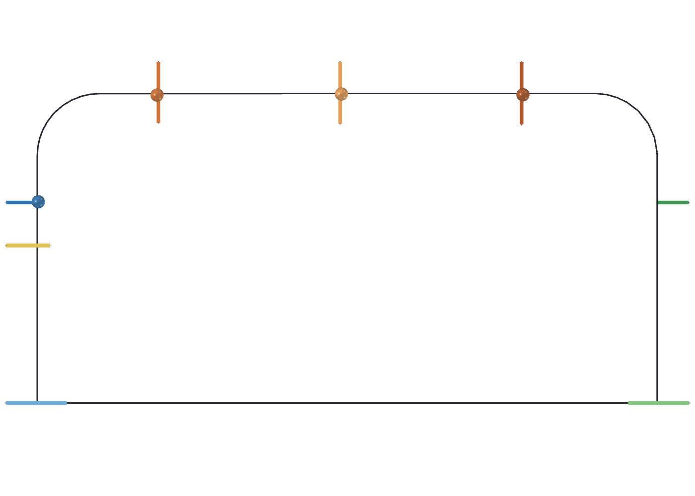
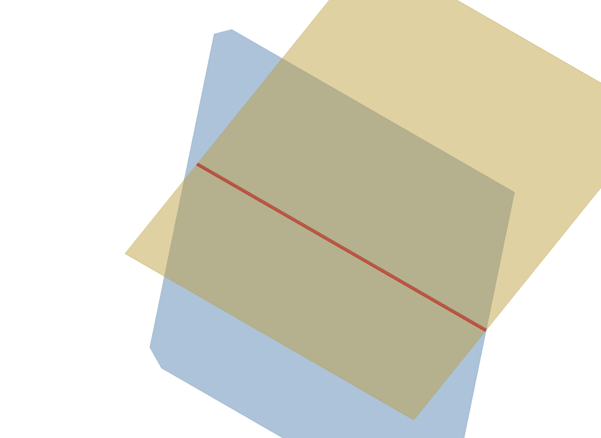
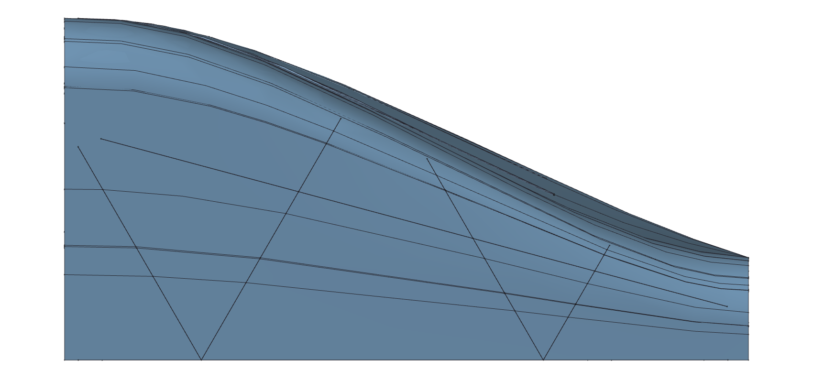
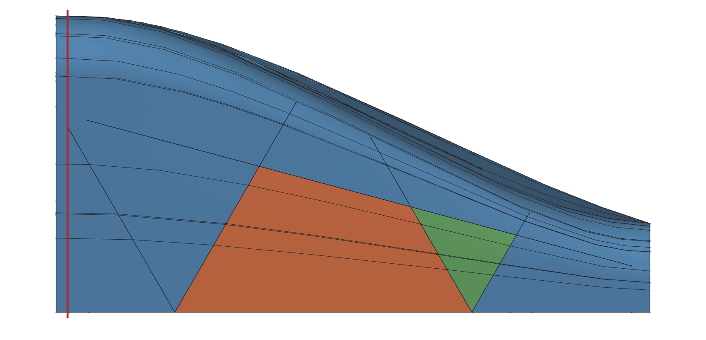
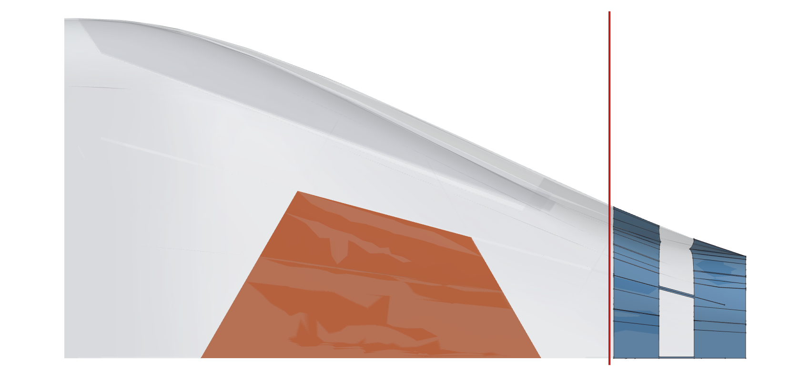
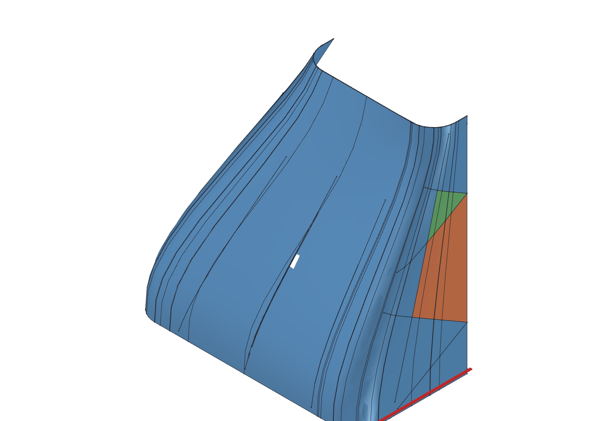
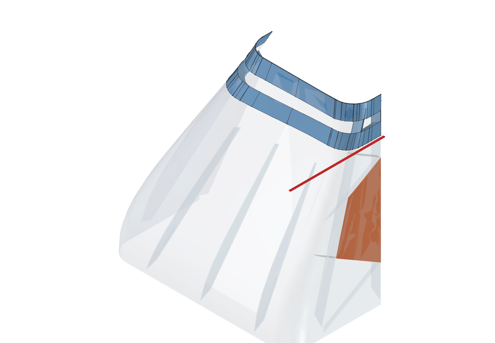
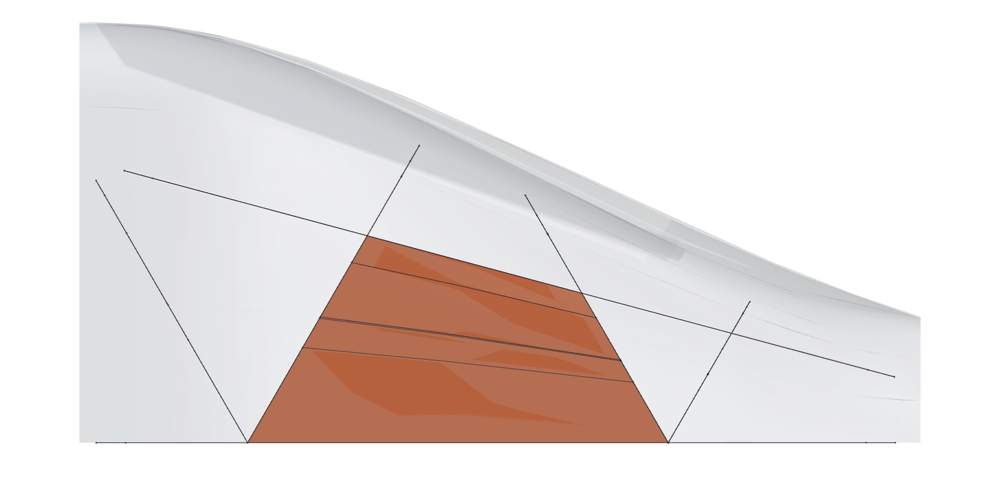

# Cowl interior surface — the algorithm

*IP-FC-16. Written 2026-08-21, once [OQ-ARCH-17](../architecture/freecad_migration.md#open-questions)
removed the last undecided item.*

The cowl today is a solid blank with channels cut into it. It has no wall
([cowl.md §6.2](cowl.md)), which is sufficient for printing and insufficient for everything
else: a blank has no mass to report, no wall to analyse, and nothing to assemble against.
This document states the method that gives it one.

It is an **algorithm** document. It says what to build and how to know the result is right.
It does not choose an OCC entry point, because the acceptance tests below are what a choice of
API has to satisfy, and an API named here without being measured would read as decided.

---

## 1. What this produces, and what it must never become

The output is the **solid representation** of [cowl.md §6.4](cowl.md): the notched blank,
shelled, with the rib modelled where each notch is. It serves **UC-2, UC-3, UC-4, UC-7 and
UC-8**.

> **The UC-1 print export continues to come from the un-shelled notched blank.** Cowls are
> printable in spiral vase mode, which spirals one contour per layer and admits no interior
> geometry at all, so a cowl that has been given a modelled inner surface is no longer
> vase-printable ([OQ-DES-CW6](cowl.md#open-questions)). Shelling is a downstream operation for
> the other use cases and **never a replacement for the blank**. A port that "improves" the
> cowl by giving it a proper wall and exports that for printing has silently removed a
> printing capability, and nothing in the geometry flags it — the STL looks better and slices
> worse.

Both representations come from one parametric source. This document describes the branch that
produces the second one.

---

## 2. Preconditions

These are properties of the input the algorithm relies on. **Each is asserted at run time, not
assumed.** A precondition that is merely true today is an accident waiting to be inherited.

### P1 — Every section is steeper than `overhang_angle_from_bed`

The interior is a *horizontal* inset, so on a wall tilted by α from vertical it leaves a
perpendicular wall of `t·cos α`, which is zero at a horizontal face. The cowl design avoids
near-horizontal geometry deliberately — the nose closure is split off as `nose_nose` and
`nose_plate` so the body never turns over, the tail is open at both ends, and every internal
relief is cut at `overhang_angle_from_bed` — so the degenerate case is outside the design
domain rather than a case to survive
([OQ-ARCH-17](../architecture/freecad_migration.md#open-questions)).

The shallowest surface the design permits is 35° from the bed, or **55° from vertical**, which
still leaves

    0.6 mm × cos 55° = 0.344 mm

of wall: 57 % of nominal, and about seven times the 0.05 mm floor below which nothing in this
project means anything.

**Assert it.** A section whose local slope is shallower than `overhang_angle_from_bed` is a
design violation upstream. The build stops and names the station. It must not emit the knife
edge, which renders, exports, passes `isValid()`, and resurfaces later as a stress singularity
in a UC-8 result nobody re-derives by hand. This assertion is also one of the few places the
**unenforced** couplings on `overhang_angle_from_bed` would actually surface — that value has
to agree with where the nose/cowl break line falls and with the buttress ramps, and nothing in
the code enforces either ([OQ-DES-CW11](cowl.md#open-questions)).

### P2 — The eroded section is a single closed loop

Erosion can pinch a region into pieces or annihilate it entirely, and OCC's behaviour when it
does is not a clean failure. See §7. Assert one loop per station.

### P3 — The exterior is available as a surface, not only as a mesh

Sectioning a tessellated OML gives polylines whose vertices are mesh artifacts, and a surface
fitted through them inherits the tessellation. This is what IP-FC-4's STEP export exists for.

### P4 — No notch lies in the layer plane

A rib forms because the slicer's single perimeter walks into the notch and back out again
**within a layer**. A notch lying in the layer plane offers no such path: the feature would have
to be formed between layers instead of within one, which thin-wall perimeter slicing cannot do,
and it comes out malformed. **So horizontal ribs are not used** — this is a property of the
design, stated 2026-09-04, and it is what keeps §4.2's `t_cut / sin θ` away from its
singularity. The shallowest cut the design contains is the tail's 30° diagonal, at 1.4 mm.

This is P1's sibling and a different object: P1 says the *body* is nowhere shallower than
`overhang_angle_from_bed`, because a horizontal surface leaves no wall; P4 says no *notch* is
horizontal, because a horizontal notch leaves no rib.

**Asserted 2026-09-04, in the build and not only in the check** (IP-FC-118).
`cowl_interior.dilated_notches` sees every cutting tool, so it is where P4 lives: a tool whose
own plane is horizontal is refused, and so is one with no planar face at all, which is not a
slab and whose thickness has no direction. Every build reports the shallowest cut plane it saw
— 90° on the nose, 30° on the tail — because the assertion deliberately separates *horizontal*
from *not horizontal* and says nothing about *shallow*: no minimum angle is stated anywhere in
the design, and choosing one in a constant would be inventing a design decision. If a floor is
ever wanted it is an open question, not a number in that file.

It had been true and unchecked, which is what P1's own paragraph warns about. Worse, the one
place that could have seen it looked away: `check_cowl_interior.in_plane_width` returned
`None` for a horizontal cut and `rib_gap` answered with `continue`, so the notch dropped out of
the rib check without comment and the part reported `OK`. Both now raise, and P4 joins P1 and
P2 in the block of preconditions the acceptance test requires to fire.

---

## 3. Inputs

| Symbol | Source | Value at the sweep |
| --- | --- | --- |
| `S` | the exterior, as surfaces | `oml/vsp_nose.step`, `oml/vsp_tail.step` |
| `n_p` | `slicing.cowl_n_perimeters` | 1 |
| `w` | `printer.extrusion_width` | 0.6 mm |
| `t = n_p · w` | derived | 0.6 mm — **the inset** |
| `t_cut` | `buttress_cut_thickness` | 0.1 mm |
| feature stations | the buttress parameters | see §4.1 |

`t` is the *horizontal* inset, and it is the cowl's own perimeter count in the same sense
`cowl_n_perimeters` is used everywhere else — see [OQ-DES-CW9](cowl.md#open-questions).

---

## 4. The construction

    exterior S
      → stations ζ₀ … ζₙ            §4.1  adaptive, derived not tuned
      → sections C(ζ) = S ∩ {z = ζ}
      → eroded contours Cin(ζ)      §4.2  2-D, in the layer plane
      → consistent parameterization §4.3
      → fitted interior surface     §4.4  G1 threshold, G2 objective
      → closed solid                §4.5

### 4.1 Stations

Start from the stations that already carry meaning, then refine by measurement (§5).

**Seed stations.** The OML's own defining sections ([cowl.md §1.2](cowl.md)), plus every
**feature station** — the axial positions where the exterior itself has an edge:

- each buttress ramp's start and end, where `r_inset · tan(overhang_angle_from_bed)` brings
  the notch to full depth or takes it away;
- the cut plane, `cut_len`;
- the base flange, for the nose.

**Rib edges are interior knots, not patch boundaries — and that is the reverse of what this
section said before §4.2 moved to the three-dimensional identity.** While the surface was fitted
through *notched* contours, a rib edge was a crease in the thing being fitted, so splitting there
was the only way to keep §4.4's continuity requirement from smoothing away a feature the part
really had. The surface now follows the **un-notched** blank and the ribs are subtracted from the
finished cavity as solids, so the fitted surface has no crease at a rib edge to preserve: the
blank genuinely is smooth there, and demanding C² across it smooths away nothing. The crease the
part really has still arrives, as the boundary of a boolean between two well-formed solids, which
is where a crease belongs (§4.2). Splitting at every rib end is instead what made the tail 60
patches.

So the two readings of `feature_stations()` do opposite jobs, by which solid they are given:

| Called on | Returns | Used as |
| --- | --- | --- |
| `body` (un-notched blank) | the blank's own creases | **patch boundaries**, via `_patches` |
| `notches` (the dilated tools) | every ramp start, ramp end, cut-plane crossing | **interpolation rows** — the fit's seed is front-loaded with all of them ([OQ-DES-CW22](cowl.md#open-questions)), and §5's second pass scans finely around each |

**Measured 2026-10-11: the blank has no interior crease in any configuration built so far.** All
twelve walls in the soak corpus (§6.4) — both kinds, `U` = 0.5 through 4.0 — report `patch 1/1`,
so `_patches` returns a single span every time and the multi-patch machinery below it is dormant.
The notch-edge count over the same twelve is 4 for the nose and 19–26 for the tail. Everything
below about patch boundaries therefore describes a path no current build takes; it is kept because
a future cell with a genuine axial crease in its blank — a step, a second flange — would take it.

Matching the exterior's continuity class remains the actual requirement that G1/G2 is a statement
of ([OQ-ARCH-5](../architecture/freecad_migration.md#open-questions)). Under the 3-D identity the
exterior whose continuity the fit must match is the blank's, not the notched part's.

**Axial spacing has a floor, and the floor is a design parameter.** `MIN_INTERVAL` = 0.20 mm is
the smallest axial gap the construction will *create*, and it is exactly `t`/3 — three station
rows across the thickness of the wall being built. It is enforced in one place only: §5's
subdivision refuses to split an interval narrower than `2 · MIN_INTERVAL`, so refinement cannot
manufacture a tight pair.

**Two separations are enforced, and the one that matters is not.** `feature_stations()`
deduplicates its *own* output — successive notch edges closer than `max(Z_TOL, MIN_INTERVAL)` are
collapsed — and `_patches()` drops any patch shorter than `MIN_INTERVAL`. But the stations a patch
is actually seeded with are the union

    _seed(p_lo, p_hi)  ∪  {notch edges strictly inside the patch}

and **that union applies no separation filter at all.** The uniform seed stations and the notch
edges are independent sets, so a seed station can land arbitrarily close to a notch edge even
though neither set contains a close pair on its own. That is how the real `tail_shell` fit at
`U` = 3.0 ends up with a pair **0.0009 mm** apart — 220 times finer than the floor, and 670 times
finer than the wall it is building — from two stations that are each individually legitimate.

Two rows that close carry very nearly the same eroded contour, so the fit is asked to interpolate
a near-duplicate, and the axial pole track through them is near-degenerate (§4.4, §6.2).

**Decided 2026-10-04** ([OQ-DES-CW24](cowl.md#open-questions), alternative 2) and **built the same
day** ([IP-FC-144](../implementation/freecad_migration.md#work-items)): the per-patch union carries
a separation filter, and the floor is `station_floor(t)` = `max(t, MIN_INTERVAL)` — the wall, with
the old constant surviving as a hard under-floor for a wall thinner than it. Both end stations are
preserved exactly, because a patch boundary is a station the patches on either side must sample at
the same `z`; the filter displaces a crowding neighbour rather than the end.

It costs no accuracy, as measured and then confirmed on the rebuilt part: at `tail_shell`
`U` = 3.0 the station set goes 32 to 27 on the floor and refines to **30 rows at worst wall error
0.0496 mm**, against 36 rows at the same 0.0496 mm before — with the tightest remaining gap
0.6516 mm, and `z` = -60.0000 no longer present beside `z` = -60.0009.

### 4.2 Eroding a section

For station ζ, take `C(ζ) = S ∩ {z = ζ}` **with the buttress notches already cut**, and erode
by `t`:

    Cin(ζ) = erode( C(ζ), t )

**Erode the notched section by the morphological identity, not directly.** Where the section
is the blank minus the notches, `A − B`, use

    erode(A − B, t)  ==  erode(A, t) − dilate(B, t)

The right-hand side is well conditioned; the left-hand side is the exact shape that returned a
**null shape** from `Part::Offset2D` in IP-FC-54 and took the whole part with it. That was a
different part — the boom bulkhead's web — but the same operation on the same kind of input,
and the failure was not a tangency a nudge would clear: every erosion from 3.0 to 5.0 mm was
null while 6.0 mm succeeded.

**The rib falls out of this and is not modelled separately.** The notch is `t_cut` = 0.1 mm
wide. Eroding by `t` removes a `t`-neighbourhood of it from each side, so the gap the erosion
leaves is

    t_cut + 2·n_p·w  =  0.1 + 1.2  =  1.3 mm

which is exactly the rib thickness [OQ-DES-CW3](cowl.md#open-questions) states. The wall
follows the notch in and back out, and the material between the two passes *is* the rib. That
is the whole reason the notch exists — it buys a rib inside a single-wall print, under a mode
that permits no other mechanism ([cowl.md §6.4](cowl.md)) — so the algorithm reproducing it
for free is the confirmation that the erosion is the right operation.

**1.3 mm is the vertical-cut case, and not every cut is vertical.** The tail's diagonal buttress
slabs are extruded to `t_cut` and then rotated 30°, so the slab is 0.1 mm thick normal to its
own plane and a layer plane cuts through it `t_cut / sin 30°` = 0.2 mm wide -- making the rib
there 1.4 mm. Measured to four decimals at every diagonal, and resolved as
[OQ-DES-CW19](cowl.md#open-questions) on 2026-09-04: **the cut's thickness is fixed whatever its
orientation, and a perimeter's width is evaluated parallel to the build plate**, so the rib is

    2·n_p·w + t_cut / sin θ

with θ the angle between the cut plane and the layer plane. The construction above is the
θ = 90° case of it, and **P4 is what keeps θ away from 0**, where the expression diverges: a
horizontal notch would leave no rib at all, so the design does not contain one. Anything checking a rib has to carry the angle: a flat 1.3 mm expectation
reports correct geometry as an error, which is what §6's first version did.

**The identity is evaluated in three dimensions, and that is where the creases come from.** The
surface is fitted through `erode(A, t)` alone — the un-notched blank, which on these cowls is a
rounded rectangle with no crease anywhere in it — and `dilate(B, t)` is subtracted afterwards as a
solid. A rib's crease therefore arrives as the boundary of a boolean between two well-formed
solids, rather than as a feature a single periodic B-spline is asked to represent. The 2-D
predecessor did the latter and failed badly: it overshot at every rib corner, producing
self-intersecting wires, unorientable faces, and a fuse that landed **9× off its own volume** from
identical inputs. This is also why a rib edge is not a patch boundary (§4.1) — there is no crease
in the fitted surface to split at.

**That says where a crease comes from, not that the one the kernel returned is in the right
place**, and the two were conflated until 2026-10-11. §6.9 measures it.

### 4.3 Contour correspondence

A surface fitted through a stack of contours needs each contour parameterized **consistently**
with its neighbours, or the surface twists between stations. This is the classic loft failure
and it does not announce itself: the result is a valid, closed, plausible solid.

- Anchor the parameter origin to a **feature**, not to whatever the sectioning returned first.
  The rounded-rectangle sections ([OQ-DES-CW5](cowl.md#open-questions)) have four corner arcs;
  use one of them, consistently, and a fixed traversal direction.
- Distribute the remaining parameter by **arc-length fraction**, so a station with a notch and
  a station without still correspond.
- Where a notch is present at one station and absent at the next, the correspondence would not
  be well defined. **Under §4.2's three-dimensional identity the case does not arise**: the
  contours being fitted are the *un-notched* blank's, so no contour in the stack has a notch in
  it and every one of them corresponds to its neighbors by arc-length fraction. This bullet
  previously concluded that such stations are patch boundaries rather than points to interpolate
  through; they are now interpolation rows, by design (§4.1).

### 4.4 The surface

Fit a surface **through** the eroded contours with continuity conditions imposed. The four
requirements are [OQ-ARCH-5](../architecture/freecad_migration.md#open-questions)'s and are not
re-opened here:

1. **Curvature-aware adaptive spacing** — §4.1 and §5.
2. **Bidirectional curvature.** Doubly curved, circumferentially *and* axially. Not
   developable, not ruled.
3. **G1 tangency is the threshold, G2 curvature is the objective**, across every join within a
   patch.
4. **Not a ruled surface with tangency discontinuity.**

**What this excludes.** A `ruled=True` loft is excluded outright by (4). So is a `ruled=False`
loft that merely interpolates the section curves without tangency constraints — it satisfies
neither (3) nor generally (2). What is wanted is an **approximation with continuity
constraints**, the same class of construction OpenVSP uses for the exterior, applied to the
interior.

**Why this is not cosmetic.** Wall thickness is the *difference* between the exterior and the
interior. The exterior is a piecewise cubic Bézier carrying G2 across several stations by
design. If the interior is only C0 at its joins, **wall thickness is discontinuous at every
join** — a thickness step at a seam the exterior does not have — even though each surface is
individually acceptable. That is a stress raiser for UC-8 and a visible artifact in UC-4 and
UC-7.

**As built, the continuity is C² in both directions, and the axial fit is global within a patch.**
`_fit` interpolates each eroded contour with `GeomAPI_Interpolate` and no tangent constraints,
giving a C² cubic row curve; it then interpolates each *pole track* across the patch's stations the
same way, giving a C² cubic axially. The patch surface is bicubic and C² throughout, and because
evaluating an interpolated pole track at its own parameter returns the original pole, the surface
passes through the input contours exactly.

**That makes one station's data a global constraint, not a local one.** A C² cubic interpolating
spline is a tridiagonal solve over all of a patch's stations, so moving one row changes every
coefficient in that patch. The influence decays geometrically along the knot sequence with
alternating sign — for uniform knots the ratio is 2 − √3 ≈ 0.268 per span, about 3.7× attenuation
per station. So on the knot sequence it is global in principle but short-ranged in practice: five
stations away, a 0.01 mm displacement is of order 10⁻⁵ mm.

**That figure describes the spline's own coefficients and does not bound the finished wall's
measured sensitivity — measured 2026-10-04, it understates it by three orders of magnitude.**
Displacing one row of the input contours and measuring the real cut wall 7.5 station intervals away
gives a gain of **0.408 mm per mm**, reproduced to three figures at δ = 0.001, 0.003 and 0.01 mm
(§7.1). That implies about 1.12× attenuation per station where the coefficient decay predicts 3.7×.
Whatever closes that gap — the cut geometry, the lids and side caps rebuilt from the changed
surface, or something else — is not the tridiagonal solve, and is not established. **So a
perturbation response reaching far down the part is not by itself evidence against the fit**, and an
earlier version of this paragraph which said it was has been withdrawn.

**Patch boundaries are hard stops.** Patches are split at the *body's* own creases, each is fit
separately, and adjacent patches are made to pass through their shared station exactly — which is
why `END_INSET` is applied only at the part's own two ends (§4.1). A perturbation inside one patch
cannot reach another patch's surface at all.

### 4.5 Closing the solid

The wall is bounded by the exterior, the interior, and an annulus at each open end. Both cowls
are open — the tail at both ends, the nose body where it is cut to the closure parts — so
there is no cap to construct and no turnover to handle.

**Both cowls are one symmetry cell, not a full body — [cowl.md OQ-DES-CW20](cowl.md#open-questions).**
The tail is built as its `y ≥ 0` half, the nose as one octant; every step above — the sections,
the erosion, the surface fit, the notch cuts, the wall — runs entirely inside that cell, bounded
by the cell's own construction planes, and produces a cell-local result only. A full, mirrored
body is never constructed as an intermediate at any point in this construction.

**Mirroring happens exactly once, as the very last step, to the finished wall — never earlier,
and never to any other intermediate.** The cavity is cut out of the cell's own notched body while
still inside the cell; the resulting wall is what gets carried out to the whole part, by the same
mechanism and in the same mirror order the outer OML solid already uses to build itself from that
same cell. Nothing here mirrors a partial result — the cavity, the un-notched body, or any other
earlier intermediate — and finishes construction on it afterward: a boolean between two shapes
that were each already carried out to the whole part by an independent mirror step is not
trustworthy regardless of whether both are exactly symmetric, since OCC's boolean kernel is free
to introduce asymmetry or fail outright on a full-size operation even when its inputs are exact,
and this project has measured it doing both. One symmetry cell, one deferred mirror, one code
path for both cowls, differing only in which cell and how many mirrors — never in order of
operations.

**Mirroring a solid that still carries the flat cap where it was cut from its cell is itself not
safe to do by an ordinary boolean fuse.** Two solids that share their entire boundary over exactly
one face and nothing else are a degenerate case for OCC's general boolean intersector, measured to
fail outright (`ValueError: Null shape`) even when that shared face is exact to machine precision.
The cap is instead stripped from the finished wall, the remaining open shell mirrored, and the two
open shells sewn together along their now-identical shared edge — construction, not a boolean
asked to discover a relationship its two inputs already have exactly.

---

## 5. The refinement criterion

**Spacing is derived, not tuned.** Refine until the fitted surface agrees with the *true*
per-layer erosion, then stop. That replaces an arbitrary interval with one tolerance that
means something physical.

Between each adjacent pair of stations:

1. Take the midpoint ζ_m.
2. Section the **fitted** surface at ζ_m. It must give exactly one open arc; a midpoint where it
   does not is an insertion for a different reason, recorded below.
3. Sample that arc at `CHECK_ARC` (§6.6), so the sampling is a spacing and not a count.
4. Measure the deviation `d` as the worst departure of the **perimeter width** from the width it
   is supposed to be: each sample's in-plane distance to the **exterior** section, less `t`, in
   absolute value. Absolute because both signs are failures — too thick is a cavity that did not
   reach, too thin is a wall that will not print.
5. If `d > τ`, insert ζ_m as a station and recurse on both halves.

**Step 4 measures the wall, not the agreement of two curves, and an earlier version of this
section specified the latter.** It called for the two-sided Hausdorff distance between the fitted
contour and an ideal contour re-eroded at ζ_m — which the implementation has not done since the
criterion became the in-plane wall width, and the difference is not presentational:

- Hausdorff bounds the wall only **indirectly**, so §5 converged on a different quantity from the
  one `check_cowl_interior` accepts the part on. The two now measure the same quantity, which is
  what lets a prediction be checked against an acceptance reading at all (§6.4).
- It needed the re-eroded reference contour of step 2, which is the expensive half of §4.2, at
  every candidate midpoint of every round.
- Both of its sides scaled with the sample count, making the whole construction **quadratic** in a
  number the rib's 1.3 mm gap had already forced upward. Distances from points to one polyline are
  linear in it, which is what makes checking at the needed resolution affordable.

The function that computed it, `cowl_interior.hausdorff`, had no caller left and was removed
(IP-WTM-31). Nothing in the construction computes a Hausdorff distance today.

Terminate when every interval passes. A floor on interval length guards against a
non-converging feature; **reaching the floor is a failure to report, not a result to accept**,
because it means the surface does not represent the erosion at that station and nothing
downstream will know.

**As built the floor is also a blind spot, which is a defect.** Step 1 is skipped outright for any
interval already narrower than `2 · MIN_INTERVAL`: the midpoint is not taken, the wall is not
measured there, and nothing is reported. So an interval too short to subdivide is also an interval
this criterion never looks at.

**Both passes do it.** The pre-cut fit refinement skips before measuring the fitted wall, and the
post-cut scan skips before calling `_finished_wall_gap`, so the *finished* wall is not measured
across such an interval either and `worst_finished` never includes it. A near-duplicate pair is
therefore unmeasured at every stage.

Where §4.1's unfiltered station union has put two rows 0.0009 mm apart, that is simultaneously the
interval the C² system is worst conditioned across (§6.2) and the one place no convergence
measurement runs. Refusing to *subdivide* a short interval is correct — subdividing it is exactly
what would make things worse. Declining to *measure* it is not, and the two were conflated into a
single guard.

**Decided and built 2026-10-04** ([OQ-DES-CW24](cowl.md#open-questions) alternative 2,
[IP-FC-144](../implementation/freecad_migration.md#work-items)): the two behaviours are separated.
Both passes now compute the interval's divisibility and measure regardless; an interval that
exceeds τ but sits at the subdivision floor is **reported** rather than silently skipped. It is
reported and not raised, because promoting it to a refusal is a separate decision nobody has made.

### The tolerance, and why it is absolute

    τ = 0.05 mm

**It does not scale with `U`, and that is the opposite of the project's usual rule** — for a
stateable reason. `compare_backends.bbox_tol()` scales with `U` because it measures agreement
between two engines on a whole part, and a whole part gets bigger. This tolerance measures
whether a **wall** is in the right place, and the wall is `n_p · w` = 0.6 mm at every `U`,
because extrusion width is a property of the machine. A tolerance that grew with `U` would be
2 % of the wall at U = 0.5 and 67 % of it at U = 4.

0.05 mm is the smallest linear dimension that means anything in this project, and it is 8 % of
the wall. **Getting absolute-versus-relative backwards here is not hypothetical**: IP-FC-56
used an absolute 1e-9 mm³ volume tolerance on parts of very different sizes, which is 6e-14 of
a bulkhead, and it cost two silent forty-minute runs before the cause was found. The rule is
that the tolerance is relative to *the thing being measured*. Here that thing is the wall.

### A gap this criterion does not cover, and the fix decided for it

**Steps 1-5 above run entirely before the rib cut.** They measure the fitted surface against the
true per-layer erosion of `S` — §4.2's smooth interior, with no notch subtracted from it yet.
`dilated_notches()`'s rib cut happens afterward, in `cavity()`, and nothing in this criterion or
anywhere else in the construction re-measures the *finished*, rib-cut wall against τ.

**That gap is real, not theoretical: found 2026-09-23, root-caused 2026-09-25
([OQ-DES-CW21](cowl.md#open-questions), full evidence in
[freecad_migration.md IP-FC-143](../implementation/freecad_migration.md)).** The finished wall
reads thinner than τ at the tail's shallow-angle (30°) diagonal buttresses, growing with `U` from
a few thousandths of a millimetre at `U` = 1 to 0.150 mm — three times τ — at `U` = 4, confirming
what §10's `U` = 4 prediction below already expected of this construction. Five direct
measurements ruled out every candidate that would have meant this criterion's own convergence was
at fault (`RIB_CUT_FUZZ`, `RIB_FACETS`'s polygon approximation, a coverage gap in step 5's own
bisection, cross-mirror rib overlap at the tail's seam) and instead found the smooth surface
already clean at the exact point the finished wall reads thin — the rib cut itself removes
measurably more material there than the smooth surface's own offset predicts. **This criterion is
correct as far as it goes; it simply does not go far enough**, because a rib boundary at a
shallow cut angle is a case §4.2's erosion identity does not by itself protect.

**Decided, 2026-09-25: extend this criterion with a second pass evaluated after the rib cut, not
work around the gap by bounding `U` or widening τ.** The termination structure is the same as
steps 1-5 — measure the deviation, insert a station and recurse where it exceeds τ, stop when
every interval passes — but run a second time against the *finished* solid's own wall thickness
near each notch boundary, rather than against the pre-rib fitted surface. A build only converges
once both passes are inside tolerance.

**Correction, 2026-09-26: the second pass cannot run inside `cavity()` at all, and an initial
implementation there was wrong for exactly that reason.** `cavity()` is only ever given `body` —
`cowl_tree.pieces()`'s `cell_body`, the *un-notched* cell — because that is the correct, and only,
reference for steps 1-5's own pre-rib fit. The finished wall's true exterior is not `body`; it is
`notched` (`cell_cut`, "that same cell with its buttress tools already cut into it"), which
`shell_solid()` alone holds, and only after computing `inside = cavity(...)`. A `cavity()`-internal
attempt at this second pass measured the rib-cut cavity against `body`'s exterior — the only
exterior it has ever had — and at a station where a buttress cut removes exterior material, that
reference is measurably wrong: a direct check (`tail_shell`, `U` = 3.0, `z` = -217.727) found the
real wall's exterior loop 0.56 mm from the true thin point, while `body`'s own exterior at the same
(x, y) was 26.5 mm away, a different surface entirely. **The second pass belongs in
`shell_solid()`, evaluated directly on `wall = notched.cut(inside)`** — both the exterior and the
cavity boundary then come from the same finished, cell-sized solid, which is exactly what
[§6](#6-verification)'s wall check already does on the whole part and what this function's own
docstring already argues is strictly better done at cell size, before mirroring. Full evidence
trail in [freecad_migration.md IP-FC-143](../implementation/freecad_migration.md).

**Correction, 2026-09-26: not by cutting `notched` a second time.** Implemented instead by
slicing `notched` directly at each candidate `z` and comparing that contour against the cavity's
own boundary — the same "two already-sliced contours" pattern `outer_at` already uses against
`body`, never a second, independent boolean between `notched` and the cavity. A second cut here
would repeat the exact "two shapes each independently built, then a boolean between them" mistake
`shell_solid`'s own docstring already recounts three instances of; `shell_solid`'s own
`notched.cut(inside)` remains the one authoritative cut. This still needed `open_arc`'s stripped
polyline discipline reproduced without `open_arc` itself — `notched`'s section does not always
chain the way `body`'s does — and, once reproduced, built open rather than closed, since a closed
polyline's wraparound chord across the excluded construction-plane strip cuts straight across the
cell's full width and reads spuriously close to legitimate points nowhere near a real notch.
Both are recorded in full in [freecad_migration.md IP-FC-143](../implementation/freecad_migration.md).

**Correction, 2026-09-27, per [cowl.md OQ-DES-CW22](cowl.md#open-questions): the second pass does
not re-scan the whole patch on every round.** Verified correct but measured unaffordable: re-checking
every point across the full patch, every one of up to six rounds, cost 9.5 hours without finishing
the `U` = 3.0 target once the pass actually needed multiple rounds to converge, rather than the
zero-insertion pass every case tried before OQ-DES-CW21 happened to take. **Decided: round 0 still
scans the whole patch, front-loaded with stations placed at the notch topology's own edges (already
read for the edge-focused scan) rather than left to discover them one bisection at a time; round 1
onward re-scans only a ±15-20 mm window around that round's own insertions**, a width measured
directly from how far one properly-bisected insertion's effect on the finished wall actually
reaches (decaying from -0.023 to -0.024 mm within a millimetre of the insertion to at most
±0.0012 mm, 2.4 % of τ, beyond 20 mm), not assumed. **Implemented and verified 2026-09-27**: both
`tail_shell` `U` = 1.0 (765 s, zero refinement rounds needed) and `U` = 3.0 (4,277 s, six rounds)
now converge without raising `Unconverged`, a large improvement over the 9.5-hour build this
replaced. Full numbers in [IP-FC-143](../implementation/freecad_migration.md).

**A residual gap, found immediately on that same verification, is not this pass's convergence
failing to run long enough — §6.5 is the measurement, and it is larger and more structured than
this paragraph was first written to describe.** This pass's own
comparison (`_finished_wall_gap`/`finished_outer_at`) measures distance between two independently-
sliced contours -- the candidate surface's own slice and `notched`'s -- and never performs the real
`notched.cut(inside)` boolean itself, by design (a second boolean here would repeat the "two shapes
each independently built, then a boolean between them" mistake `shell_solid()`'s own docstring
already records three instances of). That prediction does not always match what the real boolean
produces: even a completely unconverged, round-0 candidate already shows the real, external
`wall_thickness()` check reading 0.0534 mm thin at `tail_shell` `U` = 3.0's worst station, at the
same time this pass's own distance-based check reports that station clear. **An initial hypothesis
that the gap came from `FINISHED_PLANE_TOL`'s exclusion band hiding a defect near a cell-boundary
plane was tested directly and refuted**: the real worst point there sits 78.688 mm from the tail's
one cell-boundary plane, thirty times the 0.5 mm tolerance -- nowhere near it. The real, external
check already catches this correctly; the gap is between what this pass converges to internally
and what that check finds, not a gap in acceptance testing.

**Characterized further, and a fix attempted directly, 2026-09-27.** Inserting a station at the exact
point the real (not predicted) measurement says is worst — the most favorable case for closing the
gap by refinement — moved the real thickness there by only 3 % of the deficit, against roughly
fourteen times that effect on the *predicted* thickness for the same kind of insertion (the
measurement behind this section's own windowed re-scan sizing above). Station insertion is a weak
lever on the real result, and this pass has no other lever to pull.

**Where this pass actually stands, measured corpus-wide 2026-10-10 — §6.5.** The 2026-09-27 study
described the gap as signed both ways and present at every station at roughly ±0.01-0.04 mm, and
concluded it was pervasive noise rather than a targetable defect. **Measured properly, that was the
right order of magnitude:** this pass's prediction and the real wall differ by at most 0.0039 mm
across the six fully measured `tail_shell` walls, and at four of the six the prediction is
conservative. The quantity this pass converges is very nearly the quantity that matters.

An intermediate version of this paragraph, written earlier on 2026-10-10, reported instead that the
pass was "conservative below `U` = 3 and optimistic above it" by 0.1084 and 0.1743 mm, and that
tightening τ could not help. **Both are withdrawn.** The real side of that comparison was sampled at
a fixed 1 440 points a loop, which on a section whose perimeter scales with `U` is 1.45 mm apart at
`U` = 4 on a 0.6 mm wall; §6.6 is the measurement. There is no regime change.

**The other half of that withdrawal needs qualifying, because the measurement has since come in.**
"τ could not help" was withdrawn as resting on bad numbers, and it was right to withdraw it on those
grounds. Measured properly by `freecad/tau_study.py`, τ *is* a lever on a `nose_cowl_shell` — 0.01403
to 0.00187 mm — and on a `tail_shell` it is **not** a lever at all: pass 2's worst gap is unchanged
across a fivefold tightening and the build then refuses to converge (§6.8). So the withdrawn claim
happens to describe the tail correctly, for a reason that has nothing to do with the evidence it was
made from. A claim that is accidentally true is still not supported, and the figure to cite for the
tail is §6.8's, not the withdrawn one's.

**A separate, more serious finding, 2026-09-28, re-reviewed and substantially corrected
2026-10-03.** Investigating whether the residual above reflects unreliable measurement, five
independent fresh builds confirmed the real reading is exactly reproducible (0.546556 mm to six
decimal places, every time). But the §6.2 probe — displacing one row of the fit's *input* contours
by a sub-0.1 mm amount — breaks `shell_solid()`'s construction at two stations, reproducibly.
**That failure is `notched.cut(inside)` returning the cell wall in more than one solid, and §7
carries its full current account**: both signatures, the figures, and what is and is not
established about it.

Two corrections belong here, because this subsection is where the errors were made.

**It is not a mirror-step failure.** Earlier versions attributed it to `mirror_across_cell`
("5 disconnected shells"); that was an artefact of the test harness, which called the mirror
directly and so skipped `shell_solid()`'s own earlier `len(wall.Solids)` check — the mirror was
reporting a wall that had already come apart one step before.

**The "rib crowding" explanation is withdrawn.** It rested on a ratio between two tools' distances
to the *interior surface*, which never compares the tools to one another; at the station it was
derived from, the three tools it called crowded have their own nearest points 87.7-176.9 mm apart
on a 300 mm part. Measured directly 2026-10-03, the real dilated tool set's largest pairwise
overlap is 382.5 mm³ — 0.59% of the smaller tool — against the ~40% that produced the pathological
topology in IP-FC-137's synthetic H3 test, and the three Side tools named as "the real crowding" do
not overlap each other at all. **§9.8's reading is the correct one: that mechanism is not present
in the real part.**

*The real blank and the real tools, sectioned at `z` = -283.9951 and seen down the axis. The black
outline is the half cell; each coloured bar is one tool's section, and the spheres are the nearest
points the ranking was read from. The three `Side` tools ranked as maximally crowded sit at
opposite ends of the top face.*

A mechanism is now established for one of the two stations and not the other: `z` = -60.0000 is the
near-duplicate station pair of §4.1, acting through the C² forcing term of §6.2. `z` = -294.1530 is
still unexplained, and three candidate predictors — absolute clearance, crowding ratio and row
spacing — have each been proposed and refuted by testing.

*The two real dilated tools with the largest mutual overlap — `Top1Safe` (blue) and a diagonal
(yellow) — with their intersection in red. They cross transversally, and the intersection is a
307 x 1.8 x 1.9 mm sliver: 382.5 mm³, 0.59% of the smaller tool. IP-FC-137's synthetic case paired
nearly-coincident slabs overlapping by about 40%, which is a different arrangement, not a smaller
amount of the same one.*

**What survives from the clearance surveys.** The corrected per-wire re-measurement — after the
`_Polyline` multi-loop bug that `_min_wire_distance` now guards against — found a minimum clearance
of 60 nm at `z` = -134.498, with 15 points from 60 nm to 4.1 um scattered across nearly the whole
length, recurring at a second `U` and on `nose_cowl_shell`'s octant, so it is a property of the
construction generally rather than one cowl or one `U`. A single rib binds at every one of those
points, and all three tested with the row-nudge protocol stayed stable across the full 0.001-0.1 mm
range. **What that in-plane clearance physically bounds is unverified**: whether its minimum lies on
a tool's cut floor, which bounds the wall, or on a flank, which bounds nothing, has never been
checked, and across four stations measured both ways it varied by a factor of 2.5 while the real
`wall_thickness()` varied by 4.9%.

**The two-metric check design is not closed.** Metric A ships opt-in and flag-only
(`CLEARANCE_MARGIN_MM` = 0.01 mm, for the reason in the next paragraph). Metric B is computed but
enforced nowhere, and on the 2026-10-03 evidence should be retired rather than given a cutoff: at
`z` = -60.0000 both metrics pass — Metric A 0.097097 mm, Metric B 5.950x — and the wall severs
anyway.

**The thin-wall threshold is 0.01 mm, not the coarser 0.1 mm print-accuracy figure first proposed.**
That 0.1 mm is a positional tolerance (where a feature sits); wall thickness is a different quantity,
and a single spiral-vase perimeter's thickness is exactly where a small absolute change can flip the
slicer's decision to extrude it at all. That reasoning is unaffected by the corrections above.

### The three convergences, and where the chain breaks

Three convergences run between a candidate surface and a verdict on the part, and **each one hands
off across a change of quantity**. Written out because the individual facts are recorded above and
in §6.1 but the chain they form is not, and most of the confusion about this construction has been
confusion about which link is which — including in
[OQ-DES-CW23](cowl.md#oq-des-cw23--cavitys-post-cut-check-predicts-the-finished-walls-thickness-rather-than-measuring-the-real-cut--withdrawn-2026-10-10-not-a-design-choice),
which was withdrawn once the links were measured separately. §6.4 and §6.5 carry those
measurements.

| stage | what it measures | criterion | does that quantity converge? |
| --- | --- | --- | --- |
| **Pass 1**, `_refine` | the *smooth* fitted surface's own perimeter width against `t`, in the layer plane, before any rib (§5 step 4 — **not** a Hausdorff distance against a re-eroded contour, which is what this row said before IP-WTM-31) | τ = 0.05 mm | **Yes.** Bisection to a floor; reaching the floor is reported, not accepted |
| **Pass 2**, the post-cut loop | a *prediction* of the finished wall's thinness: slice-to-slice distance between `notched` and the candidate, never the real boolean | τ = 0.05 mm | **At τ = 0.05 only.** Within `POST_CUT_ROUNDS` = 6 on all 28 soak builds, worst 0.0484 mm. At τ = 0.02 or 0.01 it does **not** converge on a `tail_shell` at either `U` = 0.5 or `U` = 2.0: it exhausts `cavity`'s 64-station patch budget while its own worst gap stays put (§6.8) |
| **Acceptance**, `wall_thickness` | the *real* cut, mirrored wall: a nearest-point minimum from the inner contour to the outer | `WALL_TOL` = 0.01 mm | **No.** Still falling at 3840 inner samples at 17 of 24 stations. The sampling half is fixed — `WALL_ARC` = 0.125 mm since IP-WTM-25, where it was `AROUND` = 240 — and the measure half is not. §6.4's C4 converges and is now **reported beside** this one on every run (IP-WTM-10); which of them gates is OQ-DES-CW29 |
| *(candidate)* area-based mean | (outer area − inner area) / mean ring length on the same section | — | **Yes**, to 1e-6 mm from 16000 area points — but a mean cannot see a local thin spot |

Four consequences follow, and they are what make this a design problem rather than a tuning one.

**τ is not `WALL_TOL`, and the gap between them is deliberate.** τ is what the two refinement
passes stop at; `WALL_TOL` is what the part is held to, five times tighter. A candidate can satisfy
both passes and still fail acceptance, by construction and not by error — "The tolerance, and why
it is absolute" above, and the two constants' own notes in `cowl_interior.py`, say why one may be
as loose as the construction's budget allows while the other is set by what the slicer does with a
thin perimeter.

**Pass 2's prediction tracks the real wall closely, and the hand-off is not where the chain
breaks.** §6.5 is the measurement, over every build the soak recorded rather than the 12 stations of
one. Across the six fully measured `tail_shell` walls the prediction differs from the real wall by at
most **0.0039 mm** — under half of `WALL_TOL`, under a tenth of τ — and at four of the six it is
conservative, reporting more thinness than is there. Station insertion is independently measured to
move the real wall by about 1/14 of what it moves the prediction, so this pass has little lever on
the part.

**The clause that used to follow — "it does not need one, because it is not where the error is" — is
true only at τ = 0.05.** Measured on `tail_shell` at `U` = 0.5 and `U` = 2.0 (§6.8), this pass's own
worst gap is **invariant in τ**: 0.0601 mm at all three criteria on one wall, 0.0508/0.0481/0.0481
on the other, while pass 1's prediction over the same range converges to 0.0073 mm. Asked for
anything tighter than 0.05 the pass *does* need a lever, has none, and keeps inserting stations
until the budget stops it. The weak coupling recorded above is therefore not a harmless property of
a pass that has nothing to fix; it is the reason a tighter criterion cannot be adopted.

**Two earlier readings of this consequence are superseded, in opposite directions.** The first,
from one build's 12 stations with the real side read by the non-converging nearest-point minimum,
called the gap pervasive measurement noise at a mean absolute 0.0121 mm. The second, 2026-10-10,
called it a regime change — zero below `U` = 3 and 0.11–0.17 mm above it — and concluded that no
tightening of τ could certify the part. **The second was the worse error:** its real side was
discretized at a fixed 1 440 samples a loop, which scales to 1.45 mm between samples at `U` = 4 on a
0.6 mm wall (§6.6). The first was closer to right. What is true is that the gap is small.

**`TAU` is no longer an untested lever, and on a tail it is a ruled-out one** (§6.8, IP-WTM-27,
IP-WTM-28, IP-WTM-44). It is a lever on a `nose_cowl_shell` — 0.01403 to 0.00187 mm — and on a
`tail_shell` it moves the finished wall not at all and then refuses to build, at `U` = 0.5 and
again at `U` = 2.0. The second withdrawn reading above therefore reached the right conclusion about
the tail from numbers that could not support it, which is worth separating: the reasoning was
withdrawn on its merits and the outcome happens to have survived.

**The acceptance metric had no settled value to converge to, and now there is one.** `worst_low`
drifts one way — thinner — with sampling, so under it a reading over `WALL_TOL` did not show the
wall was that thin and a reading under it did not show compliance; `check_cowl_interior` prints
exactly that, reporting a failure as "`WALL_TOL` compliance is not demonstrated". §6.4 replaces it:
C4, the corner-excluded minimum, converges on a real section, is accurate against closed-form truth,
and is not blind at a corner. **It rescues the nose and not the tail.** Of the twelve distinct
walls, five meet `WALL_TOL` and all five are `nose_cowl_shell` at `U` ≤ 3; every `tail_shell`
configuration fails, reading 0.0134 to 0.0469 mm, one and a half to five times over, and so does the
nose at `U` = 4. At `tail_shell` `U` = 1.5 and `U` = 3.0 it reports *exactly* what the incumbent
does,
and since its samples are a subset of the incumbent's that equality means the incumbent's own worst
sample survived the corner exclusion at those two configurations.

**The generalization this paragraph used to draw from that is withdrawn.** It read "so the tail's
thin spot is not at a corner and no corner-based fix reaches it", and `U` = 0.5 measured directly
on 2026-10-12 says otherwise (§6.8.1): there the incumbent reads 0.03663 mm against the selected
measure's 0.01345, the corner term is 0.019 to 0.033 mm at nine of the twelve stations, and the
incumbent's own worst station is **89 % corner term**. The two measures agree exactly on two tail
configurations and differ by 2.7x on another, so whether the worst reading sits at a corner is a
property of the configuration, not of the kind. On the nose the exclusion matters a great deal
(§6.4).

The 16× disagreement once recorded at one station between the nearest-point minimum (0.0534 mm)
and the area mean (0.0033 mm) is a disagreement between two unsound measures, and neither figure
survives as a reading of that wall.

**Which figures in this document are settled, and which are not.** §6.4, §6.5 and §6.6 are
measured with the selected instrument at a sampling density refined until the reading stopped moving,
and they stand. [IP-FC-151](../implementation/freecad_migration.md#work-items) is superseded by
[wall_thickness_measure.md](../implementation/wall_thickness_measure.md).

**Two classes of figure elsewhere in this document do not stand.** Anything built on `worst_low`,
including §9.9's whole corpus table, is a reading from a measure that does not converge. And
**anything taken at a fixed sample count rather than a fixed spacing is wrong by a factor that grows
with `U`** — up to six at `U` = 4 — which is §6.6 and which withdrew two findings published earlier
on 2026-10-10. Where this document quotes a figure from either class it now says so in place.

**The nose is now judged, and it mostly passes.** Figures recorded before 2026-10-10 placed its
stations across a bounding box up to twice the part's length and reached only 5 to 9 of 12; on the
wall's real extent all six nose walls section at 12 of 12, and five of the six meet `WALL_TOL` with
margin. §6.7 carries that and what the nose/tail asymmetry implies about the mechanism.

---

## 6. Verification

| Check | What it catches |
| --- | --- |
| **Perpendicular wall** at sampled points equals `t·cos α` within τ | the erosion was applied as a 3-D normal offset instead of a 2-D inset — a different surface, and the exact error mode this whole method exists to avoid |
| **Rib thickness** measures `2·n_p·w + t_cut / sin θ` -- 1.3 mm at a vertical cut, 1.4 mm at the tail's 30° diagonals ([OQ-DES-CW19](cowl.md#open-questions)) | the notch eroded as a notch rather than being smoothed away. **Write the angle into the expectation:** a flat 1.3 mm here reports correct geometry as an error, which it did |
| **Volume** equals exterior minus interior cavity | the solid closed the way it was meant to |
| **G1 across every join within a patch** | requirement (3), the one a plausible-looking loft silently fails |
| **Surface distance** from the fitted surface to a densely re-eroded reference, via [`surface_distance.py`](../../src/Fuselage/tools/surface_distance.py) | a fit that passes at the sampled stations and wanders between them |
| **P1, P2 assertions fire** on a deliberately shallow section | the preconditions are checked rather than documented |
| **The cavity closes to exactly one solid** (`cavity()`), and the mirror sews to one (`mirror_across_cell`, `_extend_across_cell`) | a rib that failed to bridge the erosion identity. §9.8 is why this is refused at any scale rather than accommodated |
| **The cell wall closes to exactly one solid** (`shell_solid()`, `len(wall.Solids) != 1`) | `notched.cut(inside)` returning the wall in pieces. This is a *separate* check from the cavity's, at a later step, and it is the one that catches a wall that came apart at the shell cut rather than at the rib cut |
| **Partition identity**: the cut and its complement re-add to the blank within `PARTITION_TOL` = 2.0e-3 | the cut losing or inventing material. Independent of the solid count — a wall can come apart with the partition intact, and the partition can collapse without the solid count being unusual |

The last three are **construction-integrity** checks: they do not ask whether the wall is in the
right *place*, only whether the construction produced a coherent solid at all. The solid-count and
partition checks are independent and both are needed — a wall can sever while cut and complement
still sum to the blank to 2.05e-05, and the partition can slip by 0.993 without the solid count
being unusual.

The wall and rib checks are the load-bearing ones. Volume agreement says two solids enclose the
same space; it does not say the wall is where it should be, and a wall in the wrong place with
compensating error elsewhere passes on volume alone.

That is about what a volume check cannot *see*. There is a second problem with it, in the
number itself, and §9.6 carries it: `Shape.Volume` is wrong on solids of this kind by a
fraction of a percent, by an amount that depends on how the solid happens to be cut into
faces. **A volume here is only meaningful as a difference between volumes taken the same way
over the same operands** — which is what the row above and both identities in §9.6 are. A
volume compared against an expected value, or between two independently built solids, has to
come from [`solid_measure.py`](../../src/Fuselage/freecad/solid_measure.py) instead.

### 6.1 Measurement cautions

Twenty-one ways a measurement of this geometry has misled this work, each one paid for:

- **A compliant specimen cannot test an explanation of non-compliance, and a verdict that does not
  know it will report a pass.** `locate.exterior_verdict` sorts stations into those thin only
  against the notched exterior and those thin against both, which is how §6.8.2 tests whether the
  residual is a reference-surface effect. Its first real run was `nose_cowl_shell` at `U` = 1.0 --
  63 stations, worst reading **0.0037 mm** against `WALL_TOL` = 0.01 -- so both buckets were empty
  and it reported **CLEAN**. Nothing had been tested. It now requires a station over tolerance to
  exist before it will report clean, alongside the separate requirement that some station have the
  two exteriors coinciding, and names which guard failed. This is the **seventh** time this
  subsystem has cross-checked two measures of an effectively empty input, which is the argument for
  pointing a new instrument at a known-healthy build before a known-bad one: the healthy build is
  what exposes a verdict that cannot tell "nothing wrong" from "nothing measured".

- **Two wall figures from this subsystem may be two different measures, not two samplings of one.**
  `cavity`'s second pass converges a plain nearest-point minimum at `CHECK_ARC` = 0.20 mm; the
  acceptance gate's published figure is the corner-excluded minimum at 0.125 mm. On `tail_shell` at
  `U` = 0.5 they read 0.03763 and 0.01345 mm on one wall, a factor of 2.80, and **the sampling
  difference accounts for almost none of it** -- the sampling term runs -0.0068 to +0.0086 mm while
  the corner term runs to 0.0326 mm (§6.8.1). The two measures do not even have their worst stations
  in the same place. So a log line from a build and a figure from the gate are not comparable
  without saying which measure each used, and `locate.criterion_split` exists to do that
  attribution rather than leave it to be assumed.
- **The cheapest configuration can be the worst case for the thing being measured.** IP-WTM-28 ran
  on `tail_shell` at `U` = 0.5 because it is the cheapest tail at 727 s, and that `U` turned out to
  be the corpus's extreme for the measure mismatch above -- 2.81x where the other five tail
  configurations run 0.92x to 1.68x. Nothing was wrong with the measurement, but the conclusion it
  supports is narrower than it looks, and the follow-up at a mid-`U` tail is filed separately
  (IP-WTM-44) rather than assumed. Choosing a configuration for its cost means choosing it for a
  reason unrelated to the question, so what is extreme about it has to be checked afterwards.
- **A bounding box is not evidence of where material is.** A failed wall piece's box read
  `x` = -164.89 against the blank's -150.25, suggesting material outside the solid it was cut
  from; sampled every millimetre, no section lay outside the blank. Reading the same solid through
  two different FreeCAD calls can also give boxes that disagree by several millimetres.
- **`Shape.slice()` can return nothing at one exact plane.** The healthy wall returns no section at
  `z` = -141.0000 and a normal one at ±0.05 mm. A gap in a section sweep must be confirmed by
  volume before it is called a hole. **Met again on 2026-10-11, and the second time it nearly read
  as a defect**: a 298-station dense scan of `tail_shell` at `U` = 3.0 reported one `no_wall` at
  `z` = -293.98226487, and the kernel *agreed* — worthlessly, because with zero wires the nesting
  test and `Part.makeFace` are both answering "not an annulus" about the same empty input, so they
  cannot disagree. Re-probed at six offsets the wall returns a 2-loop annulus at every one, ±0.01,
  ±0.05 and ±0.20 mm, each with ~5 742 samples on a ~1 150 mm perimeter. **A cross-check between
  two measures of an empty input confirms nothing**; only a neighbouring plane does, which is what
  `locate.nearby_states` and `is_slice_artifact` now ask automatically. **It is deterministic and it
  is rare**, both measured when the scan was extended to the whole corpus the same day: that wall
  scanned twice, hours apart in separate processes, gave the identical `z` to the last printed digit
  with the identical six healthy neighbours, so this is a property of that plane against that
  geometry rather than an intermittent flake — and it is the only occurrence in **1 704** stations
  across all twelve distinct walls. The distinction matters for how far the re-probe can be trusted:
  an intermittent failure could in principle also strike a neighbour, a deterministic one cannot.
- **`distToShape()` returns a minimum.** It reads 0.0000 for any face that merely touches a solid
  at an edge, so it cannot decide whether a face lies *on* that solid. That needs the face sampled
  across its area.
- **`Face.Edges` does not list a seam edge twice, so a seam and a hole are the same observation.**
  A periodic surface's closing seam is topologically one edge met twice by one face, and the natural
  way to detect it is to count occurrences. Measured 2026-10-12 on a cylinder, whose lateral face
  certainly has a seam: it appears **once**, like any other edge. The kernel's `ancestorsOfType`
  does not separate them either, since it returns *distinct* ancestor faces and so answers "one
  face" for both. The only sound discriminator left is the surface's **periodicity** — a seam can
  exist nowhere else — and `boolean_edges.anomalous_edges` uses it for that reason. The assumption
  had been "tested" against a fake that supplied the edge twice by construction, which tested the
  classifier and not the vendor; `test_geometry_bridge_cowl_checks` now asks the kernel.
- **`Shape.isValid()` passes a solid whose shell is open.** Measured 2026-10-12: a `tail_shell`
  cavity reporting `1 solids, valid=True` has one edge of 3 164 adjacent to a single face, confirmed
  against the kernel's own adjacency and with every alternative explanation excluded (§6.9.1). So
  `isValid()` is not a closed-shell test and `valid=True` must not be read as one; closedness has to
  be asked for separately. Same class as §7.1's invalid five-face sliver passing a volume check —
  a reassuring answer to a question that was not asked. The decision about what to do is
  [cowl.md OQ-DES-CW30](cowl.md#open-questions).
- **The display mesher is not the geometry.** Redundant topology can make the viewport draw a solid
  several times its true size while `Shape.tessellate()`, `MeshPart.meshFromShape()` and STL export
  all return its correct extent — a display artefact, not an export defect.
- **`Face.Area` is unreliable on B-spline faces** (§9.6); use the wire signed area.
- **A station named by its printed value is not that station, and adding it to a station set
  manufactures a near-duplicate pair.** Stations here are notch edges carried at full double
  precision, and a probe that wants "the station at `z` = -283.9951" and unions that literal into
  the seed set does not select the existing station — it adds a second one 0.0000339 mm from the
  real edge at -283.9951338812. That is 28× tighter than the 0.0009433 mm pair §4.1's floor exists
  to remove, and it puts δ/h ≈ 885 into §6.2's forcing term at δ = 0.03 mm against 11.1 at the pair
  already established as causal. **Select a station by searching for the nearest existing one and
  print what was found**; never name one by a rounded literal.
- **A nearest-point minimum is not a converged wall thickness, and at `WALL_TOL` it is not a
  measurement at all.** `wall_thickness` samples the inner contour and takes each sample's distance
  to the nearest point of the outer one. Measured 2026-10-05 on `nose_cowl_shell` at `U` = 1, that
  minimum does not settle: at **17 of 24 stations it was still falling at 3840 samples**, drifting
  0.0015 to 0.0079 mm per doubling — for instance `z` = -43.5213 reading 0.5830, 0.5792, 0.5774,
  0.5661, 0.5606 as the count goes 240 → 3840. It is not noise and not discretization of the outer
  curve: the outer polyline is 0.0125 mm per segment, whose chord bias is under 1e-6 mm, and a
  remeasure of the worst station returns the identical value to ten decimals. The measure itself is
  the problem — a nearest-point distance at a **concave corner cuts across the corner rather than
  across the wall**, and this section has such a corner at every slot mouth, so denser sampling
  keeps landing nearer one. A minimum that falls with every doubling cannot be compared against a
  0.01 mm tolerance in either direction. **Measuring along the contour's own local normal does not
  fix it** — tried the same day, it oscillates instead of drifting, by up to 0.0139 mm per doubling,
  because the tangent estimate at a crease is itself unstable. What does converge is the
  **area-based mean**, (outer area − inner area) / mean ring length: 0.556253, 0.590421, 0.595922,
  0.596701, 0.596704, 0.596705, 0.596704 mm as the area discretization goes 200 → 64000, settled to
  1e-6 mm from 16000 on. Note the first of those: **`_wire_area`'s own default of 200 points is
  0.044 mm wrong**, 4.4× `WALL_TOL`, so any 0.01 mm work must pass an explicit count. Both kinds
  behave the same way — `tail_shell` at `U` = 1 also had 17 of 24 stations unsettled at 3840 samples,
  with its own worst reading 0.0555 mm at `z` = -30.8264 — so this is a property of the measure on
  this geometry and not of one part.
- **Ask the kernel before building an instrument — but only one of its four routes to these
  questions survives this geometry.** Everything above was built by hand, and each hand-built
  measure needed its own convergence study. OCC answers some of it topologically, with no sampling
  and no threshold. Measured 2026-10-05 on a 2464-face `tail_shell` wall:

  | route | result |
  | --- | --- |
  | `Part.makeFace(wires, 'Part::FaceMakerBullseye')` | **works, 0.6 s.** Resolves the section's wires into regions and reports one face with two wires for a continuous ring, several one-wire faces for a broken one. `Part::FaceMakerCheese` agrees exactly; `Part::FaceMakerSimple` does not resolve nesting and returns the two enclosed areas' sum, 150914 mm², instead of the 958.819 mm² between them |
  | `solid.common(planar_face)` | **unusable.** Would answer the same question, and did not finish in nine minutes |
  | `Edge.Continuity` | **the wrong quantity.** It reports the edge *curve's* own smoothness, not the continuity between the two faces across the join: a box's sharp creases, a filleted box's tangent joins and a cylinder's periodic seam all read `CN`. FreeCAD's Python API does not expose `BRep_Tool::Continuity(E, F1, F2)`, so §6's G1 requirement cannot be read off the built shape this way |
  | `Face.makeOffset2D(-d)` | **exact on clean geometry, unusable here.** On a 0.6 × 100 mm polygon ribbon the erosion is textbook — 1.9884 mm² at d = 0.290, 0.0000 at 0.300, `CADKernelError` at 0.310, the transition exactly at the half-width — and on the real section's convoluted B-spline boundary one call did not finish in six minutes |

  So the ring-continuity question is best asked of the kernel, and `Face.Area` on the resulting
  nested face is a better material area than a difference of two separately-integrated wire areas:
  958.819 mm² against 954.742 mm² by hand, 0.43 % apart, and the kernel's figure needs no
  discretization choice. **The morphological thickness measure, which was the standing candidate for
  a converged local thickness, is refuted on real geometry by the last row.**
- **A mean thickness from area is only trustworthy where the two loops are near-equal in length.**
  `area / mean(boundary)` reads 0.5993 mm at the reference station, where the loops are 1601.8 and
  1598.2 mm — 0.0007 mm from nominal, the best figure any measure here produces. At `z` = -25 on the
  same part it reads 0.4753 mm, and reads **identically on a healthy and a damaged wall**, so that
  is the estimator failing and not a defect: a convoluted boundary adds length without adding area
  and depresses the ratio. Use it where the section is a thin near-uniform ribbon, and nowhere else.
- **Twelve stations is too few to find this check's own failures, independently of the measure.**
  `STATIONS` = 12 is what `check_cowl_interior` and `soak_cowl_shell` sample. Re-run at 24 on
  `tail_shell` at `U` = 1, **three stations fail even the old `TAU` = 0.05 mm** — the 12-station
  default reports the same build `OK`. Whatever is decided about the tolerance and the measure, the
  station count is a separate coverage gap: a quantity that varies along the part is not bounded by
  twelve samples of it.
- **`Shape.tessellate(deflection)` does not re-mesh a shape it has already meshed, so a second
  convergence run on the same object converges on nothing.** FreeCAD caches a shape's
  triangulation. Measured 2026-10-06 on a cylinder: a *fresh* shape gives 500, 1 672 and 5 024
  facets at deflections 0.02, 0.005 and 0.001, and the **same** shape asked again gives 5 024 at
  all three — including when a coarser deflection is requested after a finer one.
  `solid_measure.converged_volume` walks the deflections coarse to fine on one shape, so its first
  run is sound: each request really is finer than what is cached. A second run on that shape
  compares identical volumes, declares convergence immediately, and reports `DEFLECTIONS[1]` — the
  *coarsest* comparison — as the deflection it converged at. With `tol` = 0 the same call raises
  `NotConverged` and then succeeds. The volume returned is still the finest mesh's and therefore
  right; it is the reported deflection, and any convergence *claim*, that is not. The production
  path is unaffected because `soak_cowl_shell.py` reads `mesh_volume` at one fixed deflection on a
  freshly built shape. **Measure a convergence on a shape that has not been tessellated before**,
  and treat a convergence report from a reused shape as unsound. Whether `solid_measure` should
  defeat the cache, and what that costs on a real cowl, is OQ-DES-CW27 in
  [cowl.md](cowl.md#open-questions).
- **A fixed sample count is not a fixed accuracy on a part that scales, and it silently became the
  largest error in this subsystem's measurements.** `unit_width` = `U` * 100, so a section's
  perimeter grows with `U` while the wall stays an absolute 0.6 mm. Discretizing a loop at a fixed
  `Number` therefore buys a circumferential spacing proportional to `U`: `check_cowl_interior`'s
  `AROUND` = 240 is 1.8 mm apart on a `tail_shell` at `U` = 1 and **8.7 mm at `U` = 4**, fourteen
  times the wall being measured, and the first corpus sweep's 1 440 samples were 0.30 mm and
  1.45 mm. Measured 2026-10-10 at `U` = 4: a station reading 0.2136 mm thin at 1 440 samples reads
  **0.00264 mm** at a fixed 0.125 mm spacing, and that wall's worst station falls from 0.2136 to
  0.0347 mm. **Index a reading by spacing in millimetres, never by sample count**, and refine the
  spacing until the reading settles before quoting it. §6.6 is the measurement and the two published
  findings it withdrew. `cowl_interior`'s own `check_samples` already does this correctly at
  `CHECK_ARC` = 0.20 mm; the things that measure its output did not.
- **A bounding box is not the part, and a station grid placed across one samples empty space.** This is the first caution above in a second guise, and it cost more: `z_extent` exists precisely because `Shape.BoundBox` is computed from the untrimmed B-spline geometry, and measured 2026-10-10 a `nose_cowl_shell` wall at `U` = 4 has a box of `z` -400 to -12 where the part spans -200 to -24 -- **twice its length**. A box-based grid found 5 of 12 stations on that wall; a grid on the real extent finds 12 of 12. Every nose figure recorded before that was measured at 5 to 9 stations and excluded from every verdict, which is why the nose went **unjudged for a day while being compliant**. The tail was never affected, its mask spanning the whole OML -- so the kind that fails the tolerance is the kind the box happens to fit, and nothing flagged the difference. **Place stations from a sectioning extent** (`corpus.sectioning_extent`), never from a box. §6.7 is the measurement. **Found a third time on 2026-10-11**, in `locate.dense_grid` — the one function whose whole purpose is a scan dense enough to find a break between the gate's stations, placing them across the box. On a nose wall at `U` = 4 that spends half the scan on empty space and classifies it `no_wall`, which is a *false positive* in the tool meant to find a broken ring. Three recurrences in one module is the measure of how natural the mistake is: `Shape.BoundBox` is the obvious call, it never fails, and it is wrong by 100 % on a real part. **The fix is confirmed on the wall that exposed it**: scanned later that day over its sectioning extent, that same `nose_cowl_shell` at `U` = 4 returns 174 stations and **not one** `no_wall`, where a box-placed grid would have put roughly half of some 390 stations outside the material and called every one of them a hole.
- **A point sampled from a tessellation is not on the face it came from, and a reconstruction of a
  surface is not that surface.** §6.9's check had to be wrong four times before it was right, and
  all four were the same mistake in different clothes — a point or a surface that *looked* like the
  one being asked about. Face **vertices** are shared with neighboring faces, so probing there
  classified 35 of a nose cavity's 60 faces as lying on more than one operand, and an end-lid edge
  22.5 mm from the nearest tool was reported as a rib crease. A facet **centroid** is on a chord,
  so it sits inside a curved face by up to the tessellation deflection — exact for a plane, 0.1 mm
  off a B-spline at the deflection first used, against a 1e-5 mm tolerance; that put **zero** of
  the same cavity's faces on the fitted surface. `Surface.projectPoint(Method='LowerDistance')`,
  and `parameter()` plus `value()` behind it, put the rib edges **2.411 mm** off a surface the
  kernel put them 6.9e-18 mm from — the interior surface is periodic in `u`, and a parameter solve
  returning a local minimum looks exactly like that. `Surface.toShape()` reproduced the same
  2.411 mm, rebuilding the surface over its own natural parameter range rather than the fit's.
  **Measure against the operand the kernel was actually handed, and snap a sampled point onto its
  face with `distToShape` before measuring from it.** None of the four raised anything.
- **A `distToShape` against a whole solid's faces answers a different question than one against the
  face you mean, and the whole-boundary answer is the reassuring one.** The same nose rib edges read
  6.9e-18 mm from `smooth.Faces` and 2.411 mm from the fitted B-spline alone, because they lie on a
  **side cap** — they are where the rib cut runs out to the cell boundary, not creases in the
  interior surface. Measuring against the whole boundary would have passed the check while
  measuring none of the 45 edges the question was about. **Name the face class you mean**: the
  fitted surface, its closing lids and caps, and the `SurfaceOfExtrusion` end-overrun walls are
  three different things on one operand's boundary.
- **A topological fingerprint cannot see a wall get thinner, and it looks like a reliable identity
  right up to the point where it matters.** IP-WTM-41's design-input screen needs to know whether a
  parameter override actually changed the built wall, because a case that did not change it covered
  nothing and must not be counted as coverage. Fingerprinting each wall on solid count, face count,
  edge count and bounding box named **7 of 15** cases unchanged — including the one that takes the
  wall from 0.6 mm to 0.4 mm. A thinner wall keeps the same outer surface, so it keeps the same
  topology and the same box exactly; only the interior moves, and none of those four quantities is
  measured there. **A geometric quantity has to be in the fingerprint**, and the cheap one is
  `Shape.Volume`: IP-FC-119 measured it wrong by 0.16–0.24 % on this project's B-spline solids, so
  it is never a measure here, but the error is a deterministic bias and so it is a sound *difference
  detector* — the same shape returns the same wrong number and two different shapes return different
  ones. The general form: **an identity test has to be sensitive in the direction the thing can
  change**, and the cheapest available quantities were all measured on the surface that stays put.
- **A distance measured in a plane is not a thickness, and this is the caution that bounds every
  other figure in this section.** A plane cutting a slab inclined at θ to it reads `thickness / cos θ`
  — always *larger*, never smaller, so the error has a known sign. Every wall-thickness measure in
  this subsystem is in-plane: the incumbent nearest-point minimum, the selected corner-excluded
  minimum, both of OQ-DES-CW29's candidates, and `cavity`'s own convergence criterion. Where the
  wall's inner surface meets the layer plane squarely that costs nothing, and the fitted interior
  surface **does not**: measured, it is inclined 21.5 to 30.8° exactly where the wall is thin, so
  the in-plane figures there are optimistic by a factor of 1.08 to 1.16, which on a 0.6 mm wall is
  2.9 to 7.0 times the deficit itself (§6.8.2.2). **A 3-D minimum distance cannot substitute, even in
  principle**: the in-plane nearest-point distance is already a minimum over the inner loop within
  one plane, and a 3-D minimum is taken over a strictly larger set, so it is always *shorter* than
  the in-plane figure rather than more correct. What an in-plane measure gets wrong at an inclined
  surface is its **direction**, which makes the direction the measurement — leave the inner surface
  along its own outward normal and bisect for where the material ends. **An in-plane pass is
  therefore not evidence of compliance; an in-plane failure is still evidence of a defect.**
- **`distToShape`'s accuracy depends on the surface class, so a single "is the sample on this face"
  tolerance silently selects by surface type.** Against a planar face the solve is exact; against a
  trimmed B-spline it is iterative and lands a little further out. A 1e-6 mm threshold therefore *accepts*
  samples on cut faces and *rejects* samples on the fitted interior surface — which is precisely
  backwards, because the fitted surface carries the wall and the cut faces are the artifact
  population. Measured: of the samples no face claimed at 1e-6, **every one** lands on a B-spline at
  1e-4 — 20 of 20, 86 of 86 and 336 of 336 on three walls — and relaxing the threshold moved one
  wall's real share from 3 % to **37 %**. The general form is the same mistake as the item above in a
  different guise: **a tolerance chosen for one surface class becomes a classifier when applied
  across several**, and it will classify in whichever direction the numerics happen to run.

### 6.2 Conditioning: the row-nudge probe, and what it can establish

A robustness probe rather than a correctness check, recorded here because the verification method
is itself a design decision.

**Procedure.** Build the surface normally. Take the converged stack of eroded contours — §4.2's
output, which is §4.4's *input* — scale one row radially by δ, refit through the modified stack,
and run the same cut production performs. The question it asks is whether the construction's output
is continuous in its own input: a δ well inside the error the fit already accepts (worst wall error
0.0496 mm, against δ = 0.01 mm) should not change the *topology* of the result.

**Its validity domain is narrow, and stating it is part of the method.** Displacing one row while
its neighbours stay fixed is not the same as a surface uniformly δ off — it is a one-station kink,
and its severity is δ *relative to the neighbouring row gap*, not δ itself. Against a 0.0009 mm
gap, δ = 0.01 mm asks the fitted surface for a local slope near 11:1 and the probe is manufacturing
the failure it then reports; against gaps of 0.2 mm and wider the ratio is 0.045 or less and the
probe is measuring what it claims to. **A result from this probe is uninterpretable without that
ratio quoted beside it.**

**Why the ratio and not the displacement: it is the forcing term of the C² system.** For a cubic
interpolating spline the junction equation at interior knot `i`, with interval lengths `h`, is

    h(i-1)·M(i-1) + 2·(h(i-1) + h(i))·M(i) + h(i)·M(i+1)
        = 6 · [ (y(i+1) - y(i)) / h(i)  -  (y(i) - y(i-1)) / h(i-1) ]

A displacement δ applied at station `i` enters the right-hand side as δ/h. At h = 0.0009 mm and
δ = 0.01 mm that term is ≈ 11, which is exactly the tabulated ratio — the ratio is not a heuristic
chosen to separate the cases, it is what the C² constraint actually sees. The second derivative the
fit must then carry scales as δ/h², of order 10⁴ mm⁻¹: the surface is being asked for a near-cusp.
**That is a statement about the station set, not about the cut**, which is why the `z` = -60.0000
result belongs to §4.1 and not to the boolean.

**No real build performs this operation**, so a failure it produces is evidence about conditioning,
not a prediction that a build will fail. **Whether the probe corresponds to anything a real build can
do is not established**, and it is the reason a failure it produces is not by itself grounds for a
build-time check.

**The complementary test is varying genuine design inputs and letting the fit reconverge, and it is
now a measurement on finished walls rather than on the round-0 construction.** The 21-case screen of
2026-09-30 ran fit-dilate-cut and checked `isValid()`, which could not be asked about the section
ring at all; IP-WTM-41 rebuilt that axis through `shell_solid`, saved the walls and scanned them at
1 mm — **42 cases over two kinds, 36 walls, 1 638 stations, every one a healthy annulus**, reported
in `cowl.md` OQ-DES-CW26. So the probe's failure mode still has no counterpart in any legitimate
configuration that has been built.

**Six of the 42 cases did fail to build, and the failure is nothing like this probe's.** They are
refused by `dilated_notches`' facet precondition — `RIB_FACETS` = 48 cannot tile a dilation once
`in_plane / t` falls below `2·sin(π/48)` — which is a named, correct check on the *cutting tools*
before any fit is involved, and the construction declining a configuration rather than shipping a
wall with a hole in it. That is `cowl.md` OQ-DES-CW32. The distinction matters here precisely because
this section is about what a *failure* is evidence of: a precondition that refuses the inputs is not
the same kind of event as the probe's `Unconverged`, and neither is the same kind of event as the
probe's silent sign-reversed swing.

### 6.3 Rib-cut clearance: what the scan measures, and what it does not

**What the quantity is.** Take a horizontal slice through the cowl at some height `z`. Two closed
outlines appear in it. One is the **fitted interior surface**, the boundary of the hollow cavity
inside the part. The other is the **dilated buttress tool**, the shape that gets cut away to leave
the slot a rib stands in. **Metric A is the clearance between those two outlines: the shortest
distance from any point of one to any point of the other, in millimeters.** `cowl.md` and the
source both use that name, and this section is its design authority.

It is one number per station, not a dimension between two named features, so it has no arrow on a
drawing. The two dimensions the figures below *do* carry — how far the tool reaches past the
surface, and how far the slab stops short of it — are a different measurement on the same pair of
curves, and §6.3.1 uses them to show why Metric A cannot be what it claims.

**Which direction is bad, and what the threshold is for.** A small gap would mean the tool passes
very close to the cavity wall, leaving almost no material between the slot and the inside of the
part — a thin spot, or in spiral-vase printing an open one. So small is the alarming direction, and
any station reading under `CLEARANCE_MARGIN_MM` = 0.01 mm is flagged for someone to look at. The
scan reports; it never fails a build. It is opt-in through `clearance_check` and off by default,
because it costs on the order of an hour.

**There is no such clearance, anywhere, and there cannot be.** §4.2 forms a rib by cutting
`dilate(B, t)` out of the cavity, so a tool that does any work at all must overlap the cavity.
Overlapping regions have crossing boundaries, and crossing boundaries have no clearance between
them. Measured 2026-10-24, walking the whole 40 mm axial run of `nose_cowl_shell`'s tool at `U` = 1
in 0.25 mm steps:

| stations over the tool's run | |
| --- | --- |
| tool and surface both have a section | 160 |
| of those, outlines **cross** — clearance is exactly zero | **160** |
| of those, outlines **apart** — a real clearance exists | **0** |

**So Metric A estimates a quantity that is identically zero at every station it can be evaluated
at.** Every non-zero figure it has ever reported is error. The threshold follows: if the true value
is zero everywhere, every station is under 0.01 mm and all of them should flag. The scan names only
fifteen because at the rest the error happened to exceed 0.01 mm. **Its flag list is the list of
stations where the arithmetic error was smallest**, which is why §6.3.4 finds the flagged stations
in refinement-pass pairs and why §6.3.5 finds the figure moving by a factor of 2680 with sampling
alone.

That is the finding. §6.3.5's sampling measurements explain why the reported numbers are arbitrary;
this explains why there are no right ones to report. The quantity someone would want — how close
the tool's cut floor comes to the outer surface, which is the finished wall — is §6.3.2's
distinction, and `wall_thickness()` already measures it.

#### 6.3.1 The geometry, drawn from the model

The scan flags fifteen stations on each cowl kind under 0.01 mm, the worst of them at 81 nm. Read
off that list, a figure like 81 nm says the fitted interior surface comes within a tenth of a micron
of a cutting tool: a part that only just survives its own construction.

The two figures below are sections of the two stations that matter most to that reading — the worst
figure reported, and the only station on either kind the scan calls a real clearance. Neither is a
near miss. At both the tool has already crossed the fitted surface and is cutting into it, which is
how a rib is formed. **Neither reported figure is a small clearance, because at neither station is
there a clearance at all.** That is the finding these figures exist to support, and it is what
OQ-DES-CW25 turns on.

Reading them takes two facts about how a cavity is built. A cavity is built as a single 45° symmetry
cell and then mirrored, so a horizontal section of one is a wedge with three sides: the fitted
interior surface, and two radial planes where the cell was cut away from its neighbors. **Those two
radial planes are not interior surface.** A buttress rib stands on one of them.

Each sheet shows that wedge on the left. On the right, at 13:1, is a window around the point where
the fitted surface meets the plane the rib stands on. Both sheets use the same window, so the
surface sits at the same height in each and the tool is the only thing that moves between them.

*The worst station, `z` = -36.9470, where the scan reports 0.000081 mm.* The drawing is what is
actually there. The dilated tool runs through the fitted surface and 4.251 mm past it, into the
cavity; the 0.100 mm slab inside it reaches 3.651 mm in. That is correct geometry, not a defect:
§4.2 forms a rib by removing `dilate(B, t)` from the cavity, so the tool belongs exactly where the
drawing puts it, and the 0.600 mm between the two dimensions is `t`.

What is wrong is the 81 nm. Asked for the exact distance between these two outlines, the kernel
returns 0.000000000000 mm and finds two points where they cross. The true answer is zero, and the
scan prints 0.000081 mm.

It cannot print zero. Metric A measures 200 sampled points on the surface's outline against a
400-segment chord approximation of the tool's, and no sample is a crossing point, so what it
returns is the nearest sample's leftover. §6.3.5 measures that leftover against sampling density:
on this geometry, at this station, it ranges from 0.000081 to 0.216 mm and does not converge.

*`z` = -8.0479, the one station on either kind the scan calls a real clearance.* It is not one. This
station is the end of a rib's run: the slab stops 0.409 mm short of the cavity, so no rib forms
here. But the dilated tool still crosses the fitted surface, by 0.191 mm, and the kernel puts
0.0606 mm² of its section — 0.04 % — inside the surface. Two outlines that intersect have no
clearance between them to report.

So the two stations are not a crossing and a clearance. They are a rib and the end of a rib, and the
dilated tool crosses the fitted surface in both. Across both kinds, 28 of the 30 flagged stations
are crossings and not one of the 30 is a measured clearance, so what these two sections show is the
normal case rather than two awkward exceptions.

These are documentation figures rather than released drawings, so they carry no border, no title
block and no revision block. They are PNG on white, because a TechDraw SVG export has no background
of its own and renders black-on-black in a dark-themed viewer. Every number in a figure's note block
is measured from the model by the script that draws it. What they do not yet carry is real
`DrawViewDimension`s: the two dimension spines are annotation geometry built from the kernel's own
coordinates, projected in the same view as the geometry they measure, so they are in register but
are not driven by the projection. IP-FC-153 covers that.

An earlier revision of this section carried hand-drawn SVG figures of the same sections, and they
are withdrawn. They were polylines emitted from exported coordinates, which is a second
implementation of projection and owns every error it makes. Two of those errors are worth keeping on
record, because they are what the method invites. One figure was 0.30 mm across, which made the
81 nm it claimed to show 0.12 of a pixel. And the TechDraw replacement's own first revision drew
three overlaid views, each centered on its own extent, which put the three curves 4.2 mm out of
position relative to each other. A drawing of a clearance that misplaces the things being compared
is worse than no drawing.

#### 6.3.2 Two questions a reported distance has to pass

A distance from this scan means nothing until two questions are answered, and the distance itself
answers neither.

**The first is whether it is a clearance at all.** The scan measures outline to outline. That cannot
tell a tool sitting just clear of the surface from one already cutting into it, because both give a
positive boundary-to-boundary distance. So the scan also tests the tool section's own points against
the interior candidate *solid*. That gives three states rather than two:

| state | what the reported figure is |
| --- | --- |
| **clear** — no part of the tool's section is inside the surface | a real clearance |
| **crossing** — part in, part out | zero, exactly: the kernel finds the two boundaries intersecting. The reported figure is not that zero but a sampling leftover, and §6.3.5 measures it spanning a factor of 2700 on one station's own geometry |
| **engulfed** — the whole section is inside the surface | zero, and the cut is removing material along the tool's entire section |

A dilated tool is supposed to cross. §4.2's identity forms the rib by removing `dilate(B, t)` from
the cavity, so any tool that reaches the wall band must cross the surface somewhere along its run.
Every crossing is a station where this metric reads near zero by construction.

**The second question is whether a real clearance bounds the wall.** A buttress tool is a slab: a
six-sided or rectangular profile extruded through `buttress_cut_thickness`. Only part of its
boundary bounds the finished wall.

| Face | What it bounds |
| --- | --- |
| **cheek** — the two broad faces, `buttress_cut_thickness` apart | the slit's own side walls, and nothing about the wall's thickness. The material beyond a cheek is the rib, whose thickness the dilation sets at `t` by construction rather than by any distance measured here |
| **floor** — the innermost reach of the cut, including both overhang ramps | the wall's radial thickness. The only part of the tool whose distance to the interior surface says anything about the wall |
| **end** — the two axial caps | the ends of the slit's run |
| **outer** — the profile's far edge | nothing. It sits outside the blank entirely and cuts no material |

A floor bounds wall only where it lies inside the blank, and that is not everywhere. The protected
core — `cowl_tree.core`, the region buttress cuts may not enter — splits each long diagonal tool's
floor into an 8.4 mm² piece inside the blank and a 1.4 mm² piece outside it. Three of the side tools
carry sub-0.02 mm² slivers whose normals read as floor while sitting outside the part entirely. Both
are genuine faces of the real tool, and neither bounds any wall where it sits, so this is tested per
contact rather than inferred from the face's role.

There is a third possibility, and measurement says it is the common one: the minimum lands on no
face's own surface at all. The dilated boundary reproduces each face's offset across that face's own
extent, but near an edge of the original slab it is whatever the 48 translated copies bridge the
corner with. A contact there is not a distance to either adjacent face, and which of the two happens
to be nearest is an accident of the bridge rather than a fact about the wall.

#### 6.3.3 How each contact is attributed to a face

`tool_face_roles` labels the faces from the geometry rather than from the construction. The slab's
own normal gives the two cheeks, and the direction from the tool toward the part's `z` axis
separates floor from outer. `clearance_face_scan` then locates each reported minimum, attributes it
to a face of the **undilated** tool, and reports which of the cases above the station falls into.

The attribution checks itself, and that is what separates a face contact from an edge contact.
§9.2's structuring element is a horizontal disc, so a face with outward normal `n` moves out by
exactly `t·hypot(n.x, n.y)`. A contact on that face's own dilated image reproduces that figure; a
contact on a bridging facet does not. Measured on the nose, cheek contacts reproduce it exactly,
0.6000 against 0.6000, while the contacts the role test called floor read 0.5490 to 0.5524 against a
predicted 0.5901. That is how the edge contacts were found. The threshold is `FACE_IMAGE_TOL` = 1 %
of `t`, which is coarse against the section discretization and twenty times finer than the 0.04 mm
discrepancy an edge contact actually produces.

`Face.Orientation` cannot be used to find a face's outward normal on these tools. Measured
2026-10-04 on `tail_shell`'s eleven, every slab reports *both* of its cheeks as `Forward`. Flipping
the surface normal on that flag therefore returns the same direction for two opposite faces of one
solid, which is impossible, and it labeled the cut floor as the outer face on all eleven. The
outward direction is instead read by stepping off the face and asking the solid which side the point
landed on, with the step kept well inside `buttress_cut_thickness` so it cannot cross to the
opposite cheek.

#### 6.3.4 What the measurement found

Measured 2026-10-04 on both kinds at `U` = 1. Of the 15 stations the scan flags under 0.01 mm on
each kind, not one is a distance to anything that bounds the finished wall.

| | `nose_cowl_shell` | `tail_shell` |
| --- | --- | --- |
| tools | 1 | 11 |
| worst figure reported | 0.000081 mm at `z` = -36.9470 | 0.000047 mm at `z` = -78.9869 |
| **land on a cut floor** | **0** | **0** |
| land on a cheek | 7 | 11 |
| land on no face's own dilated surface | 8 | 4 |
| **crossing** (no clearance exists) | **14** | **14** |
| **clear** *(as the scan reports it — see the sampling defect above)* | 1 | **0** |
| **engulfed** (no clearance exists) | 0 | 1 |

The last three rows of that table rest on only four sampled places, for the reason §6.3.5 gives, so
read them one way and not the other. A point that tests inside really is inside, or within the
1e-3 mm tolerance of the boundary, which is a tangency and not a clearance either. A reported
`crossing` therefore stands. A reported `clear` is only the absence of evidence from four places,
and a reported `engulfed` says only that all four are inside. The 28 crossings stand. The nose's
single `clear` does not.

- **Zero land on a cut floor, on either kind.** The cheek contacts bound the rib, not the wall. The
  rest have a floor as their nearest face, but an offset that disagrees with that floor's own
  dilated image: 0.5490 to 0.5524 mm against 0.5901 on the nose, and 0.5213 to 0.5595 against
  0.5560 and 0.6000 on the tail. Those contacts sit on the dilation's treatment of the
  floor-to-cheek corner, not on the floor.
- **Neither kind has a genuine clearance among its fifteen.** The tail's one non-crossing station,
  `z` = -83.7372, is `engulfed`: all four sampled places lie inside the surface. The nose's one
  non-crossing station, `z` = -8.0479 at 0.000611 mm, was recorded here as the only real clearance
  measured on either kind. It is not one. Sectioned and measured by the kernel — the second figure
  above — the dilated tool there reaches 0.191 mm past the fitted surface, with 0.0606 mm² of its
  section inside it. The scan calls it `clear` only because the four places its sampler stands on
  all miss the end cap that penetrates. So zero of the thirty stations across both kinds is a
  measured clearance, and none is a floor contact.

  That 0.000611 mm is quoted here as the scan printed it, and it should not be read as a
  measurement at all. The exact in-plane distance at `z` = -8.0479 is zero: the two boundaries
  cross, at two points the kernel reports. Re-measured 2026-10-24 on a fresh build at exactly that
  station, the scan's own method returns 0.000584 mm, and varying only its sampling returns
  anything from 0.000163 to 0.292392 mm. The two published figures are the same leftover read
  twice, not two measurements that disagree. §6.3.5 carries the sweep.
- **What those contacts sit on is not established.** Their offsets match neither the adjacent faces'
  images nor an arc of radius `t` about the shared edge, which would read 0.6000, so the simple
  corner-arc account of the 48-gon's envelope does not fit them either. The measurement establishes
  a negative: a contact whose offset disagrees with its nearest face's predicted image is not on
  that face. Saying which surface it *is* on needs the dilated tool's own face carrying each
  contact, which has not been recorded.
- **The flagged stations on the nose come in pairs**, about 0.027 mm apart and with opposite
  gap-direction sign: `z` = -34.5506/-34.5774, -39.3934/-39.3665, -27.5384/-27.5115,
  -36.9470/-36.9702. That is the refinement pass bracketing one crossing from both sides, not four
  separate thin places.

#### 6.3.5 Limits on the instrument

Four limits apply to every figure this scan reports. The first decides what the others are worth,
and was found last, on 2026-10-24.

**1. At a crossing station the exact distance is zero, and the scan cannot return zero.** Asked
for the distance between the two section boundaries at `z` = -36.9470, `Shape.distToShape` returns
0.000000000000 mm, and `Shape.section` finds two points where they intersect. The same holds at
`z` = -8.0479. Metric A instead samples: `_min_wire_distance` discretizes the surface's outline to
200 points and the tool's to a 400-segment chord approximation, and takes the least point-to-chord
distance. No sample is a crossing point, so the figure it returns is the nearest sample's leftover.

**That leftover does not converge, and it decides the flag.** Measured on one build, one station,
with only the sampling changed:

| surface points / tool segments | Metric A | against `CLEARANCE_MARGIN_MM` = 0.01 mm |
| --- | --- | --- |
| 100 / 200 | 0.216054 mm | not flagged |
| 150 / 300 | 0.118449 mm | not flagged |
| **200 / 400** — as shipped | **0.000081 mm** | **flagged** |
| 250 / 500 | 0.039903 mm | not flagged |
| 300 / 600 | 0.000557 mm | flagged |
| 400 / 800 | 0.027226 mm | not flagged |
| 600 / 1200 | 0.054105 mm | not flagged |
| 1000 / 2000 | 0.039360 mm | not flagged |
| 2000 / 4000 | 0.015543 mm | not flagged |
| 5000 / 10000 | 0.008207 mm | flagged |
| 20000 / 40000 | 0.001161 mm | flagged |

**None of those eleven readings is correct.** The correct value is 0.000000 mm, and it appears
nowhere in the column. 0.216054 is not right and 0.000081 is not right; they are wrong by 0.216 mm
and by 81 nm respectively. A larger point count is less wrong, because the error falls roughly with
the point spacing, but it never becomes right — the method cannot produce zero at all. So "the
value changes with sampling" is not a precision complaint. It means there is no setting at which
the number is the answer, and no way to tell from the number which setting produced it.

The figure spans a factor of 2680 on geometry that never changed, crosses the threshold in both
directions as sampling is refined, and shows no trend toward the exact zero. At `z` = -8.0479 the
same sweep runs from 0.000163 to 0.292392 mm, a factor of 1792, and flips the flag the same way.
**So a flagged station is not a fact about the part. It is a fact about where the sample points
fell.**

Two converses were tested and both come back negative, so the cause is the sampling itself and not
a known defect of it. Neither wire degenerates under `discretize` at any count used here: the
surface's 3-edge outline returns 199, 399, 1999 and 19999 distinct points covering 99.8 % to
100.0 % of its 159.362 mm perimeter, and the tool's 100-edge outline returns 399, 799, 3999 and
39999 distinct points covering 99.5 % to 100.0 % of its 214.301 mm. So this is not the `Number`
= 120 degeneracy of limit 2. Nor is the shipped 200/400 reading merely coarse — it is the third
*smallest* of the eleven, three hundred times below its neighbors, which is why it flags.

**Is it simply too coarse near the buttress?** Next to the features it has to resolve, the sampling
is coarse: the cavity outline is 159.362 mm around and gets 200 points, so **0.797 mm between
points**, while the dilated tool is only **1.300 mm wide** — one or two point-gaps across the whole
tool — and the 400 chords on the tool are 0.536 mm each against an end-cap facet of 0.0785 mm. But
refining it does not rescue the metric, for two reasons, and the second is the one that settles it.

The first is that no density reaches the answer. The figure falls roughly as the point spacing
does, and at 20000/40000 it still reads 0.001161 mm against an exact zero.

The second is that **the scan reports the smallest readings it can find, and at a crossing those
are a scatter.** Walking 2.0 mm along a rib's run in 0.020 mm steps, 101 stations:

| | |
| --- | --- |
| stations whose exact gap is zero | **101 of 101** |
| Metric A across them | 0.000965 to 0.052888 mm, median 0.047232 |
| under the 0.01 mm line | **8 of 101 — 8 %** |

The tool is through the surface at every one of those stations, so the true answer is zero at every
one. Metric A instead returns a spread of two orders of magnitude, and 8 % of it falls under the
warning line by where the points landed. `clearance_margin_scan` then refines toward the minimum
and reports the 15 smallest, which is a search for the luckiest sample rather than the tightest
place: the eight smallest readings above all lie between `z` = -36.88 and -37.02, which is where
the refinement pass went. That is also why §6.3.4's flagged stations come in pairs about 0.027 mm
apart.

**A withdrawn explanation.** Until 2026-10-24 this section and the figures said the reported figure
was "the distance from the sampled station to a geometric crossing." That is refuted: if it were,
refining the sampling at a fixed station would reproduce it, and instead it moves from 0.000081 to
0.027226 mm between 200 and 400 points. Moving the station does change the figure smoothly —
±0.05 mm gives 0.006218 and 0.006410 mm, ±0.00005 mm gives 0.000074 and 0.000087 mm — but that is
the sample points moving with the section, not a distance to anything.

**And even a perfect measurement would say nothing here.** A converged Metric A would read zero at
all 28 crossing stations, which is already guaranteed by §4.2: the dilated tool has to pass through
the surface or no rib forms. The metric asks how wide the gap is at places where, by construction,
there is no gap.

**The defect is contained to this scan.** `_min_wire_distance` and `_min_wire_contact` have two
call sites between them, `tool_clearance_ranked` and `clearance_face_scan`, both inside the opt-in
clearance scan. No build validity check reads either. `clearance_sheet.py` reproduces the sweep
above from the library, so the numbers here are re-derivable rather than quoted.

**2. The engagement sampler stands at four places, not at 120.** `clearance_face_scan` classifies a
station by testing `wire.discretize(Number=CROSSING_SAMPLES)` points of the tool's section against
the interior candidate solid. With `CROSSING_SAMPLES` = 120, on the dilated tool's section at
`z` = -36.9470 — 100 edges, 214.301 mm around — that call returns 125 points standing at four
places on one cheek. (Nine are distinct at 1e-5 mm resolution; the extras sit within 2 µm of those
four.) Together they span 5.399 mm of the 214.301 mm perimeter: 2.5 % of it, at one end, on one
side. The tool's two rounded end caps get nothing. The cap is the only part of the tool that
penetrates at `z` = -8.0479, which is why that station reads `clear` while the kernel finds
0.0606 mm² of it inside the surface.

Those same four places also produce `fraction_inside`. Three of them are inside the surface at
`z` = -36.9470, so the scan reports 94/125 = 75.2 %. Re-sampled by arc length at 0.010 mm the
figure is 2.29 %, which agrees with the kernel's own area ratio, 2.673/137.246 = 1.95 %. The 75.2 %
was published in an earlier revision of this section and is withdrawn, and so is the quantity:
`fraction_inside` says where four points fell, not how much of the tool is inside. An older caution
about it still holds and is now secondary — the test uses a 1e-3 mm tolerance and counts boundary
points as inside, so even a sound reading of a few percent is a tangency rather than a deep bite.

What causes the degeneracy is not established, and the obvious explanation is refuted. The first
account recorded for it was that `discretize` allocates per edge and so lands most samples on the
faceted end. That is wrong in its own predicted direction: no sample lands there at all. Nor is it a
property of multi-edge wires. The converse was tested two ways. The same wire at `Number` = 200 and
400 returns 199 and 399 distinct points spread over the whole perimeter, and a synthetic wire of the
same shape — two long parallel sides, 48-facet end caps, 98 edges, no cowl involved — is healthy at
120, 200 and 400. What is established is therefore narrower than "many short edges break
`discretize`": this section, at this one `Number`, degenerates.

*This* defect reaches the classification and not the distance. The three engagement states come
from that `Number` = 120 call. Metric A's own figure comes from `_min_wire_contact`, which samples
at `Number` = 200 and 400, both measured healthy on this wire. IP-FC-154 carries the repair. This
paragraph used to end "so the reported distances are not affected", which was wrong and is
withdrawn: the distances are affected, by limit 1, which is a different mechanism from this one.

**3. Eight of the fifteen figures are smaller than the dilation's own approximation error.** §10
records that the 48-gon is inscribed in the disc at `t·cos(π/48)` = 0.99786 `t`, so the dilated
boundary falls 0.0013 mm short of the true offset at each facet midpoint. The reported minima run
from 0.000081 mm to 0.006470 mm, and the first eight are below that 0.0013 mm. The scan is
resolving distances finer than the faceting of the tool it measures against. That is independent of
both questions in §6.3.2, and true of the figures that pass them.

**4. The figures are not reproducible between builds at the same station.** Two `tail_shell` builds at
`U` = 1, measured at the identical 15 stations, give 0.000068 and 0.000108 mm at `z` = -66.1661,
which is 59 % apart, and 0.000282 against 0.000352 mm at `z` = -96.3180. The non-reproducibility
previously attributed to Metric B's own defect is present in Metric A too, and follows from the same
cause: near a crossing the figure is set by how close the station happens to land, and a rebuilt
surface moves it.

That is limit 1 seen from a different angle, and not a separate effect. A rebuilt surface moves the
section a little; the sample points move with it; the leftover they produce changes. The same
applies to the 0.000611 against 0.000584 mm in §6.3.4, which is one leftover read twice rather than
two measurements that disagree.

One figure has not been re-measured. The single worst clearance on record, 60 nm at `z` = -134.498,
came from a `tail_shell` build above `U` = 1. The crossing mechanism is a property of §4.2's
identity rather than of scale, so there is no reason to expect it to differ there, but that is an
expectation and not a measurement.

#### 6.3.6 Why the quantity is called "Metric A"

The name is historical. The scan once reported two numbers side by side: Metric A, and a companion
"Metric B" that was the ratio between the two nearest tools' clearances and was described as a
crowding signal. Metric B was retired outright under [OQ-DES-CW24](cowl.md#open-questions), because
it compared each tool's distance to the *surface* and never the tools' positions to each other, so
it could not represent the idea it was named after. It no longer exists anywhere in the code, and
`clearance_margin_scan` returns `(z, metric_a)` pairs. Only the `metric_a` key in the scan's own
rows still carries the name.

Read the name as a label for the quantity defined at the top of this section, and nothing more. In
particular it is not a wall thickness. That description was withdrawn under
[OQ-DES-CW24](cowl.md#open-questions), and §6.3.4 refutes it.

Whether the metric is kept at all is
[OQ-DES-CW25](cowl.md#oq-des-cw25--does-metric-a-measure-the-face-that-bounds-the-wall-and-should-it-be-kept-at-all),
and §10 carries what remains unestablished about it.

### 6.4 Which measure reads the wall, and what it says the wall is

This section is the artifact of
[wall_thickness_measure.md](../implementation/wall_thickness_measure.md): the instrument the
acceptance gate should use, chosen against requirements fixed before any candidate ran, and what
that instrument then says about the 28 walls the 2026-10-06 soak saved.

**Why a screening was needed.** Every measure in this subsystem had been judged by whether it agreed
with itself under refinement, and none by whether it agreed with a known answer. The incumbent —
`check_cowl_interior.wall_thickness`'s `worst_low`, a nearest-point minimum — does not converge: at
a concave corner the nearest-point distance cuts *across* the corner rather than through the wall,
so denser sampling keeps finding a shorter path. It was still falling at 3 840 samples at 17 of 24
stations while the gate samples 240. So no thinness figure this project had recorded was a settled
number, and §6.1's own cautions could not say which way the error ran.

**The five requirements, derived rather than chosen.** Each follows from `WALL_TOL` = 0.01 mm or from
how a single-perimeter spiral-vase wall fails, so they are not matters of taste. The cowl wall is
`cowl_n_perimeters * extrusion_width` = 1 × 0.6 mm — **one** perimeter — and the slicer drops it or
keeps it at a point.

| | requirement | threshold | why that threshold |
| --- | --- | --- | --- |
| G1 | **Local** — sees a thin patch one extrusion width long | ≥ 80 % of the patch's true depth | A patch shorter than one extrusion width is below what the path planner resolves; one that long must be seen. This is the requirement the converged area mean fails. |
| G2 | **Convergent** on a real saved section | step ≤ 0.001 mm between the two finest levels, **and** each step ≤ 0.6× the one before | A tenth of `WALL_TOL`, so the instrument's own residual cannot be confused with the quantity. Contraction is required separately because a measure drifting 0.0009 mm per doubling in small, non-growing steps otherwise passes. |
| G3 | **Accurate against closed-form truth** | within 0.001 mm on a uniform tube | Convergence shows a measure settles, not that it settles on the right number. The area mean reading 0.4753 mm where the wall is 0.6 mm is this project's own example. |
| G4 | **Discriminating** | patch depth to 0.002 mm, located to 2 mm | The converse of G1. The area mean reads identically on a healthy and a damaged wall. |
| G5 | **Affordable** | ≤ 60 s for 12 stations of the largest wall | The gate runs in the build and in the suite. `Face.makeOffset2D` on a real section did not finish in six minutes for one call, which is what closed that route. |

**G2 has to be screened on a real section, and that was a defect in the first design of this
screening.** Concentric circular boundaries make a nearest-point distance exactly radial and exactly
equal to the wall, so no diagonal shortcut across a corner exists to be found. Screening convergence
on a fixture passes the very measure being replaced. The fixtures remain the authority for G1, G3 and
G4, which need closed-form truth a real wall cannot give.

**The screening.** G2 on `nose_cowl_shell` at `U` = 1, `z` = −44.8421; G1/G3/G4 on the fixtures.

| candidate | G1 | G2 | G3 | G4 | G5 | verdict |
| --- | --- | --- | --- | --- | --- | --- |
| C0 nearest-point minimum (incumbent) | pass 1.000 | **fail 0.019808** | pass 0.000006 | pass 0.000006 | pass 16.9 s | rejected on G2 |
| C1 inscribed circle | — | fail 0.021283 | fail 0.312292 | — | pass 25.3 s | **untested, not refuted** — see below |
| C2 windowed normal | pass 1.000 | **fail 0.006784** | **fail 0.028952** | pass 0.000006 | pass 13.6 s | rejected on G2, G3 |
| C3 polygon erosion | — | n/a | — | n/a | **9.5 s a station** | rejected on G5 — ≈114 s for 12 stations |
| C4 corner-excluded minimum | pass 1.000 | pass 0.000425 | pass 0.000006 | pass 0.000006 | pass 13.6 s | **passes all five** |

C0's rejection is the screening's own control: it passes every synthetic requirement cleanly — locality
1.000041, accuracy 0.000006 mm, convergence 0.000018 mm contracting about 4× a doubling — and fails
on the real section, running 0.4735 → 0.5921 → 0.5873 → 0.5675 → 0.5632 while its *median* moves
0.000027 mm. The quantity that is unstable is the minimum, not the wall.

C1 is recorded as **untested rather than refuted**, because reporting "the inscribed circle does not
work" from this run would be false. Its first implementation aimed the normal at the outer loop's
centroid, which on an annulus is the axis, so it reported ≈0 everywhere. Fixed, its G2 residual
(0.021283 mm) is within 14 % of its own walk discretization (0.018750 mm), fixed at 33 steps and so
unable to refine when the sampling does — the measure cannot converge below its own step size. And
the formulation degenerates: along a normal on locally flat wall, `max min(t, gap − t)` peaks at
`gap`/2, so what it returns is the ray distance and the measure reduces to C2. A genuine
inscribed-circle measure is a distance transform or a medial axis, which is different machinery and
is not implemented. If C4 is ever disqualified, that is the route to build next.

C2 is worth keeping on the record as a **directional confirmation**: its deltas contract
(0.058572 → 0.025239 → 0.006784) where the incumbent's do not, so widening the tangent window does
address the instability it was aimed at. It buys partial progress and not an instrument.

**C4 was not adopted on the screening alone, because passing it was ambiguous.** Dropping samples
within 0.3 mm of a concave corner makes the real section read exactly nominal — which is either the
answer (the corners were the artefact) or exactly the failure this screening predicted in writing:
*excluding the corners removes the places a wall is thinnest.* Nothing in the screening distinguishes
those, because every fixture puts its thin patch on smooth wall. So a disqualifying converse was
added: a 0.15 mm patch one extrusion width wide placed **at** the re-entrant corner a rib leaves in
the bore, held to the same 80 % G1 asks on smooth wall. **C4 reports 100 % of that defect's depth**,
from 2 819 surviving samples of 2 880; the exclusion discards 61. The incumbent is the control, since
it excludes nothing and a universal pass would otherwise be unreadable.

Two limits of the selection, stated rather than implied. *How* C4 sees a defect centred on its own
blind spot is not traced — a surviving sample just outside the exclusion zone can reach the recessed
surface diagonally, the same cutting-across mechanism that makes the incumbent non-convergent, here
landing on about the right answer because the thinning is real. That it works is measured; why it
works is not. And a defect **narrower** than one extrusion width, lying wholly inside the exclusion
zone with no diagonal access, is untested — and out of scope by G1's own definition.

**The first corpus run's figures are withdrawn, and §6.6 is why.** They were taken at a fixed 1 440
samples a loop, which is a sample *count*, so the circumferential spacing it bought was proportional
to the section's perimeter and therefore to `U`. Re-measured at a fixed 0.125 mm spacing,
`tail_shell` at `U` = 4 reads 0.0347 mm where that run reported 0.2136 mm, and at its own worst
station the reading falls from 0.2136 to **0.00264 mm**. The withdrawn figures were:

| | incumbent C0 | selected C4 |
| --- | --- | --- |
| walls measured at all 12 stations | 14 | 14 |
| of those, meeting `WALL_TOL` = 0.01 mm | 0 | 0 |
| worst, **superseded** | `tail_shell` `U` = 4.0 at 0.2765 mm | `tail_shell` `U` = 4.0 at 0.2136 mm |

**What survives that correction, and what does not.** The screening above stands: it compared
candidates against each other and against closed-form truth at one `U`, where the sampling was
adequate, and C4 is still the selected measure. What does not stand is any *absolute* reading taken
at a fixed sample count on a large-`U` wall, and the corrected figures are in §6.6.

**One claim in particular was wrong, and it is the third time this question has turned over.** This
section previously said "the thin readings were not mostly instrument artefact," against three
earlier hints that they were. **At large `U` they mostly were.** The honest statement is that the
answer depends on `U` because the instrument's own spacing depended on `U`: at `tail_shell` `U` = 1
the published 0.0282 mm becomes 0.0286 mm properly sampled and nothing changes, while at `U` = 4 the
0.2136 mm becomes 0.0347 mm and 84 % of it was the instrument. A figure quoted from that run cannot
be read without knowing which end of the range it came from, which is why `sweep.sweep` now records
its own sampling in every row.

**The nose walls were long unjudged, and the reason was a bad station grid rather than anything
about the nose.** They sectioned at only 5 to 9 of 12 stations, which excluded every one of them from
every verdict. That was blamed here on the corpus saving the wall while the gate places stations from
the *body*'s z extent -- a real difference, but not this one. The actual cause is that the grid came
from `Shape.BoundBox`, which on a nose wall is up to **twice the part's length**; placed across the
wall's *real* extent instead, all six nose walls section at 12 of 12. **Measured properly, five of
the six meet `WALL_TOL` with margin** -- §6.7 has the figures and what they imply about where the
defect lives. `soak_cowl_shell` also records the bounds it used (IP-WTM-18), which remains the way to
reproduce the gate's own stations exactly.

**A "`U` break" read off those figures is withdrawn too.** This section previously reported that the
nose showed the same rise with `U` that the tail did, and took the agreement between the two kinds as
evidence that the break was a property of the construction. Both columns came from the same
fixed-count sampling, so the rise with `U` is the instrument's and the agreement between kinds is
what two readings sharing one artefact look like. §6.6 has what is left of it.

**What the corrected sweep does show about the corners is a clean split between the two kinds.**
C4 differs from the incumbent only by discarding samples within 0.3 mm of a concave corner, so it
takes its minimum over a subset of the same distances and can never report more thinness. The size
of that difference says where the corner artefact lives:

| | incumbent C0 | selected C4 | difference |
| --- | --- | --- | --- |
| `nose_cowl_shell`, `U` = 0.5 to 4.0 | 0.0294 – 0.0380 mm | **0.0011 – 0.0140 mm** | 0.015 – 0.037 mm |
| `tail_shell`, `U` = 0.5 to 4.0 | 0.0366 – 0.0469 mm | 0.0134 – 0.0469 mm | 0.000 – 0.023 mm |

**On the nose the incumbent's reading is mostly corner artefact; on the tail it is not.** At several
tail stations the two agree *exactly*, and because C4's samples are a subset of C0's, equality means
C0's own worst sample survived the exclusion — the thin spot there is not at a concave corner at all,
so no corner-based fix can reach it. Five of the six nose walls read inside `WALL_TOL` under C4,
which is why judging the nose on a complete station grid (IP-WTM-21) now matters: on the stations
that do section, the nose may already be compliant.

**Every figure in this section is in-plane, and that is a fourth limit on the selection — the only
one that cannot be fixed by sampling.** The screening above compared five candidates on how well
each recovers a known thickness, and C4 won it fairly. What the screening never asked is whether a
*section plane* is the right place to take the measurement at all. It is not, wherever the wall's
inner surface is inclined to that plane: the reading is then `thickness / cos θ`, larger than the
wall by a factor this document measures at 1.08 to 1.16 on the fitted interior surface (§6.1,
§6.8.2.2). All five candidates inherit that bias equally, including C4, because all five are
distances taken inside one plane — so it does not change which candidate the screening selects, and
it does change what any of their readings means.

Three consequences for reading this section:

- **The C4 column is a lower bound on the deficit**, not a measurement of it. Where C4 reads
  0.0134 mm on a `tail_shell`, the wall measured along its own normal at those same samples is
  0.0943 mm thin.
- **The split between the kinds in the table above still stands**, because it is a comparison of two
  in-plane measures against each other and the bias is common to both.
- **"Five of the six nose walls read inside `WALL_TOL`" is an in-plane pass and therefore not a
  compliance claim.** One of the six — `U` = 4.0 — has since been measured in 3-D at **0.0790 mm**
  thin on 94 of its 251 under-nominal readings.

A 3-D measure now exists (`wall_measure.normal_distance`, §6.8.2.2) and is verified against the same
closed-form fixtures G1/G3/G4 use. **It is not a sixth candidate for this screening, because it
cannot pass G5 as a search.** G5 allows 60 s for twelve stations of the largest wall. C4 measures
about two thousand samples a station in well under a second; the 3-D measure costs about **2 s a
sample** — a `distToShape` per candidate face to find the sample's own face, eight more for a
parameter-free normal, and about fifteen `isInside` calls to bisect. Twelve samples a station is
**770 s measured**, already 13× over G5, and matching C4's sampling would be about 48 000 s a wall,
**800× past it**. So the two measures are not alternatives: the in-plane measure is the only
affordable search, and the 3-D measure is the only correct confirmation. What makes OQ-DES-CW33 hard
is the join between them — **which samples to confirm** — because in-plane severity is measured to
rank the real readings *last* (§6.8.2.3), so the cheap search cannot be the selector.

### 6.5 Pass 2's prediction against the real wall

§5's "three convergences" table states that pass 2 converges on a *prediction* of the finished wall
rather than on the wall. This section measures how far that prediction is from the part.

**Both sides are on disk, so this costs no build.** Pass 2's own final figure is printed per build by
`cavity()` as `worst finished wall error` — `worst_finished` from the last, passing round — so a
build that returns a solid carries pass 2's guarantee that its predicted thinness is at most
`TAU` = 0.05 mm everywhere it scanned. The real side is §6.6's sweep. The join lives in
`wall_measure.prediction`.

**The comparison is one-sided, because the two sides are maxima over different grids.** Pass 2 scans
142 to 529 points a build, so its maximum is close to the whole wall's true worst; a 12-station sweep
gives a *lower bound* on the real worst. That asymmetry can only hide real thinness, never invent it,
so "the real wall is thinner somewhere than pass 2 predicted anywhere" is sound while the reverse is
not, and the shortfall is clamped at zero rather than reported signed. These are not per-station gaps.

**This section previously reported a regime change at `U` ≥ 3, and it is withdrawn.** It had pass 2
optimistic by 0.11 to 0.17 mm above `U` = 2, from a real side read at a fixed 1 440 samples a loop.
§6.6 shows that sampling is the dominant error at large `U`. Re-measured at a fixed 0.125 mm spacing:

| build | pass 2 predicted | real, refined | shortfall | rounds |
| --- | --- | --- | --- | --- |
| `tail_shell` `U` = 1.0 | 0.0481 | 0.0286 | none | 0 |
| `tail_shell` `U` = 3.0 | 0.0430 | 0.0469 | 0.0039 | 5 |
| `tail_shell` `U` = 4.0 | 0.0393 | 0.0347 | none | 2 |

**So pass 2's prediction is sound, and the withdrawn finding was measuring the instrument.** The
largest shortfall left is 0.0039 mm at `U` = 3.0 — under a tenth of pass 2's own `TAU` and under half of
`WALL_TOL`. At `U` = 1 and `U` = 4 the prediction is conservative, reporting more thinness than is
there. The claim that "no tightening of `TAU` can certify this part", which rested on the withdrawn
numbers, does not hold *as an argument*: pass 2 is tracking the part closely, which is what that
claim denied. Its conclusion has since turned out to be right about the tail for an unrelated
reason — tightening `TAU` leaves the tail's wall where it is and then fails to converge (§6.8) — so
the sentence above withdraws the reasoning, not the outcome.

**What that leaves is a much simpler statement, and an actionable one.** Properly sampled, every
`tail_shell` wall's worst reading sits between 0.028 and 0.048 mm — above `WALL_TOL` = 0.01 mm by
three to five times, consistently, at every `U`. Pass 2 stops at `TAU` = 0.05 mm, and the walls come
out just inside it. **The wall is about as thin as pass 2's criterion permits**, which is what a
binding constraint looks like rather than what a construction defect looks like. The chain §5
describes is not broken at the hand-off; it is converging to a criterion five times looser than the
part's tolerance, exactly as `TAU`'s own note says it does by design.

**What this left unestablished has since been measured, and it answered differently on the two
kinds.** Whether tightening `TAU` toward `WALL_TOL` actually produces a compliant wall was a
measurement rather than a design choice, and `freecad/tau_study.py` took it by building one part at
several `TAU` and reading the resulting wall, the fit rows and the rounds spent. Three answers were
possible and the rig preferred none: the wall thins in proportion and `TAU` is the lever; the build
raises `Unconverged`; or the wall does not move, which would refute the reading above.

**The nose gave the first answer and the tail gave the second and third together** (§6.8). A
`nose_cowl_shell` at `U` = 4 becomes compliant at `TAU` = 0.02 for 14 % more build time. A
`tail_shell` at `U` = 0.5 does not improve at all — pass 2's worst gap is 0.0601 mm at `TAU` = 0.05,
0.02 and 0.01 alike — and then refuses to converge at both tightened values, against `cavity`'s
64-station patch budget rather than `POST_CUT_ROUNDS`. So the paragraph above is right that the wall
is as thin as pass 2's criterion permits on a nose, and on a tail the criterion is **not** what is
binding: something else is, and station insertion does not reach it. That is IP-WTM-26.

#### What was established about the mechanism at `tail_shell` `U` = 3.0

Carried here from the open question this measurement closed, because these are findings about the
construction and they would otherwise be lost. All concern the single worst station of one
`tail_shell` `U` = 3.0 build, `z` = −217.726 mm.

**Why pass 2 predicts instead of measuring.** Pass 2 slices `notched` and the candidate at each
station and measures contour to contour; it never performs `shell_solid()`'s real
`notched.cut(inside)`. That was deliberate. Cutting a second, independent copy of the candidate
every round repeats the "two shapes each independently built, then a boolean between them" mistake
`shell_solid()`'s own docstring records three instances of, and a NURBS-solid boolean at this scale
is itself unreliable enough that the docstring documents two *differently shaped* results
(23 745.581 mm³ in one solid against 21 995 mm³ in five) from two surfaces that both measured inside
tolerance beforehand. The real check also cost 53–54 s a round on top of the round's existing
118–150 s refit-and-cut.

**The discrepancy is complete at round 0.** A *round-0 candidate* is one pass 1 has fully converged
and pass 2 has not yet changed — zero insertions, zero re-cuts. On such a candidate, pass 2's own
distance check read 0.5851 mm (0.0149 mm thin, comfortably inside τ and nothing it would act on),
while replaying the real downstream pipeline — `_extend_across_cell`, `notched.cut(inside)`,
`mirror_across_cell` — and measuring the result read 0.5466 mm, thin by 0.0534 mm. That matched the
final reading of a build that ran all six rounds (0.0534 mm) and the first historical reading of the
whole investigation (0.0531 mm). Since the discrepancy is fully present before a single station is
inserted, the windowed re-scan cannot explain it and cannot close it by tuning.

**It is reproducible to six decimals, and ordinary in its sensitivity.** Five independent, fresh,
identically parametrized builds all read that station's real thickness as exactly 0.546556 mm. A
small absolute perturbation applied 22 mm away, at an ordinary non-notch-edge row, produced a clean
linear response at every magnitude tested. The residual at this station is bounded sensitivity, not
instability. Instability does exist in this construction, but specifically at notch-tool-edge
stations, which this one is not — [OQ-DES-CW24](cowl.md#open-questions).

**One hypothesis was tested and refuted, recorded so the wrong turn is not repeated.** The
hypothesis was that `finished_outer_at`'s exclusion of every point within `FINISHED_PLANE_TOL`
= 0.5 mm of a cell-boundary/mirror plane — needed to strip the flat construction face the cell was
cut from, or the check reads a spurious near-zero gap — was also discarding a real defect near that
plane. The real wall's own worst point, located explicitly on the finished, mirrored wall, sits at
`x` = 134.319, `y` = 78.688 mm: 78.688 mm from the tail's one cell-boundary plane (`y` = 0), thirty
times `FINISHED_PLANE_TOL`. No plausible tolerance change would have included or excluded a point
that far away. Refuted by measurement, not merely unconfirmed. That the worst point lies on the same
side of the cell as the un-mirrored original geometry also makes the mirror step an unlikely
contributor.

**Guiding insertion by the real cut was tested directly and does not work.** One station was inserted
at the exact bisected midpoint the existing algorithm would choose, but selected using the *real*
boolean-cut measurement rather than the prediction — the most favourable case, since the insertion is
informed by the real defect rather than guessed. The real thickness moved from 0.5466 to 0.5483 mm:
**+0.0017 mm**, closing 3 % of the deficit. The same insertion moves the *predicted* thickness by
−0.023 to −0.024 mm at the same distance, about fourteen times more. Station insertion is strongly
coupled to the prediction and weakly coupled to the part, which is why this item's history shows the
predicted reading moving substantially (0.0083 mm at an early wrong-reference implementation, to
0.0430 mm after six rounds against the right one) while the real reading barely moved at all across
the entire investigation (0.0531 to 0.0534 mm). Tightening the candidate surface's own resolution
relies on the same mechanism and inherits the same weak coupling.

**One figure above is superseded as a reading of the wall.** The 0.0534 mm is a nearest-point
minimum at 240 samples, from a measure since shown not to converge. §6.4's selected measure reads
that wall's worst at 0.1514 mm on the corpus's own grid. What the round-0 finding establishes is not
the size of the deficit but that prediction and reality part company before pass 2 acts at all —
and that conclusion is unaffected, since both figures exceed τ while the prediction stayed inside it.

---

### 6.6 Sampling density: a fixed sample count on a part that scales

**The cowl scales with `U` and its wall does not.** `unit_width` = `U` * 100, and every length on a
cowl's parameter sheet is a fraction of it except two: `cowl_n_perimeters` and `extrusion_width` are
absolute, because a nozzle does not scale with an airframe. Their product is the wall, 0.6 mm at
every `U`. So a `tail_shell` section's perimeter runs from about 430 mm at `U` = 1 to 2 088 mm at
`U` = 4 while the quantity measured across it stays fixed.

**Every measurement of that wall fixed the sample count, so the spacing scaled with `U`.** The
realized circumferential spacing, on the station this was measured at:

| | section perimeter | gate inner, `AROUND` = 240 | gate outer, 8x | first corpus sweep, 1 440 |
| --- | --- | --- | --- | --- |
| `tail_shell` `U` = 1 | 428.3 mm | 1.785 mm | 0.223 mm | 0.297 mm |
| `tail_shell` `U` = 4 | 2 088.4 mm | **8.702 mm** | 1.088 mm | 1.450 mm |

The gate puts its inner samples **fourteen times the wall thickness apart** at `U` = 4, and nothing
in it reports that. `cowl_interior`'s own `check_samples` is the one figure in this subsystem already
expressed as a spacing rather than a count — `CHECK_ARC` = 0.20 mm — and pass 2's scan density is
measured to hold at exactly 0.200 mm at `U` = 3 and 4. **The inconsistency is between the
construction and the things that measure its output.**

**What it costs, measured by refining the spacing rather than the count.** `wall_measure.density`
sweeps a station through six spacings from 2.0 to 0.0625 mm, so a reading is indexed by millimetres
and is comparable across `U`. At `tail_shell` `U` = 4's worst station under the selected measure:

| spacing, mm | 2.0 | 1.0 | 0.5 | 0.25 | 0.125 | 0.0625 |
| --- | --- | --- | --- | --- | --- | --- |
| thinness, mm | 0.2467 | 0.0232 | 0.0332 | 0.0346 | 0.0346 | 0.0347 |

Settled by 0.25 mm and moving 0.00008 mm per halving thereafter. **84 % of the coarse reading was
the instrument.** That series was taken before `corner_excluded_min`’s own resampling defect was
found (§6.4), which moves a tail reading by about 0.001 mm; its endpoint matches the corrected
sweep’s 0.0347 mm for this wall, and the trend is what the table is for. Re-measuring all twelve stations at a fixed 0.125 mm spacing:

| | published, 1 440 samples | refined, 0.125 mm | stations over `WALL_TOL` |
| --- | --- | --- | --- |
| `tail_shell` `U` = 1.0 | 0.0282 | **0.0286** | 3 of 12 |
| `tail_shell` `U` = 3.0 | 0.1514 | **0.0469** | 4 of 12 |
| `tail_shell` `U` = 4.0 | 0.2136 | **0.0347** | 4 of 12 |

At `U` = 1 nothing changes, because 1 440 samples was already 0.30 mm there. At `U` = 4 the figure
falls by a factor of six, and at that wall's own worst station — `z` = -362.8182, the station the
published number came from — it falls from 0.2136 to **0.00264 mm**. Every station of every wall
measured is a healthy annulus, so these are thin walls and not severed ones.

**Three conclusions, and the first two are corrections.** The apparent regime change at `U` ≥ 3
(§6.5) was the instrument. The claim that the thin readings "were not mostly instrument artefact"
(§6.4) was wrong at large `U` and right at small `U`, because the instrument's own error scaled with
`U`. What survives is that **the wall is genuinely 0.028 to 0.048 mm thin at its worst, at every `U`,
over `WALL_TOL` by three to five times** — and that figure is now consistent across the range rather
than growing.

**The mechanism is not identified, and two candidate explanations are refuted rather than merely
untested.**

- **Smooth-arc chord sag is far too small.** A coarsely sampled outer polyline's chords lie inside
  the true curve, so an inner sample measures to a chord and reads closer. That is real, exactly
  predictable as `s^2 / (8R)`, and confirmed to grow linearly in `U` at fixed count — and at the
  spacing the corpus sweep used on a `U` = 4 section it is about **0.0005 mm against the 0.18 mm
  observed, four hundred times too small**. Correct arithmetic over the wrong geometry. Two synthetic
  reproductions, including one with absolute-sized notches, also failed to produce the error.
- **Curvature does not predict the thin spot, and at large `U` it is anti-correlated.** Measured as a
  percentile rank of local curvature at the thin spot, with inside-tolerance stations as controls:
  the worst stations rank 0.31 to 0.67 while the *controls* rank 0.81, 0.95 and 0.96, with local
  radii of 1.6 to 1.8 mm. The sharpest places on a `U` = 3 or `U` = 4 section carry essentially no
  thinning (0.0006 to 0.0043 mm). At `U` = 1 the ranks are mixed — 0.94, 0.12, 0.50 at the thin
  stations — so curvature fails as a predictor in both directions.

What is known about where the defect is: the thin spots sit at **scale-invariant angular positions**,
nearly identical station for station between `U` = 3 and `U` = 4 (142.73 against 142.72, -147.07
against 147.05, -156.83 against -156.81, 52.22 against 52.24), which follows from every buttress
position being a fraction of `unit_width`. At `U` = 4 the worst spots hold `x` within 1 mm of
-197.7 across three stations, close to the half-width. That is a lead, not a mechanism.

**The fix in the library, and the one owed to production.** `sweep.measure_wall` and
`sweep.sweep` now take `spacing` and derive the count per station from that station's own perimeter,
and every result row records which of the two it used, so a figure can never be read without knowing
how it was sampled. `locate` was caught by the same bug from the other side: at 720 points it
classified a healthy `U` = 4 annulus as severed, which the kernel contradicted at `z` = -285.2857.

**The production half is now done too (IP-WTM-25), and it moves what the gate reports.**
`check_cowl_interior.wall_thickness` samples at `WALL_ARC` = **0.125 mm**, derived per station from
that station's own perimeter, with **one spacing for both loops**: the outer loop's old eight-fold
densification is retired, because the chord sag it existed to suppress is about 4e-6 mm at this
spacing by the `s^2 / (8R)` arithmetic above — four orders inside `WALL_TOL` — and because
`sweep.measure_wall` discretizes both loops at one spacing, so a gate figure and a corpus figure are
no longer confounded by their sampling. Measured on the saved walls at their mid station:

| saved wall | gate at the old density | gate at 0.125 mm | samples |
| --- | --- | --- | --- |
| `tail_shell` `U` = 4.0 | 0.4454 | **0.5675** | 1 440 → 14 238 |
| `tail_shell` `U` = 1.0 | 0.5722 | **0.5667** | 1 440 → 3 559 |
| `nose_cowl_shell` `U` = 4.0 | 0.5381 | **0.5787** | 1 440 → 12 429 |

At `U` = 4 the thinning the gate reports at that station falls from 0.1546 to 0.0325 mm on the tail
and from 0.0619 to 0.0213 mm on the nose — the same correction this section measured on the corpus,
now in the check that judges a build. At `U` = 1 it moves the other way by 0.0055 mm, which is the
sparse-inner-loop error rather than the chord error, and is the reason both directions are kept in
mind: a coarse spacing can make a sound wall look thin *or* hide a real thin spot, and which
dominates depends on the geometry. The cost is about **22 s a station** at `U` = 4 and under 9 s
elsewhere, measured across the test bridge and therefore an upper bound on the in-process figure,
against a tail build of 1 200 to 4 900 s.

**What it does not fix.** `worst_low` is still a nearest-point minimum and still does not converge
(§6.4) — this is the sampling, not the measure. Adopting the converged measure beside the incumbent
in the gate is IP-WTM-10.

### 6.7 The station grid: a bounding box is not the part

**`Shape.BoundBox` on these solids is an outer bound and nothing more**, and §5's own `z_extent`
records why: the box is computed from the untrimmed B-spline geometry rather than from the trimmed
result. Measured 2026-10-10 on the saved corpus, the gap is not subtle:

| saved wall | bounding box, `z` | real extent, by sectioning | stations found, box | real |
| --- | --- | --- | --- | --- |
| `nose_cowl_shell` `U` = 0.5 | -50.00 .. -1.50 | -25.00 .. -3.00 | 5 of 12 | **12 of 12** |
| `nose_cowl_shell` `U` = 2.0 | -200.00 .. -6.00 | -100.00 .. -12.00 | 5 of 12 | **12 of 12** |
| `nose_cowl_shell` `U` = 4.0 | -400.00 .. -11.99 | -199.99 .. -24.00 | 5 of 12 | **12 of 12** |
| `tail_shell`, every `U` | tight to 0.001 mm | same | 12 of 12 | 12 of 12 |

A nose wall's box is **twice the part's length**. A grid placed across it puts its end stations in
empty space, which is why every earlier nose figure in this document was taken at 5 to 9 of 12
stations and was therefore excluded from every verdict. The tail was never affected, its mask
spanning the whole OML -- which is exactly the asymmetry `z_extent`'s docstring warned about, and
the reason this went unnoticed: the kind that fails the tolerance is the kind the box fits.

`wall_measure.corpus.sectioning_extent` probes interior fractions of the box for one that sections
and then bisects outward to each real end, the same idea as `z_extent` reimplemented where it can be
used without importing a vendor module. `measurable_station_grid` places stations across that, and
`sweep` now uses it.

**So the nose is judged, for the first time, and it is compliant below `U` = 4.** The corpus sweep
re-run on the real extent reaches **12 of 12 stations on all twelve distinct walls**, so for the
first time every configuration has a verdict rather than an exclusion:

| | `tail_shell` | `nose_cowl_shell` |
| --- | --- | --- |
| `U` = 0.5 | 0.0134 | **0.0011** meets |
| `U` = 1.0 | 0.0286 | **0.0031** meets |
| `U` = 1.5 | 0.0421 | **0.0038** meets |
| `U` = 2.0 | 0.0345 | **0.0050** meets |
| `U` = 3.0 | **0.0469** worst | **0.0083** meets |
| `U` = 4.0 | 0.0347 | 0.0140 |

**Five of twelve walls meet `WALL_TOL`; seven do not.** That replaces "no wall meets the tolerance",
which was true of what had been *judged* -- and what had been judged was the tail, because the
tail's bounding box is tight and the nose's is not. The kind that fails is the kind the grid defect
never touched, which is why it went unnoticed.

The defect is now precisely located: **every `tail_shell` configuration fails, at every `U`, and the
only nose configuration that fails is `U` = 4.** Under the incumbent measure nothing passes at all
(0 of 12), because its readings are dominated by corner artefact on the nose -- 0.029 to 0.038 mm
where the selected measure reads 0.001 to 0.014.

**And it is the strongest mechanism evidence so far, because it is a converse.** The nose cell is an
octant with two construction planes and **no diagonal buttresses**; the tail is a half cell with one
plane and the 30° diagonals of `top_diag_angle`. The construction *without* the diagonals meets the
tolerance at four `U` values out of six; the construction with them fails at all six. That implicates
the diagonal buttresses specifically, rather than the erosion identity, the rib dilation or the
boolean, all of which both kinds share. It is consistent with
[OQ-DES-CW21](cowl.md#open-questions)'s own large-`U` thinning being pinned to the diagonals, and
with the tail's thin spots clustering near 140-157° -- the mirror of 30° is 150°. Confirming it means
measuring the tail's thin-spot angles against its buttress angular positions directly, which is
cheap on a saved wall.

**The two kinds also scale differently, and that was invisible until the grid was fixed.** With all
twelve of the nose's stations reachable, its thinning is **strictly monotonic in `U`** while the
tail's is not monotonic at all:

| `U` | 0.5 | 1.0 | 1.5 | 2.0 | 3.0 | 4.0 | ratio |
| --- | --- | --- | --- | --- | --- | --- | --- |
| `nose_cowl_shell` | 0.00115 | 0.00310 | 0.00376 | 0.00504 | 0.00829 | 0.01403 | **12.2x**, monotonic |
| `tail_shell` | 0.01345 | 0.02862 | 0.04208 | 0.03449 | **0.04689** | 0.03468 | 3.5x, peak at `U` = 3.0 |

A factor of 12.2 across a factor of 8 in `U` is very nearly linear, and nothing in the nose's
construction is supposed to scale that way: the wall is an absolute 0.6 mm at every `U`. So the two
kinds are not one phenomenon at two magnitudes. **The tail is already twelve times the nose at
`U` = 0.5, where the nose's own scaling term has barely started** — which says the diagonals
contribute a large `U`-independent part, and something else contributes a part that grows with the
part. Both belong to IP-WTM-26, and the nose is the cheaper one to chase: 38 to 117 s a build
against 727 to 4 525 s.

**That reading of two separate terms is no longer an inference from the scaling; it is measured**
(§6.8.2). Asked which of the construction's two exteriors each kind's thinness is referenced to, the
nose answers "neither — they are the same surface here", with its 20 over-tolerance stations thin
against both and the two worst readings agreeing to 0.00003 mm, confined to a 10 mm band at
`z` = -104.9 to -115.0. The tail answers "the notched one" at 106 of 114 stations, where the
OML-referenced wall is 0.00065 to 0.00402 mm — nearly exact — leaving 8 stations at 0.0103 to
0.0185 mm that survive the swap. Two phenomena, two sizes, and only the smaller one is shared.

### 6.7.1 The ribs are not where the wall is thin

The nose/tail asymmetry above points at the tail's four diagonal buttresses, and the tail's
thin-spot angles rotate monotonically with `z` -- 142.7° through 160.1° across six stations at
`U` = 0.5 -- which is what the trace of a plate tilted 30° about X does. So the obvious hypothesis is
that `dilate(B, t)` is wrong where the diagonals cluster: a disc dilation rounds every convex edge by
`t`, and clustered tools' envelopes merge.

**Two parts of that are ruled out by arithmetic, before any measurement.**

- **Faceting is 0.0013 mm.** `dilated_notches` builds the dilation as a union of `RIB_FACETS` = 48
  translates on a circle of radius `t` (§9.2), so a true offset point whose direction falls between
  two translates is still covered unless the tool's own boundary turns away from it; at a sharp
  convex corner the chord sags by `t(1 - cos(π/48))` = 0.00128 mm. That is twenty-five times smaller than
  the thinning. The *gross* faceting mode is a different thing and is guarded: at `RIB_FACETS` = 24
  adjacent copies stop overlapping, and the measured result was 0.1035 mm of wall where 0.6 was
  wanted, which `dilated_notches` now refuses with `PreconditionFailed`.
- **Merging introduces nothing.** A Minkowski sum distributes over union --
  `dilate(A ∪ B, t)` = `dilate(A, t) ∪ dilate(B, t)` exactly -- so two dilated envelopes meeting is
  the exact dilation of both, however tight the cluster.

**And the measurement refutes the rest of it.** `freecad/rib_proximity.py` finds each station's
thinnest point and reports its distance to all eleven buttress tools by name, raw and dilated. On
`tail_shell` at `U` = 0.5:

| `z` | thin, mm | nearest tool | distance to the raw tool | to its dilated envelope |
| --- | --- | --- | --- | --- |
| -35.909 | **0.01153** | `Side1Safe` | 3.729 mm | 3.132 mm |
| -22.818 | **0.01163** | `Diag22Safe` | 0.543 mm | 0.243 mm |
| -5.364 | **0.01346** | `Bot1Safe` | 6.735 mm | 6.401 mm |
| -31.545 | 0.00402 | `Diag11Safe` | 0.612 mm | 0.312 mm |
| -1.001 | 0.00072 | `Bot2Safe` | 15.115 mm | 14.700 mm |

**Ten of the twelve thin spots sit more than 3`t` from any rib, and the worst one is 6.7 mm away --
eleven times `t`.** If the dilation were thinning the wall, the thin spots would sit *on* the
dilated envelopes' boundaries. Two do, at 0.243 and 0.312 mm inside a diagonal's envelope, and they
read 0.01163 and 0.00402 mm -- one marginally over tolerance and one comfortably inside it, which is
the same spread the far stations show. The nearest rib is a diagonal at six of twelve stations, but
four diagonals among eleven tools span most of the part, so that is what proximity alone predicts.

The envelopes do merge, and the overlaps are small: the largest is a top/diagonal pair at 64.6 mm³,
**3.55 % of the smaller tool**, and diagonal-to-diagonal pairs share 29.3 mm³ (1.61 %) and 4.0 mm³
(0.22 %). [IP-FC-137](../implementation/freecad_migration.md#work-items)'s synthetic pathology needed
roughly **40 %** overlap, so the real construction is an order of magnitude away from that condition
at this `U`.

**What the diagonals plausibly still do, and it is not about their dilation.** A first version of
this paragraph said every notch edge is a patch boundary, so four diagonals would multiply the
patches and shorten the intervals within them. **That was wrong, and the log says so directly:
every one of the twelve builds reports `patch 1/1`.** `_patches` is fed the un-notched blank's
creases, of which these cells have none, so the diagonals add no patch boundary at all (§4.1).

What they do add is **interpolation rows**, because the fit's seed is front-loaded with every notch
edge. The tail's 19–26 notch edges go into a single patch's station set, where `station_floor(t)`
then drops five or six of them as too close to a neighbor — 25→19, 28→23, 32→27. So the diagonals
act on the fit by crowding its rows, not by subdividing its domain, and crowded rows are exactly
the condition `station_floor` exists to limit (§4.1, §6.2). That still makes the diagonals matter
through the *fit* rather than through the cut, and the thin magnitudes are the same order as `TAU`
itself. The sharper version of the test is to compare each thin spot's magnitude against the local
fit row spacing — a cheap addition to this same tool.

**That refined hypothesis has now been measured, and its sign is wrong (IP-WTM-30).** Crowded rows
being the bad ones predicts a *negative* correlation between a station's wall error and the width of
the fit-row interval it sits in. `locate.row_spacing_split` measures both from one build, so the
rows and the wall are the same object, and `freecad/exterior_split.py --rows` drives it. On
`tail_shell` at `U` = 0.5, 21 fit rows, 12 stations, interval widths spanning 0.99 to 10.00 mm:

| `z` | interval | to nearest row | incumbent | crease-excluded |
| --- | --- | --- | --- | --- |
| -35.90865 | 9.99929 | 4.09030 | 0.03066 | 0.01155 |
| -31.54507 | 9.99929 | 1.54542 | 0.03663 | 0.00402 |
| -27.18149 | 7.54295 | 0.36182 | 0.03266 | 0.00290 |
| -22.81790 | 7.54295 | 2.81755 | 0.03076 | 0.01163 |
| -9.72716 | 6.75054 | 0.27390 | 0.02506 | 0.00185 |
| -5.36358 | 6.75054 | 2.11306 | 0.01365 | 0.01345 |
| -44.63581 | 5.65349 | 1.01663 | 0.03257 | 0.00176 |
| -40.27223 | 5.65349 | 0.27329 | 0.02317 | 0.00305 |
| -18.45432 | 3.57678 | 1.54603 | 0.03168 | 0.00231 |
| -48.99939 | 1.64495 | 0.07802 | 0.00305 | 0.00305 |
| -1.00000 | 1.49724 | 0.50000 | 0.00137 | 0.00137 |
| -14.09074 | 0.99119 | 0.30017 | 0.02513 | 0.00204 |

Spearman's rho against interval width is **+0.556** on the incumbent and **+0.599** on the
crease-excluded reading. Positive: the wall reads *thinner where the rows are further apart*, which
is the same direction §6.8.3 measures on a nose and the opposite of what crowding predicts. **So the
diagonals do not thin the wall by crowding the fit's rows.** They may still matter through the fit
in some other way, but not this one.

**Two limits on that, because +0.6 on twelve points is not a law.** At n = 12 the two-tailed 5 %
threshold for Spearman's rho is about 0.59, so the crease-excluded figure is marginal and the
incumbent's is not significant; and the twelve stations are the acceptance grid's, chosen to sample
the part evenly rather than to sample interval widths evenly. What the table supports more strongly
than the correlation is a weaker and more useful statement: **narrow intervals bound the error
small** -- every station in an interval under 1.7 mm reads under 0.0031 mm crease-excluded -- while
wide intervals do not make it large, since the 9.99 mm interval holds both 0.01155 and 0.00402 and
the 6.75 mm interval holds both 0.01345 and 0.00185. Row spacing looks like a bound on the error
rather than a predictor of it, which is exactly what §6.8.3's saturation measured from the other
side: tightening the spacing helps until a floor and then stops.

**One support this paragraph used to claim has since been withdrawn.** It read "consistent with
§6.8's result that tightening `TAU` improves the wall proportionally", which was true of the nose
and is now measured false of the tail: on `tail_shell` at `U` = 0.5 — this section's own
configuration — tightening `TAU` leaves pass 2's worst gap at 0.0601 mm unchanged and then raises
`Unconverged` (§6.8). If the diagonals act through the fit, they do not act through the part of the
fit that a tighter convergence criterion reaches, and §6.8's row placement measurement says why:
pass 1 spends its extra rows in the sparse middle of the patch, not in the crowded notch-edge
region this paragraph is about.

One cross-check worth recording: this build measured 0.01346 mm at `U` = 0.5 against the saved
corpus wall's 0.01345 mm -- a fresh build, a different grid and a different code path, agreeing to
five decimals.

### 6.8 Tightening the criterion: measured, not argued

Every `tail_shell` wall reads three to five times `WALL_TOL`, and §5's two refinement passes both
stop at `TAU` = 0.05 mm, so the walls come out just inside the criterion they were converged to. That
reading says `TAU` is the binding constraint. **Whether it is, and what tightening it costs, is a
measurement**, and `freecad/tau_study.py` takes it: it builds one part once, then re-cuts the wall by
calling `shell_solid` directly at each `TAU`, and measures each result. Three outcomes were possible
and the rig prefers none of them -- the wall improves, the build raises `Unconverged` against
`POST_CUT_ROUNDS` = 6, or the wall does not move at all.

`nose_cowl_shell` at `U` = 4, the cheapest configuration that fails the tolerance (117 s a build
against 4 525 s for the largest tail):

| `TAU` | fit rows | pass 2 predicted | real wall | stations over `WALL_TOL` | build |
| --- | --- | --- | --- | --- | --- |
| 0.05 (current) | 11 | 0.01530 | 0.01403 | 2 of 12 | 117 s |
| 0.02 | 15 | 0.00393 | **0.00378** | **0 of 12** | 133 s |
| 0.01 | 17 | 0.00393 | **0.00187** | **0 of 12** | 138 s |

**The part becomes compliant at `TAU` = 0.02, for four extra fit rows and 14 % more build time.**
At 0.01 it has five times the margin. Neither tightening raised `Unconverged`, and neither exhausted
the round budget -- the outcome that looked most likely beforehand, given that `tail_shell` at
`U` = 3.0 already spends 5 of its 6 rounds at `TAU` = 0.05. Pass 1's log shows it doing exactly what
the criterion asks: *"refining: 10 stations -> 16, worst wall error 0.0519 mm over 0.010"*, then
16 -> 17 at 0.0181 mm.

Two independent checks that this is the wall and not the rig: the `TAU` = 0.05 row reads 0.01403 mm,
and the *saved* `U` = 4 nose wall from the soak -- a different build, four days earlier, measured
through a different code path -- reads 0.01403 mm on the same grid. And every station of every wall
is a healthy annulus at all three criteria.

**The nose result does not carry to the tail, measured 2026-10-12 (IP-WTM-28).** `tail_shell` at
`U` = 0.5 -- the cheapest tail there is -- one build for the cell shapes and then one re-cut per
criterion, 1 h 52 min for the three in a single process:

| `TAU` | pass 1 stations | pass 1's worst | pass 2's round-1 gap | outcome | real wall | over `WALL_TOL` | re-cut |
| --- | --- | --- | --- | --- | --- | --- | --- |
| 0.05 (current) | 19 | 0.0286 | 0.0601 | converged, 21 rows | 0.01346 | 3 of 12 | 711 s |
| 0.02 | 20 | 0.0122 | 0.0601 | **`Unconverged`** | -- | -- | 3 827 s |
| 0.01 | 23 | 0.0081 | 0.0601 | **`Unconverged`** | -- | -- | 2 154 s |

**Neither failure is the round budget**, which was the outcome this measurement was written
expecting. `POST_CUT_ROUNDS` = 6 is never reached; both stop against `cavity`'s other limit,
`budget` = 64 stations in one patch, while applying the insertions of round 3 and round 2
respectively -- 20 → 36 → 62 → 94 stations at `TAU` = 0.02, and 23 → 43 → 77 at 0.01. The
construction does not run out of rounds, it runs out of room, and it does so while inserting
stations *faster* each round rather than converging.

**Pass 2's first-round gap is the same number at all three criteria.** 0.0601 mm at 0.05, at 0.02
and at 0.01, to the four decimals the log prints, while pass 1's own worst prediction across that
range falls 0.0286 → 0.0122 → 0.0081 mm. Tightening the criterion fivefold moved the smooth surface
and left the finished wall exactly where it was. On the nose the same tightening moved the real wall
from 0.01403 to 0.00187 mm, so **the two kinds do not answer this lever the same way** -- the same
split §6.7 found in the thinning itself, now in the response to the fix rather than in the symptom.

**And the rows a tighter criterion buys are not where the wall is thin.** The four extra rows at
`TAU` = 0.01 land at `z` = -34.9993, -23.7718, -8.3134 and -6.6258, in the sparse middle of the
patch. The stations pass 2 then reports over tolerance cluster at `z` = -16.3 to -12.0 and -3.1 to
-1.9, where the seeded notch-edge rows are already 0.7 to 1.6 mm apart. Pass 1 inserts where *its
own* criterion is worst, and on this wall that is a different place from where the cut leaves the
wall thin.

**Where pass 2 does want to split, it increasingly cannot.** 77 of its over-tolerance stations at
`TAU` = 0.02, and 25 at 0.01, are reported "in an interval at the 0.400 mm subdivision floor;
reported, not split" -- `2 · MIN_INTERVAL`, a hard geometric floor -- with gaps of 0.020 to
0.055 mm, the same band as the residual §6.7 is chasing. By the end of a run most of the wall's thin
stations are places the refiner has already stopped being able to subdivide.

One figure from the later rounds must not be read as a trend: the round-2 and round-3 worst gaps
(0.0564 and 0.0558 mm) are **not** comparable with round 1's 0.0601 mm, because rounds 1 onward
re-scan only a window around their own insertions (OQ-DES-CW22), and those windows sit where the
previous round's thin spots were. Only the round-1 figure is a full-patch scan, which is why the
comparison above uses it.

**`U` = 2.0 reproduces all of it, at a configuration where the measure mismatch is 1.10x instead of
2.81x (IP-WTM-44).** `U` = 0.5 was chosen for being the cheapest tail and turned out to be the
corpus's extreme for §6.8.1's instrument difference, which left the refusal above confounded: asking
pass 2 for 0.01 mm there is asking for about 0.0036 mm by the gate's measure. At `U` = 2.0 the same
request means about 0.0091 mm, a fair one. The construction refuses anyway:

| `TAU` | pass 1 stations | pass 1's own worst | pass 2's round-1 gap | outcome | stations when it stopped |
| --- | --- | --- | --- | --- | --- |
| 0.05 | 25 → 27 | 0.0497 | 0.0508 | converged, wall 0.0366 | 28 |
| 0.02 | 25 → 30 | **0.0169** | **0.0481** | `Unconverged`, 5 656 s | 30 → 57 → 106 |
| 0.01 | 25 → 40 | **0.0073** | **0.0481** | `Unconverged`, 1 799 s | 40 → 76 |

So the finding is not an artifact of the configuration that was cheap to measure. **And pass 1
converges to 0.0073 mm — inside `WALL_TOL` — while the finished wall it hands over still reads
0.0481.** That is the sharpest statement this study produces: the fit can be made to meet the part's
own tolerance, and doing so changes the finished wall by nothing measurable.

**The reason is structural, and `cavity` already documents the half of it that is a fact.** The two
passes measure against **different exteriors**, deliberately and necessarily: `outer_at` is `body`'s
un-notched OML, because no cut exists when the surface is fitted, and `finished_outer_at` is
`notched`'s real exterior. `finished_outer_at`'s own note records the two diverging by **26.5 mm**
at one real thin station's worst point. Pass 1 therefore converges the wall measured out to the OML,
and every measure of the finished wall — pass 2, the gate's incumbent and the gate's selected
measure alike — is referenced to the notched exterior. Tightening τ tightens the first quantity,
which is not the one the part is held to. This is a third and deeper sense in which two figures in
this subsystem are not the same measurement, after §6.8.1's sampling and corner terms: a different
*reference surface*, not a different instrument on one surface.

**What that does and does not establish.** It explains the invariance without appealing to anything
unmeasured, and it is consistent with pass 2's over-tolerance stations at `U` = 0.5 clustering at
`z` = -16.3 to -12.0 and -3.1 to -1.9, among that build's seeded notch-edge rows. It does **not**
identify what makes the notch-referenced wall thin, because the notch tools are dilated by exactly
`t` and the wall against a notch face should be `t` by construction to within the dilation's
0.00128 mm faceting (§6.7.1).

### 6.8.2 The two exteriors, measured against each other, and what survives the swap

The explanation above is weak as stated -- two different reference surfaces of course give two
different numbers -- and it has a converse that can refute it. **At a station where the two
exteriors coincide, no buttress tool is within reach, so the two readings are the same number and
there should be no residual either. A station that reads thin against *both* exteriors is one no
choice of reference surface explains.** `cavity` now takes an opt-in `exterior_split` list and
round 0 of the post-cut loop appends `(z, gap_to_notched, gap_to_oml)` a station: the **same**
`_finished_wall_gap` call with only the exterior swapped, never a contour rebuilt elsewhere, since
rebuilding an operand is how four earlier attempts at this subsystem's measurements each produced a
plausible wrong number (§6.1). `locate.exterior_verdict` sorts the stations and
`freecad/exterior_split.py` is the driver. Measured 2026-10-13:

| build | stations | coincident | explained by the exterior | **thin against both** | worst to notched | worst to OML |
| --- | --- | --- | --- | --- | --- | --- |
| `nose_cowl_shell` `U` = 4.0 | 195 | 32 | **0** | **20** | 0.01530 | 0.01528 |
| `tail_shell` `U` = 0.5 | 142 | 5 | **106** | **8** | 0.06005 | 0.01848 |

**The answer is different on the two kinds, and that is the result.**

**On the nose the reference surface explains nothing at all.** Not one of its 20 over-tolerance
stations is thin only against the notched exterior, and the two worst readings agree to
**0.00003 mm** -- 0.01530 against 0.01528. Where the nose's wall is thin the two exteriors are
effectively one surface, because its single notch tool is nowhere near. Its thin stations are also a
*localized band*, `z` = -104.9 to -115.0, about 10 mm of a 176 mm patch, rather than spread over the
part. So the nose's `U`-linear thinning (§6.7) is a wholly separate phenomenon from the tail's, now
measured rather than inferred from the scaling.

**On the tail it explains the bulk and not the remainder.** 106 of 114 over-tolerance stations are
thin only against the notched exterior, and at them the OML-referenced wall is not merely compliant
but nearly exact -- 0.00065 to 0.00402 mm where the notch-referenced reading is 0.044 to 0.060, a
factor of 15 to 90. Eight stations survive the swap, at `z` ≈ -5.2 to -7.3, -22.9 to -24.0 and
-34.4 to -36.5, reading 0.0103 to 0.0185 mm against the OML: still one to two times `WALL_TOL`, so
a real residual remains after the reference surface is accounted for.

**The single most useful station is pass 2's own worst.** At `z` = -15.27863 the notch-referenced
reading is **0.06005 mm** -- the very figure that is invariant in `TAU` and that blocks convergence
at 0.02 and 0.01 (§6.8) -- while the OML-referenced reading at that same station is **0.00175 mm**.
The fitted surface is doing its job there to within two thousandths of a millimetre. That is why no
tightening of `TAU` moves the number: `TAU` governs the fit, and at the station that blocks
convergence the fit is already almost exact. Pass 2 is refusing the build over a reading that is
about the notch geometry.

**Whether that reading is a thin wall or an in-plane artifact is the open part, and it should not be
assumed either way.** The notch tools are dilated by exactly `t`, so material t from the tool is
present by construction; but `dilate(B, t)` rounds the tool's convex edges to radius `t`, so where a
notch emerges through the OML the cavity boundary is that rounded surface, which lies `t` from a
three-dimensional *edge*. An in-plane nearest-point distance from such a sample to the sectioned
exterior can be shorter than `t` without any material being missing, and `_finished_wall_gap`
applies no corner exclusion. Three numbers on the same tail wall are consistent with that reading:
the notch-referenced 0.0601, the OML-referenced 0.0185, and the acceptance gate's corner-excluded
0.01345 (§6.8.1) -- the two corner-free figures agree within 0.005 mm while the corner-inclusive one
is three to four times either. **That is a hypothesis with a cheap test** -- apply an exclusion at
the exterior's own notch junctions and see whether 0.0601 falls to about 0.018 -- and it is filed as
IP-WTM-45 rather than concluded here.

What the measurement does settle is the shape of IP-WTM-26's remaining target. It is no longer "the
0.028-0.048 mm thinning": it is **two separate residuals of 0.015 to 0.019 mm**, one in a 10 mm band
on a nose where the notch is irrelevant, one in three short clusters on a tail, with the large
notch-referenced figures accounted for by the reference surface.

### 6.8.1 `TAU` and `WALL_TOL` are thresholds on two different measures

The table above compares 0.01 mm against 0.0601 mm as though they were the same kind of number.
**They are not, and that is a large part of why alternative 1 cannot be read as "ask for a 0.01 mm
wall".**

- Pass 2 converges `_finished_wall_gap`: a **plain minimum** distance from every discretized inner
  sample to the outer polyline, at `CHECK_ARC` = 0.20 mm, with no corner exclusion.
- The figure this document publishes as "the real wall", and the one `tau_study` measures, is
  `candidates.corner_excluded_min` at 0.125 mm.

These are the incumbent and the selected measure of [OQ-DES-CW29](cowl.md#open-questions) -- the
question of which one should read a wall at all, which is open. On the `U` = 0.5 build above they
read **0.03794 and 0.01346 mm on one wall**, a factor of 2.81. Setting `TAU` = `WALL_TOL` therefore
asks pass 2's measure to reach 0.01 mm, which on this wall is a much harder thing than a 0.01 mm
wall, and the measurement above is the construction refusing it.

The ratio is not a constant, and `U` = 0.5 is the worst case for it across the corpus:

| `U` | 0.5 | 1.0 | 1.5 | 2.0 | 3.0 | 4.0 |
| --- | --- | --- | --- | --- | --- | --- |
| pass 2 predicted | 0.0379 | 0.0481 | 0.0484 | 0.0366 | 0.0430 | 0.0393 |
| real wall, selected measure | 0.0135 | 0.0286 | 0.0421 | 0.0345 | 0.0469 | 0.0347 |
| ratio | **2.81x** | 1.68x | 1.15x | 1.06x | 0.92x | 1.13x |

**So the cheapest tail is also the one where this artifact is largest**, which is an unlucky
coincidence rather than a chosen one -- `U` = 0.5 was picked for costing 727 s. A tail at `U` = 2.0
or 3.0, where the two measures nearly agree, would be the fairer test of whether `TAU` = 0.01 is
reachable at all, and it is filed as IP-WTM-44 rather than claimed here.

`locate.criterion_split` splits the difference into the part that is an instrument difference and
the part that is a disagreement about what a wall is -- the **sampling term**, one measure at both
spacings, and the **corner term**, one spacing and both measures -- and
`freecad/criterion_check.py` runs it over the saved walls with no build. The two fine readings come
from one section at one sampling, so the corner term is non-negative by construction rather than by
tolerance (§6.4, IP-WTM-10), and a violation is reported rather than clamped.

**Measured on the saved `tail_shell` `U` = 0.5 wall, 12 stations, 285 s: the difference is the
corner term, not the sampling.** In millimetres of thinness:

| `z` | pass 2 | incumbent | selected | sampling | corner |
| --- | --- | --- | --- | --- | --- |
| -48.99939 | 0.00297 | 0.00305 | 0.00304 | -0.00008 | 0.00002 |
| -44.63581 | 0.03529 | 0.03257 | 0.00176 | 0.00272 | **0.03081** |
| -40.27223 | 0.02735 | 0.02317 | 0.00305 | 0.00418 | 0.02012 |
| -35.90865 | 0.03690 | 0.03066 | 0.01153 | 0.00625 | 0.01912 |
| -31.54507 | 0.03597 | **0.03663** | 0.00402 | -0.00067 | **0.03262** |
| -27.18149 | 0.03369 | 0.03266 | 0.00282 | 0.00104 | 0.02983 |
| -22.81790 | 0.03006 | 0.03076 | 0.01163 | -0.00070 | 0.01913 |
| -18.45432 | **0.03763** | 0.03168 | 0.00231 | 0.00594 | 0.02937 |
| -14.09074 | 0.02745 | 0.02513 | 0.00204 | 0.00232 | 0.02309 |
| -9.72716 | 0.01829 | 0.02506 | 0.00127 | -0.00677 | 0.02379 |
| -5.36358 | 0.02225 | 0.01365 | **0.01345** | 0.00861 | 0.00020 |
| -1.00000 | 0.00136 | 0.00137 | 0.00072 | -0.00002 | 0.00065 |

**The sampling term is small and signed both ways** -- -0.0068 to +0.0086 mm -- so pass 2's 0.20 mm
spacing is not what makes its figure large. **The corner term carries essentially all of it**: 0.019
to 0.033 mm at nine of the twelve stations, and at `z` = -44.636 it is 0.0308 mm against a selected
reading of 0.0018, eighteen times the thickness error it is added to. The worst figures reproduce
`tau_study`'s own to within 0.0003 mm (0.03763 against 0.03794, 0.01345 against 0.01346) from a
different code path on a wall built six days earlier.

**And the two measures do not have their worst stations in the same place**, which is the part that
matters for reading either figure:

- The incumbent's worst station, `z` = -31.545, is **89 % corner term** -- 0.03262 of 0.03663. What
  is being reported there is a nearest-point distance taken across a concave corner.
- The selected measure's worst station, `z` = -5.364, has a corner term of **0.0002 mm**. That
  reading is a genuine thin wall, and it is the station §6.7.1 records as 6.7 mm from the nearest
  rib -- eleven times `t`, the farthest of the twelve.

So on this wall the gate's two measures are not a pessimistic and an optimistic reading of one thin
spot. They are reporting two different places, for two different reasons, and only one of them is a
thin wall. Both still exceed `WALL_TOL`, so the verdict on a tail is unaffected -- which is why
OQ-DES-CW29 records itself as blocking a nose and not a tail.

**`U` = 2.0, measured the same way (IP-WTM-44's premise check), 12 stations in 492 s.** This
configuration was measured because `U` = 0.5's 2.81x makes it a poor place to ask whether a tighter
`TAU` is reachable, and the corpus's prediction-versus-selected ratios put `U` = 2.0 and 3.0 near
unity. The ratio reproduces -- **1.10x** here against the published 1.06x -- so the premise holds
and the fair test is available. But the per-station split says the near-agreement of the two
*figures* is not agreement about the wall:

| `z` | pass 2 | incumbent | selected | sampling | corner |
| --- | --- | --- | --- | --- | --- |
| -198.99939 | 0.00126 | 0.00126 | 0.00126 | -0.00000 | 0.00000 |
| -180.99945 | 0.03545 | 0.03727 | 0.00106 | -0.00182 | **0.03621** |
| -162.99950 | 0.03680 | 0.03168 | 0.00169 | 0.00512 | 0.02999 |
| -144.99956 | **0.03801** | 0.03019 | 0.00615 | 0.00782 | 0.02404 |
| -126.99961 | 0.03170 | 0.03723 | 0.00945 | -0.00553 | 0.02778 |
| -108.99967 | 0.03783 | 0.03097 | 0.00198 | 0.00686 | 0.02899 |
| -90.99972 | 0.03252 | 0.02976 | 0.01034 | 0.00275 | 0.01942 |
| -72.99978 | 0.03047 | **0.03829** | 0.01622 | -0.00783 | 0.02208 |
| -54.99983 | 0.03459 | 0.02489 | 0.00225 | 0.00970 | 0.02264 |
| -36.99989 | 0.03297 | 0.02959 | 0.00315 | 0.00337 | 0.02645 |
| -18.99994 | 0.03547 | 0.03449 | **0.03449** | 0.00097 | 0.00000 |
| -1.00000 | 0.00529 | 0.00533 | 0.00533 | -0.00004 | 0.00000 |

**The three maxima sit at three different stations** -- pass 2's at `z` = -145.0, the incumbent's at
-73.0, the selected measure's at -19.0 -- so a ratio of maxima is not an instrument comparison at
all, and the "1.06x" and "0.92x" that made `U` = 2.0 and 3.0 look unconfounded are ratios of that
kind. Underneath them the corner term runs **0.019 to 0.036 mm at eight of the twelve stations**, as
large as at `U` = 0.5. The two measures disagree about this wall just as much; what differs is that
at `U` = 2.0 their disagreements happen to peak at comparable heights in different places.

**One pattern now holds on both tails measured, and it is the useful one.** The selected measure's
own worst station has a corner term of essentially zero -- 0.0002 mm at `U` = 0.5 and **exactly
0.00000** at `U` = 2.0, where the two measures return the identical 0.03449 mm. The incumbent's
worst station, by contrast, is 89 % corner term at `U` = 0.5 and 0.02208 of 0.03829 at `U` = 2.0.
So where the selected measure reports the wall at its thinnest, it is reporting a place both
measures agree about; where the incumbent reports its own worst, it is usually reporting a corner.
That is two configurations, not a law, but it is the first direct evidence on the question
OQ-DES-CW29 turns on, and it runs in the selected measure's favour.

**What `TAU` should be set to is a decision, and it is filed as
[OQ-DES-CW28](cowl.md#open-questions).** The measurement above removes two of its alternatives
rather than choosing between them: `TAU` = 0.01 and `TAU` = 0.02 both refuse to build the cheapest
tail, so neither is a setting that can simply be adopted. What remains is a choice among accepting
the wall as built, making the criterion adaptive, raising the refiner's own limits, and removing the
residual's mechanism instead (§6.7, IP-WTM-26 and IP-WTM-36) -- and the last of those moved from an
aspiration to the critical path the moment station insertion was measured not to be a lever.

#### 6.8.2.1 Two independent exclusions converge on the same wall (IP-WTM-45)

§6.8.2 left one question open: whether the 0.0601 mm pass 2 reads against the notched exterior is a
thin wall or an in-plane distance taken **across the crease** where a notch face meets the OML.
`dilate(B, t)` rounds a tool's convex edges to radius `t`, so the cavity boundary there lies `t`
from a three-dimensional *edge*, and an in-plane nearest-point distance from such a sample can read
shorter than `t` with no material missing.

`candidates.outer_corner_excluded_min` tests it: the incumbent minimum, with inner samples whose
nearest point on the **outer** contour sits within 0.30 mm of a crease dropped. That is a different
exclusion from `corner_excluded_min`, which keys on concave turns of the **inner** contour, and
neither subsumes the other. **It needs no build**, because a saved wall's own outer loop *is* the
notched exterior. Measured on `tail_shell` `U` = 0.5, 12 stations, 214 s:

| `z` | incumbent | inner-turn excluded | outer-crease excluded | creases | dropped |
| --- | --- | --- | --- | --- | --- |
| -1.00000 | 0.00137 | 0.00072 | 0.00137 | 2 | 5 |
| -5.36358 | 0.01365 | **0.01345** | **0.01345** | 16 | 85 |
| -9.72716 | 0.02506 | 0.00127 | 0.00185 | 14 | 83 |
| -14.09074 | 0.02513 | 0.00204 | 0.00204 | 47 | 230 |
| -18.45432 | 0.03168 | 0.00231 | 0.00231 | 66 | 361 |
| -22.81790 | 0.03076 | 0.01163 | 0.01163 | 71 | 342 |
| -27.18149 | 0.03266 | 0.00282 | 0.00290 | 56 | 312 |
| -31.54507 | **0.03663** | 0.00402 | 0.00402 | 68 | 363 |
| -35.90865 | 0.03066 | 0.01153 | 0.01155 | 70 | 366 |
| -40.27223 | 0.02317 | 0.00305 | 0.00305 | 66 | 335 |
| -44.63581 | 0.03257 | 0.00176 | 0.00176 | 68 | 365 |
| -48.99939 | 0.00305 | 0.00304 | 0.00305 | 2 | 5 |

**546 creases were found and 2 852 samples dropped, so the test engaged.** That has to be said
first: the exclusion only fires where the exterior turns sharply enough to register, and on a
synthetic notch an 8-degree span yields no crease at all while a 2-degree span yields three -- so a
reading that did not move would have been ambiguous rather than a refutation. This one moved.

**The two exclusions agree to 1e-5 mm at 7 of the 12 stations and nowhere differ by more than
0.00065 mm**, and they agree exactly on the worst: the incumbent's 0.03663 mm falls to **0.01345 mm
under either**, a 63 % reduction, and both put the remaining worst at the same station,
`z` = -5.36358. Two artifact models built on different criteria -- one on the inner contour's
concave turns, one on the outer contour's creases -- are excluding the same samples and leaving the
same wall. The reason they coincide is geometric: at a notch the inner contour turns concavely and
the exterior carries the junction crease *in the same place*, so "near an inner corner" and "nearest
an outer crease" are the same set of samples on this wall.

That also retires a doubt recorded against the selected measure in
[OQ-DES-CW29](cowl.md#open-questions). Its 0.30 mm exclusion margin was chosen by screening rather
than derived, and the standing worry was that it might be discarding the places a wall is genuinely
thinnest. On this wall the samples it discards are demonstrably the ones whose nearest exterior
point is a notch junction, reached from the opposite direction by a measure that never looks at the
inner contour at all.

**What this does not establish.** Neither exclusion proves material is present. Both identify which
samples are *suspect* and agree on the set; whether the real three-dimensional wall at a notch
junction is at least `t` is a different question, because every measure here is in-plane and the
surfaces at a junction are inclined to the layer plane. What is established is that **pass 2's
criterion is compared against a figure that is 63 % junction artifact on this wall**, which is why
no tightening of `TAU` moves it (§6.8) and why the station that blocks convergence is one where the
fit is accurate to 0.00175 mm (§6.8.2).

#### 6.8.2.2 The wall measured perpendicular to itself, and the two populations it separates

The paragraph above used to end "a 3-D normal-distance measurement would settle it and none exists
in this subsystem". `wall_measure.normal_distance` is that measurement, and
`freecad/normal_check.py` is its driver. It settles the question, and the answer is **not** the one
the in-plane evidence pointed at.

**What it measures, and why a 3-D *minimum* would have been useless.** From a sample on the wall's
inner boundary it takes the inner surface's own outward normal and bisects `Shape.isInside` to find
where the solid ends along it. A 3-D *minimum* distance is a minimum over a superset of the in-plane
one, so it is always smaller and could only ever make a thin reading thinner -- it could not
exonerate a wall even in principle. What an in-plane nearest-point measure gets wrong at a junction
is its **direction**, which is why the direction is the measurement.

**The measure is checked against closed form before it is believed.** On `truth`'s fixtures, whose
thickness is exact by construction, it reads 0.6 mm on a uniform tube, 0.45 inside a patch cut into
the outer surface, and 1.0 mm on a rib raised 0.4 mm off the inner surface -- that last being the
case a measure which always started from the nominal bore would fail while passing the other two. It
declines rather than guessing in five named ways (`on_crease`, `no_normal`, `not_entered`,
`off_surface`, `unbounded`), and its verdict refuses to call a run established when every thin
sample declined, because "the measure cannot see here" and "the material is present" are different
answers.

**Measured on four saved walls, 12 stations each at 0.125 mm circumferentially, no build.** The
first thing the measure does is ask which **face class** each under-tolerance reading sits on, which
is cheap enough to ask of all of them and turns out to be the decisive question. A wall's boundary is
mostly cut faces -- 480 planar to 40 B-spline on the nose at `U` = 1 -- so that is where the readings
were always going to come from, and the two classes have **opposite** biases.

| wall | thin readings | on cut faces | **on the fitted interior surface** |
| --- | --- | --- | --- |
| `nose_cowl_shell` `U` = 1.0 | 109 | 109 | **0** |
| `tail_shell` `U` = 0.5 | 372 | 348 | **24** (6.5 %) |
| `nose_cowl_shell` `U` = 4.0 | 251 | 157 | **94** (37 %) |
| `tail_shell` `U` = 1.0 | 2 456 | 438 | **2 018** (82 %) |

**The proportion is not a property of the construction, it is a property of the configuration**, and
reading one wall as representative would have been wrong in both directions: a compliant nose's thin
readings are *entirely* artifact, while on a tail at `U` = 1.0 four fifths of them are real. One
station there -- `z` = -72.2723 -- has **2 017 of its 4 267 samples under tolerance, 1 954 of them on
the fitted surface**, which is 46 % of the section's circumference and not a localized defect at all.

**A tolerance in the census was biasing those counts the worst possible way, and it had to be fixed
before any of them could be read.** `distToShape` to a planar face returns an exact distance; to a
trimmed B-spline it is an iterative solve that stops at its own tolerance. So a 1e-6 mm "is this
point on this face" threshold **placed cheek samples and rejected fitted-surface ones**. Of the
samples no face claimed at 1e-6, every single one lands on a B-spline at 1e-4: 20 of 20, 86 of 86 and
336 of 336 on the three walls above. Correcting it moves the fitted share from 1 % to 6.5 % on the
tail at `U` = 0.5 and from **3 % to 37 %** on the nose at `U` = 4.0. The retry is applied only where
the strict pass finds nothing, and a loosely placed sample keeps a separate `(loose)` label --
keeping the two apart is what exposed the bias.

**The 347 on cut faces are pessimistic artifacts.** Their in-plane shortest path leaves the surface
at 15 to 73 degrees from its own normal and runs across a **slot mouth**: the nearest point on the
outer loop sits at a coordinate of exactly `buttress_cut_thickness`/2 = 0.05 mm. One nose sample
makes it unmistakable -- its path runs purely in `x` from 0.650 to 0.050, a distance of **0.60000 mm**,
nominal to five decimals, measured across the gap rather than through material. Along their own
normals these samples read 0.68 to 3.0 mm; 15 are formally exonerated and **none is confirmed thin**.
The incumbent's worst figure on this wall, 0.56337 mm, is one of these.

**The readings on the fitted interior surface are the wall, and there the in-plane measure is
optimistic.** 66 of them were re-measured along their normals across the three walls that have any,
and **every one came back confirmed thin -- and thinner than the plane said. None was exonerated.**

| wall | station | samples | worst in-plane | **worst normal, 3-D** | obliquity | ratio |
| --- | --- | --- | --- | --- | --- | --- |
| `tail_shell` `U` = 0.5 | -5.3636 | 5 | 0.58655 | **0.50570** | 30.1-30.8° | **7.0x** |
| `nose_cowl_shell` `U` = 4.0 | -104.0907 | 14 | 0.58597 | **0.52098** | 27.2-27.3° | **5.6x** |
| `tail_shell` `U` = 1.0 | -72.2723 | 14 | 0.57742 | **0.53554** | 21.5-21.9° | **2.9x** |

So the real worst deficits are **0.0943, 0.0790 and 0.0645 mm -- six to nine times `WALL_TOL`** --
where the in-plane figures at those same samples read 0.0135, 0.0140 and 0.0226.

**Two independent checks say the figures are sound.** First, for a plane cutting a slab inclined at
θ the in-plane width is `thickness / cos θ`, and all 66 samples satisfy that to **0.0037 mm or
better**, most to under 0.0005 -- between a 2-D polyline minimum in `numpy` and a 3-D `isInside`
bisection in the kernel, so it is two unrelated instruments agreeing through a trigonometric
identity rather than one agreeing with itself. Second, the **in-plane** column reproduces figures
already in the record from entirely separate work: 0.01345 mm is exactly §6.8.2.1's crease-excluded
worst for that wall, and 0.01403 mm is exactly the nose figure `cowl.md` OQ-DES-CW28 records at
`U` = 4. The old half of the measurement agrees with what was already known; the new half is the
normal column.

It also makes §6.8.2.1's premise quantitative rather than suspected: at the thin stations the
interior surface is inclined **21.5 to 30.8 degrees** to the layer plane, so every in-plane figure
there is the true thickness multiplied by 1.08 to 1.16. Each ray was checked to exit through a
B-spline face -- the OML -- rather than into a slot, so these are thicknesses to the exterior and not
webs.

**So the cowl wall is genuinely thin on both kinds, by more than anything previously reported, and it
is not localized.** The hope that the residual was entirely artifact is refuted; so is the first
reading of this measurement, which put the tail's defect at 4 samples and 0.0550 mm. On a
`tail_shell` at `U` = 1.0 nearly half of one station's circumference is thin on the real inner
surface.

Two things follow for the open questions. OQ-DES-CW29 asks which of two in-plane measures should
gate, and the answer is now that **both are optimistic at an inclined surface and neither sees any of
this**. Whether the gate should carry a 3-D pass is OQ-DES-CW33 — and that question's own prerequisite
is answered below.

**What this measurement does not explain is the inclination itself, and that is now the open
mechanism question.** The 21.5–30.8° is measured, reproduced on both kinds, and unaccounted for.
It matters more than a loose end, because the obliquity is not incidental to the defect — it *is*
the defect. The deficit is the in-plane reading times `1 / cos θ`, so a surface that met the layer
plane squarely would be compliant at the same in-plane figure, and a construction change that
squares the surface up removes the problem rather than measuring around it. That makes this question
to OQ-DES-CW33 what IP-WTM-26 is to OQ-DES-CW28: an answer here could retire the open question
instead of informing it.

Three mechanisms are candidates, and each makes a different prediction that the **already-saved**
walls can test without a build:

| candidate | what it says the inclination is | prediction that separates it |
| --- | --- | --- |
| the exterior's own taper | the interior surface inherits the OML's cone angle, because it is fitted a fixed `t` inside it | θ tracks `cone_angle`, appears on **both** kinds, and is roughly uniform along a patch rather than clustered |
| the rib tool's ramp | a notch dilated by `t` meets the interior at a shallow angle and leaves an inclined facet on it | θ concentrates near `feature_stations`' notch edges, and is **absent** on a nose cell, which has no diagonals |
| the fit relaxing between rows | with axial rows far apart, the fitted surface leans across the gap rather than holding the offset | θ tracks the local axial row interval, which §6.8.3 already measures as *bounding* the error |

The instruments all exist: `normal_distance.station_normals` reports θ per sample today, and
`locate.row_spacing_split` and `rib_proximity` are the two correlates to split it against — the same
two that refuted crowding in its sign (IP-WTM-30) and put 10 of 12 thin spots more than 3`t` from any
rib (§6.7.1). Those two prior results are worth carrying in: they are evidence *against* the second
and third candidates as stated, which makes the first the one to test first and the cheapest to test,
since `cone_angle` is a design input and the saved corpus spans a factor of eight in `U`. The work
item is IP-WTM-49.

#### 6.8.2.3 In-plane severity is an inverted selector, measured

OQ-DES-CW33's cheapest alternative keeps the in-plane measure as a fast search and re-measures only
the worst `N` samples a station in 3-D. That stands or falls on whether in-plane severity ranks the
readings that are wall thicknesses near the top of the ordering. **It ranks them at the bottom,
uniformly, on every wall that has any:**

| wall | station | thin | on the fitted surface | their ranks | `N` needed |
| --- | --- | --- | --- | --- | --- |
| `tail_shell` `U` = 0.5 | -35.9086 | 55 | 14 | 38-52 | **53** |
| `tail_shell` `U` = 0.5 | -22.8179 | 62 | 5 | 48-58 | **59** |
| `nose_cowl_shell` `U` = 4.0 | -119.9087 | 36 | 22 | 14-35 | **36** |
| `nose_cowl_shell` `U` = 4.0 | -104.0907 | 88 | 72 | 12-87 | **88** |
| `tail_shell` `U` = 1.0 | -72.2723 | 2 017 | 1 954 | 19-2 016 | **2 017** |

The pattern is the same everywhere: the cut-face artifacts occupy the top twelve to nineteen ranks
and the real readings occupy everything below, out to the very last one. On three of these five
stations `N` would have to be **every thin sample at the station** to catch them all.

**The reason is structural rather than incidental, which is why it should be expected to hold.** An
artifact reads short because its in-plane path cuts clean across a slot mouth, which is a large
error -- up to 0.73 mm on the samples measured. A real reading is wrong only by the inclination
factor, 1.08 to 1.16, so it sits *just* under tolerance. Sorting by severity therefore sorts
artifacts first by construction.

So a small-`N` confirmation pass does not merely risk missing the defect; it selects almost purely
against it. The first run of this measure demonstrated that accidentally: with `N` = 12 a side it
re-measured 111 samples on a `tail_shell` and found **none** of the 24 that were wall thicknesses.

### 6.8.3 The nose's `U` trend is the axial seed being a count, and it has a floor underneath

The nose's finished wall thins strictly monotonically in `U` while the wall is an absolute 0.6 mm at
every scale, so something in the construction scales with the part (§6.7). §6.8.2 removed the
reference surface as the explanation: at `U` = 4.0 all 20 of the nose's over-tolerance stations read
thin against **both** exteriors, agreeing to 0.00003 mm. The cause is therefore in the fit or the
cut.

**`_seed` takes a fixed *count*.** `n = SEED_MAX if (z_hi - z_lo) >= SEED_LONG_MM else SEED_MIN`,
so any patch over 3 mm is seeded with six stations whether it is 22 mm long or 176 mm. `_refine`
bisects from there and stops at the first subdivision inside `TAU`. Measured by
`freecad/seed_density.py` on `nose_cowl_shell`, 2026-10-13:

| `U` | patch | stations | axial spacing | pass 1's worst | finished wall | build |
| --- | --- | --- | --- | --- | --- | --- |
| 0.5 | 22.00 mm | 10 | 2.44 mm | 0.00643 | 0.00189 | 71 s |
| 1.0 | 44.00 mm | 10 | 4.89 mm | 0.01293 | 0.00370 | 80 s |
| 2.0 | 88.00 mm | 11 | 8.80 mm | 0.02595 | 0.00666 | 98 s |
| 3.0 | 132.00 mm | 10 | 14.67 mm | 0.03896 | 0.00997 | 133 s |
| 4.0 | 176.00 mm | 11 | 17.60 mm | 0.03083 | **0.01530** | 236 s |

**The station count is 10 or 11 at every `U` while the patch grows eightfold**, so the axial spacing
grows 2.44 → 17.60 mm, and the finished wall's error tracks it: `finished / spacing` is 0.000680 to
0.000869 across the whole range, constant within ±13 %. `FIT_ARC` and `CHECK_ARC` are ruled out by
the same builds, because both are already spacings with a count floor and so *saturate* -- the fit
spacing is 0.399 mm at `U` = 1 and 1.002 mm at `U` = 3 and 4 alike -- while the thinning keeps
growing. A cause that saturates cannot explain a trend that does not.

**The converse confirms the cause and refutes the proportionality.** Holding `U` = 4.0 and raising
`SEED_MAX` alone:

| `SEED_MAX` | stations | axial spacing | pass 1's worst | finished wall | build |
| --- | --- | --- | --- | --- | --- |
| 6 (current) | 11 | 17.60 mm | 0.03083 | **0.01530** | 236 s |
| 12 | 15 | 12.57 mm | 0.02060 | **0.00733** | 233 s |
| 24 | 26 | 7.04 mm | 0.04991 | **0.00710** | 299 s |

So the seed is a real cause, not a correlate: at fixed `U` the finished wall falls by a factor of
2.15 and **crosses from failing `WALL_TOL` to meeting it**, the nose's only failing configuration
becoming compliant. But the improvement **saturates**: 17.60 → 12.57 mm buys a factor of 2.1, and
12.57 → 7.04 mm buys 3 %, leaving the wall near **0.0071 mm** at `U` = 4 however many stations are
seeded.

**That saturation was called a floor, and it is not one — it is `TAU`.** The correction is measured
below ("The saturation is the convergence criterion"): `_refine` stops at the first subdivision
inside `TAU`, so once the seed is dense enough that the *as-seeded* fit already passes, bisection
does nothing at all and the accepted error stays at whatever `TAU` permits. At `TAU` = 0.02 the same
`U` = 4 nose reaches **0.00268 mm**, well under the number more seeding could not get past.

**Two cautions about reading these tables.**

- **Pass 1's worst is not comparable between runs with different seeds**, and the `SEED_MAX` = 24
  row shows why: it reports 0.04991 mm, *worse* than the `SEED_MAX` = 6 row's 0.03083, because with
  26 seeded stations the first measurement was already inside `TAU` = 0.05 and bisection stopped
  without refining at all, while 10 seeds forced a subdivision that happened to land at 0.03083.
  The number records where bisection stopped, not how good the fit is. Only the finished-wall column
  is comparable across these runs.
- **The `U` sweep alone cannot separate spacing from part size**, because both change together along
  it. The apparent proportionality in the first table is what the converse was needed to test, and
  the converse says spacing accounts for the part above the floor and not the floor itself.

**What to do about `SEED_MAX` is a decision, not a measurement, and it is filed as
[OQ-DES-CW31](cowl.md#open-questions).** The seed's own note defends being thin on measured cost --
seeding six everywhere once cost 23 minutes a part on a tail whose 59 feature stations make 60
patches -- so making it a spacing is a trade between build time and a compliance failure, across
every build of both kinds.

#### The floor is not the circumferential fit resolution, and the coarse direction is what says so

The obvious next candidate for the 0.0071 mm floor was the fit's resolution in the *other*
direction. `FIT_ARC` is excluded above as a cause of the `U` **trend**, correctly, because it
saturates once its count clamp stops binding -- a cause that saturates cannot explain a trend that
does not. **A quantity that saturates is the right shape for a floor**, which is the opposite claim
and had not been tested, and the arithmetic was suggestive: at `U` = 4 the nose fits at 1.002 mm
around the section against a 0.6 mm wall, so the fitted surface's control rows are further apart
than the wall is thick.

Holding `U` = 4.0 and `SEED_MAX` = 24 -- where the axial seed is measured above to have stopped
binding -- and moving `FIT_ARC` alone, through `freecad/seed_density.py --arcs`:

| `FIT_ARC` | fit points | achieved spacing | pass 1's worst | finished wall | build |
| --- | --- | --- | --- | --- | --- |
| 2.0 | 120 | 1.595 mm | 0.04990 | **0.0071043** | 267 s |
| 1.0 (current) | 191 | 1.002 mm | 0.04991 | **0.0070996** | 283 s |
| 0.5 | 382 | 0.501 mm | 0.04992 | **0.0071014** | 343 s |
| 0.25 | 765 | 0.250 mm | 0.04992 | **0.0071032** | 448 s |

**Refuted.** A 6.4x range of circumferential spacing -- from 2.7 times the wall thickness down to
0.4 times it -- moves the finished wall by **4.7e-6 mm**, which is 0.066 % of the figure and three
orders of magnitude below `WALL_TOL`. The build cost moves by 1.7x over the same range, so the
sampling was really applied; the spacing column is read back from the build's own report rather
than assumed, because the point count is clamped to `[FIT_MIN, FIT_MAX]` = [120, 1200] and a run
asking for a spacing the clamp will not give is a run that measured nothing.

**The coarse direction is the half that makes this conclusive.** A mechanism that was real but
saturated would still degrade the wall when the sampling was *loosened*; `FIT_ARC` = 2.0 puts the
control rows 1.595 mm apart, nearly three times the wall thickness, and the finished wall does not
move at all. So this is not a saturated cause but an uninvolved one, and the floor has to be
somewhere else.

**By-product: the pass-1 caution above is confirmed independently.** Pass 1's worst is pinned at
0.0499 mm in all four runs -- immediately under `TAU` = 0.05 -- while the finished wall is seven
times better at 0.0071. That is exactly what "the number records where bisection stopped, not how
good the fit is" predicts, now seen with the fit resolution varying 6.4x and the figure not moving
from the threshold it stopped at.

#### The floor figure is nearly converged, and `CHECK_ARC` is the instrument as well as the criterion

`CHECK_ARC` = 0.20 mm sets `n_check`, and `n_check` is handed to **two** places: `_refine`, where it
is the resolution of pass 1's own convergence criterion and therefore decides where stations get
inserted, and `_finished_wall_gap`, where it is the resolution the finished wall is read at. So it is
both the control loop and the ruler, and a sweep of it moves the wall and the ruler together. That
has to be said before the table, because it is the reason a sweep of this constant is not by itself
evidence about either one.

Holding `U` = 4.0, `SEED_MAX` = 24 and `FIT_ARC` = 1.0:

| `CHECK_ARC` | achieved | seeded -> stations | pass 1's worst | finished wall | build |
| --- | --- | --- | --- | --- | --- |
| 0.4 | 0.399 mm | 26 -> 26 | 0.049911 | **0.00947** | 271 s |
| 0.2 (current) | 0.200 mm | 26 -> 26 | 0.049912 | **0.00710** | 281 s |
| 0.1 | 0.100 mm | 26 -> 26 | 0.049912 | **0.00697** | 336 s |
| 0.05 | 0.050 mm | 26 -> 26 | 0.049914 | **0.00697** | 452 s |

**The confound is inactive here, and that is measured rather than assumed.** Every row reports 26
seeded stations becoming 26 stations, with pass 1's worst identical to five decimals: bisection never
subdivided, so `n_check` reached `_refine` and changed nothing it did. In this configuration the
sweep moved only the ruler. That is a property of this configuration -- a case where pass 1 does
subdivide would not have it -- so the general caution stands.

**The reading converges, to 0.00697 mm.** The two finest rows agree to 4.3e-6 mm. So the floor is a
real property of the wall and not an artifact of how it is read; what the default sampling adds is
**1.9 %**, taking 0.00697 to 0.00710.

**But `CHECK_ARC` = 0.4 overstates it by 36 %**, which is the figure that matters for anyone thinking
of loosening this constant to buy build time. The direction is the diagnostic: a coarser sampling
reads the wall *thinner*, not thicker. That is not what under-sampling a minimum does -- missing the
true minimum would read a larger gap and so a smaller deficit -- and it is what discretizing the
**exterior** does. Both contours are polylines at `n_check`, and a coarse outer polyline's chords cut
inside the true exterior, so every distance measured to it is short. The 0.0025 mm bias at 0.4 mm
spacing is the sag of a chord on a radius of order 10 mm, which is the section's corner radius rather
than its 200 mm barrel -- and the corners are where these readings are taken. This is section 6.1's
"measure against the operand, not a rebuild" in its mildest form: the operand here is replaced by a
polyline, and the polyline's sag is inside the answer.

#### The saturation is the convergence criterion, and under it there is a real floor at 0.00268 mm

The saturation above was read as a floor in the construction. It is not: it is `TAU`. `_refine`
stops at the **first** subdivision inside `TAU`, so once the seed is dense enough that the as-seeded
fit already passes, bisection does nothing and the accepted error stays wherever `TAU` permits. The
`SEED_MAX` = 24 row is that case caught in the act -- **26 seeded stations becoming 26 stations**,
pass 1 pinned at 0.04991 immediately under `TAU` = 0.05 -- so more seeding could not have helped,
whatever the geometry was doing.

Holding `U` = 4.0 and `FIT_ARC`/`CHECK_ARC` at their defaults, and moving both levers:

| `SEED_MAX` | `TAU` | seeded -> stations | spacing | pass 1's worst | finished wall | build |
| --- | --- | --- | --- | --- | --- | --- |
| 6 | 0.05 | 10 -> 11 | 17.60 mm | 0.03083 | **0.01530**, fails | 226 s |
| 6 | 0.02 | 10 -> 15 | 12.57 mm | 0.00752 | **0.00393** | 245 s |
| 6 | 0.01 | 10 -> 17 | 11.00 mm | 0.00748 | **0.00393** | 250 s |
| 24 | 0.05 | 26 -> 26 | 7.04 mm | 0.04991 | **0.00710** | 279 s |
| 24 | 0.02 | 26 -> 28 | 6.52 mm | 0.00428 | **0.00268** | 319 s |
| 24 | 0.01 | 26 -> 28 | 6.52 mm | 0.00428 | **0.00268** | 316 s |
| 24 | 0.004 | 26 -> **63** | 2.84 mm | 0.00512 | **0.00268** | 653 s |
| 24 | 0.002 | — | — | — | **`Unconverged`** at the 64-station budget | — |

The `SEED_MAX` = 6, `TAU` = 0.05 row reproduces the first table's 0.01530 mm exactly, to five
decimals, which is the control that lets the rest be read beside it.

**`TAU` is a two-position switch on this part, not a dial.** 0.02, 0.01 and 0.004 all give the same
finished wall, and 0.02 and 0.01 give the *same build* -- identical pass 1 and identical station
count. What matters is only whether bisection runs at all. The 0.004 row is the one that settles it:
63 stations against 28, a 2.25x increase, moves the finished wall by nothing at all.

**So 0.00268 mm is a real floor, and it is 3.7x inside `WALL_TOL`.** Three criteria spanning a
fivefold range, with station counts from 28 to 63, land on it identically. Below `TAU` = 0.004 the
construction stops: `TAU` = 0.002 raises `Unconverged` against `cavity`'s 64-station patch budget,
reporting a worst measured wall error of 0.0049 mm against the 0.002 it was asked for. **That is the
same `budget` = 64 that IP-WTM-28 and IP-WTM-44 found binding on `tail_shell` at `U` = 0.5 and 2.0**,
now reached on a nose as well, so it is the hard limit on both kinds rather than a tail symptom.

**Pass 1 has its own floor, about twice as high.** At `TAU` = 0.004 with 63 stations pass 1 reaches
only 0.00512 mm and cannot get to the 0.004 it was asked for. So neither pass converges to zero under
station insertion, and the two floors differ -- which is section 6.8.2's result again: the two passes
measure out to different exteriors by construction, so there is no reason for their floors to agree.

**What this closes.** The nose's over-tolerance thinning is now fully accounted for: it is `TAU`,
with the axial seed mattering only through whether bisection is allowed to work. At any `TAU` below
0.02 the `U` = 4 nose is compliant with no other change -- 0.00393 mm at the seed as it stands --
and 0.00268 mm with both levers. There is no unexplained nose residual above tolerance left for
IP-WTM-26; what remains of that item is the `tail_shell`.

**A caution on every build time this driver has printed.** `seed_density.one` builds the wall
**twice**: `cowl_tree.emit` plus `doc.recompute()` runs the shell node's own `execute()`, which calls
`shell_solid`, and the driver then calls `shell_solid` again because the node does not expose a
`report`. So its `seconds` column is two builds. Measured against the 2026-10-06 soak on identical
configurations it is a clean factor of two -- a `tail_shell` at `U` = 0.5 reports 1 464 s against the
soak's 727 s (2.01x) and a nose at `U` = 4 reports 226 s against 117 s (1.93x) -- so halving is
sound rather than assumed, and the driver now times the two phases separately. **The ratios in the
tables above are unaffected**, both rows of each comparison paying the same double.

#### The seed is affordable on a tail and does not fix one

[OQ-DES-CW31](cowl.md#open-questions) names one measurement as its prerequisite: what generous
seeding costs on a `tail_shell`. Measured at `U` = 0.5, the cheapest tail, with nothing else changed:

| `SEED_MAX` | seeded -> stations | spacing | pass 1's worst | finished wall | build (halved) |
| --- | --- | --- | --- | --- | --- |
| 6 (current) | 19 -> 19 | 2.78 mm | 0.02855 | **0.03794** | 732 s |
| 24 | 33 -> 33 | 1.56 mm | **0.00579** | **0.03346** | 970 s |

**The cost is 33 %, not 23 minutes.** That settles the question's cost side: the 23-minute figure it
quotes prices the superseded 60-patch construction, and a current tail is one patch.

**And the benefit is 12 %, which does not reach compliance.** 0.03794 to 0.03346 mm leaves the wall
3.3x over `WALL_TOL`, where the same change takes the nose from failing to passing.

**The divergence between the two columns is the finding.** Pass 1 improves by a factor of **4.9** and
lands at 0.00579 mm -- *inside* `WALL_TOL` -- while the finished wall moves by a factor of 1.13. So
the fitted surface becomes five times more accurate and the wall it produces does not follow. That is
section 6.8.2's result again and in its sharpest form yet: the two passes measure out to different
exteriors, and on a tail 63 % of what pass 2 reads is taken at a notch junction (§6.8.2.1), so
improving the fit against the un-notched OML cannot move it.

**Two independent sampling levers now fail on the tail and work on the nose**, for two different
reasons: `TAU` fails by not building at all (`Unconverged` at 0.02 and 0.01, at `U` = 0.5 and 2.0 --
§6.8), and the seed fails by building fine and not helping. A residual that resists both is not a
sampling problem, which is what IP-WTM-26 has left to explain.

### 6.9 The shape of the rib edges

§4.2 moves the rib creases out of the fitted surface and into a boolean, on the grounds that "the
creases then arrive as the edges of a boolean between two well-formed solids, which is where a
crease belongs". **That is an argument about where a crease comes from, and until 2026-10-11
nothing checked that the one the kernel returned is where it should be.** The set identity the
construction rests on is

    ∂(S − T)  ⊆  ∂S ∪ ∂T

and a rib edge is specifically the intersection ∂S ∩ ∂T — so every point of one must be on the
fitted interior surface **and** on a face of the dilated tool, at once.

**What `cavity` checks after the cut is a volume and a count**, neither of which constrains
geometry: at most `RIB_RESIDUE` = 0.01 mm³ of tool left inside, and exactly one solid. A trimming
curve that has wandered 0.05 mm off the surface it should lie on changes the residue by nothing
measurable, splits nothing, and leaves the wall 0.05 mm wrong along its whole length.
[IP-FC-137](../implementation/freecad_migration.md#work-items)'s synthetic result is the precedent:
a genuinely invalid five-face sliver "passed the existing volume-only OK/retry check" at
0.000000 mm³. And three steps in the cut are entitled to move geometry — the **fuzzy** boolean
(`RIB_CUT_FUZZ` = 1e-5 mm, whose own note records it snapping near-tangent geometry together),
`removeSplitter()`, which refits what it merges and runs on both operands as well as the result,
and the documented near-tangency between a dilated diagonal and the interior surface, which is
where a trimming curve is worst determined.

`wall_measure/boolean_edges.py` measures it and `freecad/rib_edge_check.py` runs it. The tool is a
union of translated polyhedra, so every face of it is planar and the distance to one is a dot
product; the fitted interior is a single B-spline, so the distance to it is one kernel call. Both
operands come out of `cavity`'s existing `report` (`smooth_shape`, `rib_tool`) beside the cavity it
returns, so the builder needed no change.

| | nose `U` = 0.5 | tail `U` = 0.5 |
| --- | --- | --- |
| buttress tools | 1 | 11, four of them diagonal at a 30° cut |
| notch edges | 4 | 19 |
| cut faces / edges | 60 / 174 | 1 060 / 3 164 |
| tool faces (all planar) | 152 | 2 740 |
| **rib edges** (`surface` meets `tool`) | **45**, 21.67 mm | **831**, 623.29 mm |
| samples at 0.20 mm | 187 | 4 540 |
| worst distance to the fitted surface | **5.265e-08 mm** | **2.972e-04 mm** |
| worst distance to a tool face plane | 7.247e-16 mm | 2.132e-14 mm |
| at the kernel's own tolerance (1e-07) | 187 of 187 | 4 298 of 4 540 |
| within `RIB_CUT_FUZZ` (1e-05) | 187 of 187 | 4 503 of 4 540 |
| over `RIB_CUT_FUZZ` | 0 | 37 |
| **over `WALL_TOL`** | **0** | **0** |

**The edges conform.** The tool side is exact to 2e-14 mm — it is a plane, and the boolean put the
edge on it. The surface side is at the kernel's own coincidence tolerance for 95 % of the tail's
samples and all of the nose's, and its worst departure anywhere is **0.3 µm**: 34 times under
`WALL_TOL` and 170 times under `TAU`. **So this is not the mechanism behind the residual
0.013–0.047 mm** (§6.4) — it is forty-five times too small at the one `U` where both were measured,
and that is a refutation with a number rather than an argument.

**The 37 that exceed the fuzz are all edge *endpoints*, in two bands.** Every one is sample `i` = 0
or 1 of its edge, and they cluster at `z` ≈ −1.57 to −1.84 and `z` ≈ −10.0 to −10.2 — just past the
fit stations at `z` = −1.5000 and −10.0011, both of which are notch edges carried into the seed by
[OQ-DES-CW22](cowl.md#open-questions)'s front-loading. A vertex is where three surfaces meet rather
than two, so it is the least constrained point on a trimming curve; at 0.1–0.3 µm this is the
kernel resolving that, not a defect.

Two things worth recording that the check turned up on the way:

- **Two tool faces are coincident with a cell construction plane to 1.9e-6 and 5.9e-6 mm** — inside
  `RIB_CUT_FUZZ`, which is why they classify as `ambiguous` rather than as `tool`. That is exactly
  the near-coincident-geometry class `RIB_CUT_FUZZ` was introduced for (its own note records the
  `Diag12Safe` sliver at `U` = 0.75), now located and quantified rather than inferred. A rib tool
  that reaches the cell boundary will have a face in that plane, so this is expected; what was not
  known is how close.
- **One of the tail's 3 164 edge groups is not shared by exactly two faces.** On a closed solid
  every edge has two, and the nose has no such group. It is one edge in 3 164 and it is a `lid`
  group, not a rib edge, so it does not touch the result above. **It does not reach the finished
  part**: measured 2026-10-12 through `boolean_edges.anomalous_edges`, all twelve saved walls have
  **zero** edge groups that are not shared by exactly two faces — not a seam, not a pole, not an
  open boundary, on either kind at any `U`. So whatever it is, it is confined to `cavity`'s
  intermediate output and a later step resolves it. Which of the four things it is is IP-WTM-35,
  and §6.9.1 is how far that has got.

The cheap measures agree with `distToShape` to every printed digit on all sixteen of the worst
samples in both runs, which is the only reason the figures above are quotable: both are optimistic
in a known direction (§6.1), and the agreement is checked rather than assumed.

#### The surface, not the edge

An edge in exactly the right place says nothing about the surface it is drawn on. The position check
above constrains the **trim curve**; `removeSplitter` (`ShapeUpgrade_UnifySameDomain`) refits what it
merges, and a refit that reproduces the trim boundary to the kernel's tolerance can still differ
from the original in the patch *interior*, where nothing pins it. That is a boundary-value problem,
and its signature is a displacement in the middle of a patch rather than at the edge where it was
introduced. Three tests, strongest first.

**1. The control nets are identical, which settles it outright.** `surface_identity` compares
degrees, pole counts, knots, multiplicities, weights and periodicity, and then every pole. On both
kinds:

    cut face 0   IDENTICAL   degrees True  poles True  knots True
                 weights True  periodic True  worst pole 0.000e+00 mm

Not "within tolerance" — **no pole moved at all**, on the tail as well as the nose, with eleven
tools, 1 050 tool faces and 831 rib edges cut into it. The boolean trimmed and did not refit, so
nothing is imposed on the surface at a patch edge and nothing can propagate inward: a trim cannot
move the surface it trims. The cut carries **three** faces on that one surface at the tail;
`bspline_surfaces` groups by control net rather than by face, so that is one surface, not three.

**2. Measured independently, the patch interior is flat.** 600 probes on the nose and 829 on the
tail, each one's distance to the pre-cut face tabulated by its distance to the nearest rib edge —
which is where propagation would show:

| distance to the nearest rib edge | tail probes | worst deviation | worst normal angle |
| --- | --- | --- | --- |
| 0.00 – 0.10 mm | 4 | 0.000e+00 mm | 0.0072° |
| 0.10 – 0.50 mm | 93 | 3.553e-15 mm | 0.0000° |
| 0.50 – 2.00 mm | 360 | 7.324e-15 mm | 0.0000° |
| 2.00 mm – ∞ | 372 | 7.944e-15 mm | 0.0000° |

Every band at double-precision noise, with no trend in distance. The nose is the same: 3.553e-15,
3.553e-15 and 7.944e-15 mm over its three populated bands.

**3. The normals agree, which is the sensitive test.** A normal difference is first order in a
surface perturbation where a position difference is second order, so two surfaces can match to
1e-14 mm in position and still disagree visibly in slope. They do not: 0.0000° mean over 150 nose
and 345 tail probes. **The one non-zero reading, 0.0072°, is not a measurement.** It sits in the
nearest-edge band, where a probe has the fewest usable offsets, and it is **three times below
`face_normal`'s own resolution floor** — the method's coplanarity residual gives a median 0.0214° on
this very run — so it is instrument noise, as it has to be when the control nets are bit-identical.

**What the normals did find is the crease angle, and the tail's is shallow.** The angle between the
fitted surface and the tool's cutting plane is a design quantity the position check cannot reach,
and 0° is the tangency `RIB_CUT_FUZZ` exists for — its note records a dilated diagonal grazing the
interior surface "at a shallow near-tangent angle" and pinching off a zero-volume sliver at
`U` = 0.75. Over 200 rib-edge samples, ranked worst-conformance first:

| | nose `U` = 0.5 | tail `U` = 0.5 |
| --- | --- | --- |
| **minimum crease angle** | 54.731° | **18.258°** |
| median | 89.739° | 81.923° |
| maximum | 90.000° | 89.997° |
| samples under 40° | 0 of 187 | 5 of 200 |
| samples under 60° | 4 of 187 | 34 of 200 |

The tail comes **three times closer to tangency than the nose**, and its five shallowest creases are
18.3°, 25.3°, 31.3°, 36.0° and 39.9°. Nothing here failed, so this is not a defect — but it is the
first direct reading of the quantity the documented degeneracy is a limit of, and it is one cheap
scalar per build. **If the minimum crease angle collapses toward 0 near `U` = 0.75, where
`Diag12Safe`'s sliver actually occurred, it is a predictor of that failure rather than a description
of it** — and the fuzzy boolean would then have something to be checked against instead of only
tuned by hand. That is the sharpest form of IP-WTM-34 and the reason to pay for a sweep.

**The sweep has now been paid for, and the hypothesis is refuted — with the sign reversed**
(IP-WTM-34, 2026-10-13). Three `U` on each kind:

| | nose 0.5 | nose 0.75 | nose 1.0 | tail 0.5 | tail 0.75 | tail 1.0 |
| --- | --- | --- | --- | --- | --- | --- |
| **minimum crease angle** | 54.731° | 66.427° | 66.427° | **18.258°** | **35.478°** | **43.078°** |
| median | 89.739° | 89.805° | 89.800° | 81.923° | 82.714° | 85.442° |
| over-fuzz samples | 0 | 0 | 0 | 37 | 56 | 90 |
| worst departure, mm | — | 4.745e-08 | 6.060e-08 | 2.972e-04 | 1.935e-04 | 1.431e-04 |

**The minimum crease angle does not collapse near `U` = 0.75. It rises monotonically with `U`, and
its shallowest value is at `U` = 0.5 — a configuration that builds cleanly.** 18.258° at `U` = 0.5,
35.478° at the `U` where `Diag12Safe`'s sliver actually occurred, 43.078° at `U` = 1.0. The quantity
is therefore **anti-correlated** with the failure it was hoped to predict: it is nearly twice as far
from tangency at the degenerate configuration as at a sound one. So the minimum crease angle is a
description of how shallow the tail's rib cuts are, not a predictor of that degeneracy, and the
fuzzy boolean does not get a check out of it.

**The two unmeasured trends are now measured, and neither is flat.** The over-fuzz count grows with
`U` on the tail — 37, 56, 90 — faster than `U` itself, while staying at exactly 0 on the nose at
every `U`. The worst departure *falls* with `U` — 2.972e-04, 1.935e-04, 1.431e-04 mm — which is the
opposite direction, so the two are not two views of one quantity. The nose's minimum crease angle is
flat above `U` = 0.75 to four significant figures (66.4270° and 66.4273°).

**One thing the sweep confirmed in passing, which is worth more than the hypothesis it refuted.**
`tail_shell` at `U` = 0.75 now builds **cleanly**: one valid solid, `rib_residue` exactly 0.0, no
edge group that is not shared by two faces, no sample over `WALL_TOL` on the rib edges. That is the
configuration a refusal floor (`MIN_U` = 0.8) once existed for, and which IP-FC-139/140/141 retired
on the grounds that the defect no longer reproduced. This is that claim measured on the geometry
rather than inferred from a clean sweep, and it holds.

**And it covers `cavity` only.** `shell_solid` then runs `_extend_across_cell`,
`notched.cut(inside)`, `_strip_seam` and `mirror_across_cell`, each with its own boolean and its own
`removeSplitter`, and none is tested above — so "the boolean preserved the surface" was *established*
for the rib cut and *assumed* for the four steps after it. That is IP-WTM-38, and the mirror step of
it is now measured.

#### The mirror steps preserve the surface, on all twelve saved walls

**`surface_identity` is the wrong question here, and asking it anyway would fail confidently.** A
mirrored copy's poles are *supposed* to differ: identical coordinates would mean the mirror had not
moved anything. What must hold instead is that each copy is the original carried **rigidly** — same
parameterization, same shape, a different place. `boolean_edges.congruent_identity` asks that by
comparing the control net's own internal step lengths, `|P[i+1][j] − P[i][j]|` and
`|P[i][j+1] − P[i][j]|`, which a reflection preserves exactly and a refit does not. It needs no
knowledge of the reflection planes, which matters because a finished wall carries copies composed
through several cell planes and the composition is not recoverable from the saved shape.

**The test predicts one property from another, so it can fail.** Surfaces are grouped by degrees,
pole counts, knots, multiplicities and periodicity — `parameterization_key`, which never looks at a
pole. Two B-spline surfaces on one finished wall agreeing on all of that are copies of the same fit,
because nothing else in the construction produces that structure twice. Congruence is then a
prediction about their poles, tested by a function that never looks at the key. Measured 2026-10-12
through `freecad/wall_surface_check.py`, a file read a wall and no build:

| | B-spline surfaces | groups | mirrored copies tested | worst step mismatch |
| --- | --- | --- | --- | --- |
| `nose_cowl_shell`, each `U` | 40 | 2 | 35 | 1.1e-14 .. 8.5e-14 mm |
| `tail_shell`, each `U` | 190 | 5 | 95 | **0.000e+00 mm** |
| all twelve walls | 1 380 | 42 | **780** | 8.5e-14 mm |

**Every one of 780 mirrored copies is congruent, and no wall's test was vacuous** — each had at
least one group containing a copy that is not pole-identical to its representative, so congruence
was a claim about moved geometry rather than about a shape compared with itself. A group whose
members are all pole-identical proves nothing, and `mirror_verdict` reports that as `vacuous`
instead of counting it a pass. That guard is the one place this measurement was built *against* the
recurring error of §6.1 rather than caught by it — six times now a check here has returned a
plausible figure about an input that could not have disagreed with it, and this is what that costs
to avoid: one field and one test.

**The nose's residual is the floating-point floor, not geometry.** It is exactly 0 on every tail
wall and 1.1e-14 to 8.5e-14 mm on the nose, **scaling linearly with `U`** — 1.066e-14 at `U` = 0.5
and 8.527e-14 at `U` = 4, which is about 1.5 units in the last place of a coordinate of 400 mm. A
mirror whose plane passes through the origin negates a coordinate exactly; one through an offset
plane subtracts, and the subtraction rounds. That is an explanation consistent with the numbers and
with the two kinds differing, and it is **not tested** — the cell-plane positions were not read back
to confirm it. What the figures do establish is the conclusion: it is six orders below `KERNEL_TOL`
and twelve below `WALL_TOL`, so no mirror step refits the interior surface.

**What remains of IP-WTM-38.** `_extend_across_cell`, `notched.cut(inside)` and `_strip_seam` all
run *before* the mirror and are not separable from a saved wall — testing them needs a build with
the intermediate shapes in hand, the way `cavity` was instrumented with its `report` dict.

### 6.9.1 The tail's one odd edge group, and a proxy caught overruling the kernel

**The two hypotheses in §6.9's list were a periodic seam and a degenerate edge. Measured, it is
neither — it is a genuine open boundary.** On `tail_shell` at `U` = 0.5 the single anomalous group
of 3 164 is one edge, **1.05867 mm** long, carried by exactly one face, whose surface is a
`SurfaceOfExtrusion` — one of the end-overrun walls that is neither B-spline nor plane (§6.9's face
classification) — and which reports neither `U` nor `V` periodic. Four separate things had to be
ruled out to say that, and three of them are about the instrument rather than the part:

| ruled out | by what | reading |
| --- | --- | --- |
| a parameterization pole | the edge's length | 1.05867 mm, not 0 |
| a keying artifact of this measurement | the kernel's own `ancestorsOfType` | **1 face**, agreeing |
| a stray face left beside the solid | faces in the shape vs faces in its solids | **1 060 of 1 060** |
| a periodic surface's closing seam | the surface's periodicity | not periodic in either direction |

**The first version of this diagnosis was wrong twice, and both errors are worth keeping.**

*First, the proxy nearly overruled the kernel.* An open boundary contradicts what every build of
that shape reports — `cavity: 1 solids, valid=True` — and a closed valid solid cannot carry an edge
with one face. The instrument was the more likely to be wrong, because `_edge_key` includes the
edge's midpoint at `valueAt(0.5 · (First + Last))`, which is a **parameter** and not a position: two
differently-parameterized representations of one shared curve key apart, and each half then presents
as a one-face group. So `anomalous_edges` now takes `Part` and puts every anomaly to the kernel's own
adjacency, reclassifying as `keyed_apart` anything the kernel says is shared normally, and
`edge_anomaly_verdict` marks an un-cross-checked row `unchecked` as well as serious — an unchecked
suspicion is neither a clean bill nor a confirmed defect. Here the kernel agreed, so the reading
stands; the point is that it was not entitled to stand before being asked.

*Second, the discriminator itself was unsound.* The classifier separated a seam from an open
boundary by counting how many times the single adjacent face carries the edge — twice for a seam —
on the assumption that `Face.Edges` lists a seam once per orientation. **Put to the kernel, that is
false**: a cylinder's lateral face, which certainly has a seam, lists it exactly **once**
(`test_geometry_bridge_cowl_checks.TestSeamEdgesAreNotListedTwice`). So the count cannot carry the
distinction, and neither can `ancestorsOfType`, which returns *distinct* ancestors and answers "one
face" for a seam and a hole alike. The sound discriminator is the surface's **periodicity**, since a
seam can only exist on a periodic surface, and that is what the classification now uses. The
conclusion did not change — the face is not periodic either way — but it had been reached by an
argument that does not hold, and the assumption had been "tested" only against a fake that supplied
the edge twice by construction.

**So `isValid()` passes a solid with an open boundary edge in it**, which is the part of this with
consequences beyond one edge: the construction's own validity check does not establish that the
cavity's shell is closed. That is a weaker guarantee than `cavity: valid=True` reads as, and it is
the same class as the invalid five-face sliver that passed a volume check (§7.1). What it does *not*
affect is the shipped part: all twelve saved walls carry **zero** edge groups that are not shared by
exactly two faces, so a later step resolves this one. Whether the construction should refuse a
cavity whose shell is open — which would fail every `tail_shell` build today, while the walls they
produce are sound — is [cowl.md OQ-DES-CW30](cowl.md#open-questions).

### 6.9.2 The three booleans after `cavity`, and a test applied to the wrong step

§6.9 settled that the rib cut *inside* `cavity` only trims: the fitted patch's control net comes out
identical to the one it was handed, so no boundary condition is imposed at a rib edge. Three
booleans run after it — `_extend_across_cell`, `notched.cut(inside)`, and `_strip_seam` inside the
first `mirror_across_cell` — and none was covered.

**A finished wall cannot answer this, which is why it needed a build.** `mirror_families` compares a
saved wall's mirrored copies against one another, so it catches a refit applied to one copy and not
the others. A refit applied *before* the mirror leaves every copy equally refit, every copy
congruent, and the test passing. `shell_solid` therefore takes an opt-in `stages` list and appends
`(name, shape)` a step — one reference each, nothing when `None` — and `boolean_edges.stage_identity`
compares consecutive stages, matching surfaces by `parameterization_key` rather than by face index,
because a boolean renumbers faces freely and the tail's cavity already carries three faces over one
patch. A key that *disappears* is reported as `lost`, since that is what a `removeSplitter` refit
looks like.

Measured 2026-10-13:

| build | transitions | worst discrepancy | lost | verdict |
| --- | --- | --- | --- | --- |
| `tail_shell` `U` = 0.5 | 3 | **0.000e+00 mm** | 0 | clean |
| `nose_cowl_shell` `U` = 1.0 | 6 | **0.000e+00 mm** | 0 | clean |

**So all four booleans after the fit leave the surface exactly alone**, on both kinds, and
IP-WTM-38's question is closed: no interior displacement can enter the patch at any step between the
fit and the finished wall. Combined with §6.9's result for the rib cut, nothing in the construction
after `_fit` moves a pole.

**The first run of that instrument reported a refit that was not one, and the number is what gave it
away.** On the nose, which mirrors three times, the two mirror-to-mirror transitions came back at a
worst pole displacement of exactly **1.000e+02 mm**. That is a reflection distance. After a mirror
the shape carries the original copy *and* its image under the same parameterization key, so matching
by key and comparing poles compared a copy against its own reflection — and `congruent_identity`
exists precisely because "a mirrored copy's poles are *supposed* to differ", which its own docstring
says. The identity test had been applied to the one step already known to need the congruence test.
`ISOMETRY_STAGES` now names the rigid steps, each row records which test was applied, and a test
pins the converse as well: a bodily translation by a step that is only meant to trim must still
fail, so congruence cannot become a blanket excuse. The tail did not show the fault because it
mirrors once; one mirror step gave only one mirror transition and the surface ordering happened to
match across it. **A fault visible on one kind and not the other is the argument for running both**,
which is the same lesson §6.8.2 produced from the opposite direction.

## 7. Failure modes to expect

**The shell cut returns the wall in more than one solid.** `notched.cut(inside)` can sever the
cell wall. Reproduced 2026-10-03 on `tail_shell` at `U` = 3.0 under the §6.2 probe at δ = 0.01 mm,
with **two signatures that are not the same failure**:

| station | result | partition slip | signature |
| --- | --- | --- | --- |
| *(unperturbed)* | 1 solid, 107228.9 mm³ | 2.83e-05 | healthy; sections to exactly 1 loop at every `z` |
| `z` = -294.1530 | 3 solids: 90900.3, 4349.3, 718.2 mm³ | 2.05e-05 | the wall came apart; cut and complement still sum to the blank |
| `z` = -60.0000 | 2 solids: 51916.6, 4349.5 mm³ | 0.993 | the partition identity itself collapsed |

**Both are caught** — the solid-count check catches both and the partition check independently
catches the second (§6).

**The wall's own volume drops in both, but that drop is not material the boolean lost, and the
figure itself is not trustworthy.** Measured again 2026-10-04 on a fresh build at `z` = -294.1530:
the partition identity holds at **2.409e-05**, and the blank's two shares move by the same amount in
opposite directions — the wall's reading falls 16648 mm³ while the cavity's rises 16614 mm³. So the
cut accounted for the blank; the cavity simply took more of it. What cannot be quantified is the
wall's volume itself. `solid_measure.converged_volume` does not converge on the severed result at
all, returning **3171671.63 mm³ at two of the five deflections tried** — thirty times the whole part
— against 110019.53, 107691.06 and 95131.36 at the other three, on a tessellation with 946 unpaired
edges. §6.1's rule applies with force here: a volume from a failed wall is not a measurement, and
the partition identity is the only volume statement this failure supports.

Seen square on the failing `x` ≈ -150 face, with `z` across the page and each returned solid in its
own colour, against the healthy wall for reference:

*Top: healthy. Middle: `z` = -294.1530 — blue stays attached, orange and green detach; the red bar
is the displaced row. Bottom: `z` = -60.0000 — white is the healthy wall ghosted, for everything
the cut failed to return.*

The same two failures in three dimensions, which shows how little of the wall the second one
returns:

Three properties of this failure are measured and worth knowing when diagnosing one:

- **It does not occur at the perturbed station.** The row displaced at `z` = -294.1530 produces
  detached pieces at `z` -240…-90 and -122…-66. The same two pieces detach when a different station
  is perturbed instead (§7.1), so the location is a property of the geometry rather than of the
  perturbation. **This was previously argued from §4.4's attenuation instead — that the fit could
  not propagate 0.01 mm that far — and that argument is withdrawn**, because the measured
  station-to-station gain is three orders of magnitude larger than the coefficient decay predicts.
  The conclusion stands on the repeated-piece evidence, which does not depend on it.
- **The detached piece is the same piece in both signatures** — volumes 4349.266 and 4349.504 mm³,
  areas 14723.0 and 14723.1 mm², centres of mass agreeing to 0.0025 mm, 12 of 16 vertices
  bit-identical.
- **It is bounded by slot cuts and nothing else.** Sampling its ten faces against the real cutter,
  four faces totalling 225.46 mm² lie on buttress slot cuts and the remaining 14497.57 mm² is
  exactly twice its own 7248.7 mm² wall surface. It is the wall region the slots already very
  nearly isolate.

**A returned solid can have a void in it and still report as one solid.** The `z` = -60.0000 result
has **zero volume between `z` = -54 and -52**, with 2958.9 mm³ in the millimetre below and
4581.8 mm³ above, measured as thin-slab volume rather than by sectioning (the healthy wall returns
190.4 mm³ in the same band). A connected solid cannot do that, and nothing in the current checks
looks for it.

### 7.1 The cut can break the wall's section ring, and nothing catches it

**Reproduced 2026-10-04, characterized 2026-10-05, and this is the one failure mode nothing in the
construction catches.**

On `tail_shell` at `U` = 3.0, displacing the row at the notch-edge station `z` = -283.9951339 by
δ = 0.03 mm — a station whose nearest neighbouring row is **0.4311 mm** away, so δ/gap = **0.0696**
and §6.2's probe is inside its own validity domain — returns:

| | healthy (δ = 0) | δ = 0.03 mm |
| --- | --- | --- |
| section at `z` = -217.7261 | **annulus**, 200/200 of the inner loop inside the outer | **two separate strips**, 0/200 inside |
| ring length | 1600.027 mm | **1506.831 mm — 93.2 mm missing** |
| material area in section | 954.742 mm² | 922.450 mm² |
| wall thickness there | **0.5967 mm** | **0.6120 and 0.6132 mm — nominal** |
| solids returned | 1 | 1 |
| `isValid()` | True | True |
| partition slip | 2.831e-05 | **2.396e-05** |
| mirror/sew | 1 closed shell of 1 | 1 closed shell of 1 |
| verdict | OK | **OK** |

**It is not a thin wall. It is a wall of correct thickness with a hole in it.** The cross-section
ring comes apart into a 1293 mm arc and a 213 mm arc, each measuring 0.61 mm across against a
0.6 mm nominal, with about 93 mm of the 1600 mm ring simply absent. On a part that prints in
spiral-vase mode with a single perimeter (cowl.md §7) that is an open wall, not a thin one.

**And the existing check reports it as a thickness of 0.355705 mm**, which is why it read as a
thinning for a day. `check_cowl_interior.wall_thickness` sorts a section's closed loops by enclosed
area, takes the two largest and measures the distance from the second to the first — correct when
they are an outer/inner pair, and meaningless when they are two disjoint arcs, where the same code
measures **the gap between the broken ends**. The 0.355705 mm figure is that gap. The loop-ordering
fix recorded in that function's own docstring addressed outer-versus-inner; it does not address
disjointness, and nothing downstream asks whether the section is the annulus the measure assumes.

**The break is at the diagonal buttresses, and mirror-symmetric.** Sampling the gap around the
section puts every reading under tolerance inside **30.37°–30.56°** and **329.46°–329.66°** about
the `z` axis — two arcs 0.19° and 0.20° wide, 0.46° and 0.44° from `top_diag_angle` = 30°. Those
are the two break locations, which is why there are exactly two arcs. The isolated 213 mm arc is
the same region that detaches outright as the 718 mm³ piece when the cut severs instead (§7), so
the severed and silent outcomes are the same geometry failing two different ways.

The healthy reference is not in doubt: the 0.546556 mm nearest-point reading reproduces to six
decimals across five fresh builds in one session and two independently-fitted station sets in
another, and IP-FC-144's station set reads 0.546559 mm — 3e-6 mm away on 30 rows against 35. What
that number *is*, however, is a nearest-point distance and not a converged thickness; §6.1's
seventh caution has what it is worth.

**Every check means every check, and that is measured rather than assumed.** The probe reproduces
`shell_solid`'s sequence *and* `cavity`'s own `cut_and_check`, which measures §4.2's rib residue
against `RIB_RESIDUE` = 0.01 mm³ and the cavity's connectivity before the wall cut happens. At
δ = 0.03 mm the rib residue is **0.000000 mm³** and the rib cut returns one valid solid, so
`cut_and_check` passes; then the wall cut returns one solid, the partition identity reads 2.396e-05,
and the mirror sews to one closed shell. Six checks, all passing, on a 0.355705 mm wall.

**The dose series, run as one fresh sequence:**

| δ | rib residue | `cut_and_check` | wall | thickness | change | caught by |
| --- | --- | --- | --- | --- | --- | --- |
| 0 | 0.000000 mm³ | passes | 1 solid | 0.546556 mm | — | — |
| 0.001 mm | 0.000000 mm³ | passes | 1 solid | 0.546964 mm | +0.000408 mm | — |
| 0.003 mm | 0.000000 mm³ | passes | 1 solid | 0.547781 mm | +0.001225 mm | — |
| 0.01 mm | 0.000000 mm³ | passes | 1 solid | 0.550640 mm | +0.004084 mm | — |
| **0.03 mm** | **0.000000 mm³** | **passes** | **1 solid** | **0.355705 mm** | **-0.190851 mm** | **nothing** |
| 0.1 mm | 0.000000 mm³ | passes | 5 solids | — | — | solid count |

**The construction is linear and well behaved right up to the break.** The first three
displacements give 0.000408, 0.001225 and 0.004084 mm — a gain of **0.408 mm per mm at every one of
them**, to three figures. Extrapolating that line to δ = 0.03 mm predicts +0.0123 mm. The measured
value is **-0.190851 mm**: sixteen times the magnitude and the opposite sign. So this is not a
gradual degradation that a tighter tolerance would have caught earlier — it is a discontinuity, and
**it lies between δ = 0.01 mm and δ = 0.03 mm**, which is as far as the bracket has been narrowed.

**δ = 0.01 mm is not reproducible between processes.** This sequence reads +0.004084 mm and passes
everything; a different process reading the same cached rows severed the wall into three solids at
the same δ. Both are recorded; neither is treated as the outcome. δ = 0.03 mm, by contrast,
reproduced at **0.355705 mm in three independent processes**, and §6.1's note on the kernel
reproducibility floor is where that distinction belongs.

**Whether the fit carries the displacement is now open rather than settled.** This section
previously argued it could not: the measured station is 66 mm from the perturbed row, about 7.5
station intervals, so §4.4's 3.7× per-station attenuation would deliver a 0.03 mm displacement as
roughly 4e-6 mm, against 0.19 mm measured. But the *linear* regime refutes the same argument.
A gain of 0.408 mm per mm at that distance implies an attenuation of about **1.12× per station**, not
3.7×, so §4.4's figure understates the station-to-station sensitivity actually measured here by
three orders of magnitude. **The attenuation argument therefore cannot be used to rule the fit out**,
and why the measured gain is so much larger than the per-station decay predicts is itself
unexplained.

**The same region detaches regardless of which station is perturbed.** The 4349–4370 mm³ piece and
the 718.17–718.19 mm³ piece appear in the severed results at `z` = -283.9951339 and at
`z` = -294.1530459 alike. The detaching geometry is a property of the part, not of the perturbation.

**And the thin spot is not spread out — it is two arcs a fifth of a degree wide, on the diagonal
buttresses.** Measuring the silent wall's own section at `z` = -217.7261 all the way round, rather
than reducing it to one minimum, puts every sample under tolerance inside **30.37°–30.56°** and
**329.46°–329.66°** about the `z` axis: 13 samples of 2000, 0.7 % of the loop, in two arcs 0.19° and
0.20° wide, minimum 0.1035 mm. The healthy wall measured the same way has **no** sample under
tolerance anywhere, reading 0.577 to 0.737 mm. Three things follow:

- **The two arcs are mirror images** about the tail's one cell-boundary plane, 30.46° and 329.56°,
  so this is a geometric cause occurring twice and not a single kernel accident.
- **They sit on the diagonal buttress placement.** `top_diag_angle` is 30°, and the arc centres are
  0.46° and 0.44° from it. That is the same angular location [OQ-DES-CW21](cowl.md#open-questions)
  pinned its large-`U` wall thinning to, and the same place §6.5's round-0 measurement independently
  located this station's worst point — `x` = 134.319 mm, `y` = 78.688 mm, which is 30.4°.
- **So the global surface motion is beside the point.** Sampling one wall's surface for containment
  in the other found the inner surface displaced over much of the part — 46.15 % of points outside —
  but it found 30.07 % for a build that *held*, so the absolute figure localizes nothing, and the
  defect itself occupies 0.7 % of one section. What that sampling *does* separate is the asymmetry
  between its two directions: 46.15 % against 7.75 % for the failure, a ratio of 5.95, versus
  30.07 % against 26.73 % for the control, a ratio of 1.12. The failed wall is largely contained
  within the healthy one — material gone — where the control merely differs from it. That agrees
  with the partition identity, which holds at 2.409e-05 while the cavity's share of the blank grows
  by 16614 mm³.

**What this measurement cannot say.** The silent wall's section is topologically *different* from the
healthy one — two wires of 2586.876 and 426.785 mm against 1601.839 and 1598.215 mm — so pairing
"outer loop against inner loop" is valid for the healthy section and not for the silent one. The
minimum distance and its angular position are sound; the per-band figures away from the thin arcs,
which read 1.6 mm to 55 mm, are measuring unpaired curves and mean nothing.

**The originally recorded conditions for this result were wrong, and that matters for reproducing
it.** The claim was logged against `z` = -283.9951 — the four-decimal printing of the real notch
edge — and a harness that unions that literal into the seed set manufactures a station pair
0.0000339 mm apart there (§6.1). Run that way, with δ/h = 885, the same δ = 0.03 mm raises
`Unconverged` three times out of three and δ = 0.01 mm raises `ValueError: Null shape`: the forced
station fails loudly and never silently. The silent result belongs to the **real** station with its
ordinary 0.4311 mm gap.

What to do about a failure mode that passes every existing check is a design decision, not a
measurement, and it is [OQ-DES-CW26](cowl.md#open-questions).

**`Part::Offset2D` returns a null shape.** Seen in IP-FC-54, where every erosion from 3.0 to
5.0 mm was null and 6.0 mm succeeded — so a "nudge the value" workaround finds a value that
works and leaves the defect. Use the morphological identity (§4.2) and assert P2.

**An outward offset does not merge faces that grow into overlap.** FreeCAD offsets each face
of a multi-face source independently, and a *positive* offset can grow two into each other and
keep both, double-counting the overlap (IP-FC-52). Relevant wherever a dilation appears — the
right-hand side of the identity in §4.2 has one.

**The twisted loft.** §4.3. Produces a valid closed solid with a plausible volume. Caught by
the wall-thickness check and by nothing else in this table.

**Smoothing away a rib end.** Fitting one G2 surface across a feature station removes the
feature and the result looks *better*. Caught by the rib-thickness check at stations either
side of the ramp end.

**The same wire, in a different order.** `makeOffset2D` returns a wire whose edge list may be
*rotated* between processes — same edges, same lengths, same curve to 65 nanometres, different
starting edge. `Wire.discretize` allocates its points per edge, so on a wire whose edges run
from 0.04 mm to 152 mm that slides every sample along the curve by up to 0.068 mm. Anything
downstream that uses a sample *index* — a centroid taken as an unweighted mean, a parameter
origin snapped to the nearest sample — inherits it, and the station count then moves between
runs of identical code. Use arc length, never the index. This is invisible within one process:
repeats inside a single run agree exactly, and only separate processes differ.

**A boolean that fails partially and reports success.** Cutting with a list of separate tools
can succeed on most and fail on some. The result is still a valid closed solid, so nothing
downstream objects; the cavity is simply larger than it should be and eats the wall. On the tail
this cost about a quarter of the rib material and split the wall into five pieces, because the
ribs are what bridge the buttress slots. Fuse the tools into one before cutting, and check the
operation's own postcondition — §9's rib-residue and partition checks — rather than the
plausibility of the result.

**The ring break now has a reproduction that costs 0.1 s instead of 4 446 s, 2026-10-06.** The
failure in §7.1 was characterized on a real `tail_shell` at `U` = 3.0. It reproduces on a 20 mm
tube with a 0.6 mm wall and two opposing partial-height slots: the wall stays one solid, joined
above and below the slots, and its section at the slot station comes apart into two arcs — which
is the configuration `wall_thickness`'s annulus guard exists for, since the two loops are beside
each other rather than nested and the distance between them is the gap across the break, not a
thickness. `tests/test_geometry_bridge_cowl_checks.py` holds it.

**Two distinctions that reproduction pins down, both easy to get wrong.** The slots must be
*partial* height: full-height slots split the tube into two separate solids, and `wall_thickness`
loops over `wall.Solids` and measures each one on its own, so each arc is a single-loop strip and
reads a correct 0.586 mm with the guard never engaging — the function behaving properly on two
pieces, not the defect. And the guard only engages at **two or more** loops, so a ring broken by a
*single* slot leaves one C-shaped loop, takes the strip estimator, and also reads correctly. The
defect needs one solid whose section has two non-nested loops, which is what the real cowl
presented and what the synthetic case now presents for a thousandth of the cost.

---

## 8. Deliberately not specified here

- **The OCC entry point for the fit.** §4.4 states the requirement and §6 states the
  acceptance test. Naming an API here without measuring it would read as decided. **Now
  measured — see §9, which records what was built and where it departs from §4 and §5.**
- **Section count.** Derived by §5. If it is being chosen, something has gone wrong.
- **Anything about the print representation.** §1.

---

## 9. As built

*IP-FC-17, 2026-09-04. Built as
[`cowl_interior.py`](../../src/Fuselage/freecad/cowl_interior.py), with
[`check_cowl_interior.py`](../../src/Fuselage/freecad/check_cowl_interior.py) running §6.*

Sections 1 to 8 stand. **§§9.1 to 9.5 are the five places the construction had to be more specific
than they are, and in two of those different from what they say**; §9.6 adds the two acceptance
checks §6 turned out to need, and §9.7 is what the parts measure. Both cowls go through the **same
construction functions** — the nose and tail entry points differ only in which blank they ask
for — so each of these applies to both.

### 9.1 The identity is evaluated in 3-D, not per station in 2-D

§4.2 writes `erode(A − B, t) == erode(A, t) − dilate(B, t)` as an operation on each section.
Built that way, every contour handed to the fit already has the notches cut into it, and §4.4's
smooth surface is then asked to run across the crease each notch makes. That is §7's *smoothing
away a rib end* arriving by another route — not at the ramp ends but at every station, in the
circumferential direction.

What is built instead: fit the surface through the **eroded blank alone**, whose sections are
smooth and have no creases in them, then subtract the **dilated notches as solids** from the
finished interior. It is the same identity evaluated once in three dimensions instead of once
per station in two. The crease is then a boolean edge, which is what it is on the part.

### 9.2 The structuring element is a horizontal disc, not a ball

Following from §9.1: dilating a *solid* invites a solid offset, and a solid offset grows the
notch by `t` in every direction including along the surface normal, which would take `t` of wall
off the ends of every rib. The dilation instead moves the notch solid around a **horizontal
circle** of radius `t`, so the growth is in the layer plane and nowhere else. Perimeter width is
an in-plane measurement, so both halves of the identity have to be in-plane — this is the same
requirement §6's first row states for the wall, applied to the tool.

**The circle is sampled, not swept.** `dilated_notches` builds the dilated tool as the union of
`RIB_FACETS` = 48 copies of the notch solid, each translated by `t` in a horizontal direction, at
2π/48 intervals. Two consequences follow, and both are visible in §6.3's figures.

Where the tool's boundary is flat, the copies overlap heavily and the union's boundary is simply
the outermost translate. A face with outward normal `n` therefore moves out by exactly
`t·hypot(n.x, n.y)`, which is the prediction §6.3.3 checks each contact against.

Where the boundary turns through a sharp edge — the end of a slab, which is a derivative
discontinuity — no single copy reaches past the corner. Each of the 48 copies instead puts its own
corner at a different point on a circle of radius `t`, and the union's boundary runs through those
48 points. **So the rounded end that a dilation is expected to produce comes out as a 48-sided
polygon rather than an arc.** That is why the tool's end cap is visibly faceted in §6.3's detail
view, and why a tool section carries about 49 sub-0.2 mm edges at each end against two cheeks of
104.65 mm. The chord sags `t(1 − cos(π/48))` = 0.00128 mm inside the true arc.

**48 is a solidity floor, not a smoothness setting.** Adjacent copies sit `2·t·sin(π/48)` =
0.0785 mm apart, and their union is a connected solid only while that spacing is smaller than the
slab's own in-plane thickness, which is 0.100 mm for an axial cut. At `RIB_FACETS` = 24 the
spacing is 0.157 mm, the copies stop touching, and the dilated tool is a comb with gaps in it.
Measured on the tail at `U` = 1, that built a wall of 22 348.60 mm³ against about 23 680, with two
stations reporting 0.1035 mm of wall where 0.6 mm was wanted. `dilated_notches` now refuses that
case with `PreconditionFailed` instead of building it. That refusal is what §6.2 and §10 mean when
they say a configuration is unreachable: three of §10's own screening cases are turned away by it.

### 9.3 Fitting spacing and checking spacing are two different numbers

§5 has one spacing, which conflates two jobs. **The tolerance is on the printed perimeter
width**, so the sampling that has to be fine is the sampling the *wall* is evaluated at; the
sampling the surface is *defined* from only has to capture the shape. As built these are
separate: the surface is fitted at 1.0 mm of arc (120 to 1200 samples per contour) and the wall
is evaluated at 0.20 mm (480 to 6000).

This is not a refinement of an implementation detail. The criterion's cost is **quadratic** in
the sample count — it is a points-by-segments distance matrix — so a single spacing makes the
fit as expensive as the check for nothing, and it is what makes the difference between testing
the method in half a minute and testing it in an hour and a half.

### 9.4 τ measures the wall, not the surface

The number compared to τ is

    | distance(outer contour, fitted contour) − t |

measured in the layer plane at the midpoint station: **the error in the wall itself**, not the
disagreement between two constructions of the same curve. §5's own justification for 0.05 mm is that
it measures *"whether a wall is in the right place"* — this measures that, rather than a proxy for
it.

**This section used to exist because §5 disagreed with the code**: it specified a two-sided
Hausdorff distance against a re-eroded reference contour, and recording the divergence here was all
that kept the discrepancy visible. §5 now states the criterion the code applies, and the reasons it
is the better one are given there. What remains here is the arithmetic and the consequence below.

### 9.5 Periodicity has to be built, not declared

A section is a closed loop, and the surface through a stack of them has to be periodic in the
circumferential direction or the seam is a discontinuity. **`Part.BSplineSurface.interpolate`
has no periodic option, and calling `setVPeriodic()` afterwards only relabels the seam** — the
surface is still built as though it had two ends. Measured at the seam: 0.1552 mm of error,
against 0.0039 mm for a genuinely periodic skin. It is worst exactly where it is least
acceptable, because §4.3 anchors the parameter origin to a corner arc, which is where the seam
therefore falls.

As built, each row is a `Part.BSplineCurve.interpolate(..., PeriodicFlag=True)`, and the surface
is skinned from those curves' poles with `buildFromPolesMultsKnots(..., vperiodic=True)`.

**This section describes the tail's pre-2026-09-20 architecture, superseded under
[cowl.md OQ-DES-CW20](cowl.md#open-questions) — see §4.5 above for the construction that replaced
it.** Periodicity was a requirement of fitting one continuous 360° surface directly, not of the
geometry itself — it existed only because the construction this section describes always worked
on the full, both-sides body. The fit that replaced it (`cowl_interior.open_arc`, `_fit` with
`PeriodicFlag=False`) builds an *open* patch bounded by the cell's own construction planes
instead, and the seam this section measures is produced once, by mirroring the finished wall
(§4.5), rather than by declaring a surface periodic. This section stays as the record of why the
previous, full-body architecture needed periodicity at all; implementation status and verification
numbers are tracked in [freecad_migration.md IP-FC-139](../implementation/freecad_migration.md),
not here.

### 9.6 Two acceptance checks §6 does not have

§6's table checks properties of the finished wall. Both of the defects found while building this
produced a wall whose properties were fine — see
[freecad_migration.md, IP-FC-17 findings](../implementation/freecad_migration.md). These two
check what an *operation* promised instead, and they are the reason the build is trustworthy:

| Check | What it catches |
| --- | --- |
| **Rib residue** — after the ribs are cut, `cavity ∩ ribs` is empty | a boolean that cut some tools and not others. Measured 0.000000 mm³ on a correct build; the failure left about a quarter of 6703.72 mm³ of rib behind and split the wall into five pieces, and every check in §6 passed it |
| **Partition identity** — `notched − cavity` and `notched ∩ cavity` add back up to `notched` | a cut that lost material. Caught a nose build that returned a **415.54 mm³** wall where every other run gives 9713.4 — which §6 passed as `OK`, because a wall that is mostly missing still measures 0.600 mm wherever it survives |

Neither is a tolerance on the answer. Both are identities that the operation has to satisfy, and
that is the whole point: a wrong cavity and a right one are both valid closed solids.

Both are computed from `Shape.Volume`, which IP-FC-119 has since measured as wrong by 0.16 to
0.24 % on solids of this kind. They are differences of volumes taken the same way over
overlapping geometry, where that error should largely cancel — and the measured partition slips
of ~1e-6 say it does.

**The audit ran (IP-FC-120, 2026-09-05), and it neither cleared nor condemned them.** What it
established is that the error is a property of the **face partition** rather than of the solid:
merging 535 faces into 449 on the nose moved `Shape.Volume` by 91.08 mm³ — 0.94 % — without
moving the solid at all. It is also not *predictable* from the partition, because two walls
with those same differing partitions had meshes agreeing to 3.3e-6. So the cancellation these
two identities rely on cannot be derived; it can only be observed, and it is observed.

Two things make that acceptable here. Both identities subtract shapes produced by the same
booleans over the same operands, which is the case where a shared partition is likely rather
than accidental. And **the direction of a failure is safe**: a partition effect would make a
zero identity read nonzero, which is a check firing, not a check passing something bad. The
rule that follows is for reading the result rather than for the build — **a residue or slip
that is small but not zero is not evidence of lost material until it has been re-measured**
by `solid_measure.converged_difference`, which cancels discretisation between matched
partitions and refuses mismatched ones, or by `solid_measure.surface_difference`, which is
indifferent to face layout altogether.

**That rule was exercised for real, not just stated, 2026-09-21 — the tail at `U` = 1.0 fired
the partition-slip check at 3.593e-04, over the floor in force at the time.** Two fuzzy-boolean
numerical-robustness interventions were tried first and neither explained it: the same small
tolerance that cleanly fixed a genuine, unrelated disconnection defect at `U` = 0.75 (a single
buttress tool's dilation grazing the interior surface at a near-tangent angle, pinching off a
literal zero-volume sliver) barely moved this slip when applied to the rib cut and did not move
it at all when applied to the wall cut — a real defect would be expected to respond to exactly
that kind of intervention, and this did not. Measured instead with `solid_measure.converged_volume`
on the wall, the kept material, and the cell body independently: the slip by converged
tessellation is **1.614e-05** (4.79 mm³), 22 times smaller than `Shape.Volume`'s reading of the
identical partition, and itself inside the 1.6e-3 ceiling already named below. `PARTITION_TOL`
is raised to `2.0e-3` in consequence — above the measured noise ceiling rather than below it, so
a real gross failure (415 mm³ against 9713, 1.6e-2) still fires and a measured noise level does
not.

**Two further limits on the above, measured 2026-09-11 under IP-FC-117.**

**The partition identity's blind spot grows linearly with `U`.** `PARTITION_TOL` is taken
against the **blank**, and the wall is a shrinking share of the blank as the part grows: the
wall goes as `U²`, because `n_p·w` = 0.6 mm is a property of the nozzle and not of the
airframe, while the blank goes as `U³`. So the *pre-2026-09-21* 1e-4 was **37.6 mm³ at `U` = 1,
0.39 % of that nose wall, and 2408 mm³ at `U` = 4, 1.54 % of that one** — four times less
sensitive, for the same reason the shell is proportionally thinner. Nothing is failing: the slips actually
measured are ~1e-6, three orders inside. What it says is that the identity's power to catch
*lost wall material* decays as parts grow, so at the large end it is a gross-failure detector
and nothing more. (An earlier draft of this paragraph put the `U` = 4 figure at 16 %, by
dividing into `Shape.Volume`'s own reading of the wall — which is exactly the instrument the
next paragraph says is unusable there. 1.54 % is against the wall's real volume.)

**And the two instruments named above are not equally safe.** `converged_difference` reaches
the geometry through `mesh_volume`, which integrates the divergence theorem and therefore needs
a **closed** tessellation — and on these shells at `U` ≥ 2 a fixed 0.001 mm tessellation came
back with **1200–1400 unpaired edges**, every such reading wrong by two to four orders of
magnitude while every closed one was sane. Refining does not rescue it: 0.00025 mm took the
count to **12320**, about ten times worse, because a finer mesh has more facets and so more
places to leave a gap. `surface_difference` samples points on the surface and calls
`distToShape`; it never integrates, so an open mesh cannot corrupt it. **Where the mesh may be
open — which is the large end of the `U` range — `surface_difference` is the one to reach
for**, and a mesh-volume figure should not be believed without its unpaired-edge count.

### 9.7 Measured, at `U` = 1

| | nose | tail |
| --- | --- | --- |
| stations, by refinement | 9 | 16 |
| worst wall error against τ = 0.05 mm | 0.0374 mm | 0.0480 mm |
| wall | 9714.2617 mm³ | 23685.2264 mm³ |
| solids / faces | 1 / 503 | 1 / 2480 |
| rib residue | 0.000000 mm³ | 0.000000 mm³ |

### 9.8 A disconnected cavity or wall is refused at any scale, not accommodated

**There is no `U` or condition under which the cavity or the wall is legitimately more than one
solid.** A rib is what bridges a buttress slot across the erosion identity in §4.2 — where
`dilate(B, t)` locally consumes all of `erode(A, t)` at a station, the identity's result there
is zero width, not a thin one, and if that zero-width point is the only thing connecting two
otherwise-separate regions, the result comes apart. An earlier version of `cavity()` and
`mirror_across_cell` treated a multi-solid result as legitimate — solidifying each disconnected
shell and returning a `Part.Compound` when there was more than one — on the grounds that the
tail's own rib slots can split a cavity into disconnected pieces. **That is wrong, corrected
2026-09-21: a disconnected result means a rib failed to bridge, and refusing it is what makes
that visible instead of printing a part that is missing a piece.** `cavity()` now raises if its
own cut does not close into exactly one solid, checked separately from the rib-residue identity
above because a rib can be volumetrically fully removed and still fail to bridge — disconnection
is a topology defect, not a volume one. `mirror_across_cell` and `_extend_across_cell` raise the
same way rather than solidify a multi-shell sew result.

**Found this way, at the tail's `U` = 0.75: a single buttress tool's dilation grazing the
interior surface at a near-tangent angle, not rib crowding.** Traced to `Diag12Safe` in
isolation from the other ten real tools — cutting the smooth interior by its dilation alone
reproduces the identical split, a literal zero-volume sliver (`0.000000` mm³, a 0.17 mm wide
bounding box) pinched off where the tool's boundary nearly touches the cavity's. This is not the
rib-crowding-near-a-corner mechanism IP-FC-137's synthetic H3 test found and then ruled out
against real geometry — it is the same class of near-coincident-geometry degeneracy this section
already documents for the mirror step (§4.5) and the cell-level cut, here inside the ordinary
rib cut instead, one tool at a time rather than between two full-part shapes. Fixed the same way
those were: not by discarding the artefact, but by making the boolean itself robust to it — a
small fuzzy tolerance (`cowl_interior.RIB_CUT_FUZZ`, chosen empirically at the smallest value
that closed this case, three orders below `RIB_RESIDUE`) on `cavity()`'s rib cut and its retry.

**That fuzzy tolerance has its own side effect, found the same day: it can split one contiguous
cell-boundary cap into several coplanar pieces.** At the tail's `U` = 0.5 and 0.75, the fuzzy
rib cut left the cap as two adjacent faces (1857.29 + 151.93 mm² instead of one 2009.22 mm² face)
— same combined area, same plane, sharing an edge that is an artefact of the cut rather than a
real boundary. `_extend_across_cell` extends every cap face it finds independently before
sewing, so two pieces of one true cap produced two overlapping lateral walls along their shared
artefact edge, and the sewn result no longer solidified validly — a second, distinct defect from
the disconnection above, surfaced only because the fix for the first one changed the cap's own
topology. Fixed by merging same-plane cap faces (`.fuse()` then `.removeSplitter()` — a plain
coplanar merge, not the near-tangent 3-D case this module otherwise avoids) back into as few
faces as the true boundary has, before extending any of them. Verified end to end after all
three fixes: both cowls build a valid, exactly symmetric wall at every one of the eight swept
`U` values, 16 of 16.

### 9.9 Measured, the full soak corpus

**28 builds, 11.6 hours, both kinds, `U` in {0.5, 1.0, 1.5, 2.0, 3.0, 4.0}, with five repeats
at `U` = 1.0 and `U` = 4.0 on each kind.** Run 2026-10-06 by `soak_cowl_shell.py` (IP-FC-117),
one build per `freecadcmd` process, judged afterwards by `soak_compare.py` against
[OQ-ARCH-19](../architecture/freecad_migration.md)'s pairwise criterion. **This replaces the
corpus of 2026-09-23, which carried no measurements at all** — all 28 of its records were
`PreconditionFailed`, so every number below is new. Both earlier generations are kept beside it,
as `soak_results.superseded-2026-10-06.jsonl` and `soak_results.superseded-2026-09-11.jsonl`.

**Read the "worst wall error" column only through §6.4.** It is `wall_thickness`'s `worst_low`, a
nearest-point minimum, which does not converge — these are lower bounds from an unsettled
instrument, not measured deviations. §6.4 re-measures all 28 of these walls with a measure screened
against closed-form truth, and the figures move: `tail_shell` at `U` = 3.0 goes from 0.0534 to
**0.0469** mm and at `U` = 4.0 from 0.1506 to **0.0347** mm. (This sentence read 0.1514 and
0.2136 mm until 2026-10-16. Those are the **withdrawn** fixed-sample-count figures §6.6 retracted —
citing them as the correction pointed at a number that had itself been corrected, and in the wrong
direction, since the re-measurement makes the tail's large-`U` readings *smaller*, not larger.)
Every other column here — volume, rib residue,
partition slip, timings — is unaffected, and the reproducibility result the soak existed to produce
(16 of 16 repeat pairs bit-identical by canonical hash) does not depend on this column at all.

| kind | `U` | wall, mm³ | worst wall error, mm | rib residue, mm³ | partition slip | elapsed, s |
| --- | --- | --- | --- | --- | --- | --- |
| nose | 0.5 | 2 407.0057 | 0.0384 | 0.000000 | 1.04e-07 | 88 |
| nose | 1.0 | 9 710.4721 | 0.0256 | 0.000000 | 8.38e-07 | 106–139 |
| nose | 1.5 | 21 916.1456 | 0.0271 | 0.000000 | 3.55e-07 | 122 |
| nose | 2.0 | 39 029.8101 | 0.0234 | 0.000000 | 1.23e-07 | 136 |
| nose | 3.0 | 87 996.2569 | **0.0067** | 0.000000 | 1.28e-07 | 172 |
| nose | 4.0 | 156 532.6015 | 0.0495 | 0.000000 | 4.36e-07 | 246–259 |
| tail | 0.5 | 5 851.3872 | 0.0342 | 0.000000 | 3.64e-06 | 874 |
| tail | 1.0 | 23 704.2956 | 0.0243 | 0.000000 | **3.66e-04** | 1 209–1 227 |
| tail | 1.5 | 53 531.0114 | 0.0360 | 0.000000 | 2.44e-07 | 1 424 |
| tail | 2.0 | 95 633.1602 | 0.0319 | 0.000000 | 2.75e-07 | 2 139 |
| tail | 3.0 | 215 743.4480 | 0.0534 | 0.000000 | 2.83e-05 | 4 446 |
| tail | 4.0 | 384 172.2640 | **0.1506** | 0.000000 | 3.20e-07 | 4 861–4 875 |

Every one of the 28 builds returned exactly **one solid, zero open edges in the tessellation, a
reliable volume, and zero stations with no wall material found**. Volume is `mesh_volume` at the
fixed `VOLUME_DEFLECTION` = 0.001 mm rung, never `Shape.Volume` (IP-FC-119), at 668 k to 3.71 M
facets.

**Cross-process reproducibility is exact at all four repeated configurations.** 16 pairs
compared, 16 identical `canonical_hash` — the screen ended every comparison and nothing reached
the `XOR / (A · 100U)` and surface-gap thresholds. Since that hash can report "different" about
parts that agree but never "same" about parts that differ, an equal hash is conclusive. The
repeated configurations include both kinds' largest case, so this is not a result confined to
cheap geometry. It neither confirms nor disturbs the separate finding that reproducibility
breaks down *near a degenerate configuration*: none of the four is near one.

**`worst_wall_error` is not monotone in `U`, on either kind.** The nose runs 0.0384, 0.0256,
0.0271, 0.0234, 0.0067, 0.0495 and the tail 0.0342, 0.0243, 0.0360, 0.0319, 0.0534, 0.1506 — both
turn around more than once, and both are worst at `U` = 4.0. So the gap against `WALL_TOL` cannot
be read as a resolution effect that finer stations would close — refining makes it worse as often
as better. On the tail, `U` = 3.0 is 2.2 times worse than `U` = 1.0 and `U` = 4.0 is 6.2 times
worse, both finer constructions than the one they lose to.

**Superseded 2026-10-10 by the corpus re-measurement, and the supersession itself was corrected
twice.** Every figure in the table above is `worst_wall_error` from the nearest-point minimum, on
the body-based station grid. Re-measured with the selected measure, on a grid placed from each
wall's **real** axial extent rather than a bounding box, **5 of the 12 distinct walls meet
`WALL_TOL` and 7 do not**: every `tail_shell` fails at every `U` at 0.0134–0.0469 mm, and the only
failing nose is `U` = 4.0 at 0.0140 mm. The nose at `U` = 3.0 — the one entry that reads inside
tolerance in the table above — reads **0.0083 mm** and genuinely meets it. §6.7 has the per-wall
figures.

This paragraph previously said the re-measurement put "none of the 14 fully measured walls inside
`WALL_TOL`" and the nose at `U` = 3.0 at 0.0519 mm. Both came from the fixed-sample-count sweep and
from a station grid laid across `Shape.BoundBox`, which on a nose wall is up to twice the part's
length, so those walls were being judged on 5 of 12 stations spent partly on empty space (§6.1,
§6.7). The table stands as what the soak recorded; it is not a statement about compliance, and
neither is any in-plane figure quoted against it (§6.1's in-plane caution, §6.8.2.2). See
[§6.1's convergence entry](#61-measurement-cautions) and
[wall_thickness_measure.md](../implementation/wall_thickness_measure.md).

**One configuration reads inside `WALL_TOL` — the nose at `U` = 3.0, at 0.0067 mm against 0.01 mm
— and that is not evidence of compliance.** It falsifies a claim that stood in
`cowl_interior.WALL_TOL`'s own note until this run, that the tolerance was unmet "at every `U`
measured", and the note is corrected. But the first correction overstated the other way, calling
this reading evidence that the construction can reach the tolerance, and **§6.1 is why it is not**:
`worst_wall_error` is `max(0, t - worst_low)`, and `worst_low` is a nearest-point minimum that does
not converge on these sections — still falling at 3840 inner samples at 17 of 24 stations, while
this check samples `AROUND` = 240. The drift runs one way, toward thinner, so a reading *under* the
tolerance at 240 samples is a lower bound that would be expected to rise past 0.01 mm under finer
sampling, exactly as every other station's did. Read the whole column as "`WALL_TOL` compliance is
not demonstrated", which is what `check_cowl_interior` itself prints, and not as twelve verdicts of
which one passed. What the non-monotonicity above removes is the belief that the gap is uniform;
what §6.1 removes is the belief that any of these figures is a settled deviation.

**`partition_slip` remains unusable as a quality indicator, and this corpus adds a second reason
why.** §6.1 already records that it moved monotonically *toward* zero as a known defect worsened.
Here it spans three and a half decades across the corpus with no relation to wall error: its
largest value, the tail's 3.66e-04 at `U` = 1.0, belongs to that kind's *second best* wall error
(0.0243 mm), while the tail's worst wall error by a factor of three (0.1506 mm at `U` = 4.0) has
a slip of 3.20e-07, among the lowest recorded. Read it as a boolean on the partition having
closed at all, nothing more.

**Measurement cost is now the tail's problem, not the nose's.** Nose builds take 38–117 s to
build and 50–140 s to measure; the tail takes 727–4 530 s to build against 146–346 s to measure.
The five tail repeats at `U` = 4.0 are 4 870 s each and are 58 % of the corpus's total wall-clock
on their own. Any future soak that adds configurations should add them on the nose, or add
repeats only where a specific pair is in question.

**This supersedes §9.7's `U` = 1 column**, which predates the three fixes in §9.8 and reports a
different wall for both kinds (9 714.2617 and 23 685.2264 mm³ against 9 710.4721 and
23 704.2956). §9.7's station counts are refinement stations; the 12 stations this corpus records
per build are `check_cowl_interior.STATIONS`, the fixed measurement grid, and carry no
information about the construction.

---

## 10. Known limits

None of these stops the parts being built or used. They are the shape of what has *not* been
established, and each is a work item in
[freecad_migration.md](../implementation/freecad_migration.md) or, for the three added
2026-10-16 at the end of this list, in
[wall_thickness_measure.md](../implementation/wall_thickness_measure.md).

**One of them is not like the others and belongs at the top.** Every entry below is a limit on a
*construction* — something not built, not measured at enough scales, or not caught by a check. The
last three are limits on the **verification** instead, and the first of those bounds every thinness
figure in this document: the wall is measured in-plane and the surface that carries it is inclined,
so each figure understates the deficit by a factor of 1.08 to 1.16 (§6.1, §6.8.2.2). A limit on the
instrument cannot be read the way a limit on the construction is, because it does not say "this
case is untried" — it says "the numbers you already have mean less than they appear to".

- **Both candidate constructions have now run, and the one in use is the better of the two**
  (IP-FC-115, measured 2026-09-05). The cavity is assembled by cutting the dilated ribs out of
  the smooth interior and then cutting that out of the blank. The same set can be had by
  cutting the smooth interior out of the blank and fusing back the part the ribs occupy. Both
  were run on one saved set of operands, so the comparison is of the assembly and not of the
  parts. They build the same wall — the symmetric difference is empty in both directions and
  2003 sampled boundary points of each lie on the other's faces to within 6e-10 mm — and the
  one in use is **316 s against 723 s** on the tail. The reason the alternative was expected to
  be easier does not hold: its two halves *overlap*, because the shell already contains whatever
  rib material lies outside the smooth interior, so the fuse that joins them is a union of two
  intersecting multi-solid sets and is the most expensive single operation in either route at
  165 s. It also depends on `removeSplitter`, which raises `Bnd_Box is void` on the tail's
  fused wall. Nothing in this section changes.
- **The dilation is brute force** (IP-FC-116). §9.2's horizontal disc is built by fusing 48
  translated copies of each notch solid. It is correct, and it makes a rib solid of roughly 250
  faces where an offset section would give about 15, which every boolean downstream then
  carries. **The cost is downstream of it, not in it**: one instrumented tail build at `U` = 1
  spends 194 s on the surface fit, **72 s on the dilation** and **337 s fusing the dilated tools,
  cutting with them and checking the residue**, 609 s in all. An earlier version of this bullet
  read the 337 s as the dilation and called it more than half the build; it is 12 %. The 48-gon
  is also only an approximation of the disc — inscribed radius `t·cos(π/48)` = 0.99786 `t`, so
  0.0013 mm short at the facet midpoints, inside τ but not exact. **48 facets is a floor rather
  than a choice**, and that part is settled: the copies sit on a circle of radius `t`, so adjacent
  ones are `2·t·sin(π/N)` apart and their union is solid only while that is under the slab's
  in-plane thickness. The 0.1 mm axial cut needs `N > π/asin(w/2t)` = 37.6, so 38 minimum;
  `RIB_FACETS` = 24 built a wall 1332 mm³ light with two stations at 0.1035 mm **while the rib
  gaps still measured 1.3000 and 1.4000 mm exactly**. `dilated_notches` now derives the floor per
  tool and refuses to dilate below it.
- **Verified at `U` = 1 only** (IP-FC-117). Both kinds have been built repeatedly at `U` = 1
  and never at any other scale. **The run-to-run volume spread that used to be recorded here is
  withdrawn**: measured 2026-09-05, two builds of the tail agree to 0.006 mm³ — 2.6e-7 relative
  — when their volume is measured by refining a tessellation, and their surfaces agree to about
  a micron. The spread of up to 0.58 % previously reported was `Shape.Volume` misreporting these
  B-spline solids by 0.16 to 0.24 %, which is IP-FC-119. The builds reproduce.

  **The 0.006 mm³ understates the disagreement by two orders of magnitude, and that is now
  measured too.** A difference of volumes lets a surface that wanders out and back cancel
  itself. The symmetric difference adds both excursions, and between the same two builds it is
  **2.08 mm³** — 260 times the difference of totals, and still only 8.8e-5 of the part.

  **There is a tolerance for the soak to judge against**, decided 2026-09-06 under
  [OQ-ARCH-19](../architecture/freecad_migration.md): two builds are the same part when the
  symmetric difference over `A · 100U` is at most **1.0e-6** and no sampled surface gap exceeds
  **5.0e-5** of `100U`. The pair above measures 2.45e-7 and 1.28e-5 — both about four times
  inside. Where they disagree is measured as well: **65.5 % of the surface is bit-identical**,
  and 5 % of it carries 83 % of the difference, sitting at the **corners of the section**,
  radius 62–66 mm, spread along the whole length rather than at the ends or at any one rib.
  That reads as an adaptive fit diverging where curvature is highest while agreeing exactly on
  the flats — noise to be bounded, not a defect with an address.

  What remains is that **no scale but one has been tried**, and that is what would overturn the
  reading above: the same corners moving the same way at every build and growing with `U` would
  be a systematic bias rather than noise, and the two thresholds come from one pair of builds
  at `U` = 1. **`U` = 4 is where to expect
  trouble**: the wall is `n_p·w` = 0.6 mm at every `U`, because extrusion width is a property of
  the machine, so at `U` = 4 that same 0.6 mm wraps a part four times the size — proportionally
  the thinnest shell, and the most surface to hold inside a fixed 0.05 mm tolerance. The OML
  blank conditioning that makes the tail correct above `U` = 1 landed under IP-FC-12 and has
  never been exercised through the shell path.

- **A second scale has now been tried, and the tail has a floor rather than a single working
  point** (IP-FC-137, measured 2026-09-11 through 2026-09-12). At `U` = 0.5 the smooth interior
  fuses clean and then the rib cut
  leaves **5540.9 mm³** of rib inside the cavity against `RIB_RESIDUE`'s 0.01 — 554 000× over
  — so `cavity`'s single retry fires, and that retry returns a **null shape**. Reproduced four
  times from identical inputs, agreeing to four decimals. The nose builds clean at the same
  `U`, so this is the tail's 22-tool cut rather than the shared path. Two things follow for
  this document. **§9.6's rib residue did its job** — it is an identity, not a tolerance, and
  it refused a cavity that had a quarter of its rib material still inside rather than passing a
  wall that would have come apart. **But the repair path is not specified here and is not
  sound**: §4.2 says what the cut must achieve and says nothing about what to do when it does
  not, and the one retry that exists in the implementation can return a null shape, which
  reaches the caller as an *empty part* rather than as a failure, because `execute()` cannot
  raise through `recompute()`.

  **Settled 2026-09-12, by stating the domain rather than fixing the cut — nobody has a fix.**
  Walking the size axis (IP-FC-137) found the failure is not confined to `U` = 0.5 and does not
  shrink gracefully toward it: `U` = 0.6 built inconsistently from identical inputs (residue 0,
  681.8 and 4082.6 mm³ across three tries, one of the clean ones failing one step later instead,
  at the wall cut rather than the rib cut), and `U` = 0.7 failed *harder* than 0.5 — residue
  15982.45 mm³, agreeing to five figures across three builds, not noise. `U` = 0.75, the sweep's
  own second CSV row and the one value in the gap that mattered, also failed, three of three.
  `U` = 0.8, 0.9 and 1.0 each built cleanly every time tried. **The floor is `U` ≥ 0.8** — the
  lowest value measured to work, not a derived bound — enforced in `cowl_tail_shell.py`'s
  `emit`, the one function every caller of this kind goes through, before the expensive build
  ever starts. A `tail_shell` request under the floor is refused in under a second with a named
  reason, not built into a null shape forty minutes later. **The empty-part risk above is also
  closed, one level up**: the refusal is `PreconditionFailed`, which was going uncaught in
  `build_part.py`'s entry point and exiting 0 regardless — measured before the fix — so it is
  now caught there and reported the same way an invalid shape already was, which incidentally
  closes the identical gap for P1, P2 and P4. So `U` ≥ 0.8 is a fact about where this
  construction has been found to work, and the nose is untouched by any of it — confirmed clean
  at `U` = 0.5 in the same reproduction, so the floor lives beside the tail's own parameters and
  not in the shared tree.

  **The leading hypothesis for *why* was tested directly, 2026-09-12/13, and it is wrong —
  wrong in its own predicted direction.** If a fixed 0.6 mm rib dilation against a local
  curvature radius that shrinks with `U` were the mechanism, a *thicker* dilation should need
  proportionally *larger* `U` to clear the same ratio: doubling it should double the floor.
  Measured instead: `U` = 0.8 and `U` = 2.0 both built cleanly at double thickness (1.2 mm), on
  every attempt, including `U` = 0.8 — the exact case the hypothesis said would now break. A
  facet-count confound in that test (doubling the dilation also trips `dilated_notches`'s own
  comb-degeneracy floor, IP-FC-116, forcing more facets alongside the thickness) was ruled out
  rather than assumed away: `U` = 0.7 at the *original* 0.6 mm with the same extra facets and no
  thickness change still failed, three of three, the same magnitude as before. **So thickness
  itself is the lever, and it runs the other way from the hypothesis** — a thicker dilation makes
  the cut more robust, not less, which turns "does a thicker wall need a bigger `U`" into "does a
  thicker wall tolerate a smaller one." **Tested against `U` = 0.5, the worst case measured: it
  still fails, but the margin it fails by collapses.** Residue 354.09 mm³, agreeing to four
  decimals across three builds, against ~5540.9 mm³ at the original 0.6 mm — a 15.6× drop for a
  2× increase in dilation, steeper than linear, but still about 35 000× over the identity's
  tolerance. So the same thickness that was already enough at `U` = 0.8 is not enough at 0.5:
  the margin a given `t` buys is not uniform across `U`, which reads as 0.5 being a genuinely
  harder case rather than as thickness being beside the point. Whether a larger `t` than double
  would clear it, and what shape that falloff actually has with only two points on it, is
  untested. Either way, the ratio-to-curvature story is ruled out as stated, and no curvature
  has still ever been measured at any station.

- **The `U` = 4 trouble the IP-FC-117 bullet above predicted arrived, and it is a gap in §5's
  criterion, not in this section's own reasoning** (IP-FC-143, OQ-DES-CW21, 2026-09-23 through
  2026-09-25). Run across the full swept range, both cowl kinds, the finished wall reads thinner
  than τ at three of sixteen builds, all at the largest sizes tried: `tail_shell` `U` = 3.0 and
  4.0, `nose_cowl_shell` `U` = 4.0 — worst 0.150 mm, three times τ, at `tail_shell` `U` = 4.0. The
  same bias exists in miniature at every smaller `U` this construction has ever built, always at
  the tail's shallow-angle (30°) diagonal buttresses, just too small to cross τ until now. Five
  measurements pinned the mechanism precisely rather than leaving it a guess: the deviation is
  absent from the pre-rib fitted surface at the exact point the finished wall later reads thin,
  is not moved by `RIB_CUT_FUZZ` or by `RIB_FACETS`, and is not the cross-mirror rib overlap a
  different symptom of IP-FC-137 found elsewhere in this same construction — it is a real,
  bounded, deterministic consequence of the dilated rib tool meeting the fitted surface at a
  shallow angle, the same kind of case §4.2's erosion identity was never asked to cover. **Decided
  rather than worked around**: bounding `U` was rejected outright as a standing project policy (a
  `U` limit is only for an actual geometric constraint, which can only occur at the minimum `U`,
  and this project's floor there is already settled at IP-FC-137's `U` ≥ 0.8 above); widening τ
  for these stations was rejected for contradicting this section's own reasoning for keeping τ
  absolute. §5's new subsection records the fix decided instead: a second refinement pass,
  evaluated after the rib cut, with the same termination structure as steps 1-5. **Correction,
  2026-09-26: that pass has to run in `shell_solid()`, against `notched.cut(inside)`, not inside
  `cavity()` against `body` — `cavity()` never holds `notched`, the post-buttress-cut cell whose
  boundary is the finished wall's real exterior, only the un-notched cell steps 1-5 need.**
  **Correction, 2026-09-27 (OQ-DES-CW22): re-scanning the whole patch every round of that pass
  measured unaffordable (hours, not minutes) once real convergence was actually exercised — §5's
  subsection now also records a windowed re-scan sized from a direct measurement, combined with
  front-loading round 0 from the notch topology.** Built and verified 2026-09-27. **A residual gap
  found on that same verification is tracked separately, not by this pass's convergence** — its
  check predicts the finished wall by distance between two independently-sliced contours rather
  than by the real boolean cut, and that prediction does not always match what the real cut
  produces. **Measured corpus-wide in §6.5:** the prediction is conservative at `U` ≤ 2 and
  optimistic by 0.11–0.17 mm at `U` ≥ 3, so what remains a limit is not the residual's size but
  that nothing in this pass detects which regime it is in.

- **`shell_solid()`'s cut can return the cell wall in more than one solid.** §7 carries the failure
  itself; what remains a *limit* is that only one of the two reproduced stations has a mechanism.
  `z` = -60.0000 is the near-duplicate station pair of §4.1 acting through §6.2's C² forcing term,
  and alternative 2 of [OQ-DES-CW24](cowl.md#open-questions) (closed 2026-10-04) fixes it.
  **`z` = -294.1530 is unexplained**, and three candidate predictors — absolute clearance, crowding
  ratio and row spacing — have each been proposed and refuted by testing. Nothing is to be built as
  a check against it until the mechanism is characterized; that is alternative 4, and the work item
  is [IP-FC-146](../implementation/freecad_migration.md#work-items).

- **The silent failure mode is reproduced, and the existing checks are therefore not sufficient**
  (IP-FC-145, 2026-10-04). A 0.03 mm row displacement at the real notch-edge station
  `z` = -283.9951339, whose nearest neighbouring row is 0.4311 mm away, returns a wall reading
  0.355705 mm against a 0.546556 mm reference — 0.244 mm under nominal, nearly five times the
  tolerance — with one valid solid, a healthy 2.396e-05 partition slip, a mirror that sews closed
  and no exception anywhere. §7.1 carries the full dose series, the switch behaviour, and the
  arithmetic ruling out the fit as the mechanism. Two things follow. **The claim's recorded
  conditions were wrong**: at the forced four-decimal station the original harness used, the same
  displacement fails loudly instead (`Unconverged`, three of three). And **no statement that the
  construction's checks catch its failures can stand** — one of them does not. What to do about it
  is [OQ-DES-CW26](cowl.md#open-questions).

- **The clearance metrics measure less than their names claim.** A corrected per-wire survey (after
  the `_Polyline` multi-loop bug) does show real thin points — 60 nm worst at `z` = -134.498, 15
  points from 60 nm to 4.1 µm, recurring at a second `U` and on `nose_cowl_shell`'s octant — but a
  single rib binds at each, every one tested is stable, and what that in-plane distance physically
  bounds is unverified. **Metric B is retired** (OQ-DES-CW24 alternative 3): it compares each
  tool's distance to the *surface* and never the tools' positions, so it cannot represent crowding,
  and at one reproduced failure both metrics pass. **Metric A** stays opt-in and flag-only at
  0.01 mm as a rib-cut clearance diagnostic, with its wall-thickness description withdrawn; whether
  it is kept at all depends on a measurement not yet taken, which is
  [OQ-DES-CW25](cowl.md#open-questions). **And the engagement classification that qualifies every
  reported figure is itself unsound** (IP-FC-154, measured 2026-10-18). Each station's
  `clear`/`crossing`/`engulfed` state is decided by `discretize(Number=120)` on the tool's section,
  which on that section returns 125 points standing at four places covering 2.5 % of its perimeter
  with both end caps unsampled. The error is one-sided, so a reported `crossing` stands — but a
  reported `clear` is only the absence of evidence from four points, and the one station recorded
  as a real clearance is, measured by the kernel, a crossing. Metric A's own *distance* is not
  affected: it is sampled at `Number` = 200 and 400, both measured healthy on the same wire.

- **Every wall-thickness figure in this document is in-plane, and the wall is inclined to the
  plane** (IP-WTM-26, measured 2026-10-15). The acceptance gate, both of
  [OQ-DES-CW29](cowl.md#open-questions)'s candidate measures and `cavity`'s own convergence
  criterion all measure within a section plane, which reads `thickness / cos θ` on a slab inclined
  at θ. The fitted interior surface is inclined **21.5 to 30.8°** exactly where the wall is thin, so
  measured along its own normal instead, **66 readings across three walls are every one confirmed
  thin and thinner than the plane said, and none is exonerated**: worst deficits **0.0943 mm**
  (`tail_shell` `U` = 0.5), **0.0790** (`nose_cowl_shell` `U` = 4.0) and **0.0645** (`tail_shell`
  `U` = 1.0), six to nine times `WALL_TOL`, where the in-plane figures at those same samples read
  0.0135, 0.0140 and 0.0226. It is not localized: on the tail at `U` = 1.0, 1 954 of one station's
  4 267 samples are thin on the fitted surface, 46 % of that section's circumference. The bias has a
  known sign, so **an in-plane failure is still evidence of a defect and an in-plane pass is not
  evidence of compliance**. A verified 3-D measure now exists (`wall_measure.normal_distance`) but
  costs about 2 s a sample against the in-plane measure's two thousand samples a station in under a
  second, and the cheap in-plane search cannot select which samples to re-measure because in-plane
  severity ranks the real readings *last* (§6.8.2.3). What the gate should do is
  [OQ-DES-CW33](cowl.md#open-questions); the work item is
  [IP-WTM-48](../implementation/wall_thickness_measure.md#work-items).

- **Why the surface is inclined there is unexplained, and it is the mechanism question under the
  limit above.** The obliquity is not incidental to the defect — it *is* the defect, since the
  deficit is the in-plane reading times `1 / cos θ`, so a surface meeting the layer plane squarely
  would be compliant at the same in-plane figure. Three candidate mechanisms are distinguishable
  from the already-saved walls and need no build: the OML's own cone angle (which would track
  `cone_angle` and appear on both kinds), the dilated rib tool's ramp where a shallow-angle notch
  meets the interior (which would concentrate near `feature_stations` and be absent on a nose cell
  with no diagonals), and the fit relaxing between widely spaced axial rows (which would track the
  local row interval, already measured as *bounding* the error in §6.8.3). None has been tested.
  **A mechanism here could remove OQ-DES-CW33 rather than answer it**, the way IP-WTM-26 stands to
  OQ-DES-CW28 — removing the inclination removes the bias, where the open question only decides how
  to measure around it. The work item is
  [IP-WTM-49](../implementation/wall_thickness_measure.md#work-items).

- **The design-input space is screened one input at a time, and only at one `U` per kind**
  (IP-WTM-41, measured 2026-10-14). 36 walls were built and scanned at 1 mm axially — 1 638
  stations, 0 severed, 0 confirmed gaps, 0 unmoved — across 21 single-input excursions on
  `nose_cowl_shell` at `U` = 1.0 and `tail_shell` at `U` = 0.5, which is what 6 h 56 min of machine
  time bought. What that leaves untested is **interactions between two inputs**, and **any input
  moved at a large `U`**, where the part is biggest and the 0.6 mm wall proportionally thinnest. The
  screen also cannot reach three of its own cases at all: `buttress_cut_thickness` = 0.07 mm,
  `extrusion_width` = 0.8 mm and `cowl_n_perimeters` = 2 are each refused by `RIB_FACETS` = 48's
  solidity precondition, which is [OQ-DES-CW32](cowl.md#open-questions) and
  [IP-WTM-47](../implementation/wall_thickness_measure.md#work-items). Because the cost scales with
  the build, closing either gap is a decision about machine time rather than a matter of writing
  more cases: the `tail_shell` population alone was 6 h 16 min of that run at the *cheapest* `U`.

## See also

- [cowl.md](cowl.md) — §1.2 the exterior's construction, §6.2 the requirement, §6.4 the two
  representations
- [freecad_migration.md](../architecture/freecad_migration.md) — OQ-ARCH-5 the method,
  OQ-ARCH-17 the precondition
- [freecad_migration.md](../implementation/freecad_migration.md) — IP-FC-17 implements this,
  IP-FC-52 and IP-FC-54 the offset failures
- [freecad_migration.md](../implementation/freecad_migration.md) — **IP-FC-17 findings**,
  the two defects §9.6 exists because of; IP-FC-115, IP-FC-116 and IP-FC-117, the three
  work items §10 names
