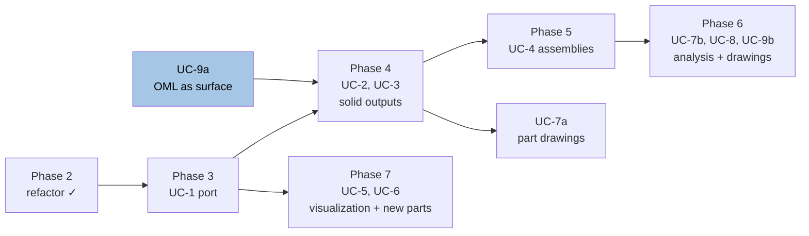

# modular-sUAS roadmap

The Python sweep drivers and OpenSCAD geometry under `src/Fuselage/` were **copied in from
another repository** to be adopted into modular-sUAS. Their original commit history did not come
with them, so anything in those files that refers to a past commit refers to the *source* repo's
history, not this one.

**Adoption status, checked 2026-10-31: `src/` is under version control — 280 tracked files.** An
earlier version of this preamble said the whole of `src/` was untracked; that stopped being true
and the claim is corrected here rather than left to mislead. One directory is still outside version
control and it is the one that cannot be regenerated — see Phase 0.

Eight phases, numbered 0 through 7. Phases 0 through 3 are strictly sequential; Phases 4 through 7
order the capabilities the port exists to enable, by dependency rather than by priority.

**Status summary, 2026-10-31.** Counted from the implementation plans, which are the accurate
record: **226 of 272 work items done** across five plans, 40 live and unfinished, 6 superseded or
withdrawn. Phase 2's plan is `Complete` while three of its own roadmap items are not — see the note
in that phase. Phase 3 is substantially delivered and gated on one item, IP-FC-13. Phases 4 through
7 are gated on two items, IP-FC-13 and IP-FC-18, plus four cowl-wall decisions recorded as open
questions in [cowl.md](design/cowl.md).

---

## Phase 0 — Adopt what was copied in

Prerequisite for everything else: until the copied-in source is in version control there is no
rollback for any of it.

- [x] Decide what actually gets adopted. `src/Fuselage/` mixed hand-authored source, ~2.6 GB of
      regenerable sweep output (`variant_output/`, `variant_output_original/`), `.bak` files in
      `archive/`, and scratch (`tools/tmp.py`). Only the first belongs in git, and that is what
      is tracked.
- [x] Extend `.gitignore` to cover the regenerable output and the junk. Verified 2026-10-31:
      `variant_output*/` and `src/Fuselage/variant_output/` are both matched, and `Thumbs.db` is
      ignored.
- [x] Commit the adopted source in one clearly-labeled commit, so the "as copied in" state is a
      recoverable baseline before any refactoring starts. **280 files tracked under `src/`.**
- [ ] Record where it was copied from and at what revision, so the two can be diffed later. Not
      verifiable from this repository — the source revision is not recorded anywhere in it.
- [ ] **Bring `src/Fuselage/parts/` under version control. 122 files, 117.8 MB, and it is the one
      directory here that cannot be regenerated.** This is the item the `.gitignore` entry above
      was written to protect and it was never completed. Checked 2026-10-31: the directory is
      **untracked and not ignored** — merely never added — so the hand-modeled STL geometry
      (`Base Thin.stl`, `Battery Tray.stl`, `collet_backer.stl` and 119 others) has no history and
      no rollback. Every other gap in this roadmap costs time; this one costs the geometry.
      Decide whether it belongs in git as-is, in Git LFS, or in a separate archive with a recorded
      checksum — at 117.8 MB of binary mesh the choice is not free, which is probably why it has
      been deferred this long.

**Environment is committed.** `pyproject.toml`, `uv.lock` and `.python-version` (3.13) are all
tracked as of 2026-10-31, and `uv sync` reproduces the environment. An earlier version of this
section said all three were untracked; that is corrected.

`OPENSCADPATH` remains a second, undeclared requirement: `solid_render()` does
`os.path.join(os.environ.get('OPENSCADPATH'), cmd)`, so an unset value fails with
`TypeError: ... not NoneType` at the first render. It is a User environment variable on this
machine only and uv cannot capture it. **It is now documented** in
[CLAUDE.md](../../CLAUDE.md) — including that it holds the OpenSCAD *binary* directory, which is a
non-standard use `solid_render` depends on and which must not be "corrected". What is still missing
is the mechanical part: there is **no `.env` and no committed `.env.example`**, so a fresh checkout
on another machine has nothing telling it the variable exists.

---

## Phase 1 — Get the parameter variation sweep working here

The goal is a sweep that runs correctly *from this repo, on this machine*, and whose output
is reproducible. Do not refactor geometry in this phase — only make it run.

**Status 2026-10-31: four of eight items verified done, one verified still open, three not
verifiable by reading the repository.** The three are marked below rather than guessed at either
way — a checked box on this roadmap means somebody confirmed it.

- [ ] **Establish a baseline.** Run one single parameter combination end to end before
      attempting the full factorial. Capture what fails; the sweep is a full-factorial
      product and a failure deep in the loop is expensive to discover. *Not verifiable from the
      repository — superseded in practice by the output below, which exists.*
- [x] **Fix path anchoring.** `solid2.import_scad()` resolves bare filenames against the
      process CWD and then calls `.absolute()`, and that absolute path is what gets written
      into generated `.scad` as `use <...>`. A previous sweep baked a since-dead `R:\` drive
      mapping into its entire output this way. **Verified 2026-10-31:** `fuselage_variants.py`
      anchors to `__file__` via `_HERE`/`_ROOT` (lines 40–41), and of **576 generated `.scad`
      files under `variant_output/`, none carries an absolute drive or UNC reference** — every
      `use`/`include` is relative, e.g. `use <../../../../../scad/fuselage_corner_geometry.scad>`.
- [ ] **Confirm the sweep is CWD-independent.** Run it from `tools/`, from the repo root,
      and from an unrelated directory, and verify the three outputs are identical. *Not
      verifiable from the repository — needs three runs. The anchoring above is the mechanism
      that should make it hold, not evidence that it does.*
- [x] **Confirm all five sweeps run**, including nose and tail. An earlier draft of this roadmap
      claimed the nose/tail sweeps were broken; that claim was lifted from
      `src/Fuselage/docs/reorganization_plan.md`, which describes a **different repository at an
      earlier point in time**. **Verified 2026-10-31 from the output rather than the code:**
      `variant_output/` holds eight `U` directories from `U_0.5` to `U_4.0`, each with `imperial`,
      `metric`, `nose` and `tail` subdirectories, and the tree carries 88 nose and 40 tail
      artifacts. The allegation is retired.
- [x] **Pin down `OPENSCADPATH`.** On this machine it holds the OpenSCAD *binary* directory
      rather than a library search path, and `solid_render` depends on that. It works; it is
      now documented in [CLAUDE.md](../../CLAUDE.md), including an explicit instruction not to
      "correct" it. What is *not* done is making it reproducible on another machine — see
      Phase 0's `.env.example` gap.
- [ ] **Fix the OpenSCAD MCP temp directory. Still open, verified 2026-10-31.** Its
      render/analyze/export tools all fail on this machine because the temp directory resolves to
      a UNC path, and `validate_scad` returns `valid: false` with an empty error list for
      *everything* — including a bare `cube([10,10,10]);` — while reporting `success: true`, so
      the failure is silent. [CLAUDE.md](../../CLAUDE.md) records it as unreliable and the render
      tools as broken. **This is why the project's cheap geometry-checking tier is the one it
      does not have**, and it is the reason the FreeCAD-side checks (`check_*.py`, and later the
      geometry bridge) had to carry that load instead.
- [x] **Add regression tests.** `tools/test_fuse.py` was a three-line scratch file, not a test
      suite. **Verified 2026-10-31: `tests/` holds 68 test modules and 1 987 passing tests**,
      asserting on measured properties rather than byte-identical `.scad`/`.stl` output. Tracked
      in detail by [test_coverage.md](implementation/test_coverage.md).
- [ ] **Regenerate output from scratch** and confirm it matches the committed reference
      geometry. *Not verifiable from the repository.* Two things now bear on it that did not when
      it was written: `variant_output_original/` is a **frozen 2025 snapshot** that no live check
      reads, so it is a historical artifact rather than a trustworthy reference; and
      [OpenSCAD STL facet order varies run to run](guidelines/general.md), so any comparison must
      be order-invariant rather than byte-wise.

**Exit criteria:** a full sweep runs clean from any working directory, writes no absolute
paths, covers nose and tail, and is reproducible run-to-run. **Two of the four are verified** (no
absolute paths, nose and tail covered); working-directory independence and run-to-run
reproducibility are not, so the phase is not closed.

---

## Phase 2 — Refactor and improve the OpenSCAD implementation

Only start once Phase 1's tests exist. Without them there is no way to tell a refactor
from a regression.

**Tracked in detail:** [doc/implementation/geometry_refactor.md](implementation/geometry_refactor.md)
carries the specific work items from the 2026-08-06 review of the geometry modules, each
with the check that proves it changed no geometry.

**Progress as of 2026-10-31: the plan is `Complete` — 23 items done, 1 superseded, 1 withdrawn —
and three of this phase's own items below are still open.** That is not a contradiction to be
smoothed over; it is the phase's real state, and the note after the checklist says what to do
about it.

What the plan delivered: keyword arguments at the seven Python→SCAD call sites, a formula
duplicated across the language boundary resolved, five library extractions the code was already
asking for, and typed parameter dataclasses. Four verification tools were built along the way,
each covering a case the others cannot; they are documented in
[src/Fuselage/docs/fuselage_folder_summary.md](../src/Fuselage/docs/fuselage_folder_summary.md) —
which is an **inherited document describing another repository**, so read the tool list from the
tree rather than from it (see the Reference documents table at the end).

**Scope corrected.** The largest planned item — regrouping the 28-parameter SCAD
signatures — was **dropped** after assessing it against Phase 3. The parameter groups
already exist in Python; the refactor would only have built an encoding of them in
OpenSCAD vectors, which the FreeCAD port discards entirely. The equivalent work on the
Python side, typed parameter objects, survives and replaced it. See OQ-GEO-1.

That assessment is now a standing guideline — see *Weigh a refactor against what replaces
the code* in [doc/guidelines/general.md](guidelines/general.md) — because the same
question applies to every remaining item in this phase.

**That gap is closed, 2026-08-06.** Nothing in the verification tooling used to render the GUI
driver `.scad` files, so a change could be certified geometry-preserving while leaving every
interactive driver broken. OQ-GEO-2 is **resolved** and
[`verify_drivers.py`](../src/Fuselage/tools/verify_drivers.py) is the answer (IP-GEO-15): it
renders every driver and treats a *warning* as a failure, because OpenSCAD reports an unknown
identifier as a warning, substitutes `undef`, renders a wrong shape and exits zero — so an
exit-code check would have passed every case the tool exists to catch. Its first run found four
genuine breakages, two of them pre-existing cowl drivers naming their OML mesh as `vsp_nose.stl`
when the meshes had moved to `../oml/`.

- [ ] **Map the current geometry.** Verified 2026-10-31: still **13 hand-written `.scad` modules
      in `scad/`, zero subdirectories**, so every `include`/`use` is a bare filename. That is why
      they resolve at all — any restructuring into subdirectories means editing every include
      line.
- [ ] **Separate library modules from drivers.** Geometry primitives and shared utilities
      (`shape_modifier_utils.scad`, `*_geometry.scad`) are a different kind of thing from
      the top-level part definitions that produce printable output. **Not started**, and the
      directory layout above is the evidence.
- [x] **Make the parameter interface explicit.** Done as IP-GEO-16: parameters are
      dataclasses (`Parameters`, `NoseParameters`), not dicts, so a misspelled field is
      an `AttributeError` where it is written rather than a silently added key — though
      only since IP-GEO-25 added `slots=True`; a plain dataclass accepts undeclared
      attributes exactly as a dict does, so IP-GEO-16 alone did not deliver this. What
      remains open is *validation* at the boundary where CSV/JSON is read — the types are
      declared but nothing checks a row's values before geometry consumes them.
- [ ] **Leave the OpenSCAD path in millimeters.** The project standard is SI internally
      (see [general.md](guidelines/general.md#units--si-is-the-project-standard)), but the
      OpenSCAD implementation is transitional — Phase 3 replaces it. Converting code that is
      scheduled for replacement buys nothing and risks geometry that is wrong by 1000× in
      one dimension while still rendering and exporting cleanly. SI arrives with the FreeCAD
      port, which is new code. Recorded here so the divergence is a decision, not an
      oversight.
- [ ] **Resolve the OML mesh coupling.** `import()` inside `cowl_geometry.scad` resolves
      relative to that file, *and* the same mesh filenames appear as data in
      `variant_param/*.json`. Code and data must move in lockstep. A stale duplicate mesh
      anywhere will silently shadow the real one.
- [ ] **Improve the geometry itself** — the MAUS unit standard (panel types, interstitial
      and boom bulkheads, corners, cowls) is only partly specified in the wiki. Close the
      gap between what the wiki claims and what `scad/` actually builds.
- [ ] **Revisit the folder reorganization proposal.** A detailed reorganization plan and a
      migration-tooling plan existed in `src/Fuselage/` — see the note at the bottom of
      this document about their disappearance. Their conclusions about path resolution
      were verified by testing and are worth recovering rather than re-deriving.

**Exit criteria:** geometry is modular and documented, the Python↔OpenSCAD parameter
contract is explicit and validated, and Phase 1's tests still pass.

**The phase is open, Phase 3 is substantially delivered anyway, and that needs stating rather than
hiding.** The three unchecked items above all restructure OpenSCAD code that **Phase 3 retires**,
and this project has an established principle for exactly that situation: *Weigh a refactor
against what replaces the code* in
[general.md](guidelines/general.md#weigh-a-refactor-against-what-replaces-the-code), which is the
standing guideline that came out of OQ-GEO-1 dropping the 28-parameter regrouping for the same
reason. Applying that principle here would **descope** the folder reorganization, the
library/driver split and the OML mesh-coupling item, and close Phase 2 on the work that was
actually worth doing.

**That descoping is a decision, and it is not recorded as taken.** It is the one thing in this
phase nobody has ruled on: the items are neither done nor withdrawn, so the phase cannot be closed
and cannot be honestly left open either. The remaining item — *Improve the geometry itself*, closing
the gap between the wiki's MAUS standard and what `scad/` builds — is **not** in that category,
because it is about the airframe rather than about code structure, and it survives the port.

---

## Phase 3 — Port the generators to FreeCAD Python scripting

The end state: parts are generated through FreeCAD's Python API rather than by emitting
OpenSCAD source. This buys real solid modeling, assemblies, technical drawings, and FEM —
none of which OpenSCAD offers. FreeCAD 1.1.1 is installed and driveable from the MCP.

**Target architecture:**
[doc/architecture/freecad_migration.md](architecture/freecad_migration.md) — what changes,
what does not, the unit boundary, and four system-level open questions. Read it before
starting: it records that only the geometry-construction and solid-evaluation layers are
replaced, that the headless path is verified working, and that the migration begins by
losing the cheapest verification tier the project has.

**What users get out of it:**
[doc/guide/freecad_workflows.md](guide/freecad_workflows.md) — the derived-part and linking
workflows, and which one serves which use case. Written ahead of the implementation on
purpose: the modeling paradigm was chosen to serve these workflows, so the guide doubles as
the acceptance criteria for Phases 3–7.

**Status 2026-10-31: substantially delivered. 125 of 157 plan items done, and the phase is gated
on one of them — IP-FC-13.**

- [x] **Prototype one part first.** Port a single well-understood component — a corner or a
      bulkhead — before committing to the approach. Done: the corner and the bulkhead were both
      built, and `freecad/` now carries 119 Python modules.
- [x] **Choose the modeling paradigm.** `Part::` primitives with booleans map most
      directly onto the existing CSG-style OpenSCAD code; `PartDesign::` bodies with
      sketches are more idiomatic FreeCAD and support proper fillets and drafts, but are a
      bigger rewrite. **Decided** as OQ-ARCH-1 (2026-08-07): build both, then choose; and as
      OQ-ARCH-11 (2026-08-15): constraints, with `PartDesign::` the staged target state.
      Stage 3 of that conversion is IP-FC-75, blocked on IP-FC-13.
- [ ] **Adopt SI internally in the ported code — not done, and now an open question.** The design
      intent was that the port is new code, written in meters, seconds, kilograms and radians from
      the start, with conversion confined to the file interface, since FreeCAD's own API is
      millimeters and its FEM stack is N/mm². **The conversion layer was built**
      ([`freecad/units.py`](../src/Fuselage/freecad/units.py), IP-FC-8) and **nothing in the
      geometry imports it**: measured 2026-10-31, its only importer is its own regression test,
      while the port is millimeters end to end because it reads the same parameter sheets and OML
      meshes the OpenSCAD path reads. Nothing built is wrong — millimeters throughout is
      self-consistent — but the authority and the code disagree. Whether to record millimeters as
      the port's regime or to adopt SI as designed is
      [OQ-ARCH-23](architecture/freecad_migration.md#open-questions), tracked as IP-FC-158.

      Hard constraint that does not change either way: **exported STL and 3MF stay in
      millimeters.** Those formats carry no unit metadata and a slicer reads them as mm regardless.

      The check this item names — a ported part's bounding box in meters equalling the OpenSCAD
      part's in millimeters divided by 1 000 — exists as `units.bbox_m_matches_mm` and is dead code
      until that question is answered. This is still the single easiest place in the project to be
      silently wrong by 1 000×.
- [x] **Validate equivalence, not appearance.** Compare ported parts against OpenSCAD
      output by measured properties — bounding box, volume, hole positions — not by eye. Delivered
      as the reference-corpus and tolerance machinery of OQ-ARCH-12, OQ-ARCH-15, OQ-ARCH-16,
      OQ-ARCH-19 and OQ-ARCH-20: relative volume, `U`-scaled bounding box, a sampled surface
      distance that adjudicates, and a reproducibility criterion. **Its sampling is still open**
      — [OQ-ARCH-21](architecture/freecad_migration.md#open-questions).
- [x] **Run the sweep headless.** Sweeps run under `freecadcmd`; the soak corpus, the station
      screens and the wall measurements in this project are all headless batch runs. Note that a
      document edited headlessly must be reloaded before the GUI shows current geometry, and that
      `freecadcmd`'s exit code is unreliable — read the artifact, not the status.
- [ ] **Then, and only then, exploit what FreeCAD adds:** FEM on the load-bearing
      structure, TechDraw for dimensioned drawings, assemblies for fit checks between
      modules. **Partly underway ahead of schedule and deliberately so:** TechDraw part drawings
      are IP-FC-21 (`active`), and the drawing standard, dimension scheme and sheet machinery are
      built. FEM and assemblies are Phases 5–6 and gated on IP-FC-18.
- [ ] **Decide the fate of the OpenSCAD implementation.** **Decided** as OQ-ARCH-4 (2026-08-07):
      retire it after IP-FC-13, with FreeCAD becoming the definition of correctness. The decision
      is made; the retirement is IP-FC-34, blocked on IP-FC-13. The box stays unchecked because
      the item is the retirement, not the decision.

**Exit criteria:** the full parameter sweep runs headless through FreeCAD and produces
geometry that is verifiably equivalent to the OpenSCAD output it replaces. **The sweep runs
headless; the equivalence demonstration is IP-FC-13 (`active`), and it is the single item this
phase and four later ones are waiting on.** `compare_backends.py` renders the same variants through
both engines and compares measured geometry; until it reports, OQ-ARCH-4's retirement cannot be
executed and Phases 4 and 7 cannot start.

**Implementation plan:**
[doc/implementation/freecad_migration.md](implementation/freecad_migration.md).

---

## Phases 4–7 — the capabilities the port exists to enable

Phase 3 delivers **UC-1** and nothing else: the same parts, generated a different way. It
is worth being blunt that UC-1 alone would not justify the migration. The reason to do it
is that **UC-2, UC-3, UC-4 and UC-7 are unreachable in OpenSCAD at any effort** — it has no
boundary representation, so there is no curved geometry to write into a STEP file, nothing
for an assembly constraint to attach to, and no arc for a drawing to dimension.

The nine use cases and their reasoning are in
[doc/architecture/freecad_migration.md](architecture/freecad_migration.md). The phases below
order them by dependency.

**`UC-9a` — the OML arriving as a STEP surface instead of a 36 MB mesh — was on the critical
path and is delivered.** It was called out separately because deferring it was the single most
likely way to get this wrong: the cowls were built by importing a tessellated STL, so until the OML
was a surface, *the cowls were not solid models*, and Phase 4 would have shipped B-rep export with
the cowls quietly excluded.

### Phase 4 — Solid model outputs

- [x] **OML as a surface. Delivered, verified 2026-10-31.**
      [`oml/vsp_nose.step`](../src/Fuselage/oml/vsp_nose.step) (603 KB) and
      [`oml/vsp_tail.step`](../src/Fuselage/oml/vsp_tail.step) (772 KB) are exported from
      [`cad/modular_sUAS_nose_tail.vsp3`](../src/Fuselage/cad/modular_sUAS_nose_tail.vsp3), and
      `cowl_tree.py` imports the surface in the STEP's own units and scales from there — a
      **12-face STEP surface** in place of an 80 000-facet mesh. The cowls are solid models.

      **The 36 MB of mesh is not removed yet, and cannot be until Phase 3 closes.**
      `vsp_nose.stl` (12 MB) and `vsp_tail.stl` (24 MB) are still tracked and still imported by
      `nose_cowl.scad` and `tail_cowl.scad` — the OpenSCAD drivers. They come out with the
      OpenSCAD retirement (IP-FC-34), not with this item.
- [ ] **UC-2 — native FreeCAD solids.** `.FCStd` per part from the sweep.
- [ ] **UC-3 — STEP export.** Neutral solid geometry for other CAD systems. IP-FC-15,
      **blocked on IP-FC-13.**
- [ ] **UC-7a — part drawings.** Dimensioned drawings of individual parts; assembly
      drawings wait for Phase 5. IP-FC-21, **`active`** — the drawing standard, the dimension
      scheme and the sheet/table machinery are built, and the design authority is
      [dimension_scheme.md](design/dimension_scheme.md).

**No mesh as an intermediate.** Tessellating and re-fitting a surface would produce a
nominally-solid model whose faces are approximations of approximations. The solid must stay
a B-rep from construction to export.

**Exit criteria:** every part in the sweep exports as a `.FCStd` and a `.step` whose volume
and bounding box match the Phase 3 mesh within the tessellation tolerance, and a cowl STEP
file opens in another CAD system with curved faces rather than facets. **Gated on IP-FC-13**,
which is Phase 3's exit criterion — UC-3 cannot be certified equivalent before the two backends
have been compared.

### Phase 5 — Assemblies

- [ ] **Cowl interior surfaces — built, and gated on verification rather than on construction.**
      New geometry: the interior generated as a per-layer 2D inset matching slicer behavior, *not*
      a perpendicular shell offset. Needed before a cowl can be a closed solid in an assembly.

      **The construction exists and builds.** `freecad/cowl_interior.py` fits the interior surface
      per the adaptive curvature-aware slice-and-fit of OQ-ARCH-5, cuts the printed ribs, extends
      the cavity across the cell planes, cuts it from the notched blank and mirrors the result; the
      design authority is [cowl_interior_surface.md](design/cowl_interior_surface.md) and
      [cowl.md §6.2](design/cowl.md). A 12-wall corpus builds, and section 5's post-cut pass
      refuses a wall it cannot converge rather than shipping one.

      **What is not settled is whether the wall it produces meets `WALL_TOL` = 0.01 mm, and that
      is four decisions rather than any missing code.** Measured: 5 of the 12 distinct corpus walls
      meet the tolerance and 7 do not — every `tail_shell` at every `U`, and `nose_cowl_shell` at
      `U` = 4. The open questions are
      [OQ-DES-CW28](design/cowl.md#open-questions) (the fit's convergence criterion is five times
      looser than the acceptance tolerance),
      [OQ-DES-CW29](design/cowl.md#open-questions) (two measures disagree about whether a nose
      complies; which one gates),
      [OQ-DES-CW31](design/cowl.md#open-questions) (the axial seed is a fixed count, and it is why
      a large nose fails) and
      [OQ-DES-CW33](design/cowl.md#open-questions) (every measure the gate has is in-plane while
      the wall is inclined 21.5–30.8° to the layer plane, so every figure understates the deficit
      by 2.9–7.0×). Seven work items in
      [wall_thickness_measure.md](implementation/wall_thickness_measure.md) are blocked on them,
      with the evidence gathered and the alternatives priced.

      **A cowl is a closed solid today**, so this item does not block UC-4 on geometry — it blocks
      any *claim* that the cowl wall is in tolerance.
- [ ] **Non-printed components.** Longerons, panels, threaded inserts, bolts — derived from
      the same parameters that already cut their clearances, never specified separately.
      **IP-FC-18, `todo` and ready to start — and it is the item that gates the most.** Nothing
      blocks it, and UC-4, mass properties, both FEM tiers and assembly drawings are all
      downstream of it.
- [ ] **UC-4 — assemblies with joints.** Fuselage unit, nose, tail, and full fuselage.
      IP-FC-19, **blocked on IP-FC-18** — an assembly joint has to join something. The joint
      representation is decided (OQ-ARCH-6: FreeCAD Assembly joints, verified against the
      constructed placement).

**Exit criteria:** a full fuselage assembly opens with every component placed, and its
mass properties are computable. **Gated on IP-FC-18**, which is `todo` and unblocked.

### Phase 6 — Analysis and documentation

- [ ] **UC-8 tier 1 — mass properties.** Mass, CG, inertia tensor. Needs no solver and
      answers a question the project asks constantly; schedulable as soon as Phase 5's
      components exist. IP-FC-20, **blocked on IP-FC-18**.
- [ ] **UC-8 tier 2 — isotropic FEM.** Deformation, stress, yield margin, with bonded
      interfaces modeled as assembly properties. IP-FC-23, **blocked on IP-FC-19**.
- [ ] **UC-8 tier 3 — orthotropic FEM.** Printed parts as layered material. The prerequisite
      is *recording* each part's print orientation, which is already designed in and simply
      not written down. IP-FC-24, **blocked on IP-FC-23**.
- [ ] **UC-7b — assembly drawings.** IP-FC-22, **blocked on IP-FC-19 and IP-FC-21** — an
      assembly drawing projects an assembly.
- [ ] **UC-9b — aerodynamic analysis.** Driven OpenVSP, VSPAERO force and moment on the
      fuselage, building toward full-configuration analysis. IP-FC-25, **`todo` and unblocked** —
      it depends on OpenVSP rather than on the assembly chain, so it can run in parallel with
      everything above. OpenVSP's license was cleared under OQ-ARCH-9 and the bridge that lets
      `pytest` drive it across a process boundary is built
      ([geometry_bridge.md](implementation/geometry_bridge.md)).

**Exit criteria:** a load case runs end to end on a full fuselage assembly and reports
stress and margin against a stated yield strength. **Gated on the IP-FC-18 → IP-FC-19 → IP-FC-23
chain**, so the whole of this phase except UC-9b sits behind one `todo` item.

### Phase 7 — Visualization and new components

Ordered last by dependency, **not by priority.** Nothing here is gated by Phases 4–6, and
any of it can be pulled forward the moment the airframe needs it. It sits after Phase 3
only because new geometry should be authored in FreeCAD rather than added to an
implementation being retired.

- [ ] **UC-5 — Blender assemblies.** Full fuselage, units, exploded, exploded with
      animation paths. `blender/splode.blend` and
      [`fuselage_splode.py`](../src/Fuselage/tools/fuselage_splode.py) are the starting
      point. IP-FC-26, **blocked on IP-FC-13** — the Blender path exports the geometry the project
      considers definitive, so which engine is definitive has to be settled first.
- [ ] **UC-6 — new components.** Printable panels and cutting templates (a 2D vector output
      kind nothing currently produces), wing joiners, boom collet and clamp, landing-gear
      bulkheads and structural blocks. IP-FC-27, **blocked on IP-FC-13** — new geometry should be
      authored against the definitive engine rather than added to one being retired.

**Exit criteria:** none stated yet — this phase is a container for work whose scope is set
by the airframe rather than by the migration. **Both items are gated on IP-FC-13**, so this phase
is not available to pull forward today even though nothing in Phases 4–6 blocks it.

---

## Reference documents — from another repository, not this one

Three planning documents from the source repo sit in `src/Fuselage/docs/`. **They are not
this repository's documents.** They were written about a different repo at an earlier point
in time, against code that has since changed, and their commit references point at a history
that did not come across with the files.

| Document | What it is |
| --- | --- |
| `reorganization_plan.md` | Proposal to separate generated output from hand-authored files. |
| `migration_tools_plan.md` | Implementation plan for tooling that would perform that move. |
| `fuselage_folder_summary.md` | Inventory of that repo's folder at that time. |

**How to use them:**

- **Never cite them as evidence about this code.** Statements about what is broken, what a
  function does, or what a directory contains describe the *source* repo. This has already
  produced one wrong roadmap item — see the nose/tail entry in Phase 1.
- The **mechanism** findings in `reorganization_plan.md` §1 are still worth reading: how
  `include`/`use`/`import()` and `solid2.import_scad()` resolve paths and shadow each other.
  Those are facts about OpenSCAD and `solid2`, not about any repository, so they carry over —
  but re-verify before relying on one.
- Both plans are **proposals — nothing in them has been executed**, and the `migrate`
  commands they describe are a specified interface, not a working tool.
- Read the filesystem for the actual layout. Always.
